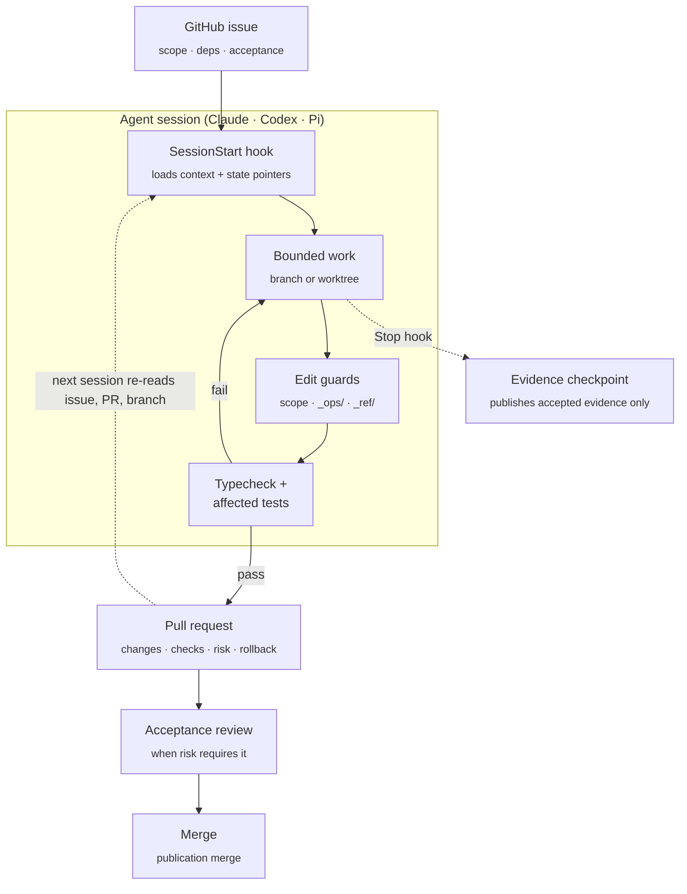
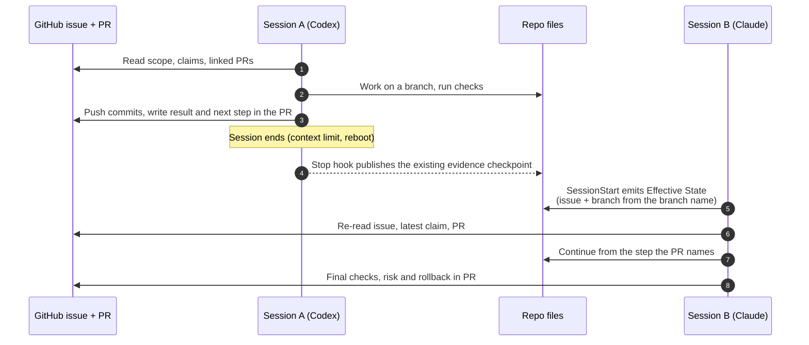
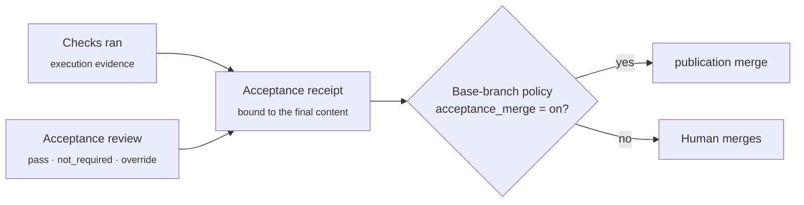
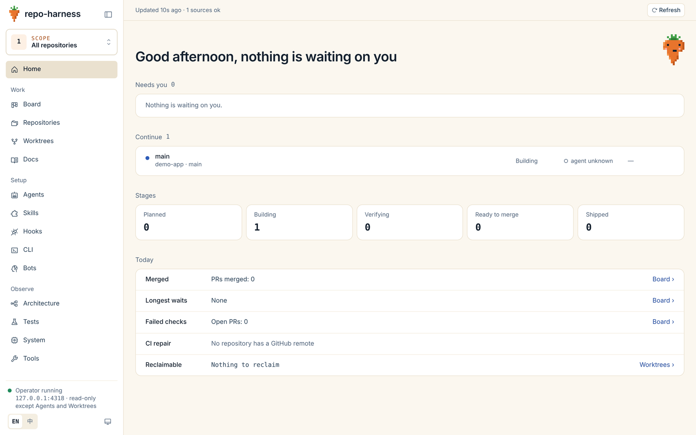

<div align="center">

# repo-harness

### Hand an AI agent a GitHub issue. Get back a PR you can actually review.


[](https://www.npmjs.com/package/repo-harness)
[](https://opensource.org/licenses/MIT)
[](https://bun.sh)
[](#supported-hosts)

[English](README.md) | [简体中文](README.zh-CN.md) | [日本語](README.ja.md) | [Français](README.fr.md) | [Español](README.es.md)

[Quick start](#quick-start) · [How it works](#how-it-works) · [Commands](#command-cheat-sheet) · [Usage guide](docs/usage.md) · [Changelog](docs/CHANGELOG.md)

</div>

---

`repo-harness` is a CLI, a set of hooks and a set of skills that wrap an existing
repository so that **Claude, Codex and Pi** can do long-running engineering work
in it — across sessions, machines and worktrees — and leave behind evidence a
human can review in minutes.

It is built for solo developers and small teams who let AI write the code and
keep the human job to one thing: **deciding whether to accept the change.**

## Why

Coding agents are fast, but three things break as soon as work spans more than
one chat:

| Without a harness | With repo-harness |
| --- | --- |
| Context lives in a chat thread and dies with it. | The **GitHub issue and PR** own the task. Any new session re-reads them and resumes the exact next step. |
| Every session re-greps the repo to rediscover its structure. | A ~12 KB stable root context, ~1 KB **capability contracts** loaded only for the files being touched, and a **CodeGraph** index for callers/callees. |
| "Done" means "the agent said it's done." | The PR carries **changed files, executed checks, residual risk and rollback**. Execution evidence and acceptance are separate, typed authorities. |
| Agents wander outside the repo or into private folders. | **Typed hooks** guard the edit boundary and print one `[Guard] reason` + one `Fix:` line when they block. |

## Quick start

**Prerequisites:** a Git working tree, [Bun](https://bun.sh) ≥ 1.4.0 (the
installer installs or upgrades it for you), and [`hc`](https://herdr.dev/)
(herdr-core) for host readiness. macOS/Linux need `bash`; Windows needs Git for
Windows. No Node.js required.

```bash
# 1. Install the CLI and user-level hook adapters
curl -fsSL https://raw.githubusercontent.com/Ancienttwo/repo-harness/main/install.sh | sh
```

```powershell
# Windows (PowerShell)
irm https://raw.githubusercontent.com/Ancienttwo/repo-harness/main/install.ps1 | iex
```

Already have Bun? Use `bunx repo-harness@latest install` instead.

```bash
# 2. From the root of the repository you want to adopt: preview, then apply
repo-harness init --dry-run   # reports every file it would write; writes nothing
repo-harness init
```

Init ends with a `=== Migration Report ===` that lists what was created or
refreshed and an `--- External Tooling ---` readiness block. That's it — open
Claude or Codex in the repo, hand it an issue, and the hooks take over.

<details>
<summary><b>What <code>init</code> adds to your repository</b></summary>

From a `repo-harness init --dry-run` on a fresh repository (abridged):

```text
your-repo/
├── AGENTS.md · CLAUDE.md          # agent rules, one standalone file per host
├── docs/
│   ├── spec.md                    # stable product intent and safety boundary
│   ├── prds/                      # product intent and design briefs
│   ├── reference-configs/         # shared standards every session can read
│   ├── researches/
│   └── architecture/              # index, modules/, diagrams/
├── tasks/lessons.md               # the one local lesson ledger
├── .ai/
│   ├── context/                   # capabilities.json, context-map.json
│   ├── harness/                   # workflow-contract.json (opt-in marker), policy.json,
│   │                              # runs/, failures/, worktrees/, events.jsonl
│   └── hooks/README.md            # operator-helper projection, not a dispatcher
├── deploy/                        # runbooks/, release-checklists/, sql/, …
├── _ops/                          # git-ignored private operations state
└── .gitignore                     # one managed block appended
```

No helper scripts are copied in. Downstream repos call `repo-harness run <helper>`.

</details>

> Upgrading, uninstalling, Pi, Windows tool pinning and cleanup semantics are in
> the [usage guide](docs/usage.md#install-in-depth).

## How it works



Three layers, each with one owner:

| Layer | What lives there | Owner |
| --- | --- | --- |
| **Task authority** | Scope, claims, status, dependencies, review evidence | The GitHub issue and its PR |
| **Repo context** | `docs/spec.md`, `docs/prds/`, `docs/reference-configs/`, `tasks/lessons.md`, `.ai/context/`, `.ai/harness/` | Your repository (written by `repo-harness init`) |
| **Runtime** | CLI, typed hook handlers, helpers (`repo-harness run <helper>`), skills | The globally installed package — never vendored into your repo |

The user-level adapters in `~/.claude/settings.json` and `~/.codex/hooks.json`
route host events into `repo-harness-hook`. For repositories that haven't opted
in, the hook exits silently.

### One task, two sessions

A session can end in the middle of a task. The next session — on another day,
host or agent — continues from the branch, the issue and the PR, not from the
old chat. No local handoff file is written:




## Design principles

- **Files over chat.** Durable truth lives in the issue, the PR and repo files.
  Chat history, transcripts and agent memory are caches.
- **Evidence over narration.** A passing check proves a command ran; acceptance
  is its own receipt. Reviewers read the PR description first, then the diff and
  the trace.
- **Guardrails, not autopilot.** Hooks load context and enforce edit boundaries.
  They never make product decisions, merge, publish or bypass review.
- **The Bot decides, the harness supplies.** repo-harness keeps no scheduler,
  budget ledger or unattended controller. Your Bot (or you) schedules work
  through the CLI and Herdr; repo-harness provides the tools and the evidence.
- **Lean context.** Load the smallest stable context, then only the capability
  blocks the touched files need.

## What you get

| | |
| --- | --- |
| **Session continuity** | The branch names the issue; the issue and PR carry scope and the next step, so any agent resumes without the original chat. |
| **Typed hook runtime** | 6 public routes (Claude 5, Codex 5), each bound to exactly one in-process handler. |
| **Edit-boundary guards** | `RepoScopeGuard`, `ExternalReferenceGuard`, `OpsPrivateGuard`, `EditScopeGuard`, `ApplyPatchScopeGuard`. |
| **Progressive context** | Root context plus per-capability contracts, backed by ArchContext and CodeGraph. |
| **Acceptance review** | A persistent, sandboxed reviewer in a linked checkout, up to three repair rounds per PR. |
| **Operator console** | A loopback-only local web board for tasks, repos, agents, skills, hooks and architecture. |
| **Refactor signals** | Measured cycles and layering violations with evidence; you accept, defer or reject. |
| **MCP sidecar** | Lets a local MCP client read real repo state and write PRDs, with no source-code write access by default. |

## Command cheat sheet

| Goal | Command |
| --- | --- |
| Install / reconcile the global runtime | `repo-harness install` · `repo-harness update` |
| Read-only health check | `repo-harness update --check` · `repo-harness setup check` |
| Adopt a repository | `repo-harness init --dry-run` → `repo-harness init` |
| Run a workflow helper | `repo-harness run <helper>` |
| Board for a parent issue | `repo-harness board --parent <n> --json` |
| List open parent issues | `repo-harness board parents --json` |
| Open the local console | `repo-harness operator serve` |
| Clean up finished worktrees | `repo-harness worktrees list` → `repo-harness worktrees clean --ids … --expected-digest …` |
| Architecture facts / review prompt | `repo-harness module list --json` · `repo-harness module review-prompt <capability> --json` |
| Refactor suggestions | `repo-harness refactor recommendations` · `repo-harness refactor decide <id> accept\|defer\|reject --reason "…"` |
| Acceptance review | `repo-harness review round\|status\|close …` ([details](docs/usage.md#persistent-acceptance-review)) |
| Merge an accepted PR | `repo-harness publication merge` ([policy](docs/control-bot-boundary.md#bot-modes-and-merge)) |
| MCP sidecar | `repo-harness mcp serve --repo . --profile planner` · `repo-harness mcp doctor --repo .` |
| Reference docs | `repo-harness docs list` · `repo-harness docs show harness-overview` |
| Remove leftovers / uninstall | `repo-harness upgrade [--apply]` · `repo-harness uninstall --dry-run` |

## Reviewing agent work

Start with the PR description: goal, scope, changes, commands that passed,
external acceptance, residual risk and rollback. Then the diff, then the latest
run trace. Accept only when checks pass and external acceptance is `pass`,
`not_required`, or an explicit override.

| Agents read first | Humans review first |
| --- | --- |
| The current prompt and referenced files | PR description |
| `AGENTS.md` / `CLAUDE.md` | Changed files and diff |
| The GitHub issue and PR | Verification records and run trace |
| Latest claim status on the issue | Residual risk and rollback |

When summaries disagree with the issue, PR or checks, the source artifacts
win.

Execution evidence and acceptance are separate authorities. A green check is
not an approval, and a reviewer record is not a merge permission:



## Operator console

`repo-harness operator serve` starts a local web board on loopback only. It
shows what needs you, what to continue, stage counts and today's merges across
every registered repository.



The console is read-only except for three bounded writes: local agent config,
docs sessions that return a Draft PR, and worktree cleanup. It never sends
messages to coding sessions or dispatches work. Details:
[usage guide](docs/usage.md#local-operator-console).

## Skills

Both hosts get the same skill names. **Bot** skills choose scope, workers and
acceptance; **Worker** skills carry out assigned steps.

| Skill | Group | Purpose |
| --- | --- | --- |
| `repo-harness` | Bot | Route explicit harness actions |
| `repo-harness-check` | Bot | Plan scoped work, review plans, assess recorded checks |
| `repo-harness-product` | Bot | PRD drafting and Goal preparation |
| `repo-harness-issue-flow` | Bot | Issue/PR-driven multi-agent development: split, dispatch, follow CI |
| `repo-harness-ship` | Bot | Explicit publication and cleanup decisions |
| `repo-harness-cross-review` | Bot | Generic review |
| `obsidian-memory` | Bot | Explicit memory recall or persistence |
| `repo-harness-setup` | Worker | Install, migration, repair or scaffold |
| `repo-harness-test` | Worker | Source tests and real fixtures |
| `repo-harness-architecture` | Worker | Model, projection or diagram work |
| `repo-harness-archimap` | Worker | Refresh the architecture map `docs/architecture/archimap.html` |
| `windows-python-first` | Worker | Native Windows file and shell work through Python |

The manifest at `assets/skill-commands/manifest.json` is the source of truth.
`merge-gate` is a CLI judge and has no packaged SKILL.md. `hooks-init`,
`docs-init` and `create-project-dirs` are internal init steps, not public
commands. More in the [usage guide](docs/usage.md#skills).

## Supported hosts

| Host | Hooks | Notes |
| --- | --- | --- |
| **Claude** | 5 routes via `~/.claude/settings.json` | Full session, edit, bash, subagent and Stop coverage |
| **Codex** | 5 routes via `~/.codex/hooks.json` | Mark the hooks file as trusted in Codex Settings |
| **Pi** | Session, notices, edit/write, bash, Stop | Optional; registered automatically when `pi` is on `PATH` |

## What repo-harness is not

- Not a hosted agent gateway, product runtime or database service.
- Not a replacement for your repo's build, test, deploy or release process.
- Not a scheduler: it never dispatches work on its own or executes refactors.
- Not vendored: downstream repos call `repo-harness run <helper>`; no helper
  scripts are copied into them.

## Documentation

| Topic | Where |
| --- | --- |
| Install in depth, update, upgrade cleanup, uninstall, rollback | [`docs/usage.md`](docs/usage.md) |
| Harness overview: flow, roles, tools | [`harness-overview.md`](docs/reference-configs/harness-overview.md) |
| Hook routes, guards and debugging | [`hook-operations.md`](docs/reference-configs/hook-operations.md) |
| Agentic development flow (Geju, P1/P2/P3, PRDs) | [`agentic-development-flow.md`](docs/reference-configs/agentic-development-flow.md) |
| Install profiles and plugins | [`install-profiles.md`](docs/reference-configs/install-profiles.md) |
| Bot integration and merge policy | [`control-bot-boundary.md`](docs/control-bot-boundary.md) |
| MCP sidecar | [`general-repo-mcp.md`](docs/reference-configs/general-repo-mcp.md) |
| External tooling (herdr, CodeGraph, ArchContext) | [`external-tooling.md`](docs/reference-configs/external-tooling.md) |
| Architecture map | [`docs/architecture/`](docs/architecture/overview.md) |
| Product spec | [`docs/spec.md`](docs/spec.md) |

## Contributing

```bash
git clone https://github.com/Ancienttwo/repo-harness.git ~/Projects/repo-harness
cd ~/Projects/repo-harness && bun src/cli/index.ts update
bun run check:ci   # the single CI-equivalent gate
```

Hook handlers live in `src/cli/hook/`, helpers in `scripts/`, canonical
reference docs in `assets/reference-configs/` (projected into
`docs/reference-configs/`). See the [maintainer reference](docs/usage.md#maintainer-reference)
for release lanes and skill sync.

## Acknowledgements

| Tool or repo | Used for |
| --- | --- |
| [Hylarucoder](https://x.com/hylarucoder) / Geju | The P1/P2/P3 due-diligence method behind the planning and decision discipline |
| Waza by [TW93](https://x.com/HiTw93) (`think`, `hunt`, `check`, `health`) | Daily planning, bug hunts, verification and health checks |
| `mermaid` | Authoring and readability review for architecture diagrams |
| [herdr](https://herdr.dev/) (`hc`) | Peer-terminal runtime: dispatch, collaboration, hosting the acceptance reviewer |
| CodeGraph (`@colbymchenry/codegraph`) | Symbol-aware navigation and impact tracing |

None of these are bundled dependencies; see
[external tooling](docs/reference-configs/external-tooling.md) for how each is installed.

## Release & license

- npm: `repo-harness@0.26.2` · workflow stamp `repo-harness@0.26.2+template@0.26.2`
- History: [`docs/CHANGELOG.md`](docs/CHANGELOG.md)
- License: MIT — see [`LICENSE`](LICENSE)
