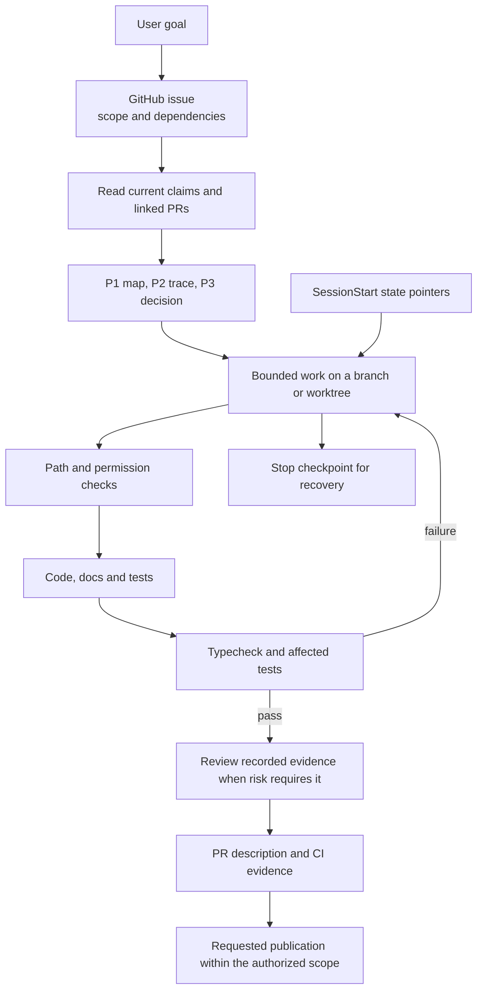

<div align="center">

# repo-harness

### Shared context, hooks and review evidence for Claude and Codex


[](https://www.npmjs.com/package/repo-harness)
[](https://opensource.org/licenses/MIT)
[](https://bun.sh)

[English](README.md) | [简体中文](README.zh-CN.md) | [日本語](README.ja.md) | [Français](README.fr.md) | [Español](README.es.md)

**Give the agent a GitHub issue and acceptance checks. Keep changes and verification evidence in its PR.**

</div>

`repo-harness` ships a CLI, skills and hooks for context, review evidence and
handoffs. The GitHub issue and PR own task identity, scope and status. Repository
files let Claude and Codex resume work across sessions.

## Contents

- [Get Started](#get-started)
- [Why repo-harness](#why-repo-harness)
- [Task Authority](#task-authority)
- [Key Features](#key-features)
- [How It Works](#how-it-works)
- [Task Workflow](#task-workflow)
- [Work Across Sessions](#work-across-sessions)
- [Hooks](#hooks)
- [Local Human Control Board](#local-human-control-board)
- [MCP Connector](#mcp-connector)
- [Reviewing Work](#reviewing-work)
- [Skills](#skills)
- [Maintainer Reference](#maintainer-reference)
- [Acknowledgements](#acknowledgements)
- [Current Release](#current-release)
- [License](#license)

## Get Started

### 1. Install the CLI

Prerequisites: a Git working tree, `bun`, and usable `herdr` >=0.9.3 for host readiness; macOS/Linux also require `bash`,
while Windows requires Git for Windows (including its Bash and `usr/bin`
tools). `jq` is optional. No Node.js required — the installer uses Bun >=
1.4.0 as the runtime, installing or upgrading Bun first when needed.

```bash
# macOS / Linux
curl -fsSL https://raw.githubusercontent.com/Ancienttwo/repo-harness/main/install.sh | sh

# Windows (PowerShell)
irm https://raw.githubusercontent.com/Ancienttwo/repo-harness/main/install.ps1 | iex
```

With Bun >= 1.4.0 already on PATH, skip the shell installer. Package-manager-owned
Bun installs fail closed with the matching upgrade command (`brew upgrade bun`)
instead of overwriting manager-owned files.

```bash
bunx repo-harness@latest install     # Bun one-shot bootstrap
bun add -g repo-harness              # or install the persistent CLI first
repo-harness install
npx -y repo-harness@latest install   # npx fallback; the CLI still runs on Bun
```

Install herdr from [herdr.dev](https://herdr.dev/) and verify `herdr --version`.
Persistent review hosting requires POSIX process groups; on Windows use WSL.
Missing or unusable herdr blocks host readiness. Before upgrading from tmux,
drain existing reviewers using the previous version and explicitly rebind terminal
endpoints. See [runtime cutover](https://github.com/Ancienttwo/repo-harness/blob/archive/docs-researches-20261004/docs/researches/20260909-herdr-runtime-cutover.md).

### 2. Bootstrap the host runtime

```bash
repo-harness install
```

On Windows, keep Git for Windows on the install/update `PATH`. That explicit
ceremony validates and pins `git.exe`, its matching `bash.exe`/`usr/bin`, and
the install account's absolute `TEMP` directory plus native `System32` tools in the OS account's
`~/.repo-harness/config.json#protectedHelperRuntime`. Protected workflow
helpers do not rediscover tools from a caller's `PATH`; rerun
`repo-harness update` after relocating or replacing Git for Windows.

The global bootstrap: installs the npm package as the global CLI, refreshes
repo-harness skill aliases, installs user-level hook adapters, and records an
explicit install profile. It is idempotent and does not apply repo-local workflow
files to the current directory. `--dry-run --json` lists components to install,
skip, and remove first. Profiles, native Codex delegation authority, refresh commands, and the
read-only `setup check` audit:
[`install-profiles.md`](docs/reference-configs/install-profiles.md).

### 3. Preview the repo-local contract

```bash
repo-harness init --dry-run
```

Run this from the target repository root. It reports the specs, task state,
helper runtime, hook adapter target, and verification files that would be created
or refreshed. It never creates an application stack; new projects and modules use
`repo-harness-setup`'s scaffold mode instead.

### 4. Apply and verify

```bash
repo-harness init
bash scripts/check-task-workflow.sh
bun test
```

### Success looks like this

Init writes repo-local files and two files under `HOME`: the repo registry
entry and, when verification runs, the global Codex handoff packet under
`~/.codex/handoffs/`. It writes no install-managed host files. When the
required Herdr skill or the architecture projection preference is missing, init
reports a skipped step that names `repo-harness update`. repo-harness supplies tools and evidence; the Bot
decides what to schedule.

Apply ends with `=== Migration Report ===`, naming where generated hook behavior
comes from, the user-level `~/.claude/settings.json` and `~/.codex/hooks.json`
adapter target, the repo-local surfaces created or refreshed, the
`.ai/harness/scripts/*` helper runtime, and an `--- External Tooling ---`
readiness block. Stable intent then lives in `docs/spec.md`, execution state in
`plans/` and `tasks/`, resume state in `.ai/harness/handoff/`. If the dry run
looks wrong, stop and read
[`hook-operations.md`](docs/reference-configs/hook-operations.md) first.

### Update and remove

```bash
repo-harness update          # reconcile CLI, mandatory deps, profile tooling, and CodeGraph
repo-harness update --check  # read-only repair guidance, no writes
repo-harness upgrade         # check retired leftovers; no writes
repo-harness upgrade --apply # back up and remove only proven owned leftovers
repo-harness uninstall --dry-run # preview owned user configuration cleanup
repo-harness uninstall           # remove owned configuration; preserve user changes/history
repo-harness mcp uninstall --dry-run # preview independent MCP setup cleanup
repo-harness mcp uninstall --services-stopped # after stopping all MCP HTTP services
```

`update` and `setup check` print one leftover count. `update` does not apply
cleanup. Run `upgrade --json` for ownership and proof per item. Use
`--scope project|global|all` to select the scan (default: `all`). Project scope
requires a Git repository. Check exits 1 when any leftover remains.

`upgrade --apply` also refreshes old owned copies of still-shipped skills from
this package. It refreshes the contract template only when an old ownership
hash matches. It keeps changed copies. It preserves legacy workflow-state
libraries.
Update continues to report counts only. This puts destructive changes and copy
replacement under the same explicit, backed-up transaction.

Old merge-gate state, v0.10.0 archives, and older backups are report-only by
default. Use `upgrade --apply --include-state-artifacts` to select these artifacts
for removal. This flag still requires ownership proof. Unknown artifacts stay.
The third-party Claude plugin and user rule lines in
`~/.claude/CLAUDE.md` and `~/.codex/AGENTS.md` are always report-only.
See [external tooling](docs/reference-configs/external-tooling.md) for the plugin ID.

Project cleanup supports regular files and host hook entries. Project
directories and symlinks remain report-only. Global cleanup supports verified
owned directories and links.

Cleanup keeps changed and unowned files. It also keeps current global typed
hook adapters and user hook entries. It backs up each target before removal.
Apply exits 0 when all eligible operations succeed, even if report items remain.
A second apply with no eligible items changes no bytes. The command prints the
backup paths and records nonempty runs in
`~/.repo-harness/upgrade-cleanup.log.jsonl`.

For project rollback, use the printed `repo-harness init rollback` command.
For global rollback, replace each target with its numbered snapshot at the
original path in the backup manifest. Do not overlay directory contents.
Restore symlinks verbatim. There is no `install --restore-transaction` command.
Keep the backup until you verify the cleanup. Homes from the older v3.x–v5.x
release line have no supported historical proof and remain report-only.

## Why repo-harness

- **File-backed sessions, not chat memory.** Separate Claude and Codex sessions
  stay coordinated through the repo. `SessionStart` injects the prior session's
  resume packet, and `Stop` writes the handoff and resume views. A session can
  end mid-task and the next one resumes the exact next step, blockers, and
  changed files without re-deriving them.
- **Token-lean by design.** Instead of grep-and-read loops that re-scan the repo
  every session, the harness leans on a pre-built CodeGraph index for structural
  queries and on progressive context loading: a stable ~12KB root context plus
  capability blocks loaded only when the files you touch need them. Agents read a
  ~1KB capability contract instead of rediscovering structure.
- **Review evidence.** The PR records the changed files, checks, residual risk
  and rollback. Review uses the observed result for the same revision.
- **Work across sessions.** A handoff records the issue, branch, current result
  and next action. The next agent reads the current issue before it continues.

In an adopted repo, the surface area is intentionally small:

| Surface | Purpose |
| --- | --- |
| `docs/spec.md` and `docs/reference-configs/` | Shared standards and stable product intent that every agent session can read. |
| `plans/`, `plans/prds/`, and `plans/sprints/` | Optional planning context and historical work records. |
| `tasks/contracts/`, `tasks/reviews/`, and `.ai/harness/checks/` | Existing closeout and recovery records retained during the lifecycle removal. |
| `.ai/harness/handoff/` and `tasks/current.md` | Session journal and resumable status, derived from workflow artifacts instead of chat memory. |

## Task Authority

The GitHub issue defines the work. The PR records the implementation and its
verification. Plans and handoffs support that work without creating another
task queue.

| Surface | Responsibility | Entry point |
| --- | --- | --- |
| Issue and PR | Scope, ownership, dependencies, status and review evidence | The assigned GitHub issue |
| Session support | Repository context, hooks and handoffs | `repo-harness init` |
| Existing observations | Read retained task and runtime records | `repo-harness fleet board --json` |

New work uses a bounded issue brief and the current repository rules. Historical
Sprint, binding and Lease records remain readable for operator and closeout
callers while the contract lifecycle is removed.

## Key Features

| | |
| --- | --- |
| **File-backed sessions** | Plans, contracts, checks, and handoffs live in the repo, so a new session resumes from artifacts instead of a chat thread |
| **Typed hook runtime** | 6 public routes (Claude 5, Codex 5), each bound to exactly one typed in-process handler, with fail-closed guards at the edit boundary |
| **Issue → PR → Review** | One task authority with bounded changes, recorded verification and review evidence |
| **Session handoff** | Record the issue, branch, evidence and next action so another agent can continue |
| **Progressive context loading** | A ~12KB stable root context plus ~1KB capability contracts loaded only for the files actually being touched |
| **CodeGraph integration** | Structural queries (callers, callees, definitions) answered from a pre-built index instead of repeated grep-and-read passes |
| **MCP planner sidecar** | ChatGPT reads real repo state and writes PRD/Sprint/Goal artifacts; Codex executes them, with no default source-code write access |
| **Claude + Codex alignment** | One user-level adapter contract, one workflow contract, and one set of repo-local artifacts shared by both hosts |

## How It Works

1. **Source package**: this repository owns the CLI, command facades, templates,
   typed hook handlers, the operator-helper asset, workflow contract, tests, and
   release gate.
2. **Target repo contract**: `repo-harness init` or migration writes repo-local
   files such as `docs/spec.md`, `plans/`, `tasks/`, `.ai/context/`,
   `.ai/harness/`, helper scripts, and `.ai/hooks/`.
3. **Host adapters**: user-level `~/.claude/settings.json` and
   `~/.codex/hooks.json` route Claude/Codex events into `repo-harness-hook`.

The hook entrypoint exits silently for non-opt-in repos. For opted-in repos, the
route registry binds the public event tuple to exactly one packaged typed
handler. `.ai/hooks/` holds operator-helper projection only; it is never a
host-event dispatcher.

The issue and PR own task authority. Repository files provide durable context
and evidence. Hooks load context and enforce the retained edit boundaries.
Handler details and policy modes:
[`hook-operations.md`](docs/reference-configs/hook-operations.md) and
[`minimal-change-hooks.md`](docs/reference-configs/minimal-change-hooks.md).

## Task Workflow

The GitHub issue and PR carry task identity, claims, status and dependencies.
Optional plans explain the work. The retained contract closeout helpers serve
old records until that lifecycle is retired.




For long-running product loops, keep discovery and engineering-plan judgment with
the parent agent before Codex loops on execution: `geju` opens the pre-contract
frame, the parent completes P1/P2/P3 and freezes the accepted direction into an
upper-layer PRD under `plans/prds/` and an ordered sprint backlog under
`plans/sprints/`, then a Codex Goal points at that sprint file. The PRD stays the
upper source of truth and the backlog is the durable execution queue, so a
resumed Goal session never reinterprets the original chat. See
[`agentic-development-flow.md`](docs/reference-configs/agentic-development-flow.md)
and [`workflow-orchestration.md`](docs/reference-configs/workflow-orchestration.md).

## Work Across Sessions

Keep the issue, branch, verification result and next action in the handoff.
Re-read the issue and PR before continuing. Use the approved OAR and Herdr host
paths for an assigned agent. repo-harness has no PM or Engineer scheduling API.

### Existing task observations

```bash
repo-harness fleet board --json
```

The board reads retained task, Lease, publication, inbox and runtime evidence.
It does not claim work or create an Engineer binding. Existing completion and
cleanup helpers remain for existing contract lifecycle callers.

Use [repo-harness](SKILL.md) for scope and worker ownership,
[repo-harness-product](assets/skills/repo-harness-product/SKILL.md) for requested
planning, and [repo-harness-check](assets/skill-commands/repo-harness-check/SKILL.md)
for scope and recorded verification.

### Refactor recommendations

```bash
repo-harness refactor recommendations [--import-node-limit <n>]   # measured suggestions with evidence
repo-harness refactor decide <id> accept|defer|reject --reason "<text>" [--import-node-limit <n>]
```

ArchContext measures structural problems such as cycles and direction
violations. repo-harness shows each suggestion with its metrics, bounded evidence
and module statistics, and records the user decision. It never executes a refactor; an
accepted suggestion goes through the normal plan and pull request workflow.

### External source intake

```bash
repo-harness external-source refresh   # one bounded, explicitly enabled GitHub observation
repo-harness external-source bind      # one immutable revision to one pending canonical task
repo-harness external-source bindings  # binding edges and current drift attention
```

Intake is inert by design. An observed Issue mints no execution authority and
does not become a runnable task on its own; binding attaches an immutable source
revision to a task that already has an approved plan and contract.

### Persistent acceptance review

Before review, configure the repository's manual `external_sources` policy and
provide working provider access. The default policy is off; initialization does
not enable it. The trusted upstream Bot must authenticate the human, authorize
the scope, and supply the bound request. Its integration calls
`repo-harness review admit --repo <execution-checkout> --request <authorized-request.json>`.
The request contains `{admission, approval, expectedRevision}`. Do not create an
approval from these examples: actor IDs and authorization references are binding
data, not authentication. Select the resulting active grant and policy digests
below, and supply the current immutable issue claim. A contract or plan file
cannot grant permission. A user waiver requires a separate upstream-authorized
decision; waiver eligibility in an admission does not grant one.

See [the control Bot boundary](docs/control-bot-boundary.md) for the integration contract.

```bash
repo-harness review round --repository-id <repository-id> --issue-id <issue-id> --campaign-id <campaign-id> --grant-sha256 <approved-grant-sha256> --policy-sha256 <policy-sha256> --actor <actor-id> --reviewer-repo <linked-checkout> --herdr-endpoint <address.json> --verification <native-report> --claim-ref <claim-reference> --claim-revision <claim-sha256>
repo-harness review status --repository-id <repository-id> --issue-id <issue-id> --campaign-id <campaign-id> --grant-sha256 <approved-grant-sha256> --policy-sha256 <policy-sha256> --actor <actor-id>
repo-harness review close --repository-id <repository-id> --issue-id <issue-id> --campaign-id <campaign-id> --grant-sha256 <approved-grant-sha256> --policy-sha256 <policy-sha256> --actor <actor-id>
```

In the Claude desktop app without Herdr, add `--launch app-terminal` and omit `--herdr-endpoint`. The first call prints the fixed host command. Claude runs it once in an app Terminal tab, then repeats the round. OAR, Seatbelt and the Receipt stay the same.

A dedicated linked checkout hosts one fleet `deep-reasoner` task-agent in the addressed Herdr session for at most three repair rounds. Default selection uses the owner’s opposite harness; `--harness` explicitly selects Claude or Codex. Only a missing executable before start allows a reported fallback. File Results pass domain binding/finding checks and the generic-review Receipt writer/verifier before close. Terminal history is observation. Claude uses an exact result-file allowlist plus mutation fingerprints; production OS write isolation and complete large-packet ingestion remain unverified.

## Hooks

The installed adapter binds 6 public hook routes: Claude installs 5 and Codex
installs 5. The route tuple `event + routeId + matcher` is
the stable contract; each tuple binds exactly one typed in-process handler. The
route table, with a Host column, is in
[`docs/reference-configs/hook-operations.md`](docs/reference-configs/hook-operations.md#hook-authority-map).

`repo-harness-hook` and its typed handler registry are the host-event runtime;
`~/.claude/settings.json` and `~/.codex/hooks.json` are the user-level adapters,
and Codex must mark its file as trusted in Settings before those hooks run.
Repo-local `.claude/settings.json` and `.codex/hooks.json` are legacy config to
retire. Debug in order: adapter config -> `repo-harness-hook` -> route registry
-> typed handler.

When a hook blocks work, read the terminal output first: one `[<Guard>] <reason>`
line and one `Fix:` line. The durable record in
`.ai/harness/failures/latest.jsonl` carries `guard`, `reason`, `fix`,
`failure_class`, and `run_id`. `.ai/harness/runs/hook-events.jsonl` records
each hook event. The edit guards are `RepoScopeGuard` (a path outside the
repository), `ExternalReferenceGuard` (`_ref/`), `OpsPrivateGuard` (`_ops/`),
and `ApplyPatchScopeGuard` and `EditScopeGuard` (no parseable target path).
Full playbook:
[`docs/reference-configs/hook-operations.md`](docs/reference-configs/hook-operations.md).

## Local Human Control Board

Run the observe-only operator view on the same machine as the adopted
repositories:

```bash
repo-harness operator serve
```

The command binds to loopback only and prints the local URL. The browser shows
the canonical Fleet summary, an attention-first worklist, a resident task
detail pane, and degraded snapshot states. The board is read-only. It does not
send messages, acquire tasks, change workflow state, start agents, or show
repository paths.

Read committed architecture facts or export a module review prompt:

```bash
repo-harness module list --json
repo-harness module review-prompt capability.runtime-harness.engineer-bindings --json
```

The prompt uses HEAD content. It reports uncommitted paths and their content
hash separately. Its input budget comes from `.archcontext/manifest.yaml`
at `runtime.contextBudgetBytes`. If the prompt needs more than one shard, send
each shard to the same reviewer with `--shard <n>`. Start review after all
shards arrive. Diff mode requires both `--base <rev>` and `--head <rev>`.

## MCP Connector

As an optional sidecar, `repo-harness mcp` exposes workflow artifacts to MCP
clients through the default `planner` profile. ChatGPT reads real repo state and
moves an idea through PRD, checklist Sprint, and task goal handoff artifacts —
with no default source-code write access, arbitrary shell execution, or default
runner. The task owner directs an explicitly addressed Herdr agent to execute the task goal.

```bash
repo-harness mcp setup chatgpt --repo .
repo-harness mcp serve --repo . --transport http --host 127.0.0.1 --port 8765 --profile planner
```

Expose that local server through an HTTPS tunnel, register the `/mcp` URL, and
the human workflow is:

1. ChatGPT reads repo-harness workflow files through MCP.
2. ChatGPT writes a PRD with `write_prd_from_idea`.
3. ChatGPT writes a checklist Sprint with `write_checklist_sprint`.
4. ChatGPT prepares `.ai/harness/handoff/task-goal.md` with `prepare_task_goal_from_sprint`.
5. The task owner sends the generated execution prompt to an explicitly addressed Herdr agent and stages each completed Sprint phase.

General repo reader/writer tools, snapshot and index consistency, server
profiles, and the opt-in dev runner:
[`general-repo-mcp.md`](docs/reference-configs/general-repo-mcp.md). Direct-coding
profile: [`chatgpt-coding-mcp.md`](docs/reference-configs/chatgpt-coding-mcp.md).
Index-stale, CodeGraph-down, and rollback operations:
[`general-repo-mcp-codegraph.md`](deploy/runbooks/general-repo-mcp-codegraph.md).

## Reviewing Work

Start with `tasks/reviews/<task>.review.md`. Its `## Human Review Card` is the
one-screen decision surface: verdict, change type, intended vs actual files,
commands passed, external acceptance, residual risk, reviewer action, and
rollback. Then inspect the active contract, the latest trace in
Verification Plan execution records, and the changed files. Accept only when the
review recommends pass, the card verdict is pass, and external acceptance is
pass, `not_required`, or an explicit override.

Execution facts and acceptance are separate authorities: a passing
`verify-contract` run proves a command ran, not that the work is accepted.
Acceptance is its own typed receipt.

Agents read source artifacts before derived summaries:

| Agent reads first | Human reviews first |
| --- | --- |
| Current user prompt and referenced files | `tasks/reviews/<task>.review.md` Human Review Card |
| `AGENTS.md` / `CLAUDE.md` | Changed files and diff |
| Active plan in `.ai/harness/active-plan` | Active contract allowed paths and exit criteria |
| Active contract in `tasks/contracts/` | Verification Plan execution records and run trace |
| Latest handoff in `.ai/harness/handoff/` | Residual risks and rollback |

`tasks/current.md` is an ignored local orientation snapshot, not a tracked file.
If it disagrees with the active plan, contract, review, checks, or handoff, the
source artifacts win.

Runtime-heavy validators (Unity, browser E2E, mobile simulators, hardware rigs,
staging smoke tests) can publish external verification manifests under the
ignored run-evidence surface — a manual convention today, not an automatic
`repo-harness check` gate. See
[external tooling](docs/reference-configs/external-tooling.md#external-verification-evidence).

## Skills

The manifest in `assets/skill-commands/manifest.json` owns skill names, source
paths, audiences, profiles and invocation policy. Bot skills select scope,
workers and acceptance decisions. Worker skills execute assigned steps.
Both hosts keep the same skill names. Load only the selected technical reference.
List the load groups with `bun scripts/skill-surface-select.ts audience-sources bot`
or `bun scripts/skill-surface-select.ts audience-sources worker`. These groups
control context loading. They do not add a host permission boundary.

| Skill | Group | Purpose |
| --- | --- | --- |
| `repo-harness` | Bot | Route explicit harness actions |
| `repo-harness-check` | Bot | Plan scoped work, review plans, assess recorded checks |
| `repo-harness-product` | Bot | Requested PRD, Sprint or Goal preparation |
| `repo-harness-ship` | Bot | Explicit publication and cleanup decisions |
| `obsidian-memory` | Bot | Explicit memory recall or persistence |
| `repo-harness-cross-review` | Bot | Generic review; direct advisory runtime retired |
| `repo-harness-chatgpt` | Bot | Explicit integration mode and advisory decisions |
| `repo-harness-setup` | Worker | Assigned install, migration, repair or scaffold |
| `repo-harness-test` | Worker | Source tests and real fixtures |
| `repo-harness-architecture` | Worker | Assigned model, projection or diagram work |
| `windows-python-first` | Worker | Native Windows file, text and shell work through Python |

Planning is merged into `repo-harness-check`. No separate planning alias remains.
`obsidian-memory` and `repo-harness-ship` stay installed for their
profiles. Both host switches prohibit implicit invocation.
External runtime skills remain user-owned. `think`, `check` and `geju` guide Bot
decisions. `hunt`, `health` and `mermaid` supply worker techniques. This change
does not vendor or edit them. The seven fleet personas remain separate from skills.
Ordinary tasks use a scoped brief and PR description. PRD/Sprint/Goal are optional
product workflows. `merge-gate` is a CLI judge and has no packaged SKILL.md.

`repo-harness init` is for an existing repo; `repo-harness-setup`'s scaffold mode
creates a new project or module. `hooks-init`, `docs-init`, and
`create-project-dirs` are internal steps, not public commands. Per-mode routing
boundaries: [`agentic-development-flow.md`](docs/reference-configs/agentic-development-flow.md)
and `repo-harness docs show harness-overview`.

## Maintainer Reference

Editing the package itself needs a source checkout:

```bash
git clone https://github.com/Ancienttwo/repo-harness.git ~/Projects/repo-harness
cd ~/Projects/repo-harness && bun src/cli/index.ts update
```

That checkout is the only editable source of truth; local Claude/Codex skill
paths are symlink-backed runtime entrypoints rebuilt by
`scripts/sync-codex-installed-copies.sh`.

`bun run check:ci` is the single CI-equivalent gate. `bun run check:release` adds
the npm unpublished-version preflight, then runs the `release` lane: the
expensive-gated tests and the tarball install smoke. It is not a second full
suite and not the CI gate; a release depends on green CI for the release SHA.
Runtime routing regressions stay in affected tests. The old routing eval gate is retired.

```bash
bun run check:ci                    # the whole gate
bun run check:context-map           # .ai/context drift against ArchContext nodes
repo-harness docs list              # runtime reference docs, resolved from the package
repo-harness docs show harness-overview
```

Hook handler changes go to `src/cli/hook/`. Operator helpers live in
`scripts/` and run through `repo-harness run <helper>`. Reference docs are canonical under
`assets/reference-configs/` and projected into `docs/reference-configs/`;
`bun run check:reference-configs` verifies that projection.

## Acknowledgements

`repo-harness` is built around a small set of external skills, repos, and agent
runtimes that shaped the workflow contract. They are not ordinary bundled
dependencies.

| Tool or repo | Used for | Dependency shape |
| --- | --- | --- |
| [Hylarucoder](https://x.com/hylarucoder) / Geju | P1/P2/P3 due-diligence method and Geju practice that shaped the planning, tracing, and decision-rationale discipline in this workflow | Methodology contribution and acknowledgement; not a bundled dependency |
| Waza by [TW93](https://x.com/HiTw93), including `think`, `hunt`, `check`, and `health` | Daily planning, bug hunts, verification, health checks, and Codex-first skill sync | Installed through the skills CLI into host skill roots |
| `mermaid` | Authoring and readability review for Mermaid architecture and system-flow source | Runtime-referenced review skill, not vendored into generated repos and never an HTML artifact generator |
| [herdr](https://herdr.dev/) | Required peer-terminal runtime: notification dispatch, peer collaboration, and hosting the persistent acceptance reviewer | Externally installed binary, checksum-pinned in `.ai/harness/policy.json`; replaces the retired tmux runtime |
| [`reverse-skill-router`](https://github.com/zhaoxuya520/reverse-skill) | Routes reverse-engineering and security tasks to specialist playbooks | Recommended explicit-only Skill (`--with-reverse-skill`); not profile-selected because upstream's target-mention authorization assumption requires independent scope review |
| CodeGraph (`@colbymchenry/codegraph`) | Symbol-aware navigation, impact tracing, and readiness checks for this self-host repo | Dev dependency in this repo; generated repos stay global-MCP-first unless policy opts in |
| [Oracle](https://github.com/steipete/oracle) by [Peter Steinberger](https://x.com/steipete) (`@steipete/oracle`, MIT) | Default GPT Pro / ChatGPT Web browser consult engine that the `chatgpt-browser` Oracle provider shells out to for `gptpro` consults | Externally-resolved binary (`--oracle-bin`, `REPO_HARNESS_ORACLE_BIN`, `node_modules/.bin`, or `PATH`); never auto-downloaded, and a missing binary is a hard `ORACLE_NOT_INSTALLED` failure |
| OpenAI Codex | Primary execution agent for repo-local implementation, verification, and GitHub contributor attribution when a commit materially includes Codex-authored work | External agent runtime; attribution is an explicit commit trailer, not hidden hook automation |

### GitHub Contributor Attribution

When Codex materially contributes to a commit, use GitHub's standard co-author
trailer at the end of the message:

```text
Co-authored-by: codex <codex@openai.com>
```

Keep this opt-in and visible per commit. Do not bake it into downstream
repo-harness commit scripts or hooks unless that repo adopts the same policy.

## Current Release

- npm package: `repo-harness@0.24.1`
- Generated workflow stamp: `repo-harness@0.24.1+template@0.24.1`
- GitHub repository: `Ancienttwo/repo-harness`
- Release notes and history: [`docs/CHANGELOG.md`](docs/CHANGELOG.md)

## License

MIT — see [`LICENSE`](LICENSE).

### Optional strategic reflection

`repo-harness strategy status|context|validate` exports project-local evidence
and validates inert proposals. It is off by default and never dispatches work.
The optional Skill needs an explicit `strategy install-skill` command. See
[Strategy and progressive memory](docs/reference-configs/strategy.md).
