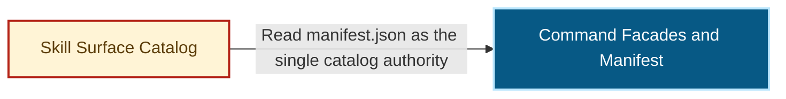

# Templates

Write headings in the repository's documentation language
(`.ai/harness/policy.json#documentation.language`; `follow-user` means the
user's language). Keep the comment header lines, field keys, issue
numbers, paths, commands and error codes as written here. Agents search
for them.

| Meaning | English heading | 中文标题 |
|---|---|---|
| Outcome | Goal | 目标 |
| Observed state at a pinned base | Current state (main@sha) | 现状（main@sha） |
| Concrete work | Do | 要做的 |
| Module and files | Module and files | 模块与位置 |
| The changed component on the capability map | Architecture slice | 架构切片 |
| Forbidden scope, invariants, deletes, compatibility | Boundaries | 边界 |
| Proof | Acceptance | 验收 |
| Dependencies | Depends on | 依赖 |
| Exclusions | Out of scope | 不做 |

## Parent issue

```markdown
<one paragraph: why this program exists, source documents with pinned-SHA links>

## Goal
<the user-visible end state, 1–3 sentences>

## Children
| Order | Issue | Module | Outcome | Depends on | Seat / status |
|---|---|---|---|---|---|
| 1 | #<n> | <module id> | <outcome> | — | writer <agent> · PR #<p> · merged |
| 2 | #<n> | <module id> | <outcome> | #<n> | open |

Merge order: <1 → 2 → (3, 4 in parallel) → 5>.

## Done when
- <observable end condition>
- Architecture model and docs/architecture/archimap.html match the merged code.

## Decisions
<filled by `decision` comments; list their links here when the parent is edited>
```

## Child issue

Title: `<module>: <outcome>` or `<area> <phase>.<n>｜<module>：<outcome>（<IDs>）`.

````markdown
Part of #<parent>. Source: <PRD or design link at pinned SHA>, requirement and scenario IDs <IDs>.

## Goal
<one or two sentences, user-visible>

## Current state (main@<short-sha>)
- <what exists now, with file:line>

## Do
- <concrete change: route, function, file, status code, scenario ID>
- <each failure case with its exact error code or message>

## Module and files
- Module: <module id from the architecture map>
- Change: <main files>
- Tests to extend: <test files>

## Architecture slice
Source: [<domain>/<capability>.md @ <sha>](https://github.com/<owner>/<repo>/blob/<sha>/docs/architecture/modules/<domain>/<capability>.md) §1.1.



- Entry anchor: `entrypoint.action-commands.profile-projection` → `scripts/skill-surface-select.ts#main`.
- Sink anchor: `sink.action-commands.facades-for-profile` → `src/core/skill-surface/catalog.ts#facadesForProfile`.

## Boundaries
- Do not change: <files, modules, public contracts>
- Invariants: <what must stay true>
- Delete in this PR: <old functions, flags, routes, files>
- Compatibility: none. <old thing> is removed, not aliased.
- PR slots: <only when split in advance: PR-1a <scope>, PR-1b <scope>>

## Acceptance
- <observable check> (<scenario ID>)
- Negative: <what must NOT happen> (<scenario ID>)
- Verify: `<typecheck command>`; `<test command with files>`

## Depends on
Depends on #<n> <short name>
Early start: <allowed against <contract>, PR stays draft until #<n> merges | not allowed>

## Out of scope
- <plausible addition> (owned by #<n>)
````

The slice has one source: the capability document that ArchContext projects
at the pinned base. Copy §1.1 from it, with the classDef lines that the
copied nodes use. Keep the target component and its direct neighbours, and
delete the other nodes. Delete the `:::component` marker from the target
node line, add `classDef target …` after the copied classDef lines, then
add `class <node ID> target`. Take the entrypoint and `file#symbol`
anchors from §1.2 of the same document. Never draw a slice from the
archimap, a source scan or memory.

## PR body

````markdown
Closes #<issue>            <!-- or: Refs #<issue> for a non-final PR of the issue -->
Depends on #<PR>           <!-- one line per PR that must merge first; omit when none -->

## Goal
<one sentence, from the issue>

## Scope
<module and files; what is explicitly not in this PR>

## Changes
- <change>
- Deleted: <old path removed in this PR>

## Architecture slice
<the changed §1.1 excerpt with `classDef target` and `class <node ID> target`, or: Architecture slice unchanged, see #<issue>>
Source: [<domain>/<capability>.md @ <base sha>](https://github.com/<owner>/<repo>/blob/<base sha>/docs/architecture/modules/<domain>/<capability>.md) §1.1

## Verification
Run on `<sha>` (<os>, <runtime version>):
- `<command>` — <N pass, 0 fail>

## Test changes
<each changed or removed assertion and why; "none" when none>

## Risk and rollback
Risk: <what could break first>. Rollback: `git revert <squash-commit>`.
````

Attach the changed slice when this PR changes `.archcontext/model/**` or a
capability entrypoint. Produce it as `worker.md` §6.1 says: apply the
`plan` preview to a scratch copy of the document, then take §1.1.
Otherwise write the one line `Architecture slice unchanged, see #<issue>`.
Never commit a generated region. `.projection-manifest.json` and the
machine regions of `docs/architecture/modules/**` come from the rolling
writer, not from this PR.

## Comments

Every protocol comment starts with its header line. Fields come next, then
at most a short body.

### issue claim

```text
repo-harness issue claim
Status: active
Seat: writer            # coordinator | writer | integrator
Slot: PR-1b             # only for a named PR slot
Agent: <kind>, session <id>
Branch: <type>/<issue>-<slug>
Scope: <what this claim covers>
Not in scope: <what it leaves>
Prior claim: <comment URL>   # only for a handoff
```

### issue claim status

```text
repo-harness issue claim status
Claim: <claim comment URL>
Status: ready for review; claim remains active   # | blocked; claim remains active | released | done
PR: #<p> head <sha>
CI: <success | failing <job> | pending>
Next: <what happens next, who acts>
```

### boundary question

```text
repo-harness boundary question
To: coordinator
Claim: <claim comment URL>
Blocker: <one sentence>
Evidence: <file:line, command and short output>
Options: <A ...> | <B ...>
Holding: no code outside the boundary until answered
```

### scope change

```text
repo-harness scope change
Re: <boundary question URL, or "coordinator decision">
Changed: <which issue section, old → new>
Why: <reason>
Affects: #<n>, #<m>   # every issue whose boundary or dependency moved
```

### decision

```text
repo-harness decision
Re: <comment URL or "parent">
Decision: <one sentence>
Why: <reason and evidence>
Applies to: #<n> ...
```

### handoff

```text
repo-harness handoff
Seat: writer | head owner | coordinator | integrator
From: <agent identity>, claim <URL>
To: <agent identity>
Authority: <the owner's instruction, quoted, or the prior holder's release>
State: branch <name>, head <sha>, done <...>, left <...>
Next command: <exact command>
```

The receiver then posts its own `issue claim` with `Prior claim:`.

### acceptance claim (on the PR)

```text
repo-harness acceptance claim
Seat: acceptor
Round: <n>
Subject: <head sha>
Tier: low | medium | high
Agent: <kind and model>, read-only
```

### acceptance record (on the PR)

```text
repo-harness acceptance record
Claim: <acceptance claim URL>

| Round | Seat | Subject | Verdict |
|---|---|---|---|
| 1 | <model>, fresh context, read-only | `<sha>` | CHANGES: 1 P1 (<short>), 2 P2 (<short>) |
| 2 (delta `<a>..<b>`) | <model> | `<sha>` | ACCEPT: round-1 findings closed |

Author: <writer>. Tier: <tier>. Follow-ups: #<n> (P3).
```

### unblocked

```text
repo-harness unblocked
To: head owner #<p>
Merged: #<dep> as <merge sha>; main is <sha>
Next: merge main into your branch (no force push), run affected checks, post integration status
```

### integration status (on the PR)

```text
repo-harness integration status
Re: <unblocked or request URL>
Head: <new sha>, parents <accepted sha> + main <sha>
Delta: <files changed by the sync; "none beyond main">
Checks: <commands and results>; CI <state>
Acceptance reuse: <valid, delta does not touch reviewed source | new round needed because ...>
```

Merge result (integrator, after `repo-harness publication merge`):

```text
repo-harness integration status
Re: <PR URL>
To: <owner | head owner #<p>>
Merge: exit <0|3|4|5|6> <merged | acceptance_merge_off | <error> | merge_outcome_unknown | provider_rejected>
Merge SHA: <merge_commit_sha>, parent <parent_sha>
Revert: <revert command from the output>
Detail: <exit 3: "PR ready, owner merges" | exit 4: the blockers | exit 5, 6: the error as it is>
```

Write `Merge SHA` and `Revert` only for exit 0. For exit 4, `<error>` is the
error code in the executor JSON.

## Dispatch packet

Send through the host channel. Never restate the issue.

```text
Role: worker (read references/worker.md of repo-harness-issue-flow)
Issue: <URL>
Slot: <PR slot or "whole issue">
Worktree: /tmp/<repo>-wt-<issue>-<slug> on <type>/<issue>-<slug> from origin/main
Model: <model>
Report: status comments on the issue; nudge <coordinator channel> with the comment URL
Authority: implement, push the PR branch, open the PR. No merge, no deletion outside the issue, no credentials.
```
