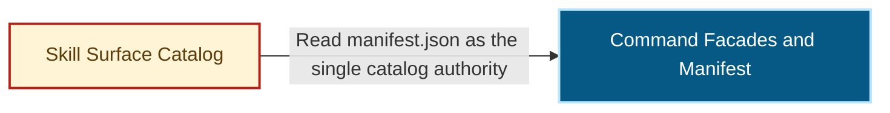

# Templates

Write headings in the repository's documentation language
(`.ai/harness/policy.json#documentation.language`; `follow-user` means the
user's language). Keep the comment header lines, field keys, issue
numbers, paths, commands and error codes as written here. Agents search
for them.

| Meaning | English heading | 中文标题 |
|---|---|---|
| Outcome | Goal | 目标 |
| Observed state at a pinned base | Current state (main@sha) | 现状（main@sha） |
| Concrete work | Do | 要做的 |
| Module and files | Module and files | 模块与位置 |
| The changed component on the capability map | Architecture slice | 架构切片 |
| Forbidden scope, invariants, deletes, compatibility | Boundaries | 边界 |
| Proof | Acceptance | 验收 |
| Exclusions | Out of scope | 不做 |

## Plan data

GitHub native fields hold the plan. Never write a second copy in a body or
a comment.

| Fact | Authority | Write it with |
|---|---|---|
| Child of a parent | Sub-issue of the parent | `gh api graphql` mutation `addSubIssue(input: {issueId: <parent node id>, subIssueId: <child node id>})` |
| Issue dependency | Blocked-by link on the blocked issue | `gh api graphql` mutation `addBlockedBy(input: {issueId: <blocked node id>, blockingIssueId: <blocker node id>})` |
| Release window | Milestone | `gh issue edit <n> --milestone <title>` |
| Plan tier | One label `tier:low`, `tier:medium` or `tier:high` | `gh issue edit <n> --add-label tier:<tier>` |
| PR stack | The PR base branch | `gh pr create --base <producer branch>`, later `gh pr edit <p> --base main` |
| PR to issue | `Closes #<issue>` or `Refs #<issue>` in the PR body | the PR body template |
| Merge order, holds, seat limit | The plan block in the newest `plan` comment | the `plan` template |

`gh issue view <n> --json number,id` gives the node id. A body line such
as `Depends on #<n>` is not a dependency. Nothing reads it.

## Parent issue

```markdown
<one paragraph: why this program exists, source documents with pinned-SHA links>

## Goal
<the user-visible end state, 1–3 sentences>

## Children
| Order | Issue | Module | Outcome | Role / status |
|---|---|---|---|---|
| 1 | #<n> | <module id> | <outcome> | merged |
| 2 | #<n> | <module id> | <outcome> | writer <agent> · PR #<p> |
| 3 | #<n> | <module id> | <outcome> | unclaimed · waits for #<n> |
| 4 | #<n> | <module id> | <outcome> | unclaimed |

## Done when
- <observable end condition>
- Architecture model and docs/architecture/archimap.html match the merged code.

## Decisions
<filled by `decision` comments; list their links here when the parent is edited>
```

The role/status column uses only these values: `unclaimed`,
`unclaimed · waits for #n`, `writer <agent> · active`,
`writer <agent> · PR #p`, `merged`. A Chinese-language repository
writes `待认领`, `待认领 · 等待 #n 合并`, `writer <agent> · active`,
`writer <agent> · PR #p`, `merged`. The claim comment wins over the
table. The coordinator corrects the table after each claim or status
change. The sub-issue list is the authority for membership. The table is a
view of it, and the plan block holds the merge order.

A parent with more than two children gets a `plan` comment before
dispatch (`plan`, below). A parent with two children or fewer needs none.

## Child issue

Title: `<module>: <outcome>` or `<area> <phase>.<n>｜<module>：<outcome>（<IDs>）`.

````markdown
Source: <PRD or design link at pinned SHA>, requirement and scenario IDs <IDs>.

## Goal
<one or two sentences, user-visible>

## Current state (main@<short-sha>)
- <what exists now, with file:line>

## Do
- <concrete change: route, function, file, status code, scenario ID>
- <each failure case with its exact error code or message>

## Module and files
- Module: <module id from the architecture map>
- Change: <main files>
- Tests to extend: <test files>

## Architecture slice
Source: [<domain>/<capability>.md @ <sha>](https://github.com/<owner>/<repo>/blob/<sha>/docs/architecture/modules/<domain>/<capability>.md) §1.1.



- Entry anchor: `entrypoint.action-commands.selection-projection` → `scripts/skill-surface-select.ts#main`.
- Sink anchor: `sink.action-commands.facades-for-selection` → `src/core/skill-surface/catalog.ts#facadesForSelection`.

## Boundaries
- Do not change: <files, modules, public contracts>
- Invariants: <what must stay true>
- Delete in this PR: <old functions, flags, routes, files>
- Compatibility: none. <old thing> is removed, not aliased.
- PR slots: <only when split in advance: PR-1a <scope>, PR-1b <scope>>
- Early start: <allowed against <contract>, the PR stays draft until its blockers merge | not allowed>

## Acceptance
- <observable check> (<scenario ID>)
- Negative: <what must NOT happen> (<scenario ID>)
- Verify: `<typecheck command>`; `<test command with files>`

## Out of scope
- <plausible addition> (owned by #<n>)
````

The slice has one source: the capability document that ArchContext projects
at the pinned base. Copy §1.1 from it, with the classDef lines that the
copied nodes use. Keep the target component and its direct neighbours, and
delete the other nodes. Delete the `:::component` marker from the target
node line, add `classDef target …` after the copied classDef lines, then
add `class <node ID> target`. Take the entrypoint and `file#symbol`
anchors from §1.2 of the same document. Never draw a slice from the
archimap, a source scan or memory.

The child has no dependency section. Its parent, blockers, milestone and
tier are GitHub fields (Plan data, above).

## PR body

````markdown
Closes #<issue>            <!-- or: Refs #<issue> for a non-final PR of the issue -->

## Goal
<one sentence, from the issue>

## Scope
<module and files; what is explicitly not in this PR>

## Changes
- <change>
- Deleted: <old path removed in this PR>

## Architecture slice
<the changed §1.1 excerpt with `classDef target` and `class <node ID> target`, or: Architecture slice unchanged, see #<issue>>
Source: [<domain>/<capability>.md @ <base sha>](https://github.com/<owner>/<repo>/blob/<base sha>/docs/architecture/modules/<domain>/<capability>.md) §1.1

## Verification
Run on `<sha>` (<os>, <runtime version>):
- `<command>` — <N pass, 0 fail>

## Test changes
<each changed or removed assertion and why; "none" when none>

## Risk and rollback
Risk: <what could break first>. Rollback: `git revert <squash-commit>`.
````

Attach the changed slice when this PR changes `.archcontext/model/**` or a
capability entrypoint. Produce it as `worker.md` §6.1 says: apply the
`plan` preview to a scratch copy of the document, then take §1.1.
Otherwise write the one line `Architecture slice unchanged, see #<issue>`.
Never commit a generated region. `.projection-manifest.json` and the
machine regions of `docs/architecture/modules/**` come from the rolling
writer, not from this PR.

A PR stacked on a producer PR sets its base to the producer's branch. The
body names no PR dependency.

Write a closing keyword (`Closes`, `Fixes`, `Resolves`) followed by an
issue number only for the issues that the PR closes, and never in a code
span or a quote. The squash commit message on main is plain text, so a
keyword in a code span can close an issue there even when the PR link list
ignores it. `repo-harness publication merge` refuses the mismatch
(`closing_references_mismatch`).

## Comments

Every protocol comment starts with its header line. Fields come next, then
at most a short body. The fence around a template in this file marks the
template only. Do not wrap the posted comment in a fence: its first line is
the header. A fence that the template itself requires in the body, such as
the plan block's JSON, stays.

### issue claim

```text
repo-harness issue claim
Status: active                  # required: active
Role: writer                    # required: coordinator | writer | integrator
Slot: PR-1b                     # only for a named PR slot
Agent: <kind>, session <id>     # required
Runtime: <claude|codex|pi>      # required on a writer claim
Model: <model id>               # on a dispatched writer claim when the seat config names a model
Branch: <type>/<issue>-<slug>   # required
Scope: <what this claim covers> # required
Not in scope: <what it leaves>  # required
Coordinator: <parent claim URL> # required on a dispatched writer claim
Dispatch reading: <per account> # on a dispatch: orchestrator.md §7.1
Prior claim: <comment URL>      # required on a handoff
```

`Status`, `Role`, `Agent`, `Branch`, `Scope` and `Not in scope` are
required. A writer claim, a handoff claim included, also requires
`Runtime:`, the runtime of the writer seat. A dispatched writer claim also
requires `Coordinator`, the coordinator's own claim URL. When the seat config
names a model, dispatch adds `Model:`, the writer seat's model id. When the
seat has no model, dispatch omits `Model:` and the claim is still valid. The
board reads the family of `Model:` (`modelFamily`) as the writer's model
family for the Medium review seat (`orchestrator.md`, `board review`). With
no `Model:` line, the writer family is unknown and the board selects no
Medium review seat. A handoff claim also requires `Prior claim`. A claim
without any required field is invalid. The coordinator reads its claim back; when a
field is missing it posts `issue claim status` with `Status: released`,
then one complete claim. It names the missing fields in a `To: <agent>`
comment and does not dispatch until the corrected claim is on the board.

Every template below ends with the line `Seat: <seat id> <hc address>` when a seat posts it by hand. The line is a reader trace; no decoder reads it. The `review start` marker keeps its own `Seat:` field and takes no second line.

`issue claim` is seat-only. The coordinator posts it, including the
claim of each agent it dispatches. Such a claim names the agent in
`Agent:` and the coordinator's own claim in `Coordinator:`. Any other
agent's claim is a request, not a claim role. A claim is valid only from an
account whose `author_association` is `OWNER`, `MEMBER` or
`COLLABORATOR`; GitHub is the only source of that permission.

### issue claim status

```text
repo-harness issue claim status
Claim: <claim comment URL>
Status: ready for review; claim remains active   # | blocked; claim remains active | released | done
PR: #<p> head <sha>
CI: <success | failing <job> | pending>
Next: <what happens next, who acts>
```

### boundary question

```text
repo-harness boundary question
To: coordinator
Claim: <claim comment URL>
Blocker: <one sentence>
Evidence: <file:line, command and short output>
Options: <A ...> | <B ...>
Holding: no code outside the boundary until answered
```

### scope change

```text
repo-harness scope change
Re: <boundary question URL, or "coordinator decision">
Changed: <which issue section, old → new>
Why: <reason>
Affects: #<n>, #<m>   # every issue whose boundary or dependency moved
```

### decision

```text
repo-harness decision
Re: <comment URL or "parent">
Decision: <one sentence>
Why: <reason and evidence>
Applies to: #<n> ...
```

`plan`, `decision`, `scope change`, `unblocked` and `issue claim`
are seat-only. Only the active coordinator holder posts them. Another
agent's comment of one of these kinds takes effect only when the
coordinator confirms it.

### plan

```text
repo-harness plan
Coordinator: <coordinator claim URL>
Baseline: main@<sha>
Supersedes: <previous plan URL>   # omit on the first plan
```

After the fields comes exactly one fenced `json` block: the plan block.
`decodePlanBlock` in `src/core/board/plan-block.ts` of repo-harness defines
its protocol and fields (merge order, holds, seat limit).
`repo-harness board --parent <n>` decodes the newest plan and fails on an
invalid block. The block holds no dependency, membership or tier: those are
GitHub fields (Plan data, above).

The coordinator posts a `plan` on a parent with more than two children
before dispatch. A plan change is a new comment with `Supersedes:`. Never
edit the old plan.

### handoff

```text
repo-harness handoff
Role: writer | head owner | coordinator | integrator
From: <agent identity>, claim <URL>
To: <agent identity>
Authority: <the owner's instruction, quoted, or the prior holder's release>
State: branch <name>, head <sha>, done <...>, left <...>
Next command: <exact command>
```

The coordinator then posts the receiver's `issue claim` with
`Prior claim:`.

### acceptance claim (on the PR)

```text
repo-harness acceptance claim
Role: acceptor
Round: <n>
Subject: <head sha>
Tier: low | medium | high
Agent: <kind and model>, read-only
```

### acceptance record (on the PR)

```text
repo-harness acceptance record
Claim: <acceptance claim URL>

| Round | Role | Subject | Verdict |
|---|---|---|---|
| <n> | <harness> (<model> or unobserved), read-only | `<40-hex subject sha>` | <PASS or FAIL>: <finding counts, for example 1 P2, 2 P3, or none> |

Model relation: <different-family | same-family | unknown>

Findings:

- <severity> <id> at <path>:<line>: <evidence> -> <fix>
- <none when the round has no finding>
```

Every review writes this record, one row per review. The fields are `Round`,
`Role`, `Subject` (the full 40-hex head SHA in backticks), `Verdict`
(`PASS` or `FAIL`, a colon, then the finding counts) and the
`Model relation` line. `repo-harness review publish` writes it for rounds
1 to 5 (`acceptor.md` §4). The board reads only this shape. A record that it cannot
read makes the PR state unknown, not accepted.

### acceptance disposition (on the PR, coordinator only)

```text
repo-harness acceptance disposition
Record: <FAIL acceptance record comment URL>
Subject: <40-hex subject sha of the FAIL row>
Findings: <finding ids, comma separated>
Decision: <comment URL of the decision that resolves them, for example a boundary answer>
```

The board ignores a FAIL row only when the disposition names its record and
subject and lists every finding ID of that record. One unresolved finding, or a
record whose `Findings:` bullets do not follow the record shape, keeps the row
failing. A later PASS record never clears a FAIL row by itself.

### review reply (in the PR review thread)

```text
repo-harness review reply
Agent: <kind>, session <id>
Disposition: fixed <sha> | disputed | rejected | deferred #<follow-up issue>
Why: <reason; for fixed, the test that fails on the base>
```

The head owner replies `fixed` or `disputed` and leaves the thread open.
Only the coordinator replies `rejected`, or `deferred` for a rule-4
deferral (`acceptor.md` §2.2), then resolves the thread (`board.md` rule 5).
A comment from a reviewer without a claim role, such as an
outside contributor, is optional input: the head owner or the coordinator
decides whether to adopt it, and answers with the same reply. A review bot
comment follows `acceptor.md` §2.3: the coordinator answers every one.

### review-bot reference (plain PR comment, written by the coordinator)

```text
Review-bot reference: <comment id or thread> adopt|decline|outdated: <reason>
Review-bot reference: no findings at <sha>: no action
```

`acceptor.md` §2.3 defines the decisions. It is not part of the
`acceptance record`.

### unblocked

```text
repo-harness unblocked
To: head owner #<p>
Merged: #<dep> as <merge sha>; main is <sha>
Next: merge main into your branch (no force push; the `unblocked` case of `worker.md`, Main moved), run affected checks, post integration status
```

### merge hold (on the parent, an issue or a PR)

```text
repo-harness merge hold
Issues: #<a> #<b>
Reason: <the stop decision, and who made it>
```

`Issues:` is for the parent only; without it, the hold covers every item
of the batch. A hold on an issue or a PR covers that issue or PR. `repo-harness board merge` reads it (`orchestrator.md` §9.3).

```text
repo-harness merge hold released
Reason: <the release decision, and who made it>
```

### integration status (on the PR)

```text
repo-harness integration status
Re: <unblocked or request URL>
Head: <new sha>, parents <accepted sha> + main <sha>
Delta: <files changed by the merge of main; "none beyond main">
Checks: <commands and results>; CI <state>
Review: <delta check rows needed for the new head (`acceptor.md` §2.2)>
```

Merge result (integrator, after `repo-harness publication merge`):

```text
repo-harness integration status
Re: <PR URL>
To: <owner | head owner #<p>>
Merge: exit <0|3|4|5|6> <merged | acceptance_merge_off | <error> | merge_outcome_unknown | provider_rejected>
Merge SHA: <merge_commit_sha>, parent <parent_sha>
Revert: <revert command from the output>
Detail: <exit 3: "PR ready, owner merges" | exit 4: the blockers | exit 5, 6: the error as it is>
```

Write `Merge SHA` and `Revert` only for exit 0. For exit 4, `<error>` is the
error code in the executor JSON.

## Dispatch packet

Send through the host channel. Never restate the issue.

```text
Role: worker (read references/worker.md of repo-harness-issue-flow)
Issue: <URL>
Slot: <PR slot or "whole issue">
Worktree: /tmp/<repo>-wt-<issue>-<slug> on <type>/<issue>-<slug> from origin/main
Model: <model>
Report: status comments on the issue; nudge <coordinator channel> only on PASS, a boundary question or a fix-loop stop
Authority: implement, push the PR branch as soon as checks pass, open the PR, run your own fix rounds. No merge, no deletion outside the issue, no credentials.
```

Paste this checklist under the packet when the issue does not already
state it (`orchestrator.md` §2 and §8):

```text
- One concern and one module in this PR; ask for a split before acceptance, not after.
- Keep the PR draft until the verification evidence exists.
- Low or docs-only: put the commands and outcomes in the PR body (Review by risk).
- A second identical CI failure is not a flake: classify it once (diff, infrastructure, stale base).
- `Affected coverage is unknown for: <paths>` is a map bug: fix the consumer edge or the test import.
```
