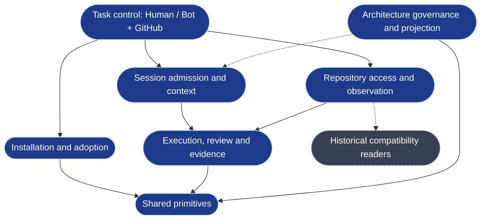
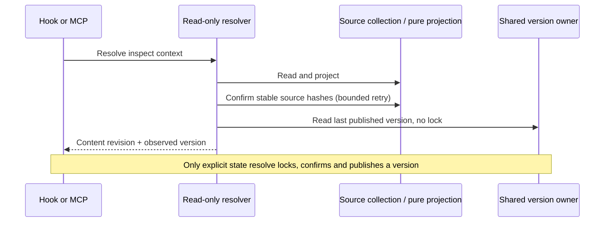
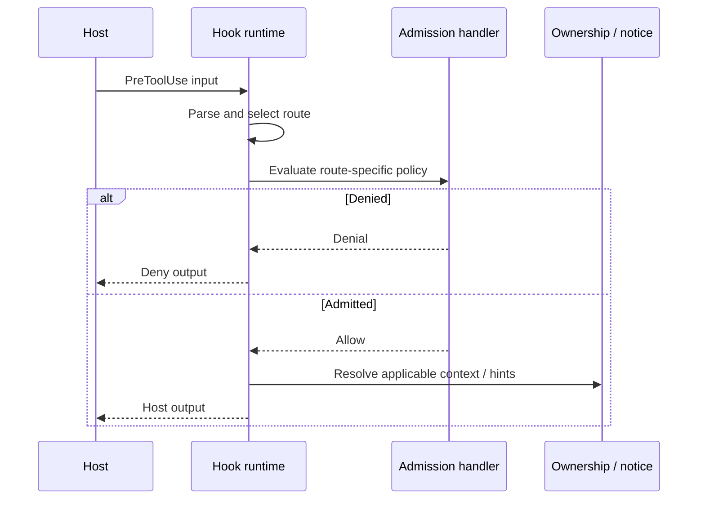
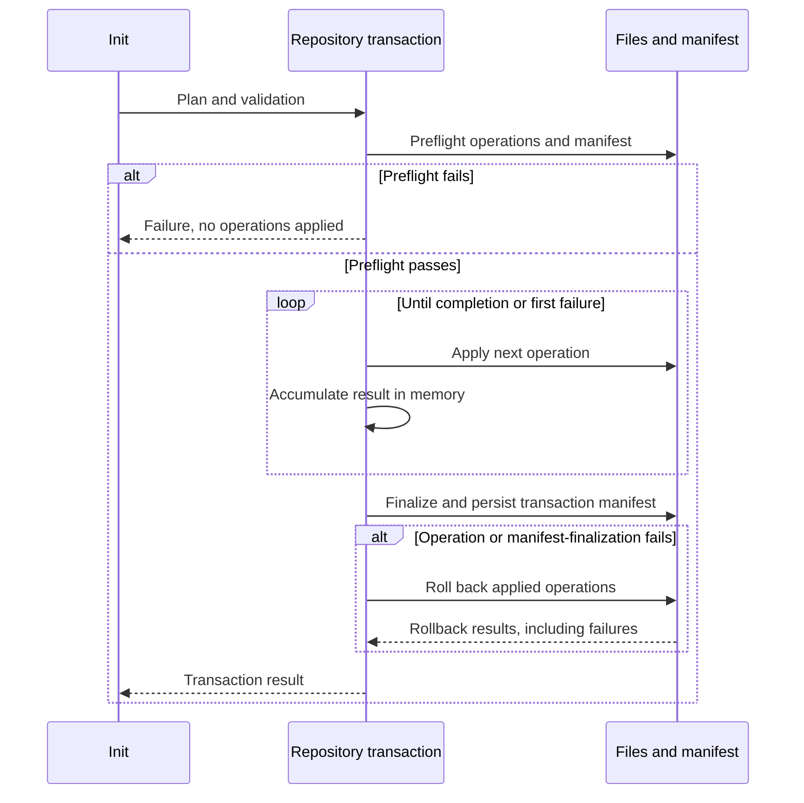
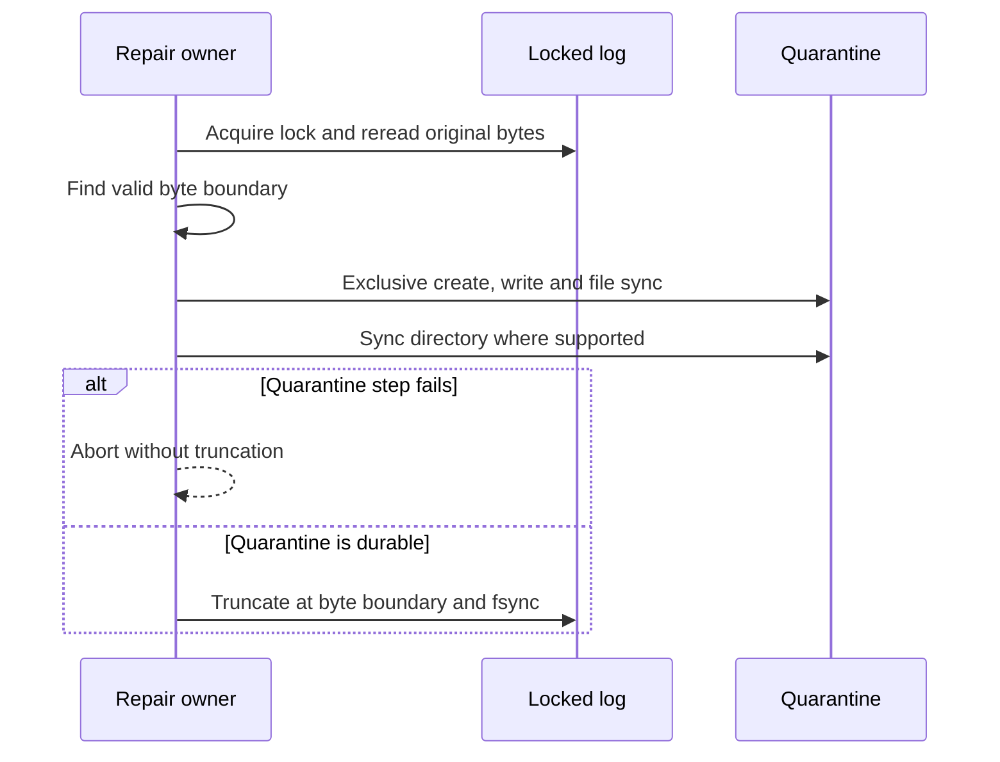

# Current Functional Architecture

Source baseline: `cb900a7fe5ebd04830fdfa62e1b18e25ec969148` (2026-10-25).
This hand-written view records source inspection, not a product execution or a
performance measurement. Model inventory and generated proof stamps keep their
own revisions. The [layered view](layered-architecture.md) and
[namespace view](process-namespace-topology.md) retain the historical `d7e92f43d`
review and subsequent edits through the source baseline above. Their file
histories identify those edits; the archived pages are not single-revision snapshots.

## Functional Domains

These eight domains are a logical view across existing capabilities. They do not
rename the six model domains or move code. `cli`, `core`, `effects` and `scripts`
are implementation layers; scripts expose command entrypoints.

| Functional domain | Responsibility and authority | Source entrypoints |
|---|---|---|
| Task control and intent | Human/Bot decides; GitHub issue/PR owns identity, claim, state and dependency | `README.md`, `AGENTS.md`, `src/cli/commands/herdr.ts` |
| Installation and repository adoption | Host install/update and repository init have separate plans, preflight and rollback | `src/cli/commands/global-runtime.ts`, `src/effects/adoption/`, `src/effects/fs-transaction.ts` |
| Session admission and context | Route host input, enforce admission, render context; Effective State is a local read projection | `src/cli/hook/route-registry.ts`, `src/cli/hook/runtime.ts`, `src/effects/state/resolve-effective-state.ts` |
| Repository access and observation | MCP and operator expose bounded access; authentication, registration and task authorization remain separate | `src/cli/mcp/`, `src/effects/operator/`, `src/effects/dev-activity/collector.ts` |
| Execution, review and evidence | Bound processes; bind review/verification to exact subjects; keep ledger, checkpoints and publication facts | `src/effects/review/generic-review.ts`, `src/effects/evidence/`, `src/effects/terminal/` |
| Architecture governance and projection | Model intent uses ChangeSets; policy selects one ownership resolver; rolling writer publishes generated output | `src/effects/architecture/`, `src/effects/architecture/archcontext-owners.ts`, architecture worker reference |
| Shared primitives | Git, locks, process lifecycle, paths, durable writes and identity; callers supply task policy | `src/effects/git/`, `src/effects/locking/`, `src/effects/process-supervisor.ts` |
| Historical compatibility | Retained Sprint, lease and Engineer readers support observation; they are not current orchestration | `src/effects/state/coordination-lease-store.ts`, `src/effects/engineers/`; product decision [#917](https://github.com/Ancienttwo/repo-harness/issues/917) |

Arrows group consumers and supporting responsibilities. They do not create new
model relations or imply that a local board schedules tasks.

## Runtime Sequences

### State reads and the version writer

`src/effects/state/resolve-effective-state.ts#resolveEffectiveStateReadOnly`
collects stable sources, projects state and attaches the last published version.
It takes no state/version lock and publishes nothing. Hook runtime and MCP use
this path. `resolveEffectiveState` is the sole version publisher, called by
`repo-harness state resolve`. `state_revision` identifies exact content;
`state_version` on a read can belong to another revision or linked worktree.
There is no persisted Effective State JSON cache.

### PreToolUse and Stop

`src/cli/hook/route-registry.ts` selects handlers. Edit/Write admission is
fail-closed; the Bash tripwire is advisory for unparsed input, and denies a
known forbidden path. These are distinct contracts. Ownership hints use the
policy-selected resolver. Archcontext mode calls package-local `archctx resolve`;
registry mode uses longest-prefix matching. A cached observation does not become
a new authority, and provider failure does not select a fallback registry.

Stop is a separate write path: `src/cli/hook/stop-handler.ts#runStopHandler` calls
checkpoint publication and writes handoff then resume. A failed checkpoint
publish keeps recovery views bound to the previous checkpoint. Read-only state
resolution does not mean that all hook events perform zero writes.

### Repository init transaction

`src/effects/adoption/` builds the repository plan.
`src/effects/fs-transaction.ts#applyAdoptionPlan` preflights all operations and the
manifest, applies sequentially and accumulates results in memory. It stops on
the first operation failure, then finalizes the manifest after the loop. An
operation failure or manifest-finalization failure triggers rollback of applied
operations. The result includes rollback failures; this is not a per-operation
durable journal. Host install/update
is a separate locked transaction, not an init step. `applyAdoptionPlan`
does not acquire that host lock or a repository-wide transaction lock.

### Operator collection and cleanup

`src/effects/dev-activity/collector.ts#runDevActivityProcess` bounds time and
stdout. Timeout/abort starts process-group termination; the failure result
settles after the termination promise. `startDevActivityCollector` starts the
next cycle only after the previous cycle settles, and `close` aborts and waits
for the in-flight cycle. The deadline and cleanup completion are separate
moments. This describes source ordering, not measured cleanup latency.

### Evidence repair

`src/effects/evidence/event-log.ts#repairCorruptTail` rereads under the log lock.
`quarantineEvidenceTail` uses original byte offsets, creates an exclusive durable
quarantine file, syncs its directory where supported, then truncates and fsyncs
the log. It does not decode and re-encode the removed bytes. Quarantine failure
prevents truncation. POSIX directory sync and Windows file flush have different
platform guarantees; see `src/effects/atomic-append.ts`.

[#947](https://github.com/Ancienttwo/repo-harness/issues/947) is fixed in this
baseline by [#949](https://github.com/Ancienttwo/repo-harness/pull/949). The old
snapshot must not be used as evidence that the old repair bug is still present.

### Review identity, retry and cancellation

`src/effects/review/generic-review.ts#runReviewRound` binds the stored round
packet to the subject and verification context. A changed packet cannot silently
reuse that round. `closeReview` records cancellation intent and checks it before
send and acceptance; cancellation can require completion of the same pending
operation. Provider/host unavailability is an explicit failure, not acceptance.
A successful retry must preserve the required session/round identity. The
contract-based entrypoint still exists; [#903](https://github.com/Ancienttwo/repo-harness/issues/903)
tracks the review-key migration. This view does not claim that migration shipped.

## Storage and Process Topology

| Surface | Sharing and lifetime | Authority / writer |
|---|---|---|
| GitHub issue/PR | Provider-owned task lifecycle | Human/Bot task decisions |
| Repository sources and `.archcontext/model/` | Tracked repository revision | Human prose; model ChangeSet author |
| Generated architecture regions and manifest | Writer-published projection revision | archctx rolling writer; feature PRs do not apply generated output |
| Git common-dir state version | Shared by linked worktrees | Explicit `state resolve`; read-only adapters only observe |
| `.ai/harness/evidence/` and recovery views | Repository-local runtime evidence | Evidence owner and Stop/checkpoint paths |
| Git common-dir historical coordination/publication/Engineer records | Retained compatibility data | Read boundaries and product decision #917; no revival of retired writers |
| Host config and registered repositories | User-owned host scope | Explicit configuration operations; registration does not grant task authorization |
| Hook and CLI processes | Started for host events or commands | Host/user/Bot |
| MCP and operator | Explicitly started local service processes | Client/user lifecycle; this document installs no service |
| Herdr task/review sessions | Bounded host/session lifecycle | Task-agent effects and explicit review cancellation/close |

## Model Follow-up and Validation Scope

Main #945 moved the durable primitive to `src/effects/atomic-append.ts` and
removed `relation.workflow-state.coordination-plane.evidence-ledger`. The retained
`relation.workflow-state.coordination-plane.execution-primitives` now covers the
valid topology persistence dependency. The old lease-write wording is no longer
a pending edit to that removed relation. This PR does not recreate it or change
model YAML.

On 2026-10-25, the package-local archctx 0.9.3 provider validated this model
through an explicitly approved, task-isolated runtime: `valid: true`, no errors.
It reported one existing warning: the manifest's `review.failOn` is ignored;
`.archcontext/policies/review.yaml` owns that policy. The temporary runtime was
stopped and its status confirmed `running: false`. No model edit or ChangeSet
apply was needed after the main #945 relation removal.

All six changed/new Mermaid diagrams rendered with the installed Mermaid CLI
11.16.0 / Mermaid 11.16.1 and local Chrome, with external networking disabled.
Visual inspection found readable labels and intact arrows and branch frames.
Earlier sandbox `EPERM` failures are historical attempt results, not current
validation blockers. No diagram was sent to an external renderer.

Flow proof is separate: CodeGraph 1.6.2 and `flows check` proved 107 of 108
selectors. The existing review-receipt selector remains unproven; this document
change does not repair or waive that model proof. Issue #948 stays open for
final review of this acceptance evidence.

### 2026-10-25 follow-up: receipt sink repair

The 107/108 result above records this PR at
`7dd32a648a3c89ffbd31cc1fd7471b453098fddd`, against source baseline
`cb900a7fe5ebd04830fdfa62e1b18e25ec969148`. It remains the result of that run.
[#956](https://github.com/Ancienttwo/repo-harness/issues/956) was then fixed by
[#957](https://github.com/Ancienttwo/repo-harness/pull/957), merged as
`b4c8b53b43c376a4da1e17a10c1fe40fc98e7d72`. The approved ChangeSet changed only
the receipt sink path from the script facade to
`src/effects/review/acceptance-receipt.ts`.

The [recorded candidate verification](https://github.com/Ancienttwo/repo-harness/pull/957#issuecomment-6400545828)
at `24633552040b45739e7dccec79017ac7ed1ed435` used archctx 0.9.3 and ready
CodeGraph 1.6.2: `flows check` reported `data.ok: true`, 108/108 proven and zero
unproven selectors. The receipt selector had a direct call at
`src/effects/review/generic-review.ts:379`. Model validation reported
`valid: true`, no errors and the same manifest policy warning. The merged tree
`c802c8d3fff2d965423be5d619f4bf1eb3491960` matches that reviewed candidate tree.
This is evidence from #957, not a rerun or a new whole-source review by #950.
The source baseline at the top of this page stays unchanged.

Separate findings remain: 10 anchor findings across 1,077 citations (three
line-out-of-range and seven missing-path; zero unchecked); projection
`human-action-required` / `unresolved-major-change` across 17 capabilities;
and partial practices coverage because practices were not enabled or evaluated.
They are not waived by model validity, flow proof or green CI. Generated
publication remains with the rolling writer. The #903 review-key migration and
#917 retained-reader decisions remain separate from this documentation repair.

Current source takes precedence over historical Remarks. Reuse the existing
issues for library moves and retained-reader decisions. Count differences in
successive generated graphs are not a separate defect. Documentation checks and
Mermaid rendering validate this prose and syntax; they do not constitute runtime
regressions, performance evidence or model flow proof.
