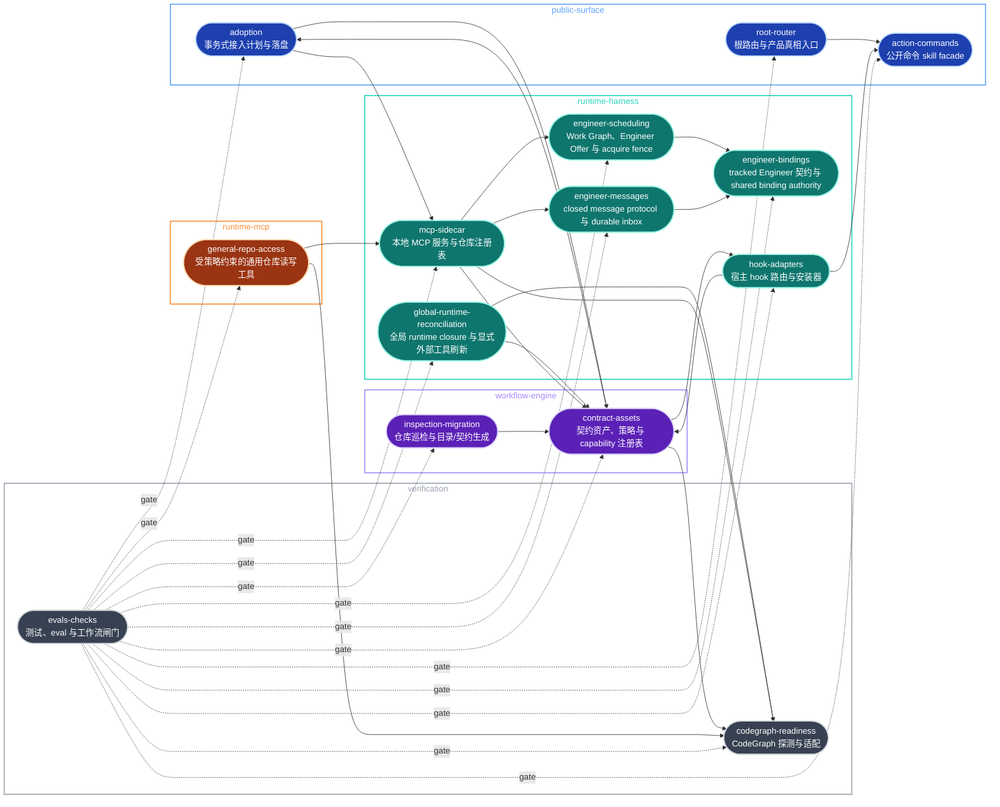

# Architecture Index

> Umbrella architecture ledger for current boundaries, snapshots, and diagrams.

## Current Snapshot

- Current capability boundaries: [architecture modules](modules/).
- Runtime hook adapter diagrams: [hook adapter architecture](modules/runtime-harness/hook-adapters.md).

## System Boundary

`repo-harness` is a repo-local workflow harness CLI and skill with an optional
local MCP sidecar. It is not a hosted product runtime, agent gateway, or database
service. Its job is to inspect a target repository, install or refresh a
file-backed workflow contract, route public command skills, expose explicitly
configured local MCP capabilities, and verify that generated repo-local surfaces
remain consistent.

Authoritative surfaces:

- Public router: `SKILL.md`, `README.md`, `AGENTS.md`, `CLAUDE.md`.
- Public command facades: `assets/skill-commands/*/SKILL.md` plus `assets/skill-commands/manifest.json`.
- Engine: `scripts/inspect-project-state.ts`, `src/core/adoption/`, `src/effects/fs-transaction.ts`, `scripts/create-project-dirs.sh`, `scripts/lib/project-init-lib.sh`, and the [Transactional Adoption Planner](transactional-adoption-planner.md).
- Contract assets: `assets/workflow-contract.v1.json`, `.ai/harness/workflow-contract.json`, `.ai/harness/policy.json`, `.ai/context/context-map.json`, and the capability authority selected by `.ai/harness/policy.json#context.capability_source` (this repo: `.archcontext/model/nodes/*.yaml`).
- Runtime harness: `assets/hooks/`, `.ai/hooks/`, user-level host adapters, and ignored `.ai/harness/*` runtime state.
- MCP sidecar: `src/cli/mcp/`, `src/cli/commands/mcp.ts`, user-owned ignored config/registry under `~/.repo-harness/`, and the [MCP sidecar architecture](modules/runtime-harness/mcp-sidecar.md).
- Verification: `tests/`, `evals/`, `scripts/check-task-workflow.sh`, `scripts/check-task-sync.sh`, `scripts/check-agent-tooling.sh`, `scripts/ensure-codegraph.sh`.
- Effective State and workflow policy: `src/core/state/` (pure Effective State
  projection, ESA PR #79), `src/effects/state/` (source resolution and
  publication), and `src/core/workflow/` — `profile.ts` owns the deterministic
  risk/profile authority and `artifact-requirement-policy.ts` (LSC-02) owns
  the Lite/Standard/Strict x edit/stop/ship artifact-requirement matrix.
  Consumer cutovers to that matrix land one package at a time through the
  Loop Semantics Convergence sprint
  (`plans/sprints/20260716-0101-loop-semantics-convergence.sprint.md`);
  its active state goldens live in `tests/state/cli-state-golden.test.ts`.
  Adapter parity is checked in `tests/state/adapter-parity.test.ts`.
- Loop semantics parity contract (LSC-08): the readiness authority
  (`src/core/workflow/operation-readiness.ts`'s `evaluateReadiness`, carried
  verbatim as `EffectiveStateV1.readiness`) and its Skill guidance
  (`EffectiveStateV1.guidance`) are projected, never recomputed, by four
  adapter surfaces — CLI (`repo-harness state resolve --json`, including
  `--field readiness`), MCP (`summarize_repo_harness_state`'s compact
  state), Hook (the Stop route's in-process `stop-handler.ts` reading
  `.readiness.allowedToStop` / `.readiness.readyToShip`), and Skill
  (guidance text matched against `CEREMONY_GUIDANCE[profile]`). All four
  agree on profile, operation, decision, reason, and readiness for the same
  fixtures; the parity gate is `tests/state/adapter-parity.test.ts`, with no
  separate gate machinery.
- Shared coordination plane: the cross-worktree ownership and visibility
  contract — lease identity and the four-state machine
  (`src/core/state/coordination-identity.ts`,
  `src/effects/state/coordination-lease-store.ts`,
  `src/cli/commands/sprint.ts`) plus the read-only kanban projection
  (`src/core/state/project-board.ts`,
  `src/effects/state/collect-board-inputs.ts`,
  `src/effects/state/resolve-board.ts`,
  `src/effects/git/worktree-topology.ts`, `repo-harness state board --json`),
  and the [Shared Coordination Plane](shared-coordination-plane.md).
- Shared execution effects: `src/effects/process-runner.ts`,
  `src/effects/process-supervisor.ts`, `src/effects/process-group-launcher.ts`,
  `src/effects/locking/`, and `src/effects/git/` own bounded process lifecycle
  and canonical filesystem/Git primitives consumed by workflow and
  verification modules.

Out of scope:

- Product application scaffolds after their first generated skeleton.
- `_ref/` external reference checkouts and `_ops/` private operations state.
- Installing, upgrading, or enabling external host tools such as Waza, `geju`, or MCP servers. This self-host repo may vendor CodeGraph as a dev dependency, but generated downstream repos keep CodeGraph host setup explicit unless local policy opts in.
- Vendoring external skill bodies such as `mermaid`.

## Umbrella Hierarchy

```text
Project
  -> architecture domain
     -> capability
        -> capability contract block
        -> workstream ledger
        -> current todo slice
        -> source plan
```

- Architecture owns stable truth: boundaries, snapshots, and embedded Mermaid source.
- The capability authority selected by `.ai/harness/policy.json#context.capability_source` owns declared capability prefixes and longest-prefix matching; this repo resolves from `.archcontext/model/nodes/*.yaml`.
- Local `AGENTS.md` / `CLAUDE.md` contract blocks own agent-facing context projection.
- `tasks/workstreams/<domain>/<capability>/` owns durable multi-session progress.
- `tasks/todos.md` owns deferred medium/long-term goals with tradeoff and revisit trigger; current execution slices stay in the active plan's `## Task Breakdown`.

## Domains

- [Public Surface](domains/public-surface.md): root router, README, root agent docs, and action command facades.
- [Workflow Engine](domains/workflow-engine.md): inspection, migration, template install, contract assets, and policy/context generation.
- [Runtime Harness](domains/runtime-harness.md): generated hook implementation, user-level adapter settings, handoff, and runtime event state.
- [Verification](domains/verification.md): unit tests, smoke checks, eval fixtures, CodeGraph readiness, and advisory tooling probes.

## Capability 地图

`.ai/harness/policy.json#context.capability_source` 选中的 capability 权威声明 14 个 capability，分属 5 个 architecture domain；本仓库的权威是 `.archcontext/model/nodes/*.yaml`。
下图按 domain 分组，只画在源码里核实过的强依赖边（import 或运行时调用），
虚线是 verification 的 gate 关系而非代码依赖。



每条实线边的源码证据：

| 边 | 证据 |
| --- | --- |
| root-router -> action-commands | `SKILL.md` 的 verify 步骤指名 `repo-harness-check`，该 facade 实体在 `assets/skill-commands/repo-harness-check/` |
| contract-assets -> adoption | `src/cli/commands/init.ts` 导入 `./adoption-plan` 的 `runAdoptionApply` / `runAdoptionPlan` |
| contract-assets -> hook-adapters | `src/cli/commands/init.ts` 导入 `../installer/install-profile` 的 `PROFILE_COMPONENTS` |
| contract-assets -> codegraph-readiness | `src/cli/commands/init.ts` 导入 `../tools/codegraph` 的 `configureCodegraph` / `ensureCodegraph` |
| global-runtime-reconciliation -> contract-assets | `src/cli/commands/global-runtime.ts` 导入 install-profile 与 skill-surface catalog，并读取 package-owned runtime assets |
| global-runtime-reconciliation -> codegraph-readiness | `src/cli/commands/global-runtime.ts` 导入 `../tools/codegraph` 的 `configureCodegraph` |
| inspection-migration -> contract-assets | `scripts/lib/project-init-lib.sh` 生成并写入下游 registry 模式的 `.ai/context/capabilities.json` 与模板契约文件（新仓库默认 `capability_source: "registry"`，与本仓库自身的 archcontext 权威无关） |
| adoption -> contract-assets | `src/core/adoption/source-checkout.ts` 以 `assets/workflow-contract.v1.json` 判定源码 checkout；`src/core/adoption/standard-plan.ts` 指向 `package:assets/templates/helpers` |
| adoption -> mcp-sidecar | `src/cli/commands/adoption-plan.ts` 导入 `../../effects/repo-registry` 的 `registerRepoHarnessRepo` |
| hook-adapters -> action-commands | `src/cli/installer/install-profile.ts` 读取 `assets/skill-commands/manifest.json` 并按名取用各命令源目录 |
| engineer-scheduling -> engineer-bindings | `src/effects/engineers/scheduling-acquire.ts` 重验精确 Engineer 合同后，通过 `delegateScheduledEngineerAcquire` 调用既有 ME-0B acquire authority |
| engineer-messages -> engineer-bindings | `src/effects/engineers/module-inbox.ts` 在 send、delivery 与 ACK 边界调用 `readEngineerBindingStatus` 重验精确 Binding |
| mcp-sidecar -> engineer-messages | `src/cli/mcp/engineer-tools.ts` 从已验证 principal 派生 sender/recipient 并调用 module inbox effects |
| mcp-sidecar -> engineer-scheduling | `src/cli/mcp/engineer-tools.ts` 调用 scheduling effects 投影并获取带 revision fence 的 Engineer offer |
| mcp-sidecar -> contract-assets | `src/cli/mcp/tools.ts` 导入 `../../effects/runtime/helper-runner` 的 `runHelper` |
| mcp-sidecar -> codegraph-readiness | `src/cli/mcp/server.ts`、`coding-tools.ts`、`reader-tools.ts` 导入 `./codegraph-adapter` |
| general-repo-access -> mcp-sidecar | `src/cli/mcp/general-repo-access.ts` 导入同目录的 `./types` / `./paths` / `./audit` / `./redaction` 与 `../../effects/repo-registry` |
| general-repo-access -> codegraph-readiness | `src/cli/mcp/general-repo-access.ts` 导入 `./codegraph-adapter` 的 `createCodeGraphCliAdapter` |

虚线 gate 边来自每个 capability 在 capability 权威里自己声明的 `verification_hints`
（例如 `tests/cli/adoption-plan.test.ts`、`tests/hook-runtime.test.ts`、`tests/cli/mcp-reader-tools.test.ts`），
以及 `bun test` 全仓测试和 `scripts/check-task-workflow.sh` 只读诊断。

contract-assets 内部还有一条投影关系而不是跨 capability 边：`scripts/sync-helper-sources.ts`
把 `scripts/` 下的 helper 单向投影成 `assets/templates/helpers/` 的打包副本，源与投影两端同属
contract-assets 前缀，漂移由 `bun run sync:helpers` 的 `--check` 模式拦截。

### Capability 索引

| capability id | 主前缀 | 职责 | 模块文档 |
| --- | --- | --- | --- |
| `public-surface-root-router` | `SKILL.md` | 根路由与产品真相入口，把请求分发到各动作命令 | [root-router](modules/public-surface/root-router.md) |
| `public-surface-action-commands` | `assets/skill-commands` | 公开动作命令的 skill facade 与 manifest | [action-commands](modules/public-surface/action-commands.md) |
| `public-surface-adoption` | `src/core/adoption` | 事务式接入计划的生成、渲染与文件系统落盘 | [adoption](modules/public-surface/adoption.md) |
| `workflow-engine-inspection-migration` | `scripts/inspect-project-state.ts` | 巡检目标仓库状态并生成或迁移工作流目录骨架 | [inspection-migration](modules/workflow-engine/inspection-migration.md) |
| `workflow-engine-contract-assets` | `assets/workflow-contract.v1.json` | 工作流契约、策略、模板与 capability 注册表的权威面 | [contract-assets](modules/workflow-engine/contract-assets.md) |
| `runtime-harness-hook-adapters` | `assets/hooks` | 宿主 hook 事件的进程内路由、handler 与安装器 | [hook-adapters](modules/runtime-harness/hook-adapters.md) |
| `runtime-harness-global-runtime-reconciliation` | `package.json` | 校验 package-local ArchContext closure，并只在显式选择时刷新 mutable provider | [global-runtime-reconciliation](modules/runtime-harness/global-runtime-reconciliation.md) |
| `runtime-harness-engineer-bindings` | `agents/engineers` | tracked Engineer 行为契约、shared binding authority 与 operator-only projection | [engineer-bindings](modules/runtime-harness/engineer-bindings.md) |
| `runtime-harness-engineer-messages` | `src/core/messages/mechanics.ts` | closed ModuleMessage schema、git-common-dir durable inbox、Binding-fenced delivery 与 digest-gated ACK | [engineer-messages](modules/runtime-harness/engineer-messages.md) |
| `runtime-harness-engineer-scheduling` | `src/core/engineers/scheduling.ts` | 显式 Work Graph、确定性 Engineer Offer、repo concurrency fence 与 ME-0B acquire bridge | [engineer-scheduling](modules/runtime-harness/engineer-scheduling.md) |
| `runtime-harness-mcp-sidecar` | `src/cli/mcp` | 本地 MCP sidecar 的传输、策略、审计与仓库注册表 | [mcp-sidecar](modules/runtime-harness/mcp-sidecar.md) |
| `runtime-mcp-general-repo-access` | `src/cli/mcp/general-repo-access.ts` | 受策略与授权约束的通用仓库读写工具面 | [general-repo-access](modules/runtime-mcp/general-repo-access.md) |
| `verification-codegraph-readiness` | `scripts/ensure-codegraph.sh` | CodeGraph 可用性探测、解析与 MCP 适配 | [codegraph-readiness](modules/verification/codegraph-readiness.md) |
| `verification-evals-checks` | `tests` | 单元测试、eval fixture、工作流与任务同步闸门 | [evals-checks](modules/verification/evals-checks.md) |

阅读约定：

- 模块文档按 capability 组织，一个 capability 恰好对应 `modules/<domain>/<capability>.md` 一个文件。
- 事实优先级：实际源码 > 本文与模块文档。本图与表若与 `src/`、`scripts/`、`assets/` 的现状冲突，以源码为准，并在同一个 PR 里更新模型与投影。
- 前缀权威在 `.ai/harness/policy.json#context.capability_source` 选中的 capability 权威（本仓库为 `.archcontext/model/nodes/*.yaml`），本表「主前缀」只取每个 capability 前缀列表的首项作为定位锚点，不是完整边界。
- Verified against: `main@13686d8d`（2026-08-08）。

## Architecture Update Flow

- Hooks do not record architecture drift. The pull request is the update unit.
- `scripts/capability-resolver.ts` resolves changed paths to capabilities with longest-prefix matching.
- When a change alters responsibilities, entrypoints, relations or flows, write the model change through an archctx ChangeSet and run `repo-harness architecture-projection apply --json` in the same branch.
- Read architecture documents on demand. Update real boundaries explicitly.
- `scripts/workstream-sync.sh` keeps durable multi-session progress under `tasks/workstreams/<domain>/<capability>/` and projects only pointers into local contracts.
- Semantic diagrams live as Mermaid fenced blocks in the relevant architecture module or snapshot Markdown.
- Mermaid fenced blocks are the only architecture diagram artifacts; agents must not generate standalone HTML.
- `mermaid` is an external authoring/review skill (`~/.codex/skills/mermaid`), not a production dependency or vendored architecture body.

## Request Archive

- `docs/architecture/requests/archive/` keeps the historical cards of the retired request queue.
- No new request cards are created.

## 2026-07-16 Closeout Runner Guardrails

- P1: helper dispatch and authoritative benchmark production are separate
  consumers of one neutral lifecycle/locking effects layer. Workflow helper
  policy remains in `src/effects/runtime/helper-runner.ts`; benchmark semantics
  remain in `scripts/run-harness-profile-benchmark.ts`.
- P2: helper identity selects a fixed timeout envelope. A private launcher
  waits on an inherited start barrier while the supervisor publishes the PGID;
  only then may the target start. The supervisor normally performs `SIGTERM ->
  500ms -> SIGKILL` and publishes completion only after PGID absence; if the
  supervisor itself exceeds its hard envelope, the synchronous parent repeats
  that bounded cleanup against the published PGID. Expensive consumers contend on
  `<git-common-dir>/repo-harness/expensive-run.lock`. Linked worktrees therefore
  share one lane while repo-local state locking keeps its existing path.
- P3: the directory-token primitive was moved, not duplicated, so state and
  closeout locks retain the same fail-closed ancestor, exact-token, and stale
  owner rules. Portable process-group cleanup is guaranteed on POSIX; Windows
  uses best-effort `taskkill /T`, and direct raw Bash helper execution remains
  internal rather than a second supported lifecycle authority.

## 2026-09-12 root drift card resolved without an architecture change

- 漂移卡 `docs/architecture/requests/root.md`(high、workflow-surface、觸發檔
  `scripts/ensure-task-workflow.sh`、Detected 2026-09-12T13:35)歸檔為 Resolved。
- 該事件只是 helper 投影重寫:事件當下的 `scripts/ensure-task-workflow.sh` 與
  `origin/main` 的版本逐位元組相同,最後一次真實內容改動仍停在 `9563083c`。
  模組邊界、entrypoint、依賴規則、runtime path 與驗證命令都沒有動,所以不需要
  snapshot;卡片的 Contract Files 是 `none`,也沒有本地契約需要同步。


## Review Backlog

- Treat user-level `~/.codex/hooks.json` and `~/.claude/settings.json` as host adapters. Keep hook implementation under `.ai/hooks/`, and treat repo-local `.claude/settings.json` / `.codex/hooks.json` hook adapters as retired legacy config.
- Run `bun scripts/capability-resolver.ts validate --format text` when capability data changes. The workflow helper remains a read-only diagnostic.

<!-- BEGIN ARCHCONTEXT:generated target="projection_target.architecture.index" sourceDigest="sha256:cbbccfd6824322f42c77802d563b81761359bdeea76580d95d90817b08c25bca" rendererVersion="archcontext.docs-renderer/v5" outputDigest="sha256:7493e84acdcb236f0ae94e21492b501de2978b0a5d4181f5b76364b2cba75d56" -->
# Architecture Index

Generated: 1970-01-01T00:00:00.000Z

## Entities

- [PR Publication](modules/organization/publication.md) — capability / active
- [Task Fleet](modules/organization/task-fleet.md) — capability / active
- [Action Commands](modules/public-surface/action-commands.md) — capability / active
- [Adoption](modules/public-surface/adoption.md) — capability / active
- [Root Router](modules/public-surface/root-router.md) — capability / active
- [Strategy Reflection](modules/public-surface/strategy-reflection.md) — capability / active
- [Agent Runtime Effects](modules/runtime-harness/agent-runtime-effects.md) — capability / active
- [Bound Task Freezes](modules/runtime-harness/bound-task-freezes.md) — capability / active
- [Collaboration Substrate](modules/runtime-harness/collaboration.md) — capability / active
- [Read-only Delegated Runs](modules/runtime-harness/delegated-runs.md) — capability / active
- [Engineer Bindings](modules/runtime-harness/engineer-bindings.md) — capability / active
- [Engineer Messages](modules/runtime-harness/engineer-messages.md) — capability / active
- [Engineer Scheduling](modules/runtime-harness/engineer-scheduling.md) — capability / active
- [Engineering Overlay](modules/runtime-harness/engineering-overlay.md) — capability / active
- [Evidence Ledger](modules/runtime-harness/evidence-ledger.md) — capability / active
- [External Source Intake](modules/runtime-harness/external-source-intake.md) — capability / active
- [Global Runtime Reconciliation](modules/runtime-harness/global-runtime-reconciliation.md) — capability / active
- [Hook Adapters](modules/runtime-harness/hook-adapters.md) — capability / active
- [Integration Product Acceptance](modules/runtime-harness/integration-acceptance.md) — capability / active
- [Interface Change Requests](modules/runtime-harness/interface-change.md) — capability / active
- [MCP Sidecar](modules/runtime-harness/mcp-sidecar.md) — capability / active
- [Operator Board](modules/runtime-harness/operator.md) — capability / active
- [Pipeline Observer Ledger](modules/runtime-harness/pipeline-ledger.md) — capability / active
- [PM Dispatch Boundary](modules/runtime-harness/pm-dispatch.md) — capability / active
- [Refactor Recommendations](modules/runtime-harness/refactor-program.md) — capability / active
- [Task Agent Host](modules/runtime-harness/task-agent-host.md) — capability / active
- [Verified Evidence Context](modules/runtime-harness/verified-context.md) — capability / active
- [Work Demand Intake](modules/runtime-harness/work-demand.md) — capability / active
- [ChatGPT Browser Consult](modules/runtime-mcp/chatgpt-browser.md) — capability / active
- [General Repository Access](modules/runtime-mcp/general-repo-access.md) — capability / active
- [Acceptance Review](modules/verification/acceptance-review.md) — capability / active
- [CodeGraph Readiness](modules/verification/codegraph-readiness.md) — capability / active
- [Evals And Checks](modules/verification/evals-checks.md) — capability / active
- [Contract Assets](modules/workflow-engine/contract-assets.md) — capability / active
- [Execution Primitives](modules/workflow-engine/execution-primitives.md) — capability / active
- [Inspection And Migration](modules/workflow-engine/inspection-migration.md) — capability / active
- [Workflow State](modules/workflow-engine/workflow-state.md) — capability / active

## Relations

- capability.verification.acceptance-review -> capability.runtime-harness.hook-adapters — calls
- capability.verification.acceptance-review -> component.acceptance-review.primary — calls
- component.acceptance-review.primary -> capability.runtime-harness.evidence-ledger — calls
- component.acceptance-review.primary -> capability.workflow-engine.execution-primitives — calls
- component.acceptance-review.primary -> capability.runtime-harness.task-agent-host — calls
- component.acceptance-review.primary -> capability.workflow-engine.workflow-state — reads
- capability.public-surface.action-commands -> component.action-commands.primary — calls
- component.action-commands.primary -> component.action-commands.bundled-skills — depends-on
- capability.public-surface.action-commands -> component.action-commands.skill-surface-catalog — calls
- component.action-commands.skill-surface-catalog -> component.action-commands.primary — reads
- capability.public-surface.adoption -> component.adoption.primary — calls
- capability.runtime-harness.agent-runtime-effects -> capability.runtime-harness.engineer-bindings — calls
- capability.runtime-harness.agent-runtime-effects -> capability.runtime-harness.engineer-messages — calls
- capability.runtime-harness.agent-runtime-effects -> capability.runtime-harness.engineer-scheduling — calls
- capability.runtime-harness.agent-runtime-effects -> component.agent-runtime-effects.journal — calls
- component.agent-runtime-effects.journal -> capability.workflow-engine.execution-primitives — calls
- component.agent-runtime-effects.journal -> capability.workflow-engine.workflow-state — reads
- capability.runtime-harness.agent-runtime-effects -> capability.runtime-harness.mcp-sidecar — calls
- capability.runtime-harness.agent-runtime-effects -> capability.runtime-harness.task-agent-host — calls
- capability.runtime-harness.bound-task-freezes -> capability.verification.acceptance-review — reads
- capability.runtime-harness.bound-task-freezes -> capability.runtime-harness.engineer-bindings — calls
- capability.runtime-harness.bound-task-freezes -> capability.runtime-harness.evidence-ledger — calls
- capability.runtime-harness.bound-task-freezes -> capability.workflow-engine.execution-primitives — calls
- capability.runtime-harness.bound-task-freezes -> component.bound-task-freezes.primary — calls
- capability.runtime-harness.bound-task-freezes -> capability.workflow-engine.workflow-state — calls
- capability.runtime-mcp.chatgpt-browser -> component.chatgpt-browser.primary — calls
- capability.verification.codegraph-readiness -> component.codegraph-readiness.primary — calls
- capability.runtime-harness.collaboration -> capability.runtime-harness.bound-task-freezes — calls
- capability.runtime-harness.collaboration -> capability.runtime-harness.delegated-runs — calls
- capability.runtime-harness.collaboration -> capability.runtime-harness.engineer-bindings — calls
- capability.runtime-harness.collaboration -> capability.runtime-harness.engineer-scheduling — calls
- capability.runtime-harness.collaboration -> capability.workflow-engine.execution-primitives — calls
- capability.runtime-harness.collaboration -> component.collaboration.primary — calls
- component.contract-assets.contract-worktree-lifecycle -> capability.verification.acceptance-review — calls
- component.contract-assets.contract-worktree-lifecycle -> capability.workflow-engine.execution-primitives — calls
- component.contract-assets.contract-worktree-lifecycle -> capability.runtime-harness.task-agent-host — calls
- component.contract-assets.contract-worktree-lifecycle -> capability.workflow-engine.workflow-state — calls
- capability.workflow-engine.contract-assets -> component.contract-assets.planning-helpers — calls
- component.contract-assets.planning-helpers -> capability.verification.acceptance-review — calls
- component.contract-assets.planning-helpers -> capability.workflow-engine.execution-primitives — calls
- capability.workflow-engine.contract-assets -> component.contract-assets.primary — calls
- component.contract-assets.primary -> component.contract-assets.capability-registry — reads
- capability.workflow-engine.contract-assets -> component.contract-assets.template-projection — calls
- component.contract-assets.template-projection -> capability.public-surface.adoption — calls
- component.contract-assets.template-projection -> capability.verification.codegraph-readiness — calls
- component.contract-assets.template-projection -> capability.workflow-engine.execution-primitives — calls
- component.contract-assets.template-projection -> capability.runtime-harness.global-runtime-reconciliation — calls
- component.contract-assets.template-projection -> capability.runtime-harness.hook-adapters — calls
- component.contract-assets.template-projection -> component.contract-assets.planning-helpers — calls
- component.contract-assets.template-projection -> component.contract-assets.primary — reads
- component.contract-assets.template-projection -> component.action-commands.skill-surface-catalog — calls
- component.contract-assets.template-projection -> capability.runtime-harness.task-agent-host — calls
- component.contract-assets.template-projection -> capability.workflow-engine.workflow-state — calls
- capability.runtime-harness.delegated-runs -> capability.runtime-harness.collaboration — calls
- capability.runtime-harness.delegated-runs -> capability.runtime-harness.engineer-bindings — calls
- capability.runtime-harness.delegated-runs -> capability.runtime-harness.evidence-ledger — writes
- capability.runtime-harness.delegated-runs -> capability.workflow-engine.execution-primitives — calls
- capability.runtime-harness.delegated-runs -> component.delegated-runs.primary — calls
- capability.runtime-harness.delegated-runs -> capability.organization.task-fleet — depends-on
- capability.runtime-harness.engineer-bindings -> capability.workflow-engine.execution-primitives — calls
- capability.runtime-harness.engineer-bindings -> component.engineer-bindings.primary — calls
- capability.runtime-harness.engineer-bindings -> capability.workflow-engine.workflow-state — calls
- capability.runtime-harness.engineer-messages -> capability.runtime-harness.engineer-bindings — calls
- capability.runtime-harness.engineer-messages -> capability.workflow-engine.execution-primitives — calls
- capability.runtime-harness.engineer-messages -> component.engineer-messages.primary — calls
- capability.runtime-harness.engineer-scheduling -> capability.verification.acceptance-review — calls
- capability.runtime-harness.engineer-scheduling -> capability.runtime-harness.engineer-bindings — calls
- capability.runtime-harness.engineer-scheduling -> capability.workflow-engine.execution-primitives — calls
- capability.runtime-harness.engineer-scheduling -> capability.runtime-harness.integration-acceptance — reads
- capability.runtime-harness.engineer-scheduling -> component.engineer-scheduling.primary — calls
- capability.runtime-harness.engineer-scheduling -> capability.organization.publication — reads
- capability.runtime-harness.engineer-scheduling -> capability.organization.task-fleet — calls
- capability.runtime-harness.engineer-scheduling -> capability.workflow-engine.workflow-state — reads
- capability.runtime-harness.engineering-overlay -> capability.runtime-harness.agent-runtime-effects — calls
- capability.runtime-harness.engineering-overlay -> capability.runtime-harness.engineer-bindings — calls
- capability.runtime-harness.engineering-overlay -> capability.runtime-harness.engineer-messages — calls
- capability.runtime-harness.engineering-overlay -> component.engineering-overlay.primary — calls
- component.evals-checks.ci-selection -> capability.workflow-engine.inspection-migration — calls
- component.evals-checks.ci-selection -> component.evals-checks.test-suite — calls
- component.evals-checks.ci-selection -> component.evals-checks.workflow-gates — calls
- component.evals-checks.evals-and-benchmarks -> capability.workflow-engine.execution-primitives — calls
- component.evals-checks.evals-and-benchmarks -> capability.runtime-harness.hook-adapters — reads
- capability.verification.evals-checks -> component.evals-checks.primary — calls
- component.evals-checks.primary -> capability.workflow-engine.contract-assets — calls
- component.evals-checks.primary -> capability.runtime-harness.evidence-ledger — calls
- capability.runtime-harness.evidence-ledger -> capability.public-surface.adoption — calls
- capability.runtime-harness.evidence-ledger -> component.evidence-ledger.primary — calls
- component.evidence-ledger.primary -> capability.workflow-engine.execution-primitives — calls
- capability.workflow-engine.execution-primitives -> component.execution-primitives.primary — calls
- capability.runtime-harness.external-source-intake -> component.external-source-intake.immutable-evidence — calls
- component.external-source-intake.immutable-evidence -> capability.workflow-engine.execution-primitives — calls
- capability.runtime-harness.external-source-intake -> capability.runtime-harness.mcp-sidecar — calls
- capability.runtime-harness.external-source-intake -> capability.workflow-engine.workflow-state — reads
- capability.runtime-mcp.general-repo-access -> component.general-repo-access.primary — calls
- component.general-repo-access.primary -> capability.verification.codegraph-readiness — calls
- component.general-repo-access.primary -> component.mcp-sidecar.repo-policy-registry — calls
- component.global-runtime-reconciliation.archctx-closure -> capability.verification.acceptance-review — calls
- component.global-runtime-reconciliation.archctx-closure -> capability.runtime-harness.evidence-ledger — calls
- component.global-runtime-reconciliation.archctx-closure -> capability.workflow-engine.execution-primitives — calls
- component.global-runtime-reconciliation.archctx-closure -> capability.runtime-harness.hook-adapters — calls
- component.global-runtime-reconciliation.archctx-closure -> capability.runtime-harness.mcp-sidecar — calls
- component.global-runtime-reconciliation.archctx-closure -> capability.workflow-engine.workflow-state — reads
- component.global-runtime-reconciliation.cli-root -> capability.verification.acceptance-review — calls
- component.global-runtime-reconciliation.cli-root -> capability.public-surface.adoption — calls
- component.global-runtime-reconciliation.cli-root -> component.global-runtime-reconciliation.archctx-closure — calls
- component.global-runtime-reconciliation.cli-root -> capability.runtime-mcp.chatgpt-browser — calls
- component.global-runtime-reconciliation.cli-root -> capability.verification.codegraph-readiness — calls
- component.global-runtime-reconciliation.cli-root -> capability.runtime-harness.collaboration — calls
- component.global-runtime-reconciliation.cli-root -> capability.workflow-engine.contract-assets — calls
- component.global-runtime-reconciliation.cli-root -> capability.runtime-harness.delegated-runs — calls
- component.global-runtime-reconciliation.cli-root -> capability.runtime-harness.engineer-bindings — calls
- component.global-runtime-reconciliation.cli-root -> capability.runtime-harness.external-source-intake — calls
- component.global-runtime-reconciliation.cli-root -> capability.runtime-harness.hook-adapters — calls
- component.global-runtime-reconciliation.cli-root -> capability.runtime-harness.integration-acceptance — calls
- component.global-runtime-reconciliation.cli-root -> capability.runtime-harness.interface-change — calls
- component.global-runtime-reconciliation.cli-root -> capability.runtime-harness.mcp-sidecar — calls
- component.global-runtime-reconciliation.cli-root -> capability.runtime-harness.operator — calls
- component.global-runtime-reconciliation.cli-root -> capability.runtime-harness.pipeline-ledger — calls
- component.global-runtime-reconciliation.cli-root -> capability.runtime-harness.pm-dispatch — calls
- component.global-runtime-reconciliation.cli-root -> component.global-runtime-reconciliation.primary — calls
- component.global-runtime-reconciliation.cli-root -> capability.organization.publication — calls
- component.global-runtime-reconciliation.cli-root -> capability.runtime-harness.refactor-program — calls
- component.global-runtime-reconciliation.cli-root -> capability.public-surface.root-router — calls
- component.global-runtime-reconciliation.cli-root -> component.action-commands.skill-surface-catalog — calls
- component.global-runtime-reconciliation.cli-root -> capability.public-surface.strategy-reflection — calls
- component.global-runtime-reconciliation.cli-root -> capability.runtime-harness.task-agent-host — calls
- component.global-runtime-reconciliation.cli-root -> capability.organization.task-fleet — calls
- component.global-runtime-reconciliation.cli-root -> capability.runtime-harness.verified-context — calls
- component.global-runtime-reconciliation.cli-root -> capability.workflow-engine.workflow-state — calls
- capability.runtime-harness.global-runtime-reconciliation -> component.global-runtime-reconciliation.primary — calls
- component.global-runtime-reconciliation.primary -> capability.public-surface.adoption — calls
- component.global-runtime-reconciliation.primary -> component.global-runtime-reconciliation.archctx-closure — calls
- component.global-runtime-reconciliation.primary -> capability.verification.codegraph-readiness — calls
- component.global-runtime-reconciliation.primary -> capability.workflow-engine.contract-assets — calls
- component.global-runtime-reconciliation.primary -> capability.workflow-engine.execution-primitives — calls
- component.global-runtime-reconciliation.primary -> capability.runtime-harness.hook-adapters — calls
- component.global-runtime-reconciliation.primary -> component.action-commands.skill-surface-catalog — calls
- component.global-runtime-reconciliation.primary -> capability.runtime-harness.task-agent-host — calls
- component.global-runtime-reconciliation.release-packaging -> component.global-runtime-reconciliation.cli-root — calls
- component.global-runtime-reconciliation.release-packaging -> capability.workflow-engine.execution-primitives — calls
- component.global-runtime-reconciliation.release-packaging -> component.action-commands.skill-surface-catalog — calls
- component.hook-adapters.edit-guards -> capability.runtime-harness.evidence-ledger — calls
- component.hook-adapters.edit-guards -> capability.workflow-engine.execution-primitives — calls
- component.hook-adapters.edit-guards -> component.hook-adapters.primary — depends-on
- component.hook-adapters.edit-guards -> capability.workflow-engine.workflow-state — calls
- component.hook-adapters.host-installer -> capability.public-surface.adoption — calls
- component.hook-adapters.host-installer -> capability.workflow-engine.contract-assets — calls
- component.hook-adapters.host-installer -> capability.workflow-engine.execution-primitives — calls
- component.hook-adapters.host-installer -> capability.runtime-harness.global-runtime-reconciliation — calls
- component.hook-adapters.host-installer -> component.hook-adapters.primary — calls
- component.hook-adapters.host-installer -> component.action-commands.skill-surface-catalog — calls
- capability.runtime-harness.hook-adapters -> component.hook-adapters.primary — calls
- component.hook-adapters.primary -> capability.workflow-engine.execution-primitives — calls
- component.hook-adapters.primary -> capability.workflow-engine.workflow-state — calls
- component.hook-adapters.primary -> component.hook-adapters.edit-guards — calls
- component.hook-adapters.primary -> capability.runtime-harness.global-runtime-reconciliation — calls
- component.hook-adapters.primary -> component.hook-adapters.session-lifecycle — calls
- component.hook-adapters.session-lifecycle -> capability.public-surface.adoption — calls
- component.hook-adapters.session-lifecycle -> component.hook-adapters.edit-guards — calls
- component.hook-adapters.session-lifecycle -> capability.runtime-harness.evidence-ledger — calls
- component.hook-adapters.session-lifecycle -> capability.workflow-engine.execution-primitives — calls
- component.hook-adapters.session-lifecycle -> component.hook-adapters.primary — depends-on
- component.hook-adapters.session-lifecycle -> capability.organization.task-fleet — calls
- component.hook-adapters.session-lifecycle -> capability.workflow-engine.workflow-state — calls
- capability.workflow-engine.inspection-migration -> component.inspection-migration.primary — calls
- component.inspection-migration.primary -> capability.workflow-engine.contract-assets — reads
- capability.runtime-harness.integration-acceptance -> component.integration-acceptance.primary — calls
- component.integration-acceptance.primary -> capability.verification.acceptance-review — calls
- component.integration-acceptance.primary -> capability.workflow-engine.execution-primitives — calls
- component.integration-acceptance.primary -> capability.workflow-engine.workflow-state — reads
- capability.runtime-harness.integration-acceptance -> capability.organization.publication — reads
- capability.runtime-harness.interface-change -> capability.runtime-harness.engineer-bindings — calls
- capability.runtime-harness.interface-change -> capability.runtime-harness.engineer-scheduling — calls
- capability.runtime-harness.interface-change -> capability.workflow-engine.execution-primitives — calls
- capability.runtime-harness.interface-change -> component.interface-change.primary — calls
- capability.runtime-harness.interface-change -> capability.workflow-engine.workflow-state — reads
- capability.runtime-harness.mcp-sidecar -> capability.runtime-harness.agent-runtime-effects — calls
- component.mcp-sidecar.coding-profile -> capability.verification.codegraph-readiness — calls
- component.mcp-sidecar.coding-profile -> capability.workflow-engine.execution-primitives — calls
- component.mcp-sidecar.coding-profile -> component.mcp-sidecar.repo-policy-registry — calls
- component.mcp-sidecar.coding-profile -> capability.runtime-harness.task-agent-host — calls
- component.mcp-sidecar.coding-profile -> capability.workflow-engine.workflow-state — calls
- capability.runtime-harness.mcp-sidecar -> capability.runtime-harness.collaboration — calls
- capability.runtime-harness.mcp-sidecar -> capability.runtime-harness.engineer-messages — calls
- capability.runtime-harness.mcp-sidecar -> capability.runtime-harness.engineer-bindings — calls
- capability.runtime-harness.mcp-sidecar -> capability.runtime-harness.engineer-scheduling — calls
- component.mcp-sidecar.host-setup -> capability.runtime-mcp.chatgpt-browser — calls
- component.mcp-sidecar.host-setup -> component.mcp-sidecar.coding-profile — calls
- component.mcp-sidecar.host-setup -> capability.workflow-engine.execution-primitives — calls
- component.mcp-sidecar.host-setup -> capability.runtime-harness.hook-adapters — calls
- component.mcp-sidecar.host-setup -> component.mcp-sidecar.primary — calls
- component.mcp-sidecar.host-setup -> component.mcp-sidecar.repo-policy-registry — writes
- component.mcp-sidecar.host-setup -> component.mcp-sidecar.transport-auth — calls
- capability.runtime-harness.mcp-sidecar -> capability.runtime-harness.interface-change — calls
- capability.runtime-harness.mcp-sidecar -> component.mcp-sidecar.primary — calls
- component.mcp-sidecar.primary -> capability.runtime-mcp.chatgpt-browser — calls
- component.mcp-sidecar.primary -> capability.verification.codegraph-readiness — calls
- component.mcp-sidecar.primary -> component.mcp-sidecar.coding-profile — calls
- component.mcp-sidecar.primary -> capability.workflow-engine.execution-primitives — calls
- component.mcp-sidecar.primary -> capability.runtime-mcp.general-repo-access — calls
- component.mcp-sidecar.primary -> capability.runtime-harness.pm-dispatch — calls
- component.mcp-sidecar.primary -> capability.organization.publication — calls
- component.mcp-sidecar.primary -> component.mcp-sidecar.repo-policy-registry — calls
- component.mcp-sidecar.primary -> capability.runtime-harness.task-agent-host — calls
- component.mcp-sidecar.primary -> capability.organization.task-fleet — calls
- component.mcp-sidecar.primary -> capability.runtime-harness.work-demand — calls
- component.mcp-sidecar.primary -> capability.workflow-engine.workflow-state — reads
- component.mcp-sidecar.repo-policy-registry -> capability.workflow-engine.execution-primitives — calls
- component.mcp-sidecar.transport-auth -> component.mcp-sidecar.primary — calls
- component.mcp-sidecar.transport-auth -> component.mcp-sidecar.repo-policy-registry — reads
- component.operator.activity-feeds -> capability.runtime-harness.hook-adapters — reads
- component.operator.activity-feeds -> capability.runtime-harness.pipeline-ledger — reads
- component.operator.activity-feeds -> capability.runtime-harness.verified-context — reads
- component.operator.activity-feeds -> component.operator.view-projections — calls
- component.operator.architecture-view -> capability.verification.acceptance-review — calls
- component.operator.architecture-view -> capability.runtime-harness.global-runtime-reconciliation — reads
- component.operator.primary -> capability.verification.acceptance-review — calls
- component.operator.primary -> component.operator.activity-feeds — calls
- component.operator.primary -> component.operator.architecture-view — calls
- component.operator.primary -> capability.runtime-harness.collaboration — calls
- component.operator.primary -> capability.runtime-harness.engineer-scheduling — reads
- component.operator.primary -> capability.runtime-harness.engineering-overlay — reads
- component.operator.primary -> capability.runtime-harness.global-runtime-reconciliation — reads
- component.operator.primary -> capability.runtime-harness.mcp-sidecar — reads
- component.operator.primary -> capability.runtime-harness.verified-context — reads
- component.operator.primary -> component.operator.view-projections — calls
- capability.runtime-harness.operator -> component.operator.primary — calls
- component.operator.primary -> capability.runtime-harness.pipeline-ledger — reads
- component.operator.primary -> capability.organization.task-fleet — reads
- component.operator.view-projections -> capability.verification.acceptance-review — depends-on
- component.operator.view-projections -> component.operator.architecture-view — depends-on
- component.operator.view-projections -> capability.runtime-harness.collaboration — depends-on
- component.operator.view-projections -> capability.organization.task-fleet — reads
- component.operator.web-console -> component.operator.activity-feeds — calls
- component.operator.web-console -> component.operator.primary — calls
- component.operator.web-console -> capability.runtime-harness.pipeline-ledger — reads
- component.operator.web-console -> component.operator.view-projections — calls
- capability.runtime-harness.pipeline-ledger -> capability.runtime-harness.evidence-ledger — calls
- capability.runtime-harness.pipeline-ledger -> component.pipeline-ledger.primary — calls
- capability.runtime-harness.pipeline-ledger -> capability.runtime-harness.task-agent-host — calls
- capability.runtime-harness.pm-dispatch -> capability.runtime-harness.evidence-ledger — calls
- capability.runtime-harness.pm-dispatch -> component.pm-dispatch.primary — calls
- component.pm-dispatch.primary -> capability.workflow-engine.execution-primitives — calls
- component.pm-dispatch.primary -> capability.workflow-engine.workflow-state — calls
- capability.runtime-harness.pm-dispatch -> component.mcp-sidecar.repo-policy-registry — reads
- capability.runtime-harness.pm-dispatch -> capability.runtime-harness.task-agent-host — calls
- capability.runtime-harness.pm-dispatch -> capability.organization.task-fleet — reads
- capability.organization.publication -> capability.workflow-engine.contract-assets — calls
- capability.organization.publication -> capability.runtime-harness.evidence-ledger — calls
- capability.organization.publication -> component.publication.primary — calls
- component.publication.primary -> capability.workflow-engine.execution-primitives — calls
- component.publication.primary -> capability.workflow-engine.workflow-state — calls
- component.publication.provider-feedback -> capability.workflow-engine.execution-primitives — calls
- component.publication.provider-feedback -> component.publication.primary — calls
- component.publication.provider-feedback -> capability.workflow-engine.workflow-state — calls
- capability.runtime-harness.refactor-program -> component.refactor-program.archctx-provider — calls
- component.refactor-program.archctx-provider -> capability.runtime-harness.evidence-ledger — calls
- component.refactor-program.archctx-provider -> capability.runtime-harness.global-runtime-reconciliation — calls
- capability.runtime-harness.refactor-program -> capability.runtime-harness.mcp-sidecar — calls
- capability.public-surface.root-router -> component.root-router.primary — calls
- capability.public-surface.strategy-reflection -> component.strategy-reflection.primary — calls
- component.strategy-reflection.primary -> component.action-commands.skill-surface-catalog — calls
- component.strategy-reflection.primary -> capability.workflow-engine.workflow-state — reads
- capability.runtime-harness.task-agent-host -> capability.runtime-harness.evidence-ledger — calls
- capability.runtime-harness.task-agent-host -> component.task-agent-host.primary — calls
- component.task-agent-host.primary -> capability.workflow-engine.execution-primitives — calls
- capability.organization.task-fleet -> capability.runtime-harness.agent-runtime-effects — calls
- capability.organization.task-fleet -> capability.workflow-engine.contract-assets — calls
- capability.organization.task-fleet -> capability.runtime-harness.engineer-bindings — calls
- capability.organization.task-fleet -> capability.runtime-harness.engineer-messages — calls
- capability.organization.task-fleet -> capability.runtime-harness.evidence-ledger — calls
- capability.organization.task-fleet -> component.task-fleet.primary — calls
- component.task-fleet.primary -> capability.workflow-engine.execution-primitives — calls
- component.task-fleet.primary -> component.task-fleet.task-inbox — calls
- component.task-fleet.primary -> capability.workflow-engine.workflow-state — reads
- capability.organization.task-fleet -> capability.organization.publication — calls
- capability.organization.task-fleet -> component.mcp-sidecar.repo-policy-registry — reads
- component.task-fleet.task-inbox -> capability.workflow-engine.execution-primitives — calls
- component.task-fleet.task-inbox -> capability.workflow-engine.workflow-state — calls
- capability.runtime-harness.verified-context -> capability.runtime-harness.delegated-runs — calls
- capability.runtime-harness.verified-context -> capability.runtime-harness.engineer-bindings — calls
- capability.runtime-harness.verified-context -> capability.runtime-harness.engineer-messages — calls
- capability.runtime-harness.verified-context -> component.verified-context.primary — calls
- component.verified-context.primary -> capability.workflow-engine.execution-primitives — calls
- capability.runtime-harness.work-demand -> capability.runtime-harness.engineer-bindings — calls
- capability.runtime-harness.work-demand -> capability.runtime-harness.engineer-scheduling — calls
- capability.runtime-harness.work-demand -> capability.workflow-engine.execution-primitives — calls
- capability.runtime-harness.work-demand -> component.work-demand.primary — calls
- capability.runtime-harness.work-demand -> capability.workflow-engine.workflow-state — writes
- component.workflow-state.continuation-ledger -> capability.runtime-harness.evidence-ledger — calls
- component.workflow-state.continuation-ledger -> capability.workflow-engine.execution-primitives — calls
- component.workflow-state.continuation-ledger -> component.workflow-state.primary — calls
- capability.workflow-engine.workflow-state -> component.workflow-state.coordination-plane — calls
- component.workflow-state.coordination-plane -> component.workflow-state.continuation-ledger — calls
- component.workflow-state.coordination-plane -> capability.runtime-harness.evidence-ledger — calls
- component.workflow-state.coordination-plane -> capability.workflow-engine.execution-primitives — calls
- component.workflow-state.coordination-plane -> component.workflow-state.primary — calls
- component.workflow-state.coordination-plane -> capability.runtime-harness.task-agent-host — reads
- capability.workflow-engine.workflow-state -> component.workflow-state.primary — calls
- component.workflow-state.primary -> capability.workflow-engine.contract-assets — calls
- component.workflow-state.primary -> capability.runtime-harness.evidence-ledger — calls
- component.workflow-state.primary -> capability.workflow-engine.execution-primitives — calls

## Projections

- [Mermaid](diagrams/architecture.mmd)
- [Structurizr JSON](diagrams/architecture.structurizr.json)
- [LikeC4](diagrams/architecture.likec4)
- [Decision index](decisions/index.md)
- [Architecture changelog](changelog.md)
<!-- END ARCHCONTEXT:generated target="projection_target.architecture.index" -->
