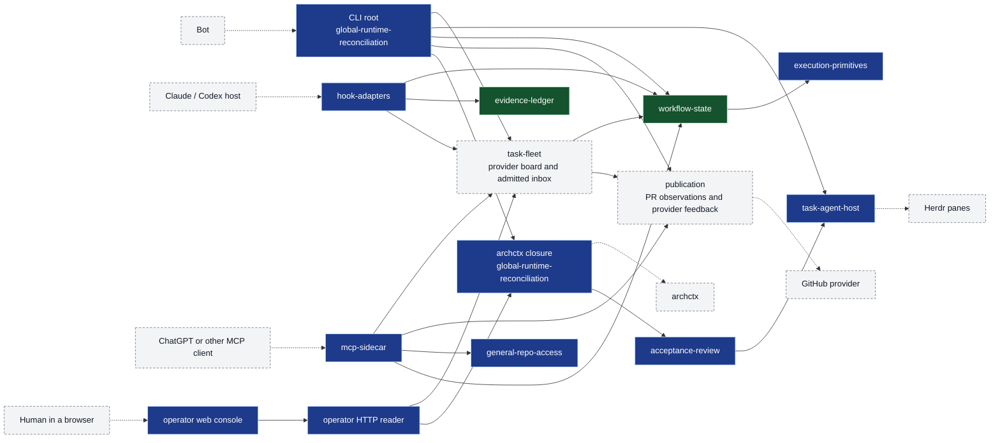

# Architecture Index

> Product-level architecture of repo-harness: boundary, domains, runtime paths,
> state authority, and links to every module page.

## Current Snapshot

- The architecture model lives in `.archcontext/model/`. The generated inventory
  below records model counts and proof status at its own projection revision.
- The full generated graph is in [diagrams/architecture.mmd](diagrams/architecture.mmd),
  [diagrams/architecture.likec4](diagrams/architecture.likec4) and
  [diagrams/architecture.structurizr.json](diagrams/architecture.structurizr.json).
  The generated entity and relation lists are at the end of this page.
- Cross-module contracts that are not capability pages:
  [Effective State Authority](effective-state-authority.md),
  [Shared Coordination Plane](shared-coordination-plane.md),
  [Global Hook Runtime](global-hook-runtime.md) and
  [Transactional Adoption Planner](transactional-adoption-planner.md).
- Current hand-written view: [functional architecture and runtime sequences](current-architecture.md).
- Archived review views, started at `d7e92f43d` and retaining later revisions through `2cee26d8`: [layered architecture and sequences](layered-architecture.md)
  and [process, namespace and mount topology](process-namespace-topology.md).

## System Boundary

`repo-harness` is a repo-local workflow harness CLI and skill with an optional
local MCP sidecar. It is not a hosted product runtime, agent gateway, or
database service. Its job is to inspect a target repository, install or refresh
a file-backed workflow contract, route public command skills, expose explicitly
configured local MCP capabilities, and verify that generated repo-local surfaces
remain consistent.

The product has two layers that share one set of files (`README.md`, "Two
Layers"):

- **Session contract.** One human, one agent session, one issue. A skill
  routes the work. The GitHub issue and PR own task identity, claim, status and
  dependency; the PR and CI carry change, verification and risk.
- **Bot-scheduled programs.** The Bot is the entry point for long-running work.
  It drives the repo-harness CLI and Herdr task agents. repo-harness supplies
  the tools and the evidence. The Bot decides what runs next.

Authoritative surfaces:

- Public router: `SKILL.md`, `README.md`, `AGENTS.md`, `CLAUDE.md`.
- Public command facades: `assets/skill-commands/*/SKILL.md` plus `assets/skill-commands/manifest.json`.
- Engine: `scripts/inspect-project-state.ts`, `src/effects/adoption/`, `src/effects/fs-transaction.ts`, `scripts/create-project-dirs.sh`, `scripts/lib/project-init-lib.sh`, and the [Transactional Adoption Planner](transactional-adoption-planner.md).
- Contract assets: `assets/workflow-contract.v1.json`, `.ai/harness/workflow-contract.json`, `.ai/harness/policy.json`, `.ai/context/context-map.json`, and the capability authority selected by `.ai/harness/policy.json#context.capability_source` (this repo: `.archcontext/model/nodes/*.yaml`).
- Runtime harness: the `repo-harness-hook` binary (`package.json` `bin`), the typed route registry `src/cli/hook/route-registry.ts`, user-level host adapters, and ignored `.ai/harness/*` runtime state. No shell operator library exists.
- MCP sidecar: `src/cli/mcp/`, `src/cli/commands/mcp.ts`, user-owned ignored config and registry under `~/.repo-harness/`, and the [MCP sidecar architecture](modules/runtime-harness/mcp-sidecar.md).
- Verification: `tests/`, `evals/`, `scripts/check-ci.sh`, `scripts/check-agent-tooling.sh`, `scripts/check-protected-paths.ts`, `scripts/ensure-codegraph.sh`.
- Effective State: `src/core/state/` projects worktree, capability ownership,
  risk and recovery pointers. `src/effects/state/` reads sources. Only `state resolve` publishes
  the shared `state_version`; hooks and MCP use the read-only resolver. `src/core/workflow/profile.ts` owns the risk profile.
  State carries no local task-file, contract, review, acceptance, checks or readiness
  projection. The CLI, SessionStart and MCP read the same projection.
  `tests/state/adapter-parity.test.ts` checks these readers.
- Provider board: `src/core/state/provider-board.ts` and
  `src/effects/state/collect-provider-board-inputs.ts` join canonical GitHub issue
  observations to exact admitted sessions. `core/sessions/` owns shared selector
  contracts; `effects/sessions/` observes their current admission and discovers
  bounded session lists. Operator HTTP consumes these shared observations.
- Shared admission and profiles: `src/effects/admission/` reads protected approval
  and current issue goals; `src/effects/github/` provides the common provider
  adapter and policy reader; `src/effects/profiles/profile-store.ts` resolves
  tracked engineer contracts. These services do not require review execution.
- Worktree safety: `src/core/state/coordination-identity.ts` keeps the task-id
  path shape that worktree safety uses. The active lease reader, Sprint board and
  task-history readers are removed. Worktree cleanup keeps its exact deletion
  guards. `src/effects/locking/task-lock.ts` keeps the shared physical task
  mutex. See [Provider Observations and Worktree Safety](shared-coordination-plane.md).
- Shared execution effects: `src/effects/process-runner.ts`,
  `src/effects/process-supervisor.ts`, `src/effects/process-group-launcher.ts`,
  `src/effects/locking/`, and `src/effects/git/` own bounded process lifecycle
  and canonical filesystem and Git primitives (capability
  [execution-primitives](modules/workflow-engine/execution-primitives.md)).

Out of scope:

- Product application scaffolds after their first generated skeleton.
- `_ref/` external reference checkouts and `_ops/` private operations state.
- Installing, upgrading, or enabling external host tools such as Waza, `geju`, or MCP servers. This self-host repo may vendor CodeGraph as a dev dependency, but generated downstream repos keep CodeGraph host setup explicit unless local policy opts in.
- Vendoring external skill bodies such as `mermaid`.
- Merging pull requests. The provider and the user perform the merge.

## Functional Domains

The [eight functional domains](current-architecture.md#functional-domains) group
responsibilities across implementation layers. They do not rename model nodes or
move directories. `cli`, `core`, `effects` and `scripts` are implementation layers.

## Model Domain Inventory

| Domain | Capabilities | Purpose | Page |
| --- | --- | --- | --- |
| public-surface | 4 | Routes user intent to CLI-backed command facades, adopts repositories, and collects strategy context. | [Public Surface](domains/public-surface.md) |
| workflow-engine | 4 | Owns the workflow contract and templates, inspects and migrates repositories, resolves Effective State and the coordination plane, and provides process, lock and Git primitives. | [Workflow Engine](domains/workflow-engine.md) |
| runtime-harness | 13 | Runs host hooks and the installed runtime, hosts task agents, records evidence and observations, serves the MCP sidecar, and retains historical Engineer readers. | [Runtime Harness](domains/runtime-harness.md) |
| organization | 2 | Projects provider fleet and PR readiness observations. Owns admitted Task Inbox and manual provider feedback. | [Organization](domains/organization.md) |
| runtime-mcp | 2 | Exposes bounded repository tools through MCP and runs the local ChatGPT browser consult. | [Runtime MCP](domains/runtime-mcp.md) |
| verification | 3 | Runs tests, gates and evals, records the acceptance receipt, and checks CodeGraph readiness. | [Verification](domains/verification.md) |

## Main Runtime Paths

The diagram is a dependency inventory, not a task scheduling sequence. Grey
nodes include retained historical readers. Current task decisions belong to
GitHub and the Human/Bot; see [current sequences](current-architecture.md#runtime-sequences).
The diagram shows the five main entry paths. Each solid edge between two
repo-harness nodes is a relation in the model. The table below gives the
relation id. Dashed edges go to external actors that the model does not
declare. The table gives their source evidence.



| Edge | Evidence |
| --- | --- |
| Bot -> CLI root | External. `README.md` "Two Layers": the Bot drives programs through the repo-harness CLI and Herdr. |
| CLI root -> task-fleet, task-agent-host, workflow-state, publication | `relation.global-runtime-reconciliation.cli-root.task-fleet`, `.task-agent-host`, `.workflow-state`, `.publication` (`buildProgram` registers the fleet, herdr, state and publication commands). |
| task-fleet -> workflow-state | `relation.task-fleet.primary.workflow-state`: read provider issue and admitted session board observations without dispatching tasks. |
| task-fleet -> publication | `relation.task-fleet.publication`: read explicit provider PR readiness and admitted provider feedback. |
| task-agent-host -> Herdr | External. The capability hosts persistent task agents in Herdr panes (capability summary). |
| publication -> GitHub provider | External. Current task/PR authority stays in GitHub. Publication observes provider PR readiness and keeps provider feedback operations; it has no publication receipt store reader or writer. |
| Host -> hook-adapters | External. User-level host hooks call the `repo-harness-hook` binary (`package.json` `bin`, [Global Hook Runtime](global-hook-runtime.md)). |
| hook-adapters -> workflow-state, evidence-ledger, task-fleet | `relation.hook-adapters.primary.workflow-state`, `relation.hook-adapters.session-lifecycle.evidence-ledger`, `relation.hook-adapters.session-lifecycle.task-fleet`. |
| MCP client -> mcp-sidecar | External. `README.md` "MCP Connector". |
| mcp-sidecar -> task-fleet, publication, general-repo-access, workflow-state | `relation.mcp-sidecar.primary.task-fleet`, `.publication`, `.general-repo-access`, `.workflow-state`. |
| Human -> operator web console | External. `README.md` "Local Human Control Board" (`repo-harness operator serve`). |
| operator web console -> HTTP reader | `relation.operator.web-console.http-reader`: GET and HEAD routes only. |
| operator HTTP reader -> task-fleet, archctx closure | `relation.operator.primary.task-fleet`, `relation.operator.http-reader.model-reader`. |
| CLI root -> archctx closure | `relation.global-runtime-reconciliation.cli-root.archctx-closure`: register the architecture-projection command. |
| archctx closure -> archctx | External. `src/effects/architecture/archctx-provider.ts` runs the package-local archctx binary. |
| archctx closure -> acceptance-review | `relation.global-runtime-reconciliation.archctx-closure.acceptance-review`: build the module review prompt from the committed model. |
| acceptance-review -> task-agent-host | `relation.acceptance-review.primary.task-agent-host`: run the persistent review session on a Herdr task agent. |
| workflow-state -> execution-primitives | `relation.workflow-state.coordination-plane.execution-primitives`: topology safety uses locks, Git and durable primitives. #945 moved the primitive and removed the former evidence-ledger relation; this does not restore lease writers. |

## Authority and State Map

Each datum has one authority. Every other representation is a projection.

| Datum | Authority (store) | Owner capability | Projections and readers |
| --- | --- | --- | --- |
| Workflow contract | `assets/workflow-contract.v1.json`; the repo opt-in marker `.ai/harness/workflow-contract.json` | contract-assets | Templates, helper copies and reference configs are byte projections. |
| Architecture model | `.archcontext/model/{nodes,relations,flows}/`, written through archctx ChangeSets | contract-assets (files); global-runtime-reconciliation runs the projection | Generated regions in `docs/architecture/**`. `repo-harness module` and the operator read the committed HEAD snapshot (`src/effects/architecture/model-reader.ts`). |
| Capability ownership | Policy-selected source: archcontext model or registry | contract-assets | Archcontext mode uses package-local `archctx resolve`; registry mode uses local longest-prefix matching. Components and parent chains participate in archcontext ownership. |
| Product intent | `docs/prds/` and the parent issue | repo-harness-product drafts; repo-harness-issue-flow splits work | The child issue body carries requirement, scope, boundaries, dependencies and acceptance. |
| Current task identity, claim, status and dependency | GitHub issue and PR | Human/Bot decisions | Issue comments carry claim, status, handoff and decisions. No local task file holds these facts; CI carries proof. |
| State content and published version | `state_revision` identifies resolved content; `state resolve` alone allocates shared `state_version` | workflow-state | Read-only hooks and MCP can return a version allocated for a different revision. |
| Historical coordination | Persisted Sprint rows, owner records and claim tokens | none | No reader parses Sprint rows, owner records or claim tokens. Retirement does not delete historical bytes. |
| Current execution admission | Protected approval under the OS account gates root, current provider goal and exact session/claim selection | acceptance-review; task-agent-host binds execution | `effects/admission/` and `effects/sessions/` reobserve authority. A board or native host attribution record cannot grant it. |
| Task mutex | `<git-common-dir>/repo-harness/coordination/v1/locks/tasks/<64hex>.lock` | execution-primitives | Inbox and feedback retain the same physical lock path through `effects/locking/task-lock.ts`. |
| Task messages | Admitted records below `<git-common-dir>/repo-harness/task-inbox/v2` | task-fleet | Exact admission SHA and claim reference/revision fence delivery. Session context renders messages as untrusted data; historical records remain separate. |
| Publication | Provider PR state on GitHub. Stored bytes under `<git-common-dir>/repo-harness/publications/v1` have no reader or writer. | publication | No code reads publication receipts. Current PR readiness observes canonical provider identity, expected head/base, checks and reviews, then reobserves identity. |
| Acceptance | `~/.repo-harness/gates/<sha256(worktree root realpath)>/acceptance.latest.json`, and immutable receipt records at `acceptance-receipts/<digest>.json` in the same directory | acceptance-review | Acceptance review validates exact subject and verification evidence; Effective State has no acceptance projection. Each later review replaces `acceptance.latest.json`. A record keeps one receipt's exact bytes under its digest. Dependency authority and product acceptance read the record by digest. |
| Harness evidence | `.ai/harness/evidence/events/log.jsonl` and `.ai/harness/evidence/blobs` | evidence-ledger | Handoff and resume recovery views. |
| Engineer contracts | Tracked `agents/engineers/**`. Stored bindings under `<git-common-dir>/repo-harness/engineers/v1` have no reader or writer. | engineer-bindings | Current scheduling joins explicitly selected profile revisions to admitted sessions. It does not infer engineers from actors or historical bindings. |
| Task agent sessions | Herdr panes; records under `.ai/harness/runs/task-agents` and task worktrees under `.ai/harness/runs/task-workspaces` | task-agent-host | Shared session discovery and current context revalidate exact bindings. Native host attribution grants no authority; runtime state does not set issue status. |
| Repository registry | `~/.repo-harness/registered-repos.json` | mcp-sidecar | Provider fleet and operator observations use its exact repository scope. |
| Global configuration | `~/.repo-harness/config.json` | global-runtime-reconciliation | Projection policy (`src/effects/architecture/projection-config.ts`). |
| Merge | The provider and the user | none | repo-harness never merges. |

Storage roots, sharing scope, locks and retention of these stores are in
[current topology](current-architecture.md#storage-and-process-topology). The
[old topology](process-namespace-topology.md#3-命名空间拓扑) is a historical snapshot.

## Capability Index

| Domain | Capability | Module page |
| --- | --- | --- |
| public-surface | Root Router | [root-router](modules/public-surface/root-router.md) |
| public-surface | Action Commands | [action-commands](modules/public-surface/action-commands.md) |
| public-surface | Adoption | [adoption](modules/public-surface/adoption.md) |
| public-surface | Strategy Reflection | [strategy-reflection](modules/public-surface/strategy-reflection.md) |
| workflow-engine | Inspection And Migration | [inspection-migration](modules/workflow-engine/inspection-migration.md) |
| workflow-engine | Contract Assets | [contract-assets](modules/workflow-engine/contract-assets.md) |
| workflow-engine | Workflow State | [workflow-state](modules/workflow-engine/workflow-state.md) |
| workflow-engine | Execution Primitives | [execution-primitives](modules/workflow-engine/execution-primitives.md) |
| runtime-harness | Hook Adapters | [hook-adapters](modules/runtime-harness/hook-adapters.md) |
| runtime-harness | Global Runtime Reconciliation | [global-runtime-reconciliation](modules/runtime-harness/global-runtime-reconciliation.md) |
| runtime-harness | MCP Sidecar | [mcp-sidecar](modules/runtime-harness/mcp-sidecar.md) |
| runtime-harness | Task Agent Host | [task-agent-host](modules/runtime-harness/task-agent-host.md) |
| runtime-harness | Agent Runtime Effects | [agent-runtime-effects](modules/runtime-harness/agent-runtime-effects.md) |
| runtime-harness | Evidence Ledger | [evidence-ledger](modules/runtime-harness/evidence-ledger.md) |
| runtime-harness | Operator Board | [operator](modules/runtime-harness/operator.md) |
| runtime-harness | Refactor Recommendations | [refactor-program](modules/runtime-harness/refactor-program.md) |
| runtime-harness | Engineer Bindings | [engineer-bindings](modules/runtime-harness/engineer-bindings.md) |
| runtime-harness | Engineer Scheduling | [engineer-scheduling](modules/runtime-harness/engineer-scheduling.md) |
| runtime-harness | Engineering Overlay | [engineering-overlay](modules/runtime-harness/engineering-overlay.md) |
| runtime-harness | External Source Intake | [external-source-intake](modules/runtime-harness/external-source-intake.md) |
| runtime-harness | Integration Product Acceptance | [integration-acceptance](modules/runtime-harness/integration-acceptance.md) |
| organization | Task Fleet | [task-fleet](modules/organization/task-fleet.md) |
| organization | PR Publication | [publication](modules/organization/publication.md) |
| runtime-mcp | General Repository Access | [general-repo-access](modules/runtime-mcp/general-repo-access.md) |
| runtime-mcp | ChatGPT Browser Consult | [chatgpt-browser](modules/runtime-mcp/chatgpt-browser.md) |
| verification | Evals And Checks | [evals-checks](modules/verification/evals-checks.md) |
| verification | Acceptance Review | [acceptance-review](modules/verification/acceptance-review.md) |
| verification | CodeGraph Readiness | [codegraph-readiness](modules/verification/codegraph-readiness.md) |

Reading rules:

- One capability has exactly one module page at `modules/<domain>/<capability>.md`.
- Fact priority: current source > model > documents. When a page conflicts with `src/`, `scripts/` or `assets/`, the source wins. Update model intent through a ChangeSet and human prose in the feature PR. The rolling writer publishes generated projections.
- The prefix authority is the capability source that `.ai/harness/policy.json#context.capability_source` selects. In this repository it is `.archcontext/model/nodes/*.yaml`.

## Umbrella Hierarchy

```text
Project
  -> architecture domain
     -> capability
        -> component
        -> capability contract block
```

- Architecture owns stable truth: boundaries, snapshots, and embedded Mermaid source.
- The capability authority selected by `.ai/harness/policy.json#context.capability_source` selects the ownership resolver: package-local `archctx resolve` for archcontext, local longest-prefix matching for registry.
- Component nodes split a capability by responsibility. Archcontext resolves component footprints and parent chains; its response identifies the owning capability.
- Local `AGENTS.md` / `CLAUDE.md` contract blocks own agent-facing context projection.
- GitHub issues and PRs own durable multi-session progress, deferred work and the current execution slice. `tasks/lessons.md` holds repeated lessons only.

## Architecture Update Flow

- Hooks do not record architecture drift. The pull request is the update unit.
- `scripts/capability-resolver.ts` routes to the policy-selected resolver. A provider failure is not permission to fall back to registry matching.
- When a change alters responsibilities, entrypoints, relations or flows, write the model change through an archctx ChangeSet and commit only the model and human prose. The rolling writer owns generated regions, diagram exports and the projection manifest. Do not run projection apply in a feature branch.
- Read architecture documents on demand. Update real boundaries explicitly.
- `scripts/workstream-sync.sh` keeps durable multi-session progress under `tasks/workstreams/<domain>/<capability>/` and projects only pointers into local contracts.
- Semantic diagrams live as Mermaid fenced blocks in the relevant architecture module or snapshot Markdown.
- Mermaid fenced blocks are the only architecture diagram artifacts; agents must not generate standalone HTML.
- `mermaid` is an external authoring/review skill (`~/.codex/skills/mermaid`), not a production dependency or vendored architecture body.

## Request Archive

- `docs/architecture/requests/archive/` keeps the historical cards of the retired request queue.
- No new request cards are created.

## 2026-07-16 Closeout Runner Guardrails

- P1: helper dispatch and authoritative benchmark production are separate
  consumers of one neutral lifecycle/locking effects layer. Workflow helper
  policy remains in `src/effects/runtime/helper-runner.ts`; benchmark semantics
  remain in `scripts/run-harness-profile-benchmark.ts`.
- P2: helper identity selects a fixed timeout envelope. A private launcher
  waits on an inherited start barrier while the supervisor publishes the PGID;
  only then may the target start. The supervisor normally performs `SIGTERM ->
  500ms -> SIGKILL` and publishes completion only after PGID absence; if the
  supervisor itself exceeds its hard envelope, the synchronous parent repeats
  that bounded cleanup against the published PGID. Expensive consumers contend on
  `<git-common-dir>/repo-harness/expensive-run.lock`. Linked worktrees therefore
  share one lane while repo-local state locking keeps its existing path.
- P3: the directory-token primitive was moved, not duplicated, so state and
  closeout locks retain the same fail-closed ancestor, exact-token, and stale
  owner rules. Portable process-group cleanup is guaranteed on POSIX; Windows
  uses best-effort `taskkill /T`, and direct raw Bash helper execution remains
  internal rather than a second supported lifecycle authority.

## 2026-09-12 root drift card resolved without an architecture change

- 漂移卡 `docs/architecture/requests/root.md`(high、workflow-surface、觸發檔
  `scripts/ensure-task-workflow.sh`、Detected 2026-09-12T13:35)歸檔為 Resolved。
- 該事件只是 helper 投影重寫:事件當下的 `scripts/ensure-task-workflow.sh` 與
  `origin/main` 的版本逐位元組相同,最後一次真實內容改動仍停在 `9563083c`。
  模組邊界、entrypoint、依賴規則、runtime path 與驗證命令都沒有動,所以不需要
  snapshot;卡片的 Contract Files 是 `none`,也沒有本地契約需要同步。

## Review Backlog

- Treat user-level `~/.codex/hooks.json` and `~/.claude/settings.json` as host adapters. The `repo-harness-hook` route registry is the hook implementation. Treat repo-local `.claude/settings.json` / `.codex/hooks.json` hook adapters as retired legacy config.
- Run `bun scripts/capability-resolver.ts validate --format text` when capability data changes. The workflow helper remains a read-only diagnostic.
- Path ownership under `capability_source: archcontext` comes from `archctx resolve` (`src/effects/architecture/archcontext-owners.ts`). Node includes and excludes can use any shape that ArchContext validation accepts.
- Several capability pairs have declared relations in both directions (for example contract-assets and global-runtime-reconciliation). The module backlogs record each pair with its edge counts.

<!-- BEGIN ARCHCONTEXT:generated target="projection_target.architecture.index" rendererVersion="archcontext.docs-renderer/v6" outputDigest="sha256:1c4bee2a4308a693d04f5c6b3ee0f6d75af80c27786b45a313eecff176030c5e" -->
# Architecture Index

## Entities

- [Publication Observations](modules/organization/publication.md) — capability / active
- [Task Fleet](modules/organization/task-fleet.md) — capability / active
- [Action Commands](modules/public-surface/action-commands.md) — capability / active
- [Adoption](modules/public-surface/adoption.md) — capability / active
- [Root Router](modules/public-surface/root-router.md) — capability / active
- [Strategy Reflection](modules/public-surface/strategy-reflection.md) — capability / active
- [Agent Runtime Effects](modules/runtime-harness/agent-runtime-effects.md) — capability / active
- [Engineer Bindings](modules/runtime-harness/engineer-bindings.md) — capability / active
- [Engineer Scheduling](modules/runtime-harness/engineer-scheduling.md) — capability / active
- [Engineering Overlay](modules/runtime-harness/engineering-overlay.md) — capability / active
- [Evidence Ledger](modules/runtime-harness/evidence-ledger.md) — capability / active
- [External Source Intake](modules/runtime-harness/external-source-intake.md) — capability / active
- [Global Runtime Reconciliation](modules/runtime-harness/global-runtime-reconciliation.md) — capability / active
- [Hook Adapters](modules/runtime-harness/hook-adapters.md) — capability / active
- [Integration Product Acceptance](modules/runtime-harness/integration-acceptance.md) — capability / active
- [MCP Sidecar](modules/runtime-harness/mcp-sidecar.md) — capability / active
- [Operator Board](modules/runtime-harness/operator.md) — capability / active
- [Refactor Recommendations](modules/runtime-harness/refactor-program.md) — capability / active
- [Task Agent Host](modules/runtime-harness/task-agent-host.md) — capability / active
- [ChatGPT Browser Consult](modules/runtime-mcp/chatgpt-browser.md) — capability / active
- [General Repository Access](modules/runtime-mcp/general-repo-access.md) — capability / active
- [Acceptance Review](modules/verification/acceptance-review.md) — capability / active
- [CodeGraph Readiness](modules/verification/codegraph-readiness.md) — capability / active
- [Evals And Checks](modules/verification/evals-checks.md) — capability / active
- [Contract Assets](modules/workflow-engine/contract-assets.md) — capability / active
- [Execution Primitives](modules/workflow-engine/execution-primitives.md) — capability / active
- [Inspection And Migration](modules/workflow-engine/inspection-migration.md) — capability / active
- [Workflow State](modules/workflow-engine/workflow-state.md) — capability / active

## Relations

- capability.verification.acceptance-review -> external.claude-code — calls
- capability.verification.acceptance-review -> external.codex — calls
- capability.verification.acceptance-review -> process.oar-review-host — deployed-on
- capability.verification.acceptance-review -> capability.runtime-harness.hook-adapters — calls
- capability.verification.acceptance-review -> capability.runtime-harness.mcp-sidecar — depends-on
- capability.verification.acceptance-review -> capability.runtime-harness.operator — depends-on
- capability.verification.acceptance-review -> component.acceptance-review.primary — calls
- component.acceptance-review.primary -> capability.runtime-harness.evidence-ledger — calls
- component.acceptance-review.primary -> capability.workflow-engine.execution-primitives — calls
- component.acceptance-review.primary -> capability.runtime-harness.task-agent-host — calls
- component.acceptance-review.primary -> capability.organization.task-fleet — calls
- component.acceptance-review.primary -> capability.workflow-engine.workflow-state — reads
- capability.public-surface.action-commands -> capability.workflow-engine.contract-assets — depends-on
- capability.public-surface.action-commands -> capability.verification.evals-checks — depends-on
- capability.public-surface.action-commands -> component.action-commands.primary — calls
- component.action-commands.primary -> component.action-commands.bundled-skills — depends-on
- capability.public-surface.action-commands -> component.action-commands.skill-surface-catalog — calls
- component.action-commands.skill-surface-catalog -> component.action-commands.primary — reads
- capability.public-surface.adoption -> capability.workflow-engine.execution-primitives — depends-on
- capability.public-surface.adoption -> capability.runtime-harness.global-runtime-reconciliation — depends-on
- capability.public-surface.adoption -> capability.runtime-harness.hook-adapters — depends-on
- capability.public-surface.adoption -> capability.runtime-harness.mcp-sidecar — depends-on
- capability.public-surface.adoption -> capability.workflow-engine.workflow-state — depends-on
- capability.public-surface.adoption -> component.adoption.primary — calls
- process.agent-host -> namespace.host.developer — runs-in
- process.agent-host -> process.hook — spawns
- process.agent-host -> process.mcp-server — spawns
- capability.runtime-harness.agent-runtime-effects -> capability.runtime-harness.engineer-bindings — calls
- capability.runtime-harness.agent-runtime-effects -> capability.runtime-harness.engineer-scheduling — calls
- capability.runtime-harness.agent-runtime-effects -> external.herdr — calls
- capability.runtime-harness.agent-runtime-effects -> component.agent-runtime-effects.journal — calls
- component.agent-runtime-effects.journal -> capability.workflow-engine.execution-primitives — calls
- capability.runtime-harness.agent-runtime-effects -> capability.runtime-harness.mcp-sidecar — calls
- capability.runtime-harness.agent-runtime-effects -> capability.runtime-harness.task-agent-host — calls
- capability.runtime-harness.agent-runtime-effects -> capability.organization.task-fleet — calls
- capability.runtime-mcp.chatgpt-browser -> external.chatgpt — calls
- capability.runtime-mcp.chatgpt-browser -> capability.runtime-harness.mcp-sidecar — depends-on
- capability.runtime-mcp.chatgpt-browser -> component.chatgpt-browser.primary — calls
- external.claude-code -> capability.runtime-harness.hook-adapters — calls
- component.global-runtime-reconciliation.cli-root -> process.cli — deployed-on
- process.cli -> namespace.host.developer — runs-in
- process.cli -> process.process-supervisor — spawns
- capability.verification.codegraph-readiness -> external.codegraph — calls
- capability.verification.codegraph-readiness -> capability.verification.evals-checks — depends-on
- capability.verification.codegraph-readiness -> capability.workflow-engine.execution-primitives — depends-on
- capability.verification.codegraph-readiness -> capability.runtime-harness.hook-adapters — depends-on
- capability.verification.codegraph-readiness -> component.codegraph-readiness.primary — calls
- external.codex -> capability.runtime-harness.hook-adapters — calls
- component.contract-assets.contract-worktree-lifecycle -> capability.verification.acceptance-review — calls
- component.contract-assets.contract-worktree-lifecycle -> component.global-runtime-reconciliation.archctx-closure — calls
- component.contract-assets.contract-worktree-lifecycle -> capability.workflow-engine.execution-primitives — calls
- component.contract-assets.contract-worktree-lifecycle -> capability.runtime-harness.task-agent-host — calls
- component.contract-assets.contract-worktree-lifecycle -> capability.workflow-engine.workflow-state — calls
- capability.workflow-engine.contract-assets -> capability.organization.publication — depends-on
- capability.workflow-engine.contract-assets -> component.contract-assets.planning-helpers — calls
- component.contract-assets.planning-helpers -> capability.verification.acceptance-review — calls
- component.contract-assets.planning-helpers -> capability.workflow-engine.execution-primitives — calls
- capability.workflow-engine.contract-assets -> component.contract-assets.primary — calls
- component.contract-assets.primary -> component.contract-assets.capability-registry — reads
- capability.workflow-engine.contract-assets -> component.contract-assets.template-projection — calls
- component.contract-assets.template-projection -> capability.public-surface.adoption — calls
- component.contract-assets.template-projection -> capability.verification.codegraph-readiness — calls
- component.contract-assets.template-projection -> capability.workflow-engine.execution-primitives — calls
- component.contract-assets.template-projection -> capability.runtime-harness.hook-adapters — calls
- component.contract-assets.template-projection -> capability.runtime-harness.operator — depends-on
- component.contract-assets.template-projection -> component.action-commands.skill-surface-catalog — calls
- capability.runtime-harness.engineer-bindings -> capability.workflow-engine.execution-primitives — calls
- capability.runtime-harness.engineer-bindings -> capability.workflow-engine.contract-assets — depends-on
- capability.runtime-harness.engineer-bindings -> capability.runtime-harness.evidence-ledger — depends-on
- capability.runtime-harness.engineer-bindings -> capability.runtime-harness.global-runtime-reconciliation — depends-on
- capability.runtime-harness.engineer-bindings -> component.engineer-bindings.primary — calls
- capability.runtime-harness.engineer-scheduling -> capability.verification.acceptance-review — calls
- capability.runtime-harness.engineer-scheduling -> capability.runtime-harness.engineer-bindings — calls
- capability.runtime-harness.engineer-scheduling -> capability.workflow-engine.execution-primitives — calls
- capability.runtime-harness.engineer-scheduling -> capability.runtime-harness.mcp-sidecar — depends-on
- capability.runtime-harness.engineer-scheduling -> capability.runtime-harness.integration-acceptance — reads
- capability.runtime-harness.engineer-scheduling -> component.engineer-scheduling.primary — calls
- capability.runtime-harness.engineer-scheduling -> capability.organization.publication — reads
- capability.runtime-harness.engineer-scheduling -> capability.workflow-engine.workflow-state — reads
- capability.runtime-harness.engineering-overlay -> capability.runtime-harness.agent-runtime-effects — calls
- capability.runtime-harness.engineering-overlay -> capability.runtime-harness.engineer-bindings — calls
- capability.runtime-harness.engineering-overlay -> capability.runtime-harness.engineer-scheduling — depends-on
- capability.runtime-harness.engineering-overlay -> capability.runtime-harness.mcp-sidecar — depends-on
- capability.runtime-harness.engineering-overlay -> capability.runtime-harness.engineering-overlay — calls
- capability.runtime-harness.engineering-overlay -> component.engineering-overlay.primary — calls
- component.evals-checks.ci-selection -> capability.workflow-engine.inspection-migration — calls
- component.evals-checks.ci-selection -> component.evals-checks.test-suite — calls
- component.evals-checks.ci-selection -> component.evals-checks.workflow-gates — calls
- component.evals-checks.evals-and-benchmarks -> capability.workflow-engine.execution-primitives — calls
- component.evals-checks.evals-and-benchmarks -> capability.runtime-harness.hook-adapters — reads
- capability.verification.evals-checks -> external.github — calls
- capability.verification.evals-checks -> capability.verification.acceptance-review — depends-on
- capability.verification.evals-checks -> capability.public-surface.action-commands — depends-on
- capability.verification.evals-checks -> capability.public-surface.adoption — depends-on
- capability.verification.evals-checks -> capability.runtime-harness.agent-runtime-effects — depends-on
- capability.verification.evals-checks -> capability.runtime-mcp.chatgpt-browser — depends-on
- capability.verification.evals-checks -> capability.verification.codegraph-readiness — depends-on
- capability.verification.evals-checks -> capability.runtime-harness.engineer-bindings — depends-on
- capability.verification.evals-checks -> capability.runtime-harness.engineer-scheduling — depends-on
- capability.verification.evals-checks -> capability.runtime-harness.engineering-overlay — depends-on
- capability.verification.evals-checks -> capability.runtime-harness.external-source-intake — depends-on
- capability.verification.evals-checks -> capability.runtime-harness.global-runtime-reconciliation — depends-on
- capability.verification.evals-checks -> capability.runtime-harness.integration-acceptance — depends-on
- capability.verification.evals-checks -> capability.runtime-harness.mcp-sidecar — depends-on
- capability.verification.evals-checks -> capability.runtime-harness.operator — depends-on
- capability.verification.evals-checks -> capability.organization.publication — depends-on
- capability.verification.evals-checks -> capability.runtime-harness.refactor-program — depends-on
- capability.verification.evals-checks -> capability.public-surface.root-router — depends-on
- capability.verification.evals-checks -> capability.public-surface.strategy-reflection — depends-on
- capability.verification.evals-checks -> capability.runtime-harness.task-agent-host — depends-on
- capability.verification.evals-checks -> capability.organization.task-fleet — depends-on
- capability.verification.evals-checks -> capability.workflow-engine.workflow-state — depends-on
- capability.verification.evals-checks -> component.evals-checks.primary — calls
- component.evals-checks.primary -> capability.workflow-engine.contract-assets — calls
- component.evals-checks.primary -> capability.runtime-harness.evidence-ledger — calls
- capability.runtime-harness.evidence-ledger -> capability.public-surface.adoption — calls
- capability.runtime-harness.evidence-ledger -> capability.runtime-harness.hook-adapters — depends-on
- capability.runtime-harness.evidence-ledger -> capability.workflow-engine.workflow-state — depends-on
- capability.runtime-harness.evidence-ledger -> component.evidence-ledger.primary — calls
- component.evidence-ledger.primary -> capability.workflow-engine.execution-primitives — calls
- capability.workflow-engine.execution-primitives -> process.process-supervisor — deployed-on
- capability.workflow-engine.execution-primitives -> external.git — calls
- capability.workflow-engine.execution-primitives -> component.execution-primitives.primary — calls
- capability.runtime-harness.external-source-intake -> capability.verification.acceptance-review — depends-on
- capability.runtime-harness.external-source-intake -> external.github — reads
- capability.runtime-harness.external-source-intake -> component.external-source-intake.immutable-evidence — calls
- component.external-source-intake.immutable-evidence -> capability.workflow-engine.execution-primitives — calls
- capability.runtime-harness.external-source-intake -> capability.runtime-harness.mcp-sidecar — calls
- capability.runtime-harness.external-source-intake -> capability.runtime-harness.task-agent-host — calls
- capability.runtime-harness.external-source-intake -> capability.organization.task-fleet — calls
- capability.runtime-mcp.general-repo-access -> component.general-repo-access.primary — calls
- component.general-repo-access.primary -> capability.verification.codegraph-readiness — calls
- component.general-repo-access.primary -> component.mcp-sidecar.repo-policy-registry — calls
- capability.runtime-harness.global-runtime-reconciliation -> external.archctx — calls
- component.global-runtime-reconciliation.archctx-closure -> capability.verification.acceptance-review — calls
- component.global-runtime-reconciliation.archctx-closure -> capability.runtime-harness.evidence-ledger — calls
- component.global-runtime-reconciliation.archctx-closure -> capability.workflow-engine.execution-primitives — calls
- component.global-runtime-reconciliation.archctx-closure -> capability.runtime-harness.hook-adapters — calls
- component.global-runtime-reconciliation.archctx-closure -> capability.runtime-harness.mcp-sidecar — calls
- component.global-runtime-reconciliation.archctx-closure -> capability.workflow-engine.workflow-state — reads
- component.global-runtime-reconciliation.cli-root -> capability.verification.acceptance-review — calls
- component.global-runtime-reconciliation.cli-root -> capability.public-surface.adoption — calls
- component.global-runtime-reconciliation.cli-root -> component.global-runtime-reconciliation.archctx-closure — calls
- component.global-runtime-reconciliation.cli-root -> capability.runtime-mcp.chatgpt-browser — calls
- component.global-runtime-reconciliation.cli-root -> capability.verification.codegraph-readiness — calls
- component.global-runtime-reconciliation.cli-root -> capability.workflow-engine.contract-assets — calls
- component.global-runtime-reconciliation.cli-root -> capability.runtime-harness.engineer-bindings — calls
- component.global-runtime-reconciliation.cli-root -> capability.runtime-harness.external-source-intake — calls
- component.global-runtime-reconciliation.cli-root -> capability.runtime-harness.hook-adapters — calls
- component.global-runtime-reconciliation.cli-root -> capability.runtime-harness.integration-acceptance — calls
- component.global-runtime-reconciliation.cli-root -> capability.runtime-harness.mcp-sidecar — calls
- component.global-runtime-reconciliation.cli-root -> capability.runtime-harness.operator — calls
- component.global-runtime-reconciliation.cli-root -> component.global-runtime-reconciliation.primary — calls
- component.global-runtime-reconciliation.cli-root -> capability.organization.publication — calls
- component.global-runtime-reconciliation.cli-root -> capability.runtime-harness.refactor-program — calls
- component.global-runtime-reconciliation.cli-root -> capability.public-surface.root-router — calls
- component.global-runtime-reconciliation.cli-root -> component.action-commands.skill-surface-catalog — calls
- component.global-runtime-reconciliation.cli-root -> capability.public-surface.strategy-reflection — calls
- component.global-runtime-reconciliation.cli-root -> capability.runtime-harness.task-agent-host — calls
- component.global-runtime-reconciliation.cli-root -> capability.organization.task-fleet — calls
- component.global-runtime-reconciliation.cli-root -> capability.workflow-engine.workflow-state — calls
- capability.runtime-harness.global-runtime-reconciliation -> capability.verification.evals-checks — depends-on
- capability.runtime-harness.global-runtime-reconciliation -> external.npm-registry — reads
- capability.runtime-harness.global-runtime-reconciliation -> component.global-runtime-reconciliation.primary — calls
- component.global-runtime-reconciliation.primary -> capability.public-surface.adoption — calls
- component.global-runtime-reconciliation.primary -> component.global-runtime-reconciliation.archctx-closure — calls
- component.global-runtime-reconciliation.primary -> capability.verification.codegraph-readiness — calls
- component.global-runtime-reconciliation.primary -> capability.workflow-engine.contract-assets — calls
- component.global-runtime-reconciliation.primary -> capability.workflow-engine.execution-primitives — calls
- component.global-runtime-reconciliation.primary -> capability.runtime-harness.hook-adapters — calls
- component.global-runtime-reconciliation.primary -> component.action-commands.skill-surface-catalog — calls
- component.global-runtime-reconciliation.primary -> capability.runtime-harness.task-agent-host — calls
- component.global-runtime-reconciliation.release-packaging -> component.global-runtime-reconciliation.cli-root — calls
- component.global-runtime-reconciliation.release-packaging -> capability.workflow-engine.execution-primitives — calls
- process.herdr-server -> namespace.host.developer — runs-in
- process.herdr-server -> process.oar-review-host — spawns
- capability.runtime-harness.hook-adapters -> process.hook — deployed-on
- component.hook-adapters.edit-guards -> capability.workflow-engine.execution-primitives — calls
- component.hook-adapters.edit-guards -> component.hook-adapters.primary — depends-on
- component.hook-adapters.edit-guards -> capability.workflow-engine.workflow-state — calls
- component.hook-adapters.host-installer -> capability.public-surface.adoption — calls
- component.hook-adapters.host-installer -> capability.workflow-engine.execution-primitives — calls
- component.hook-adapters.host-installer -> capability.runtime-harness.global-runtime-reconciliation — calls
- component.hook-adapters.host-installer -> external.pi — calls
- component.hook-adapters.host-installer -> component.hook-adapters.primary — calls
- component.hook-adapters.host-installer -> component.action-commands.skill-surface-catalog — calls
- capability.runtime-harness.hook-adapters -> capability.verification.acceptance-review — depends-on
- capability.runtime-harness.hook-adapters -> capability.runtime-harness.task-agent-host — depends-on
- capability.runtime-harness.hook-adapters -> component.hook-adapters.primary — calls
- component.hook-adapters.primary -> capability.workflow-engine.execution-primitives — calls
- component.hook-adapters.primary -> capability.workflow-engine.workflow-state — calls
- component.hook-adapters.primary -> component.hook-adapters.edit-guards — calls
- component.hook-adapters.primary -> capability.runtime-harness.global-runtime-reconciliation — calls
- component.hook-adapters.primary -> component.hook-adapters.session-lifecycle — calls
- component.hook-adapters.session-lifecycle -> capability.public-surface.adoption — calls
- component.hook-adapters.session-lifecycle -> capability.runtime-harness.evidence-ledger — calls
- component.hook-adapters.session-lifecycle -> capability.workflow-engine.execution-primitives — calls
- component.hook-adapters.session-lifecycle -> component.hook-adapters.primary — depends-on
- component.hook-adapters.session-lifecycle -> capability.organization.task-fleet — calls
- component.hook-adapters.session-lifecycle -> capability.workflow-engine.workflow-state — calls
- process.hook -> namespace.host.developer — runs-in
- process.hook -> process.process-supervisor — spawns
- capability.workflow-engine.inspection-migration -> component.inspection-migration.primary — calls
- component.inspection-migration.primary -> capability.workflow-engine.contract-assets — reads
- capability.runtime-harness.integration-acceptance -> component.integration-acceptance.primary — calls
- component.integration-acceptance.primary -> capability.verification.acceptance-review — calls
- component.integration-acceptance.primary -> capability.workflow-engine.execution-primitives — calls
- capability.runtime-harness.integration-acceptance -> capability.organization.publication — reads
- process.mcp-coding-shell -> namespace.host.developer — runs-in
- process.mcp-server -> namespace.host.developer — runs-in
- process.mcp-server -> process.mcp-coding-shell — spawns
- process.mcp-server -> process.process-supervisor — spawns
- capability.runtime-harness.mcp-sidecar -> capability.runtime-harness.agent-runtime-effects — calls
- component.mcp-sidecar.coding-profile -> capability.verification.codegraph-readiness — calls
- component.mcp-sidecar.coding-profile -> capability.workflow-engine.execution-primitives — calls
- component.mcp-sidecar.coding-profile -> component.mcp-sidecar.repo-policy-registry — calls
- component.mcp-sidecar.coding-profile -> capability.runtime-harness.task-agent-host — calls
- component.mcp-sidecar.coding-profile -> capability.workflow-engine.workflow-state — calls
- capability.runtime-harness.mcp-sidecar -> process.mcp-server — deployed-on
- component.mcp-sidecar.host-setup -> capability.runtime-mcp.chatgpt-browser — calls
- component.mcp-sidecar.host-setup -> component.mcp-sidecar.coding-profile — calls
- component.mcp-sidecar.host-setup -> capability.workflow-engine.execution-primitives — calls
- component.mcp-sidecar.host-setup -> capability.runtime-harness.hook-adapters — calls
- component.mcp-sidecar.host-setup -> component.mcp-sidecar.primary — calls
- component.mcp-sidecar.host-setup -> component.mcp-sidecar.repo-policy-registry — writes
- component.mcp-sidecar.host-setup -> component.mcp-sidecar.transport-auth — calls
- capability.runtime-harness.mcp-sidecar -> capability.workflow-engine.contract-assets — depends-on
- capability.runtime-harness.mcp-sidecar -> component.mcp-sidecar.primary — calls
- component.mcp-sidecar.primary -> capability.runtime-mcp.chatgpt-browser — calls
- component.mcp-sidecar.primary -> capability.verification.codegraph-readiness — calls
- component.mcp-sidecar.primary -> component.mcp-sidecar.coding-profile — calls
- component.mcp-sidecar.primary -> capability.workflow-engine.execution-primitives — calls
- component.mcp-sidecar.primary -> capability.runtime-mcp.general-repo-access — calls
- component.mcp-sidecar.primary -> capability.organization.publication — calls
- component.mcp-sidecar.primary -> component.mcp-sidecar.repo-policy-registry — calls
- component.mcp-sidecar.primary -> capability.runtime-harness.task-agent-host — calls
- component.mcp-sidecar.primary -> capability.organization.task-fleet — calls
- component.mcp-sidecar.primary -> capability.workflow-engine.workflow-state — reads
- component.mcp-sidecar.repo-policy-registry -> capability.workflow-engine.execution-primitives — calls
- component.mcp-sidecar.transport-auth -> component.mcp-sidecar.primary — calls
- component.mcp-sidecar.transport-auth -> component.mcp-sidecar.repo-policy-registry — reads
- process.oar-review-host -> namespace.host.developer — runs-in
- process.oar-review-host -> process.vendor-cli — spawns
- process.operator-collector -> namespace.host.developer — runs-in
- process.operator-server -> namespace.host.developer — runs-in
- process.operator-server -> process.operator-collector — spawns
- capability.runtime-harness.operator -> capability.verification.acceptance-review — depends-on
- component.operator.activity-feeds -> capability.runtime-harness.hook-adapters — reads
- component.operator.activity-feeds -> external.npm-registry — reads
- component.operator.activity-feeds -> component.operator.view-projections — calls
- component.operator.architecture-view -> capability.runtime-harness.global-runtime-reconciliation — reads
- component.operator.console-collectors -> component.operator.activity-feeds — reads
- component.operator.console-collectors -> external.archctx — reads
- component.operator.console-collectors -> external.git — reads
- component.operator.console-collectors -> external.github — reads
- component.operator.console-collectors -> external.herdr — reads
- component.operator.console-collectors -> component.operator.primary — calls
- component.operator.console-collectors -> capability.runtime-harness.mcp-sidecar — reads
- component.operator.console-collectors -> component.task-agent-host.primary — reads
- component.operator.console-collectors -> component.operator.view-projections — calls
- component.operator.console-collectors -> capability.workflow-engine.workflow-state — depends-on
- capability.runtime-harness.operator -> process.operator-server — deployed-on
- capability.runtime-harness.operator -> external.github — reads
- component.operator.primary -> component.operator.activity-feeds — calls
- component.operator.primary -> component.operator.console-collectors — calls
- component.operator.primary -> capability.runtime-harness.engineer-scheduling — reads
- component.operator.primary -> capability.runtime-harness.engineering-overlay — reads
- component.operator.primary -> capability.runtime-harness.global-runtime-reconciliation — reads
- component.operator.primary -> capability.runtime-harness.mcp-sidecar — reads
- component.operator.primary -> component.operator.view-projections — calls
- capability.runtime-harness.operator -> capability.public-surface.action-commands — depends-on
- capability.runtime-harness.operator -> capability.runtime-harness.engineer-bindings — depends-on
- capability.runtime-harness.operator -> capability.workflow-engine.execution-primitives — depends-on
- capability.runtime-harness.operator -> capability.organization.publication — depends-on
- capability.runtime-harness.operator -> capability.runtime-harness.task-agent-host — depends-on
- capability.runtime-harness.operator -> capability.workflow-engine.workflow-state — depends-on
- capability.runtime-harness.operator -> component.operator.primary — calls
- component.operator.primary -> component.acceptance-review.primary — reads
- component.operator.primary -> component.workflow-state.coordination-plane — calls
- component.operator.primary -> component.execution-primitives.primary — reads
- component.operator.primary -> capability.organization.task-fleet — reads
- component.operator.view-projections -> capability.verification.acceptance-review — depends-on
- component.operator.view-projections -> component.operator.architecture-view — depends-on
- component.operator.view-projections -> component.mcp-sidecar.repo-policy-registry — reads
- component.operator.view-projections -> capability.organization.task-fleet — reads
- component.operator.web-console -> component.operator.activity-feeds — calls
- component.operator.web-console -> component.operator.primary — calls
- component.operator.web-console -> component.operator.view-projections — calls
- external.pi -> capability.runtime-harness.hook-adapters — calls
- process.process-group-launcher -> namespace.host.developer — runs-in
- process.process-supervisor -> namespace.host.developer — runs-in
- process.process-supervisor -> process.process-group-launcher — spawns
- capability.organization.publication -> capability.workflow-engine.contract-assets — calls
- capability.organization.publication -> external.github — calls
- capability.organization.publication -> capability.verification.acceptance-review — depends-on
- capability.organization.publication -> component.publication.primary — calls
- component.publication.primary -> capability.workflow-engine.execution-primitives — calls
- component.publication.provider-feedback -> capability.workflow-engine.execution-primitives — calls
- component.publication.provider-feedback -> component.publication.primary — calls
- component.publication.provider-feedback -> capability.runtime-harness.task-agent-host — calls
- component.publication.provider-feedback -> capability.organization.task-fleet — calls
- capability.runtime-harness.refactor-program -> component.refactor-program.archctx-provider — calls
- component.refactor-program.archctx-provider -> capability.runtime-harness.evidence-ledger — calls
- component.refactor-program.archctx-provider -> capability.runtime-harness.global-runtime-reconciliation — calls
- capability.runtime-harness.refactor-program -> capability.runtime-harness.mcp-sidecar — calls
- capability.public-surface.root-router -> component.root-router.primary — calls
- capability.public-surface.strategy-reflection -> component.strategy-reflection.primary — calls
- component.strategy-reflection.primary -> component.action-commands.skill-surface-catalog — calls
- component.strategy-reflection.primary -> capability.workflow-engine.workflow-state — reads
- capability.runtime-harness.task-agent-host -> capability.runtime-harness.evidence-ledger — calls
- capability.runtime-harness.task-agent-host -> external.herdr — calls
- capability.runtime-harness.task-agent-host -> capability.runtime-harness.hook-adapters — depends-on
- capability.runtime-harness.task-agent-host -> component.task-agent-host.primary — calls
- component.task-agent-host.primary -> capability.workflow-engine.execution-primitives — calls
- component.task-agent-host.primary -> component.mcp-sidecar.repo-policy-registry — reads
- capability.organization.task-fleet -> capability.runtime-harness.agent-runtime-effects — calls
- capability.organization.task-fleet -> capability.runtime-harness.engineer-bindings — calls
- capability.organization.task-fleet -> capability.runtime-harness.evidence-ledger — calls
- capability.organization.task-fleet -> component.task-fleet.primary — calls
- component.task-fleet.primary -> component.task-fleet.task-inbox — calls
- component.task-fleet.primary -> capability.workflow-engine.workflow-state — reads
- capability.organization.task-fleet -> capability.organization.publication — calls
- capability.organization.task-fleet -> component.mcp-sidecar.repo-policy-registry — reads
- component.task-fleet.task-inbox -> capability.workflow-engine.execution-primitives — calls
- component.task-fleet.task-inbox -> capability.runtime-harness.task-agent-host — calls
- process.vendor-cli -> namespace.host.developer — runs-in
- component.workflow-state.continuation-ledger -> capability.workflow-engine.execution-primitives — calls
- component.workflow-state.continuation-ledger -> component.workflow-state.primary — calls
- capability.workflow-engine.workflow-state -> component.workflow-state.coordination-plane — calls
- component.workflow-state.coordination-plane -> component.workflow-state.continuation-ledger — calls
- component.workflow-state.coordination-plane -> capability.workflow-engine.execution-primitives — calls
- component.workflow-state.coordination-plane -> capability.runtime-harness.external-source-intake — calls
- component.workflow-state.coordination-plane -> component.workflow-state.primary — calls
- component.workflow-state.coordination-plane -> capability.runtime-harness.task-agent-host — reads
- capability.workflow-engine.workflow-state -> capability.verification.acceptance-review — depends-on
- capability.workflow-engine.workflow-state -> capability.runtime-harness.global-runtime-reconciliation — depends-on
- capability.workflow-engine.workflow-state -> component.workflow-state.primary — calls
- component.workflow-state.primary -> capability.workflow-engine.contract-assets — calls
- component.workflow-state.primary -> capability.workflow-engine.execution-primitives — calls

## Projections

- [Mermaid](diagrams/architecture.mmd)
- [Structurizr JSON](diagrams/architecture.structurizr.json)
- [LikeC4](diagrams/architecture.likec4)
- [Runtime topology Mermaid](diagrams/runtime-topology.mmd)
- [Runtime topology](runtime-topology.md)
- [Decision index](decisions/index.md)
- [Architecture changelog](changelog.md)
<!-- END ARCHCONTEXT:generated target="projection_target.architecture.index" -->
