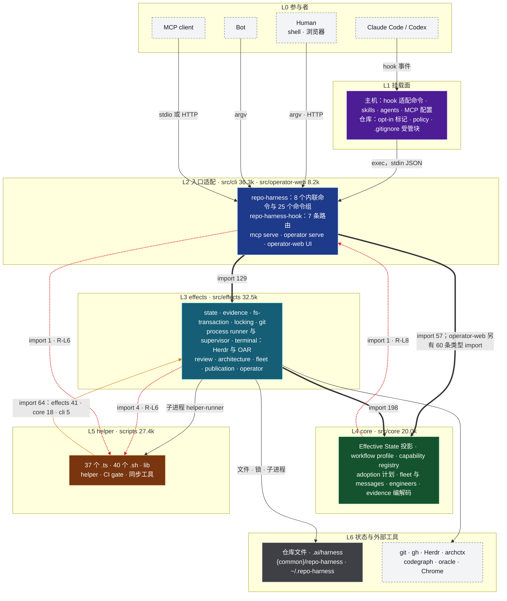
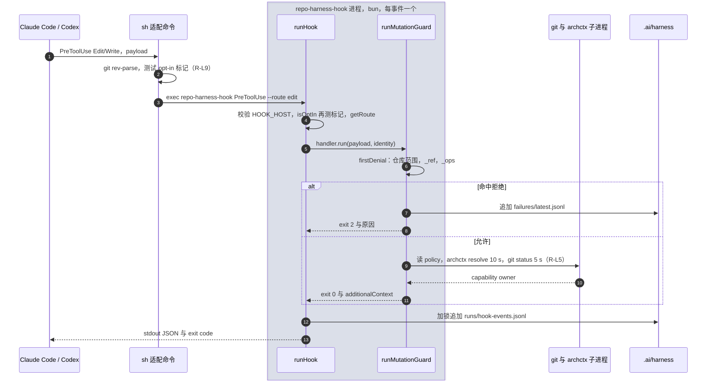
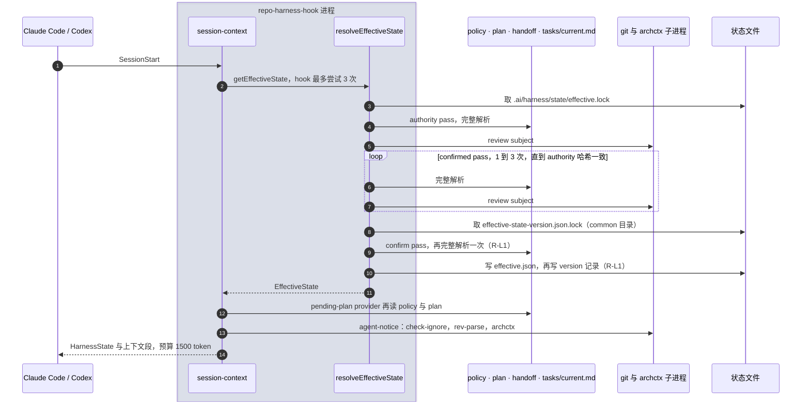
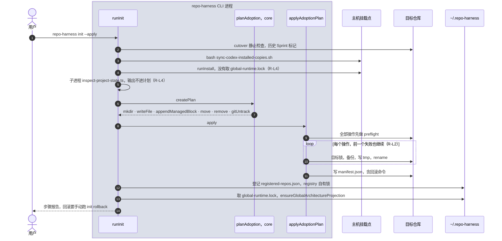
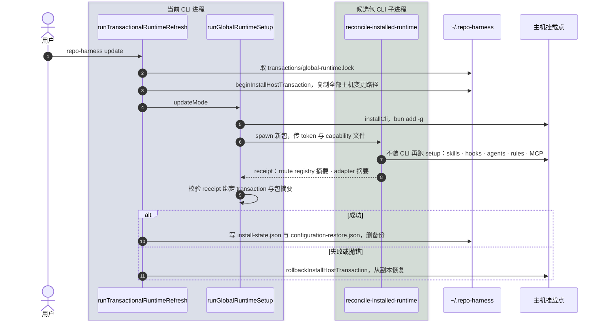
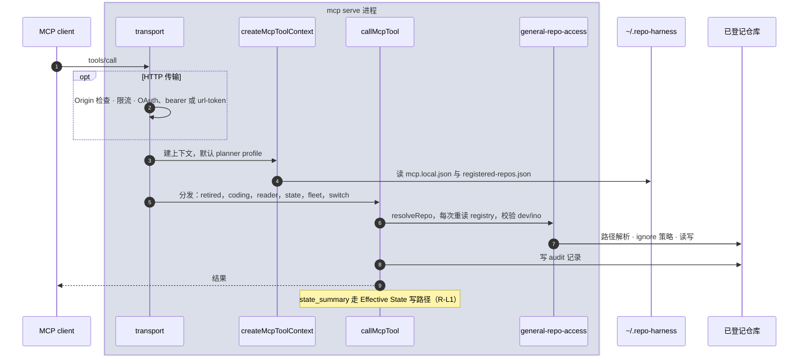
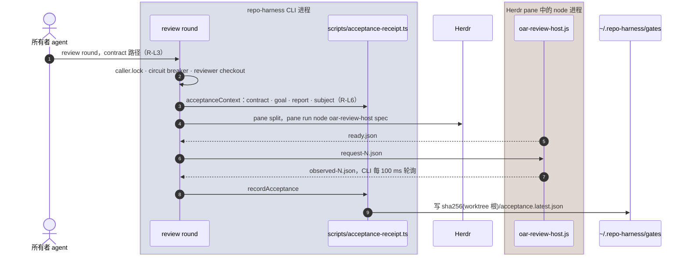
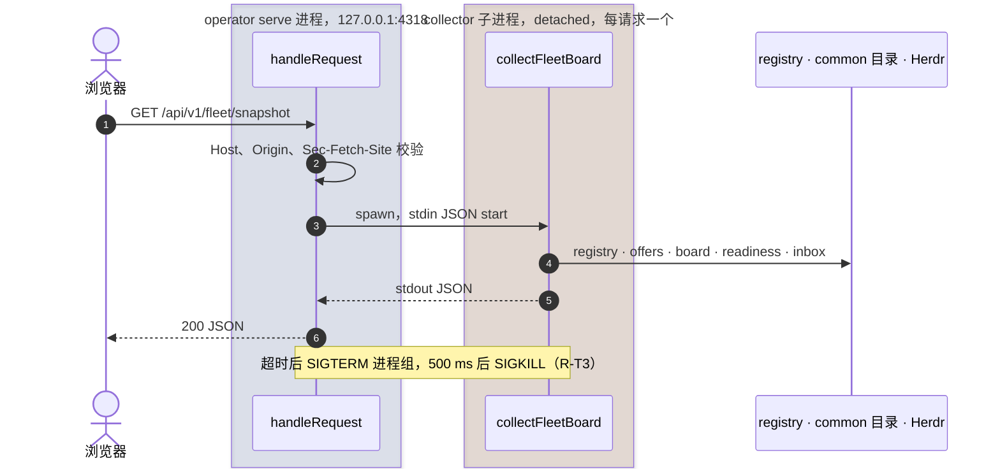

# 总分层架构与时序

> **历史归档**：初始审查基线为 `d7e92f43d`；本页保留截至 `2cee26d888af9dd34ed52982e13df0c16db00681` 的后续修订，不是单一提交的快照。
> 当前规范见 [功能架构、时序与拓扑](current-architecture.md)。
> #901/#902/#904 的只读状态、失败停止回滚、init 分离，以及 #947 的恢复修复已经合入当前基线。
> 保留历史内容用于追踪审查；历史读者的退出决定继续引用 #917，不据此删除或恢复。

> **来源**：初稿见 #900；后续段落和引用可能采用较新源码。各项来源见[截至归档基线的文件历史](https://github.com/Ancienttwo/repo-harness/commits/2cee26d888af9dd34ed52982e13df0c16db00681/docs/architecture/layered-architecture.md)，不能把全页行号统一套用到 `d7e92f43d`。
> 后续修订包括 #945 的层内依赖整理；各段落的行号保留其修订时的来源。
> **事实优先级**：源码 > `.archcontext/model/` > 本文。本文是手写视图，archctx 不投影它。
> **配套**：[进程与命名空间拓扑 + 挂载层](process-namespace-topology.md) · [Architecture Index](index.md) · 各 capability 页的 Optimization Backlog。
> **用途**：精简重构的定位图。`R-Lx` 指向本文 [Remarks](#remarks)，`R-Tx` 指向[拓扑文档的 Remarks](process-namespace-topology.md#remarks)。

## 1. 分层总图

依赖方向是 L2 → L3 → L4，core 不导入其他层。scripts（L5）在主干旁边：effects 用子进程运行它，它又直接导入 `src`。粗线上的数字是 import 边数，红色虚线是违反方向的边，橙线是没有规则约束的边。

| 层 | 目录与规模（LOC） | 职责 |
| --- | --- | --- |
| L1 挂载面 | `assets/`、`agents/`、hook 适配命令、`.ai/harness/workflow-contract.json` | 把包投影到主机和目标仓库。细节见[拓扑文档 §4](process-namespace-topology.md#4-挂载层)。 |
| L2 入口适配 | `src/cli` 36.3k：`mcp` 13.0k、`commands` 11.1k、`installer` 3.5k、`chatgpt-browser` 3.2k、`hook` 2.9k；`src/operator-web` 8.2k | 解析 argv、hook payload、MCP 请求和 HTTP 请求，再调用 effects 与 core。operator server 的代码在 `src/effects/operator/server.ts`，按入口职责归到本层。 |
| L3 effects | `src/effects` 32.5k：`state` 4.3k、`operator` 3.8k、`evidence` 3.6k、`engineers` 2.5k、`publication` 2.4k、`fleet` 2.4k、`terminal` 1.9k、`review` 1.6k | 全部 I/O：文件、锁、Git、子进程、Herdr、archctx。 |
| L4 core | `src/core` 20.0k，101 个文件 | 纯解码、计划和投影。只有 `upgrade/legacy-inventory.ts` 读文件系统。 |
| L5 helper | `scripts/` 27.4k：37 个 `.ts` 13.7k、40 个 `.sh` 10.7k、`lib/` 3.0k | `repo-harness run` 执行的 helper、CI gate、同步工具。 |
| L6 状态与外部工具 | 4 个存储根；git、gh、Herdr、archctx、codegraph、oracle | 存储根的共享范围见[拓扑文档 §3](process-namespace-topology.md#3-命名空间拓扑)。 |

## 2. 依赖方向（实测）

统计口径：`.ts`、`.tsx`、`.mjs`、`.js` 文件里相对路径的 `from`、`import(` 和 `import` 说明符。包导入不计。

| 方向 | 边数 | 判定 | 例子 |
| --- | --- | --- | --- |
| cli → effects | 129 | 允许 | `src/cli/index.ts:72` → `effects/runtime/protected-helper-platform` |
| cli → core | 57 | 允许 | `src/cli/mcp/state-tools.ts:1` → `core/state/types` |
| effects → core | 198 | 允许 | `src/effects/fs-transaction.ts:27` → `core/adoption/operations` |
| operator-web → core | 60 | 允许，只有类型 | `src/operator-web/App.tsx:18` → `core/setup/types` |
| core → effects，effects → cli | 0 | 禁止，已满足 | — |
| core → cli | 1 | 违规，R-L8 | `src/core/upgrade/legacy-inventory.ts:4` → `cli/installer/install-profile` |
| effects → scripts | 4 | 违规，R-L6 | `src/effects/review/generic-review.ts:21` → `scripts/acceptance-receipt` |
| cli → scripts | 1 | 违规，R-L6 | `src/cli/commands/capability-context.ts:13` → `scripts/capability-resolver` |
| scripts → effects / core / cli | 41 / 18 / 5 | 没有规则，R-L6 | `scripts/merge-gate.ts:9` → `effects/publication/merge-readiness` |

检查覆盖：

- `scripts/check-state-boundaries.ts` 只对 `CORE_ROOTS` 检查禁用 import、子进程调用和 core 反向 import。`CORE_ROOTS` 只有 `src/core/state`、`src/core/workflow`、`src/core/capabilities`（`:36-40`）。
- 同一脚本禁止整个 `src/effects` 导入 `src/cli`（`:372-385`），并检查约 45 个 canonical symbol 的定义位置（`:47-103`）。
- 没有检查的部分：其余约 22 个 core 子目录、`src` 与 `scripts` 之间的边、目录级环、`src/operator-web` 的隔离。仓库没有 eslint、dependency-cruiser 或 knip 配置。

## 3. 时序图

`box` 框是一个 OS 进程。每张图只画主路径和改变结果的分支。

### 3.1 Hook 热路径：PreToolUse edit

宿主每次 Edit/Write 都起一个 hook 进程。允许分支为了输出 `[CapabilityOwner]` 行，还要起 `git status`（5 s 超时）。archcontext 模式下再跑 archctx 和 node 版本探测，二者都以 `processGroup: true` 运行（`archctx-provider.ts:57,128`），每次调用是 supervisor → launcher → 目标 3 个进程。

### 3.2 SessionStart：Effective State 写路径

一次 `resolveEffectiveState` 在正常情况下跑 3 遍完整解析，每遍都读全部来源，并起 git 计算 review subject。SubagentStart、MCP `state_summary` 和 `state resolve` 走同一条路径。

### 3.3 仓库采用：`repo-harness init --apply`

`init` 先改主机，再做仓库侧 adoption。主机侧步骤与 `install` 重复，并且不在主机事务锁内。

### 3.4 全局运行时刷新：`repo-harness update`

`update` 在一个主机事务里安装新包，再让新包的 CLI 子进程完成投影。父进程只在 receipt 绑定一致时提交。

### 3.5 MCP 工具调用

stdio 传输由 client 拉起进程，没有认证步骤。HTTP 默认只监听 `127.0.0.1:8765`，绑定非回环地址需要 `REPO_HARNESS_MCP_PUBLIC_ORIGIN`。

### 3.6 验收评审：`repo-harness review round`

评审在独立 reviewer checkout 和 Herdr pane 中运行。CLI 进程通过会话目录里的文件与 pane 中的 node 进程握手。

### 3.7 Operator board

服务只接受 `127.0.0.1` 与 `::1`，只有 GET 与 HEAD 路由。fleet 快照和任务读取在一次性子进程中运行，仓库快照在 worker 线程中运行。

## Remarks

按级别排序。`高`：影响正确性或热路径成本。`中`：重复实现或无用负担。`低`：命名与清理。已经记在 capability Optimization Backlog 的条目只给链接。

| ID | 级别 | 问题 | 证据 | 精简方向 |
| --- | --- | --- | --- | --- |
| R-L1 [#901](https://github.com/Ancienttwo/repo-harness/issues/901) | 高 | SessionStart、SubagentStart 和 MCP `state_summary` 只需要读取，却和 `state resolve` 一样走写路径 `resolveEffectiveState`。一次调用正常跑 3 遍完整解析（authority、confirmed、confirm 窗口），最多 10 遍。hook 外层再重试最多 3 次，最坏 30 遍，每遍都起 git。写出的 `.ai/harness/state/effective.json` 在 `src/` 和 `scripts/` 中没有读者。 | `src/effects/state/resolve-effective-state.ts:874-883,910-958,980-995`；`src/cli/hook/runtime.ts:95-112`；`src/effects/state/state-cache.ts:6,64`；`src/cli/mcp/state-tools.ts:131` | 只读调用方改用已有的 `resolveEffectiveStateReadOnly`（`:961`）。删除 cache，或给它一个读者。`state_version` 只保留一个发布入口。 |
| R-L2 [#902](https://github.com/Ancienttwo/repo-harness/issues/902) | 高 | `applyAdoptionPlan` 不是原子事务。preflight 之后用 `map` 执行全部操作，一个操作失败后，后面的操作照常执行，也不自动回滚。目标锁 `<target>.repo-harness.lock` 用 `O_EXCL` 创建，没有过期回收，写入方崩溃后该目标一直处于锁定状态。 | `src/effects/fs-transaction.ts:661-688`（执行）、`:226-236`（目标锁）、`:917`（手动回滚） | 第一个失败即停止，并按 manifest 自动回滚。目标锁改用带过期回收的 `exclusive-directory-lock`。 |
| R-L3 [#903](https://github.com/Ancienttwo/repo-harness/issues/903) | 中 | #834 让 state snapshot 不再读 task contract。`review round` 仍只接受 `tasks/contracts/*.contract.md` 作评审键。Stop 恢复仍从 `tasks/contracts` 推导 contract，并读 `.ai/harness/sprint/active-sprint`。同一个 contract 文件在一处已退役，在另两处是必需输入。 | `src/effects/review/generic-review.ts:163-170`；`src/effects/evidence/recovery-materializer.ts:179,188-200` | 先决定评审主体的键（goal、plan 或 diff subject），再删除 Stop 恢复里的 contract 与 Sprint 推导。命名空间侧见 R-T7。 |
| R-L4 [#904](https://github.com/Ancienttwo/repo-harness/issues/904) | 中 | `init --apply` 重复 `install` 的主机步骤，保证更弱。它直接跑 `sync-codex-installed-copies.sh`，在主机事务锁之外调用 `runInstall`。它起 `inspect-project-state.ts` 子进程，输出不进入 adoption 计划。`syncBundledItemsAtHome` 的 agent 复制循环只收到空数组。 | `src/cli/commands/init.ts:567,578,612-616`；`init.ts:412-432,447`；`install` 持锁见 `src/cli/index.ts:581-586` | `init` 只做仓库侧 adoption 和 registry 登记，主机侧变更交给 `install` 的持锁事务。删除没有用到的 inspect 子进程和 agent 循环。 |
| R-L5 [#905](https://github.com/Ancienttwo/repo-harness/issues/905) | 中 | 每次被允许的 Edit/Write 都为 owner 行解析 policy、起 `git status`，archcontext 模式下还起 node 探测与 archctx 两组受监督进程。archctx memo 只在进程内有效，hook 又是每事件一个进程。Stop 与 Codex UserPromptSubmit 各自重建 capability ownership，不经过事件内的 collector。 | `src/cli/hook/mutation-guard.ts:131-161`；`src/effects/architecture/archctx-provider.ts:48-58,116-135`；`src/cli/hook/handler-registry.ts:79`；`src/cli/hook/stop-handler.ts:95` | owner 解析结果按模型摘要和 HEAD 缓存到文件，或只在 SessionStart 输出一次。 |
| R-L6 [#906](https://github.com/Ancienttwo/repo-harness/issues/906) | 中 | `scripts/` 实际是一个库层。它导入 effects 41 次、core 18 次、cli 5 次。`src` 有 5 条边反向导入它，形成 3 个跨层环，都经过 `scripts/acceptance-receipt.ts` 或 `scripts/capability-resolver.ts`。 | `src/effects/review/generic-review.ts:21`、`src/effects/publication/publication-receipt.ts:6`、`src/effects/integration/product-acceptance.ts:56`、`src/cli/commands/capability-context.ts:13` → scripts；`scripts/merge-gate.ts:9` → effects | 把 acceptance receipt 和 capability resolver 的库代码移进 `src/effects/review` 与 `src/core/capabilities`，`scripts/` 只留 CLI 外壳。然后在 `check-state-boundaries.ts` 中禁止 `src → scripts`。 |
| R-L7 [#907](https://github.com/Ancienttwo/repo-harness/issues/907) | 已解决（保留 2 对 allowlist） | 叶子原语已移入 execution-primitives，其余共享类型与调用方已归位。层内目录互相导入由 checker 持续检查。 | `scripts/check-state-boundaries.ts` 的 `INTRA_LAYER_CYCLE_ALLOWANCES` 仅保留 `src/cli/chatgpt-browser ↔ src/cli/mcp` 与 `src/effects/engineers ↔ src/effects/fleet`。 | checker 拒绝未列入 allowlist 的目录环及已失效的 allowlist 条目；两对保留项的原因在常量中记录。 |
| R-L8 [#908](https://github.com/Ancienttwo/repo-harness/issues/908) | 低 | core 只有一个文件不纯：`legacy-inventory.ts` 导入 `fs`，还导入 `cli/installer/install-profile`。边界检查只覆盖 core 约 25 个子目录中的 3 个，所以没有报出它。 | `src/core/upgrade/legacy-inventory.ts:2,4`；`scripts/check-state-boundaries.ts:36-40` | 把 I/O 部分移到 effects，然后把 `CORE_ROOTS` 扩到整个 `src/core`。 |
| R-L9 [#909](https://github.com/Ancienttwo/repo-harness/issues/909) | 低 | hook 词表有漂移。`HookEvent` 含没有路由的 `PostToolUse` 与 `SubagentStop`，`SETUP_HOOK_EVENTS` 与 `WORKFLOW_MARKER_GATE_EVENTS` 也保留它们。minimal profile 的路由集是字符串表，不是 `Route` 的字段。opt-in 标记在 sh 命令、`isOptIn`、`inspectWorkflowMarker` 中各查一次。一处注释引用不存在的 `resolveStopEffectiveState`。 | `src/cli/hook/route-registry.ts:20-27`；`src/core/setup/types.ts:111`；`src/core/adoption/minimum-harness-version.ts:29`；`src/cli/installer/managed-entries.ts:75-77`；`src/cli/hook/runtime.ts:156`；`src/effects/state/resolve-continuation-envelope.ts:13` | 删除无路由事件。profile 归属写进 `Route`。opt-in 判定只留一处。 |
| R-L10 [#910](https://github.com/Ancienttwo/repo-harness/issues/910) | 低 | 没有引用或只有测试引用的模块。`src/effects/state/write-journal.ts`（101 行）没有任何引用。只被测试导入：`src/core/messages/document-handoff.ts`（281 行）、`src/effects/operator/docs-graph.ts`（158 行，与 `src/core/docs/docs-graph.ts` 同名）、`src/effects/strategy/wake.ts`、`src/effects/evidence/attested-import.ts`（331 行）、`scripts/run-skill-routing-eval.ts`（1,603 行）。 | 在 `src`、`scripts`、`tests`、`assets`、`package.json`、`.github` 中检索 import 和文本引用 | 逐个确认后删除，或接入真实调用方。`coding-session.ts` 见 R-T1。 |
