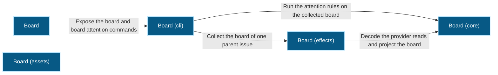
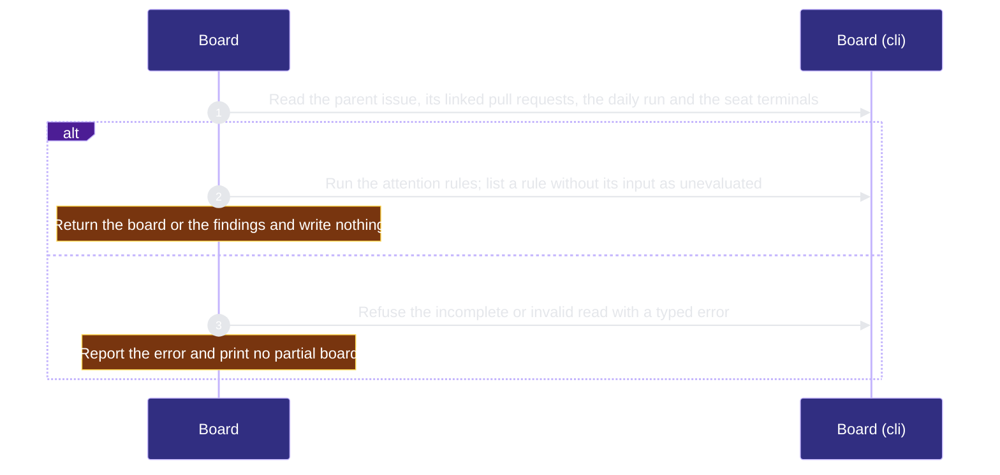

# organization/board 架構文檔

<!-- BEGIN ARCHCONTEXT:generated target="projection_target.entity.capability-organization-board" rendererVersion="archcontext.docs-renderer/v6" outputDigest="sha256:e7fde67faf2cf8555629a7a2ef2f320b4f0ae6f12fae30770a327bea5cc67855" -->
> **狀態**:`active`
> **Capability ID**:`capability.organization.board`(kind `capability`)
> **Matched Prefixes**:`src/core/board/**`、`src/effects/board/**`、`src/cli/commands/board.ts`
> **Local Contracts**:`AGENTS.md`、`CLAUDE.md`
> **事實優先級**:倉庫當前狀態 > 本文檔機器區 > 本文檔人工區。機器區(引言、§1、§2)由 ArchContext 從架構模型與源碼度量投影生成,手改會在下次投影被覆蓋。本文檔不記錄出處;本次投影所驗證的 commit 見 `docs/architecture/.projection-manifest.json`。

Projects the board of one parent issue from GitHub plan data, linked pull requests and hc seat terminals, and runs the attention rules on it.

## 1. P1:能力架構地圖

### 1.1 架構圖

- Proof: `proven` (`sha256:f2b20e0404ab5359f53c49b7bb0f5d412c753dc8d1cda3deb2cbcaa0e2d1a5b3`).
- Semantic nodes: `5`; declared relations: `4`.

### 1.2 模組職責表

| 宣告入口 | 錨點 | 職責 |
| --- | --- | --- |
| `entrypoint.board.command` | `src/cli/commands/board.ts#buildBoardCommand` | `sink.board.collect` → `src/effects/board/collect.ts#collectBoard`、`sink.board.attention` → `src/core/board/attention.ts#evaluateBoardAttention` |

組件入口:

- 組件均未宣告 `source.entrypoints`。

### 1.3 規模信號

- 規模量級:`10–20` 個文件 / `2000–5000` 行
- 匹配前綴:`src/core/board/**`、`src/effects/board/**`、`src/cli/commands/board.ts`
- 推導:掃描 `source.include` 減 `source.exclude`,跳過 `.git/` 與 `node_modules/`,再按 1–2–5 階梯分桶。精確計數不入本文檔:量級足以回答「這個能力有多大」,而逐行計數會讓覆蓋範圍內任何一次源碼改動都改寫本文檔。

### 1.4 依賴邊界

出向關係:

- `calls` → `component.board.cli` — Expose the board and board attention commands
- `depends-on` → `capability.verification.evals-checks` — Match open CI repair issues by the marker that the CI report writes
- `depends-on` → `capability.organization.publication` — Parse closing references and reuse the single-PR merge readiness projection

入向關係:

- `depends-on` ← `capability.workflow-engine.contract-assets` — Render the change hazard table in agentic-development-flow.md from the board hazard list reader.
- `depends-on` ← `capability.verification.evals-checks` — Test Board behavior through its source modules
- `depends-on` ← `component.execution-primitives.hc-client` — Implement the board host port (seat terminals by parent label and the hc version) and the attention host port (start watcher terminals with hc run, read watcher terminals, and send to and wait on seat terminals)
- `calls` ← `component.global-runtime-reconciliation.cli-root` — Register the board command
- `depends-on` ← `capability.runtime-harness.operator` — Serve and show the board of one parent issue: decode the board CLI output and evaluate the attention rules in the browser.

組件出向關係:

- `component.board.assets-layer`:
  - 無。
- `component.board.cli`:
  - `calls` → `component.board.core` — Run the attention rules on the collected board
  - `calls` → `component.board.effects` — Collect the board of one parent issue
- `component.board.core`:
  - 無。
- `component.board.effects`:
  - `calls` → `component.board.core` — Decode the provider reads and project the board

### 1.5 組件結構

| 組件 | 名稱 | 規模量級 | 宣告入口 |
| --- | --- | --- | --- |
| `component.board.assets-layer` | Board (assets) | `1–2` 個文件 / `50–100` 行 | 未宣告 |
| `component.board.cli` | Board (cli) | `1–2` 個文件 / `100–200` 行 | 未宣告 |
| `component.board.core` | Board (core) | `5–10` 個文件 / `1000–2000` 行 | 未宣告 |
| `component.board.effects` | Board (effects) | `2–5` 個文件 / `500–1000` 行 | 未宣告 |

## 2. P2:端到端數據流

> **Proof**: `proven` (`sha256:f2b20e0404ab5359f53c49b7bb0f5d412c753dc8d1cda3deb2cbcaa0e2d1a5b3`); selectors `2/2`.

<!-- END ARCHCONTEXT:generated target="projection_target.entity.capability-organization-board" -->

## 3. P3:設計決策與不變量

## 4. 歷史決策記錄(append-only)

## Optimization Backlog
