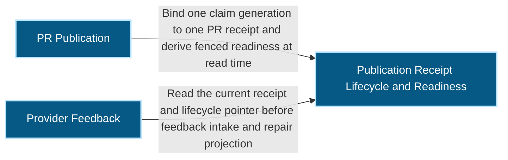
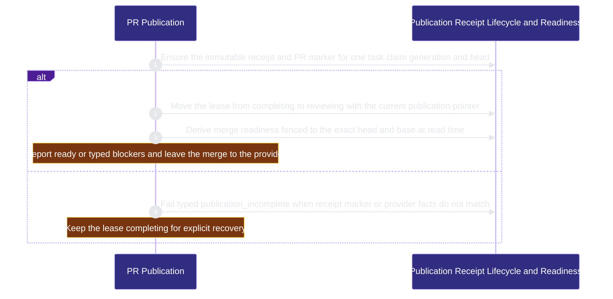

# organization/publication 架構文檔

<!-- BEGIN ARCHCONTEXT:generated target="projection_target.entity.capability-organization-publication" sourceDigest="sha256:aaade0f5c2d04d254ebdd4bd8a5744aa79512b3b226631d239b5fc8e532bc0b0" rendererVersion="archcontext.docs-renderer/v5" outputDigest="sha256:e64f2bde95ccee925a1b1ff68a2ad33227f7426f944d90082c6ea5823dd930f4" -->
> **狀態**:`active`
> **Capability ID**:`capability.organization.publication`(kind `capability`)
> **Matched Prefixes**:`src/core/publication/**`、`src/effects/publication/**`、`src/cli/commands/publication.ts`
> **Local Contracts**:`AGENTS.md`、`CLAUDE.md`
> **事實優先級**:倉庫當前狀態 > 本文檔機器區 > 本文檔人工區。機器區(引言、§1、§2)由 ArchContext 從架構模型與源碼度量投影生成,手改會在下次投影被覆蓋。本文檔不記錄出處;本次投影所驗證的 commit 見 `docs/architecture/.projection-manifest.json`。

Binds one task claim generation to one pull request through an immutable publication receipt, moves the publication through its review lifecycle, derives fenced merge readiness at read time and stores provider feedback without ever merging.

## 1. P1:能力架構地圖

### 1.1 架構圖

- Proof: `proven` (`sha256:9c365d272b01cfcf83c8b6a1dca365d542e2911d02f93a402c54917e4dd10755`).
- Semantic nodes: `3`; declared relations: `2`.

### 1.2 模組職責表

| 宣告入口 | 錨點 | 職責 |
| --- | --- | --- |
| `entrypoint.publication.command` | `src/cli/commands/publication.ts#buildPublicationCommand` | `sink.publication.ensure-receipt` → `src/effects/publication/publication-receipt.ts#ensurePublicationReceipt`、`sink.publication.enter-reviewing` → `src/effects/publication/publication-lifecycle.ts#enterPublicationReviewing`、`sink.publication.readiness` → `src/effects/publication/merge-readiness.ts#resolvePublicationReadiness` |

### 1.3 規模信號

- 規模量級:`10–20` 個文件 / `5000–10000` 行
- 匹配前綴:`src/core/publication/**`、`src/effects/publication/**`、`src/cli/commands/publication.ts`
- 推導:掃描 `source.include` 減 `source.exclude`,跳過 `.git/` 與 `node_modules/`,再按 1–2–5 階梯分桶。精確計數不入本文檔:量級足以回答「這個能力有多大」,而逐行計數會讓覆蓋範圍內任何一次源碼改動都改寫本文檔。

### 1.4 依賴邊界

出向關係:

- `calls` → `capability.workflow-engine.contract-assets` — Recompute the candidate diff with the packaged merge gate and worktree merge helper
- `calls` → `capability.runtime-harness.evidence-ledger` — Append lifecycle journal records through the durable evidence append primitive
- `calls` → `component.publication.primary` — Bind one claim generation to one PR receipt and derive fenced readiness at read time

入向關係:

- `reads` ← `capability.runtime-harness.integration-acceptance` — Read cached immutable publication receipts and reuse their canonical JSON digest
- `calls` ← `capability.organization.task-fleet` — Read publication receipts readiness and provider feedback for fleet commands and board cards

## 2. P2:端到端數據流

> **Proof**: `proven` (`sha256:9c365d272b01cfcf83c8b6a1dca365d542e2911d02f93a402c54917e4dd10755`); selectors `3/3`.

<!-- END ARCHCONTEXT:generated target="projection_target.entity.capability-organization-publication" -->

## 3. P3:設計決策與不變量

### 3.1 必须保持的不变量

1. **Receipt 是不可变的身份事实。** `publication_id` 由 protocol、provider repo、task、claim、generation 与 head 确定性计算（PRD `plans/prds/20260822-0405-fleet-acquire-publication-readiness.prd.md:40`）。崩溃重试与 rebuild 收敛到同一个身份。
2. **Receipt 不记录 merge seal。** Protocol 3 只记录 PR、head、tree、provider base 与候选 diff 指纹（`src/core/publication/publication-receipt.ts:6`、`:22-24`，#545）。Main 合并授权留在 live readiness gate。
3. **Receipt schema 独立于 `COORDINATION_PROTOCOL`。** 该常量进入 task_id 与 task_revision 摘要域（`publication-receipt.ts:5`，PRD `:42`）。改动它会改变所有任务身份。
4. **`current_publication` 指针是唯一的当前权威。** Receipt 不可变。指针是独立的可变权威（`src/core/publication/publication-lifecycle.ts:2-5`，PRD `:49`）。Lineage 事件只做审计。
5. **生命周期转换在 task lock 下对比指针。** Takeover 走 `reviewing → reserving`，然后经过已有的 `bind`。只有 `bind` 写 `bound`（PRD `:43-47`）。`sprint steal` 必须拒绝 `reviewing`（PRD `:48`）。
6. **PR body marker 是不可信载体。** Rebuild 用 live provider 事实与本地证据核对 marker。Marker 本身从不授权 lease 变更（PRD `:41`）。
7. **Readiness 在读取时派生。** 它按 `publication_id` 计算，并绑定 expected head 与 base。`ready` 还要求 PR 不是 draft。系统从不持久化 `ready=true`（PRD `:57`，`src/core/publication/merge-readiness.ts:3`、`:168`）。
8. **集成分类执行打包的 helper。** Reconcile 与 readiness 运行包内的 `scripts/worktree-merge-lib.sh`。候选仓库只作为工作目录（`src/effects/publication/publication-lifecycle.ts:59-62`、`src/effects/publication/merge-readiness.ts:537-540`，#565）。
9. **Provider feedback 是 intake 加 redispatch，不是唤醒。** Provider 事实是不可变文件。投递状态与修复尝试在单独的文件中（`src/effects/publication/feedback-store.ts:2-5`）。Feedback schema 不进入 task 或 lease 摘要（`src/core/publication/feedback.ts:7`）。Intake 不改 lease（PRD `:52`）。
10. **本能力从不合并 PR。** Merge 点击留在 GitHub（PRD `:59`）。

### 3.2 关键权衡

| 决策 | 权衡 |
| --- | --- |
| Receipt protocol 3 去掉 merge seal（#545） | Draft PR 不需要 seal 就能进入 reviewing。代价：protocol 1 与 2 的 receipt fail closed。没有迁移，也没有第二个解析器 |
| Reopen、takeover 与 abandon 用 `verifyPublicationIdentity`，不比较 base（#545） | Main 前进不再锁住修复转换。Rebuild 仍检查 base。Readiness 仍以 `base_moved_since_verification` 阻塞 |
| 新增 `publication reconcile`，不复用 `sprint reconcile` | `sprint reconcile` 不 fetch，并严格比较 target ref 字符串（PRD Problem 3，notes `publication-recovery-reconcile`）。新命令先把 provider target fetch 到隔离的观察 ref |
| `integration_state` 不写入 lease | 写入会产生与 `current_publication` 并列的第二个可变权威（notes `publication-recovery-reconcile`）。代价：每次读取都重新投影 |
| 执行打包 helper，不执行候选仓库的 helper（#565） | 候选仓库无法伪造 `absorbed`。代价：helper 路径解析在多个模块中重复 |
| 回滚边界改用 provider merge commit 与它的 parent，不再用 tag（#538） | 去掉多余 ref 和异步依赖。代价：每次多读一次 parent PR association。数据缺失或格式错误时 fail closed |
| 按需调用 `gh`，没有 daemon 或 webhook | 新鲜度取决于调用（PRD `:61`）。`gh` 速率限制未验证（PRD [UNVERIFIED]） |

### 3.3 组件

| 组件 | 文件 / 行 | 职责 |
| --- | --- | --- |
| `component.publication.primary` | 7 / 3,831 | `publication` 命令、receipt 与 marker、生命周期、readiness |
| `component.publication.provider-feedback` | 3 / 3,289 | Feedback 事件、delivery receipt、修复尝试、no-progress 判定 |

Feedback 的 CLI 入口在 `src/cli/commands/fleet.ts`（task-fleet），所以 provider-feedback 没有本能力内的 flow 步骤。

### 3.4 未决问题

- #545 之后，指向 v2 receipt 的 lease 在 reopen、takeover、abandon、readiness 与 feedback 上失败。产品内没有恢复路径。#545 把选择留给 owner：手工处理，或一次性迁移。当前源码没有迁移。

## 4. 歷史決策記錄(append-only)

### 从无 owner 到 organization 域的独立能力 (2026-10-11)

- P1：本能力的文件此前没有 capability owner。
- P2：功能来自 PRD `fleet-acquire-publication-readiness`。主要提交：`42e3d93d`（immutable receipt）、`70ace994`（review lifecycle）、`9028f759`（recovery 与 reconcile）、`8b8c4dbc`（merge readiness）、`82f1c44c`（feedback repair loop）。
- P3：用户决定把 publication 与 task-fleet 放进新的 `organization` 域。

### Receipt protocol 3 (2026-10-06, #545)

- P1：Receipt writer 总是读取主机 merge seal。只有 `merge-gate run` 写 seal，而它要求非 draft PR。
- P2：默认 Draft ship 以 `publication_incomplete` 失败，lease 停在 completing。
- P3：Receipt 不再绑定 seal。Rebuild 改为重算候选 diff。Merge gate 保留自己的 seal 检查。

### 集成分类使用打包 helper (2026-10-06, #565)

- P3：候选仓库是不可信内容。可执行的判定只来自包内 helper。

## Optimization Backlog

- **与 contract-assets 的双向依赖（重构证据）。** `src/effects/publication/publication-receipt.ts:39` 从 `scripts/merge-gate.ts` 导入 `candidate`。`scripts/merge-gate.ts` 又导入 `src/effects/publication/merge-readiness.ts`。模型只声明 publication → contract-assets。候选重构：把候选 diff 计算移进本能力或一个共享原语。
- **Helper 路径解析重复。** `WORKTREE_MERGE_LIB` 在 `publication-lifecycle.ts:62`、`merge-readiness.ts:540` 与 `src/cli/mcp/coding-workspaces.ts:311` 中重复。`src/effects/state/coordination-worktree-topology.ts:16` 有一个按 `package.json` 定位的解析器，它也适用于 hook bundle。候选：共用一个解析器。
- **provider-feedback 组件 3,289 行。** `src/effects/publication/feedback.ts` 单文件 1,700 行。可展开，现在不拆。
