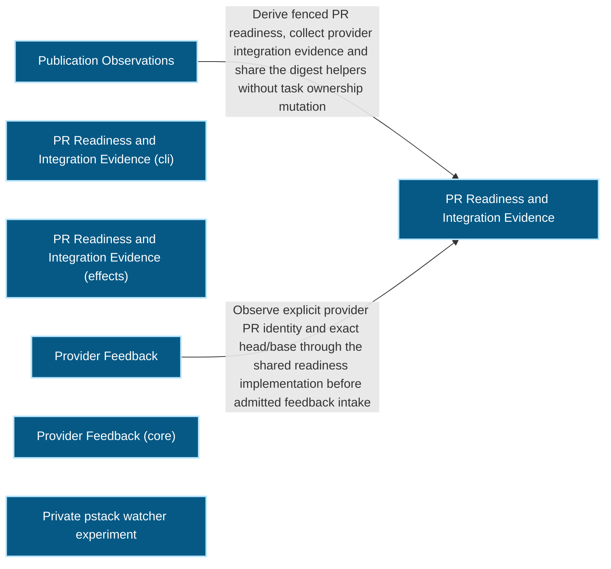
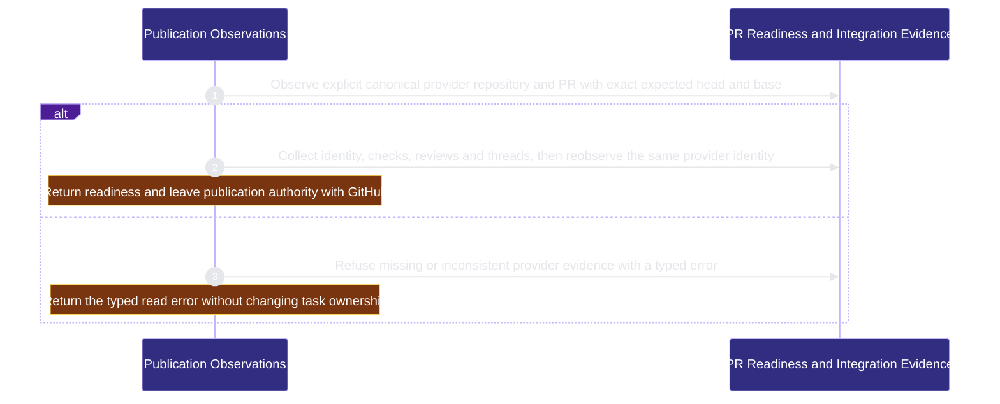

# organization/publication 架構文檔

<!-- BEGIN ARCHCONTEXT:generated target="projection_target.entity.capability-organization-publication" rendererVersion="archcontext.docs-renderer/v6" outputDigest="sha256:5632449bc38ccb985e675c5fbaf553a5ea618f043fd0b9120bdf214c1ae91774" -->
> **狀態**:`active`
> **Capability ID**:`capability.organization.publication`(kind `capability`)
> **Matched Prefixes**:`src/core/publication/**`、`src/effects/publication/**`、`src/cli/commands/publication.ts`、`src/effects/fleet/provider-feedback.ts`
> **Local Contracts**:`AGENTS.md`、`CLAUDE.md`
> **事實優先級**:倉庫當前狀態 > 本文檔機器區 > 本文檔人工區。機器區(引言、§1、§2)由 ArchContext 從架構模型與源碼度量投影生成,手改會在下次投影被覆蓋。本文檔不記錄出處;本次投影所驗證的 commit 見 `docs/architecture/.projection-manifest.json`。

Observes explicit canonical provider PR readiness and integration evidence, shares canonical publication digest helpers and records admitted manual feedback.

## 1. P1:能力架構地圖

### 1.1 架構圖

- Proof: `proven` (`sha256:95169681a5dd2e0a37c6d68fb527ae11736927d08a32ff6dd53010755651867c`).
- Semantic nodes: `7`; declared relations: `2`.

### 1.2 模組職責表

| 宣告入口 | 錨點 | 職責 |
| --- | --- | --- |
| `entrypoint.publication.command` | `src/cli/commands/publication.ts#buildPublicationCommand` | `sink.publication.readiness` → `src/effects/publication/merge-readiness.ts#collectPullRequestMergeReadiness` |

組件入口:

- 組件均未宣告 `source.entrypoints`。

### 1.3 規模信號

- 規模量級:`10–20` 個文件 / `5000–10000` 行
- 匹配前綴:`src/core/publication/**`、`src/effects/publication/**`、`src/cli/commands/publication.ts`、`src/effects/fleet/provider-feedback.ts`
- 推導:掃描 `source.include` 減 `source.exclude`,跳過 `.git/` 與 `node_modules/`,再按 1–2–5 階梯分桶。精確計數不入本文檔:量級足以回答「這個能力有多大」,而逐行計數會讓覆蓋範圍內任何一次源碼改動都改寫本文檔。

### 1.4 依賴邊界

出向關係:

- `calls` → `capability.workflow-engine.contract-assets` — Read integration proof through the packaged worktree merge helper
- `calls` → `external.github` — Read pull request readiness and post provider feedback through gh.
- `depends-on` → `capability.verification.acceptance-review` — Read the acceptance receipt for publication evidence.
- `calls` → `component.publication.primary` — Derive fenced PR readiness, collect provider integration evidence and share the digest helpers without task ownership mutation

入向關係:

- `depends-on` ← `capability.workflow-engine.contract-assets` — Read publication merge readiness from the merge helper.
- `reads` ← `capability.runtime-harness.engineer-scheduling` — Read cached publication receipts as dependency authority
- `depends-on` ← `capability.verification.evals-checks` — Test PR Publication behavior through its source modules.
- `calls` ← `component.global-runtime-reconciliation.cli-root` — Register the publication command
- `reads` ← `capability.runtime-harness.integration-acceptance` — Reuse the shared provider PR integration collector and canonical JSON helpers without historical receipt authority
- `calls` ← `component.mcp-sidecar.primary` — Reopen and take over publications and read merge readiness
- `depends-on` ← `capability.runtime-harness.operator` — Use publication readiness types in the Operator fixture.
- `calls` ← `capability.organization.task-fleet` — Read publication receipts readiness and provider feedback for fleet commands and board cards

組件出向關係:

- `component.publication.primary`:
  - `calls` → `capability.workflow-engine.execution-primitives` — Read the worktree topology and the Git common directory
- `component.publication.primary-cli`:
  - 無。
- `component.publication.primary-effects`:
  - 無。
- `component.publication.provider-feedback`:
  - `calls` → `capability.workflow-engine.execution-primitives` — Resolve the Git common directory for feedback records
  - `calls` → `component.publication.primary` — Observe explicit provider PR identity and exact head/base through the shared readiness implementation before admitted feedback intake
  - `calls` → `capability.runtime-harness.task-agent-host` — Read the exact selected immutable task session for current feedback attribution
  - `calls` → `capability.organization.task-fleet` — Reobserve exact admitted inbox context and shared message claim identity before provider feedback writes
- `component.publication.provider-feedback-core`:
  - 無。
- `component.publication.pstack-watch-pr-experiment`:
  - 無。

### 1.5 組件結構

| 組件 | 名稱 | 規模量級 | 宣告入口 |
| --- | --- | --- | --- |
| `component.publication.primary` | PR Readiness and Integration Evidence | `5–10` 個文件 / `1000–2000` 行 | 未宣告 |
| `component.publication.primary-cli` | PR Readiness and Integration Evidence (cli) | `1–2` 個文件 / `50–100` 行 | 未宣告 |
| `component.publication.primary-effects` | PR Readiness and Integration Evidence (effects) | `1–2` 個文件 / `1000–2000` 行 | 未宣告 |
| `component.publication.provider-feedback` | Provider Feedback | `2–5` 個文件 / `1000–2000` 行 | 未宣告 |
| `component.publication.provider-feedback-core` | Provider Feedback (core) | `1–2` 個文件 / `500–1000` 行 | 未宣告 |
| `component.publication.pstack-watch-pr-experiment` | Private pstack watcher experiment | `10–20` 個文件 / `2000–5000` 行 | 未宣告 |

## 2. P2:端到端數據流

> **Proof**: `proven` (`sha256:95169681a5dd2e0a37c6d68fb527ae11736927d08a32ff6dd53010755651867c`); selectors `1/1`.

<!-- END ARCHCONTEXT:generated target="projection_target.entity.capability-organization-publication" -->

## 3. P3: Current boundary after #773 slice C

The GitHub issue and PR own task and publication status. This capability reads
live provider facts. It does not create publication receipts, edit PR markers or
change claim ownership.

- `publication readiness` and MCP `publication_readiness` remain read-only.
- The publication receipt and lifecycle store readers are removed. Stored bytes
  stay in place. Integration evidence keeps its exact schema and digest checks.
- Provider readiness remains bound to the observed head, base, checks and reviews.
- Provider merge proof remains available to guarded worktree cleanup.
- Manual feedback intake and acknowledgement remain available. Historical repair
  records can explain no progress. They cannot dispatch a new repair.
- Removed commands have no alias or automatic migration. Old records remain
  historical inputs. GitHub carries new task authority.

The `flow.publication.readiness` flow replaces the retired lifecycle flow.
The publication-to-evidence-ledger journal relation is removed. The
publication-to-workflow-state relation is removed too: no publication source
imports workflow-state. `src/core/publication/publication-receipt.ts` keeps only
the canonical JSON and SHA-256 helpers that integration evidence digests use.

## 4. 歷史決策記錄(append-only)

The lifecycle behavior below is historical. Slice C retired its writers.

### 从无 owner 到 organization 域的独立能力 (2026-10-11)

- P1：本能力的文件此前没有 capability owner。
- P2：功能来自 PRD `fleet-acquire-publication-readiness`。主要提交：`42e3d93d`（immutable receipt）、`70ace994`（review lifecycle）、`9028f759`（recovery 与 reconcile）、`8b8c4dbc`（merge readiness）、`82f1c44c`（feedback repair loop）。
- P3：用户决定把 publication 与 task-fleet 放进新的 `organization` 域。

### Receipt protocol 3 (2026-10-06, #545)

- P1：Receipt writer 总是读取主机 merge seal。只有 `merge-gate run` 写 seal，而它要求非 draft PR。
- P2：默认 Draft ship 以 `publication_incomplete` 失败，lease 停在 completing。
- P3：Receipt 不再绑定 seal。Rebuild 改为重算候选 diff。Merge gate 保留自己的 seal 检查。

### 集成分类使用打包 helper (2026-10-06, #565)

- P3：候选仓库是不可信内容。可执行的判定只来自包内 helper。

## Remaining boundary

No publication receipt reader remains. Provider merge commit and tree evidence
comes from `collectPullRequestIntegration`
(`src/effects/publication/merge-readiness.ts`). Product acceptance then proves
locally that the provider merge commit is an ancestor of the final candidate
(`src/effects/integration/product-acceptance.ts#observeSelectedPullRequest`).
