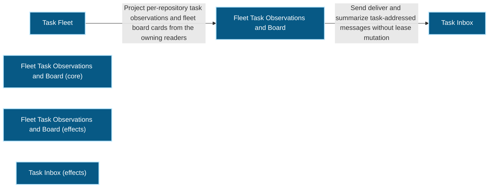
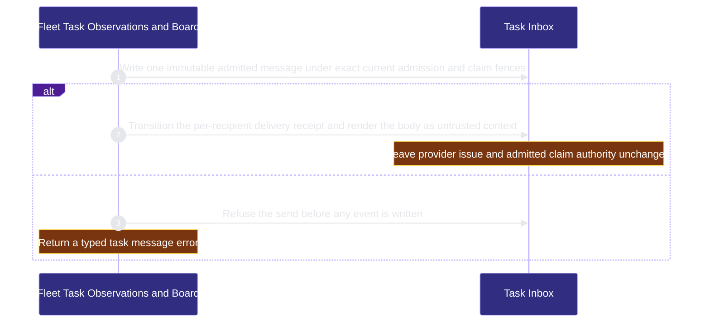

# organization/task-fleet 架構文檔

<!-- BEGIN ARCHCONTEXT:generated target="projection_target.entity.capability-organization-task-fleet" rendererVersion="archcontext.docs-renderer/v6" outputDigest="sha256:640d3f97e2ebb04ead01245d521166ecc754254207f96a02eb4be0acabe921bf" -->
> **狀態**:`active`
> **Capability ID**:`capability.organization.task-fleet`(kind `capability`)
> **Matched Prefixes**:`src/core/fleet/**`、`src/effects/fleet/**`、`src/cli/commands/fleet.ts`、`src/core/messages/mechanics.ts`、`src/core/messages/task-message-claim.ts`、`src/core/messages/task-message-error.ts`
> **Local Contracts**:`AGENTS.md`、`CLAUDE.md`
> **事實優先級**:倉庫當前狀態 > 本文檔機器區 > 本文檔人工區。機器區(引言、§1、§2)由 ArchContext 從架構模型與源碼度量投影生成,手改會在下次投影被覆蓋。本文檔不記錄出處;本次投影所驗證的 commit 見 `docs/architecture/.projection-manifest.json`。

Projects registry-scoped provider issue and admitted session fleet boards and owns admitted task message storage.

## 1. P1:能力架構地圖

### 1.1 架構圖

- Proof: `proven` (`sha256:a67cb6c015234f27ee4a3a83ab00c3bd90fa7d490598604aed41ae518089b741`).
- Semantic nodes: `6`; declared relations: `2`.

### 1.2 模組職責表

| 宣告入口 | 錨點 | 職責 |
| --- | --- | --- |
| `entrypoint.task-fleet.command` | `src/cli/commands/fleet.ts#buildFleetCommand` | `sink.task-fleet.send-message` → `src/effects/fleet/task-inbox.ts#sendTaskMessage`、`sink.task-fleet.deliver-message` → `src/effects/fleet/task-inbox.ts#deliverTaskInbox` |

組件入口:

- 組件均未宣告 `source.entrypoints`。

### 1.3 規模信號

- 規模量級:`10–20` 個文件 / `2000–5000` 行
- 匹配前綴:`src/core/fleet/**`、`src/effects/fleet/**`、`src/cli/commands/fleet.ts`、`src/core/messages/mechanics.ts`、`src/core/messages/task-message-claim.ts`、`src/core/messages/task-message-error.ts`
- 排除前綴:`src/effects/fleet/provider-feedback.ts`
- 推導:掃描 `source.include` 減 `source.exclude`,跳過 `.git/` 與 `node_modules/`,再按 1–2–5 階梯分桶。精確計數不入本文檔:量級足以回答「這個能力有多大」,而逐行計數會讓覆蓋範圍內任何一次源碼改動都改寫本文檔。

### 1.4 依賴邊界

出向關係:

- `calls` → `capability.runtime-harness.agent-runtime-effects` — Read task agent runtime effects as board observations only
- `calls` → `capability.runtime-harness.engineer-bindings` — Validate principal claims and claim actor receipts before a steer reply is recorded
- `calls` → `capability.runtime-harness.evidence-ledger` — Reuse canonical JSON and durable atomic append for task message records
- `calls` → `component.task-fleet.primary` — Project per-repository task observations and fleet board cards from the owning readers
- `calls` → `capability.organization.publication` — Read publication receipts readiness and provider feedback for fleet commands and board cards
- `reads` → `component.mcp-sidecar.repo-policy-registry` — Read the strict repository registry snapshot for offer and board authorization

入向關係:

- `calls` ← `component.acceptance-review.primary` — Reserve admitted inbox context through read-only listing and commit exact delivery receipts only after positive accepted OAR input proof; unknown acceptance leaves delivery pending
- `calls` ← `capability.runtime-harness.agent-runtime-effects` — Read the exact Task message and delivery receipt before action admission and success.
- `depends-on` ← `capability.verification.evals-checks` — Test Task Fleet behavior through its source modules.
- `calls` ← `capability.runtime-harness.external-source-intake` — Reobserve exact admitted inbox context to bind source evidence to the same current provider issue
- `calls` ← `component.global-runtime-reconciliation.cli-root` — Register the fleet command
- `calls` ← `component.hook-adapters.session-lifecycle` — Render task inbox messages as untrusted session context
- `calls` ← `component.mcp-sidecar.primary` — Acquire fleet tasks and handle task steers from the MCP tools
- `reads` ← `component.operator.primary` — Read retained per-repository task observations and the fleet board for the console
- `reads` ← `component.operator.view-projections` — Render fleet board errors and task message shapes
- `calls` ← `component.publication.provider-feedback` — Reobserve exact admitted inbox context and shared message claim identity before provider feedback writes

組件出向關係:

- `component.task-fleet.primary`:
  - `calls` → `component.task-fleet.task-inbox` — Send deliver and summarize task-addressed messages without lease mutation
  - `reads` → `capability.workflow-engine.workflow-state` — Read provider issue and admitted session board observations without Sprint or lease authority
- `component.task-fleet.primary-core`:
  - 無。
- `component.task-fleet.primary-effects`:
  - 無。
- `component.task-fleet.task-inbox`:
  - `calls` → `capability.workflow-engine.execution-primitives` — Hold exclusive directory locks under the Git common directory for the task inbox
  - `calls` → `capability.runtime-harness.task-agent-host` — Reobserve the exact task session and live admission before current inbox operations
- `component.task-fleet.task-inbox-effects`:
  - 無。

### 1.5 組件結構

| 組件 | 名稱 | 規模量級 | 宣告入口 |
| --- | --- | --- | --- |
| `component.task-fleet.primary` | Fleet Task Observations and Board | `1–2` 個文件 / `500–1000` 行 | 未宣告 |
| `component.task-fleet.primary-core` | Fleet Task Observations and Board (core) | `1–2` 個文件 / `200–500` 行 | 未宣告 |
| `component.task-fleet.primary-effects` | Fleet Task Observations and Board (effects) | `1–2` 個文件 / `500–1000` 行 | 未宣告 |
| `component.task-fleet.task-inbox` | Task Inbox | `5–10` 個文件 / `1000–2000` 行 | 未宣告 |
| `component.task-fleet.task-inbox-effects` | Task Inbox (effects) | `2–5` 個文件 / `1000–2000` 行 | 未宣告 |

## 2. P2:端到端數據流

> **Proof**: `proven` (`sha256:a67cb6c015234f27ee4a3a83ab00c3bd90fa7d490598604aed41ae518089b741`); selectors `2/2`.

<!-- END ARCHCONTEXT:generated target="projection_target.entity.capability-organization-task-fleet" -->

## 3. P3: Retained fleet observations

- `fleet board` joins each registered repository to provider issue observations and zero or more exact admitted sessions. Its result is read-only. It does not grant a claim or create a worktree.
- `fleet board` and the operator show issue, PR readiness, inbox and runtime observations. They do not persist board columns or readiness flags.
- Task messages remain immutable communication records. Per-recipient delivery receipts do not change a provider claim or PR state.
- Admitted messages name the admission digest and the exact claim reference and revision. The manual inbox path checks that recipient before delivery or acknowledgement.
- Message bodies remain untrusted data. The UserPromptSubmit inbox adapter is a no-op and prints no message context.
- Historical reply inspection validates the stored intent, event and commit chain without granting current authorization.
- Inbox layout migration retains canonical recipient keys and checks record bytes. The operator reader performs no migration.
- Global fleet offers and acquire, Engineer steer APIs and WorkEnvelope issuance are retired. Publication feedback and per-repository board reads remain for slice C.
- A provider issue or PR owns current task identity, claim, status and dependency. A local board, Sprint row or lease record is a bounded observation. It cannot grant admission, transfer a claim or complete an issue.
- Protected admission binds an approved goal and scope to an exact execution session and claim. A matching actor name is not an engineer selection; engineer association requires an explicit profile and contract revision.
- `fleet board` compares complete projected provider and session revisions, with at most three observations. A continued change returns `changed_during_read`. A discovery failure is a typed unavailable observation, not an empty session list.
- An issue without an admitted session remains a provider issue card. Runtime progress does not determine issue status.
- Current diff, activity and context routes require the closed session selector and reobserve current admission. Historical routes are explicit. A missing current session never falls back to Sprint or lease history.
- Admitted inbox delivery binds the admission SHA and the exact claim reference and revision. Runtime effects also bind the session digest and selected profile revision. Owner preparation reserves a bounded pre-prompt companion without marking messages delivered. The host consumer checks native/request attribution, local approval and expiry before it reads the companion. Only exact input-scoped accepted OAR proof lets the owner commit delivery receipts. Missing or unknown acceptance leaves delivery pending; recovery repeats the ledger commit without resending the prompt. Native host attribution grants no admission.
- The task mutex stays at `<git-common-dir>/repo-harness/coordination/v1/locks/tasks/<64hex>.lock`. Moving its implementation out of the retired lease reader created no new lock namespace.
- Worktree safety keeps exact worktree identity and merge-proof checks. Dirty, locked, marked or unknown worktrees stay protected. `ship-worktrees` journals operation progress, not task authority. PR readiness reobserves canonical provider identity, expected head/base, checks, reviews and threads before it reports readiness. Product integration also proves the provider's actual merge commit and tree locally and its ancestry into the exact final candidate; a merged PR state alone is not proof. Historical Sprint documents, owner bytes and message codecs remain for explicit history reads; they cannot replace current approval or provider evidence.
- Shared neutral source directories reuse implementations. They do not create another task state store. Provider feedback remains a Publication responsibility and joins the same admitted inbox context to explicit provider PR evidence.

## 4. 歷史決策記錄(append-only)

### 从无 owner 到 organization 域的独立能力 (2026-10-11)

- P1：本能力的文件此前没有 capability owner。`capability-resolver match` 对当时的 fleet acquire 模块返回 `root`（该模块已由 #959 删除）。
- P2：功能来自 PRD `fleet-acquire-publication-readiness`（2026-08-22 Approved）。主要提交：`1978de69`（fleet acquisition）、`38b91a39`（cross-repo board）、#265（消息与并发加固）、`4c466996`（Inbox 可移植存储路径）。
- P3：用户决定新建 `organization` 域，只放 task-fleet 与 publication。现有 engineer-* 能力留在 runtime-harness。现有 capability id 不改名，因为 id 是数据中的持久键。

## Optimization Backlog

- **双向依赖（重构证据）。** `src/effects/fleet/board.ts` 读取 agent-runtime-effects 的 runtime 投影。`src/effects/engineers/agent-runtime-effect-store.ts` 又反向导入 `src/core/fleet/board.ts`、`src/core/fleet/task-message.ts` 与 `src/effects/fleet/task-inbox.ts`。模型只声明 task-fleet → agent-runtime-effects。反向边记录在此，不作为意图关系。
- **agent-runtime-effects 的方向（集成）。** 反向有 7 条边，`relation.task-fleet.agent-runtime-effects` 一侧有 4 条。集成保留已声明的方向。是否翻转方向是开放问题。
- **repository registry 关系的目标（#1343）。** 导入只指向 `src/effects/repo-registry.ts`。这个文件现在归 `component.execution-primitives.repository-registry`。`relation.task-fleet.repo-registry` 已删除，由 `relation.task-fleet.repository-registry` 代替。task-fleet 与 mcp-sidecar 之间因此没有经过 registry 的环。
