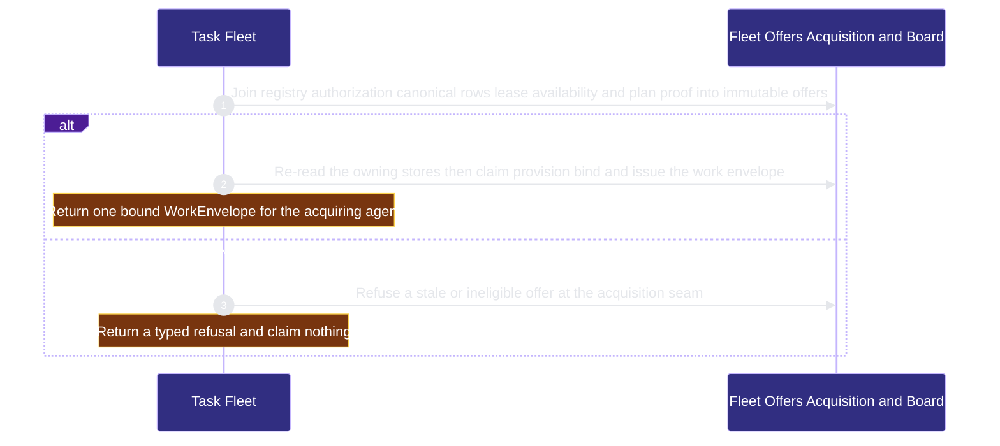
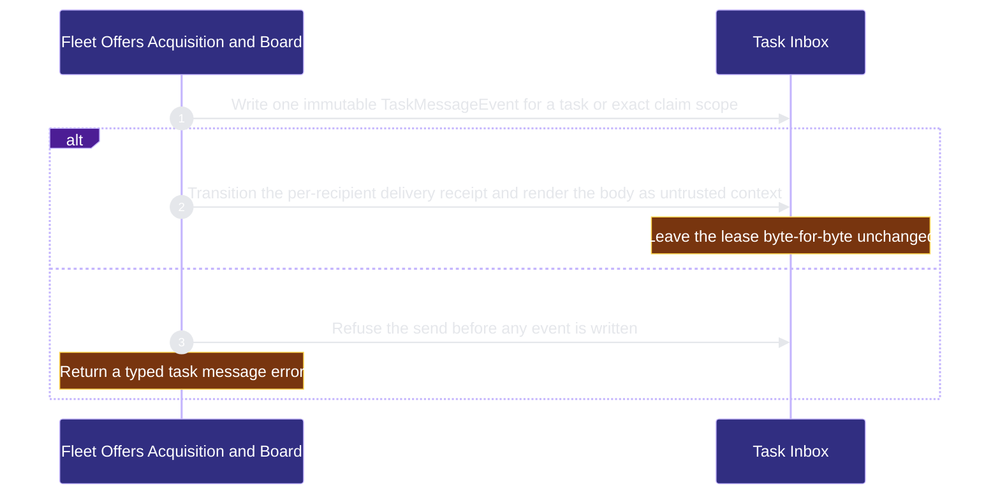

# organization/task-fleet 架構文檔

<!-- BEGIN ARCHCONTEXT:generated target="projection_target.entity.capability-organization-task-fleet" rendererVersion="archcontext.docs-renderer/v6" outputDigest="sha256:daab3348d33a3063b258a15e61b41ad0d01b5620970af9e0fa14c6682c36bdcf" -->
> **狀態**:`active`
> **Capability ID**:`capability.organization.task-fleet`(kind `capability`)
> **Matched Prefixes**:`src/core/fleet/**`、`src/effects/fleet/**`、`src/core/messages/document-handoff.ts`、`src/cli/commands/fleet.ts`
> **Local Contracts**:`AGENTS.md`、`CLAUDE.md`
> **事實優先級**:倉庫當前狀態 > 本文檔機器區 > 本文檔人工區。機器區(引言、§1、§2)由 ArchContext 從架構模型與源碼度量投影生成,手改會在下次投影被覆蓋。本文檔不記錄出處;本次投影所驗證的 commit 見 `docs/architecture/.projection-manifest.json`。

Projects task offers across registered repositories, acquires one execution-ready task into a bound work envelope, delivers task-addressed messages through the Task Inbox and projects the read-only fleet board.

## 1. P1:能力架構地圖

### 1.1 架構圖

- Proof: `proven` (`sha256:f6c44c3226d5ce7be50547661f44aeeefac250b3642463e88b54014a10eab28c`).
- Semantic nodes: `3`; declared relations: `2`.

### 1.2 模組職責表

| 宣告入口 | 錨點 | 職責 |
| --- | --- | --- |
| `entrypoint.task-fleet.command` | `src/cli/commands/fleet.ts#buildFleetCommand` | `sink.task-fleet.offers` → `src/effects/fleet/acquire.ts#collectFleetOffers`、`sink.task-fleet.acquire` → `src/effects/fleet/acquire.ts#acquireFleetTask`、`sink.task-fleet.send-message` → `src/effects/fleet/task-inbox.ts#sendTaskMessage`、`sink.task-fleet.deliver-message` → `src/effects/fleet/task-inbox.ts#deliverTaskInbox` |

組件入口:

- 組件均未宣告 `source.entrypoints`。

### 1.3 規模信號

- 規模量級:`10–20` 個文件 / `5000–10000` 行
- 匹配前綴:`src/core/fleet/**`、`src/effects/fleet/**`、`src/core/messages/document-handoff.ts`、`src/cli/commands/fleet.ts`
- 推導:掃描 `source.include` 減 `source.exclude`,跳過 `.git/` 與 `node_modules/`,再按 1–2–5 階梯分桶。精確計數不入本文檔:量級足以回答「這個能力有多大」,而逐行計數會讓覆蓋範圍內任何一次源碼改動都改寫本文檔。

### 1.4 依賴邊界

出向關係:

- `calls` → `capability.runtime-harness.agent-runtime-effects` — Read task agent runtime effects as board observations only
- `calls` → `capability.workflow-engine.contract-assets` — Run packaged contract worktree helpers to provision and bind an acquired task
- `calls` → `capability.runtime-harness.engineer-bindings` — Validate principal claims and claim actor receipts before a steer reply is recorded
- `calls` → `capability.runtime-harness.engineer-messages` — Reuse bounded canonical message mechanics for task messages and document handoff
- `calls` → `capability.runtime-harness.evidence-ledger` — Reuse canonical JSON and durable atomic append for task message records
- `calls` → `component.task-fleet.primary` — Project read-time offers and acquire one execution-ready task through the owning stores
- `calls` → `capability.organization.publication` — Read publication receipts readiness and provider feedback for fleet commands and board cards
- `reads` → `component.mcp-sidecar.repo-policy-registry` — Read the strict repository registry snapshot for offer and board authorization

入向關係:

- `depends-on` ← `capability.runtime-harness.delegated-runs` — Type the delegated run against the fleet work envelope
- `calls` ← `capability.runtime-harness.engineer-scheduling` — Collect fleet offers for the scheduling acquire path
- `calls` ← `component.global-runtime-reconciliation.cli-root` — Register the fleet command
- `calls` ← `component.hook-adapters.session-lifecycle` — Render task inbox messages as untrusted session context
- `calls` ← `component.mcp-sidecar.primary` — Acquire fleet tasks and handle task steers from the MCP tools
- `reads` ← `component.operator.primary` — Collect fleet offers and the fleet board for the console
- `reads` ← `component.operator.view-projections` — Render fleet board errors and task message shapes
- `reads` ← `capability.runtime-harness.pm-dispatch` — Read repository task offers for PM status without acquiring work

組件出向關係:

- `component.task-fleet.primary`:
  - `calls` → `capability.workflow-engine.execution-primitives` — Read the worktree topology during fleet acquire
  - `calls` → `component.task-fleet.task-inbox` — Send deliver and summarize task-addressed messages without lease mutation
  - `reads` → `capability.workflow-engine.workflow-state` — Read canonical Sprint tasks and leases to build offers and the board
- `component.task-fleet.task-inbox`:
  - `calls` → `capability.workflow-engine.execution-primitives` — Hold exclusive directory locks under the Git common directory for the task inbox
  - `calls` → `capability.workflow-engine.workflow-state` — Address task messages by canonical task under the task lock

### 1.5 組件結構

| 組件 | 名稱 | 規模量級 | 宣告入口 |
| --- | --- | --- | --- |
| `component.task-fleet.primary` | Fleet Offers Acquisition and Board | `5–10` 個文件 / `2000–5000` 行 | 未宣告 |
| `component.task-fleet.task-inbox` | Task Inbox | `5–10` 個文件 / `2000–5000` 行 | 未宣告 |

## 2. P2:端到端數據流

> **Proof**: `proven` (`sha256:f6c44c3226d5ce7be50547661f44aeeefac250b3642463e88b54014a10eab28c`); selectors `4/4`.

<!-- END ARCHCONTEXT:generated target="projection_target.entity.capability-organization-task-fleet" -->

## 3. P3:設計決策與不變量

### 3.1 必须保持的不变量

1. **Offer 只是读时投影。** Offer 不持有 task 权威，也不持有 lease 权威（`src/core/fleet/task-offer.ts:4`）。Canonical Sprint 行持有任务。Lease store 持有可用性。Registry 持有仓库授权。
2. **Acquire 在副作用之前重读权威。** `src/effects/fleet/acquire.ts:5-9` 把只读投影与 claim → provision → bind → token/envelope 分成两半。调用方不能把一个 offer 直接变成权威。
3. **只领取 `execution_ready` 的 offer。** 行必须是 pending。Lease 必须可用。快照必须稳定。仓库必须是 `read_write`。必须有与该行匹配的已批准计划（PRD `plans/prds/20260822-0405-fleet-acquire-publication-readiness.prd.md:56`）。需要规划的行不进入 acquire。
4. **Task message 只是通信事实。** 它不承载任何权威。`TaskMessageEventV1` 不可变。每个接收者的状态在单独的 delivery receipt 中。删除消息只会丢失历史，不会丢失 task、lease、publication 或 merge 权威（PRD `:39`、`:53`）。
5. **Claim 作用域的消息绑定确切的 claim 与 generation。** Takeover 之后该消息变为 `superseded`。Task 作用域的消息可以交给后继者（PRD `:53`）。
6. **消息正文是不可信的同伴数据。** Hook 只在带分隔符的 untrusted-context 块中注入正文（`src/core/fleet/task-message.ts:17-21`）。调用方提供的字段不能提升信任级别（PRD `:54`）。
7. **发送、投递、确认和 supersede 不改 lease。** 它们不证明会话存活，也不唤醒 runtime（PRD `:51`、`:53`，验收场景 5）。
8. **Fleet board 是独立的只读模型。** 它不改写 `BoardColumn`（`src/core/fleet/board.ts:8`）。它不持久化任何列或 `ready` 标志。它读 inbox 摘要时不加锁、不写文件，使用 A/B 观察（`tasks/archive/notes-20260823-1443-fleet-board-projection.md`）。
9. **Inbox 存储路径是投影。** Canonical 接收者键不变（`src/core/fleet/task-inbox-layout.ts:8`）。布局迁移离线执行，并按字节核对（`src/effects/fleet/task-inbox-layout-migration.ts:1`）。

### 3.2 关键权衡

| 决策 | 权衡 |
| --- | --- |
| 不新增权威类别，offer 与 board 都是读时投影 | 每次读取都要重新连接 registry、Sprint、lease 与计划证据。收益是没有第二份会漂移的状态（PRD `:39`） |
| Task Inbox 写入 git common dir 中的文件，不注入会话 | 消息只在真实的回合边界送达，延迟取决于下一次 hook。收益是会话替换与 takeover 之后寻址仍然正确（PRD Problem 5、`:53`） |
| Board 不为消息推断优先级 | Inbox V1 没有优先级数据。Board 只给出未读数与当前 claim 寻址（notes `fleet-board-projection`） |
| Board 不直接调用 `gh` | Readiness 已拥有 provider 身份与 blocker 投影。Board 复用它，所以 task-fleet 依赖 publication |
| 按需轮询，没有 daemon | 新鲜度取决于调用频率。PRD 把 daemon 推迟到有测量证据之后（PRD `:61`，Non-goals） |
| `fleet` 与 `publication` 是两个命令组和两个能力 | PRD 允许合并或拆分（`:68`）。用户决定把二者放进 `organization` 域。`fleet.ts` 也提供 feedback 子命令，所以 task-fleet 调用 publication |

### 3.3 组件

| 组件 | 文件 / 行 | 职责 |
| --- | --- | --- |
| `component.task-fleet.primary` | 5 / 3,189 | `fleet` 命令、offer、acquire 接缝、fleet board |
| `component.task-fleet.task-inbox` | 7 / 2,879 | 消息事件、delivery receipt、steer reply、document handoff、布局迁移 |

行数来自本 worktree 的 `git ls-files | xargs cat | wc -l`。

### 3.4 未决问题

- `src/core/messages/document-handoff.ts` 放在 task-fleet。它只依赖 engineer-messages 的 `mechanics.ts`，与 Task Inbox 共用正文上限（`document-handoff.ts:3`）。Ownership proposal 把这个判断标为 MEDIUM。engineer-messages 也是合理的 owner。需要 owner 确认。

## 4. 歷史決策記錄(append-only)

### 从无 owner 到 organization 域的独立能力 (2026-10-11)

- P1：本能力的文件此前没有 capability owner。`capability-resolver match` 对 `src/effects/fleet/acquire.ts` 返回 `root`。
- P2：功能来自 PRD `fleet-acquire-publication-readiness`（2026-08-22 Approved）。主要提交：`1978de69`（fleet acquisition）、`38b91a39`（cross-repo board）、#265（消息与并发加固）、`4c466996`（Inbox 可移植存储路径）。
- P3：用户决定新建 `organization` 域，只放 task-fleet 与 publication。现有 engineer-* 能力留在 runtime-harness。现有 capability id 不改名，因为 id 是数据中的持久键。

## Optimization Backlog

- **双向依赖（重构证据）。** `src/effects/fleet/board.ts` 读取 agent-runtime-effects 的 runtime 投影。`src/effects/engineers/agent-runtime-effect-store.ts` 又反向导入 `src/core/fleet/board.ts`、`src/core/fleet/task-message.ts` 与 `src/effects/fleet/task-inbox.ts`。模型只声明 task-fleet → agent-runtime-effects。反向边记录在此，不作为意图关系。
- **`WorkEnvelopeV1` 类型位于 effects 层。** engineer-bindings、engineer-scheduling、bound-task-freezes 与 delegated-runs 从 `src/effects/fleet/acquire.ts` 导入它（另有 `collectFleetOffers` 与 `validateFleetCommunicationEnvelope`）。候选重构：把 envelope 类型与校验移到 `src/core/fleet/`。
- **`src/cli/commands/fleet.ts` 有 933 行。** 它组合 offer、board、inbox 与 feedback 子命令。若继续增长，可以把 inbox 子命令移到 task-inbox 组件。
- **agent-runtime-effects 的方向（集成）。** 反向有 7 条边，`relation.task-fleet.agent-runtime-effects` 一侧有 4 条。集成保留已声明的方向。是否翻转方向是开放问题。
- **`relation.task-fleet.repo-registry` 的目标（集成）。** 目标从 mcp-sidecar capability 改为 `component.mcp-sidecar.repo-policy-registry`。导入只指向 `src/effects/repo-registry.ts`。mcp-sidecar primary → task-fleet 因此不形成节点级的环。
