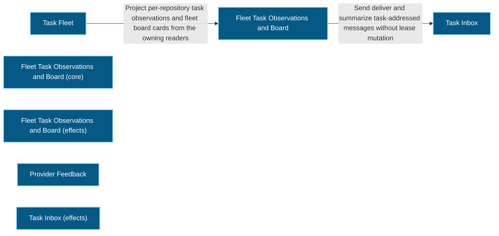
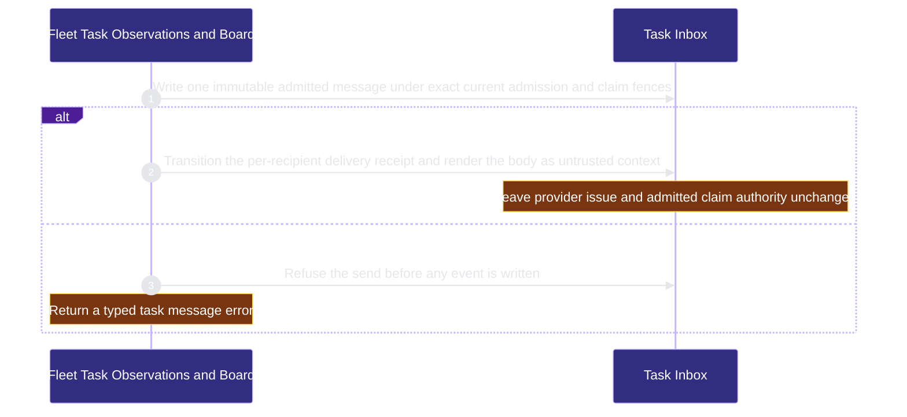

# organization/task-fleet 架構文檔

<!-- BEGIN ARCHCONTEXT:generated target="projection_target.entity.capability-organization-task-fleet" rendererVersion="archcontext.docs-renderer/v6" outputDigest="sha256:e0a41884ef949583de1894d583de100ea6ed659c035f452f779441bad822e7e2" -->
> **狀態**:`active`
> **Capability ID**:`capability.organization.task-fleet`(kind `capability`)
> **Matched Prefixes**:`src/core/fleet/**`、`src/effects/fleet/**`、`src/cli/commands/fleet.ts`
> **Local Contracts**:`AGENTS.md`、`CLAUDE.md`
> **事實優先級**:倉庫當前狀態 > 本文檔機器區 > 本文檔人工區。機器區(引言、§1、§2)由 ArchContext 從架構模型與源碼度量投影生成,手改會在下次投影被覆蓋。本文檔不記錄出處;本次投影所驗證的 commit 見 `docs/architecture/.projection-manifest.json`。

Projects registry-scoped provider issue and admitted session fleet boards, owns admitted task message storage and records admitted manual provider feedback.

## 1. P1:能力架構地圖

### 1.1 架構圖

- Proof: `proven` (`sha256:b88f02db249aa6ef43c027f88f9a9a47ca08263903c0309053b7412696fccb99`).
- Semantic nodes: `7`; declared relations: `2`.

### 1.2 模組職責表

| 宣告入口 | 錨點 | 職責 |
| --- | --- | --- |
| `entrypoint.task-fleet.command` | `src/cli/commands/fleet.ts#buildFleetCommand` | `sink.task-fleet.send-message` → `src/effects/fleet/task-inbox.ts#sendTaskMessage`、`sink.task-fleet.deliver-message` → `src/effects/fleet/task-inbox.ts#deliverTaskInbox` |

組件入口:

- 組件均未宣告 `source.entrypoints`。

### 1.3 規模信號

- 規模量級:`10–20` 個文件 / `2000–5000` 行
- 匹配前綴:`src/core/fleet/**`、`src/effects/fleet/**`、`src/cli/commands/fleet.ts`
- 推導:掃描 `source.include` 減 `source.exclude`,跳過 `.git/` 與 `node_modules/`,再按 1–2–5 階梯分桶。精確計數不入本文檔:量級足以回答「這個能力有多大」,而逐行計數會讓覆蓋範圍內任何一次源碼改動都改寫本文檔。

### 1.4 依賴邊界

出向關係:

- `reads` → `component.mcp-sidecar.repo-policy-registry-effects` — Read the Bot registry to name the sender of a fleet task message
- `calls` → `capability.runtime-harness.evidence-ledger` — Reuse canonical JSON and durable atomic append for task message records
- `calls` → `component.task-fleet.primary` — Project per-repository task observations and fleet board cards from the owning readers
- `calls` → `capability.organization.publication` — Plugin → core: read explicit PR readiness and the publication digest helpers, and store provider feedback facts and delivery receipts through the Publication feedback store, for fleet commands, board cards and provider feedback
- `reads` → `component.execution-primitives.repository-registry` — Read the strict repository registry snapshot for offer and board authorization

入向關係:

- `depends-on` ← `capability.verification.evals-checks` — Test Task Fleet behavior through its source modules.
- `calls` ← `capability.runtime-harness.external-source-intake` — Reobserve exact admitted inbox context to bind source evidence to the same current provider issue
- `calls` ← `component.global-runtime-reconciliation.cli-root` — Register the fleet command and pass the task inbox root to retention
- `calls` ← `component.hook-adapters.session-lifecycle` — Render task inbox messages as untrusted session context
- `calls` ← `component.mcp-sidecar.primary` — Acquire fleet tasks and handle task steers from the MCP tools
- `reads` ← `component.operator.primary` — Read retained per-repository task observations and the fleet board for the console
- `reads` ← `component.operator.view-projections` — Render fleet board errors and task message shapes
- `calls` ← `component.task-agent-host.review-runner` — Reserve admitted inbox context through read-only listing and commit exact delivery receipts only after positive accepted OAR input proof; unknown acceptance leaves delivery pending

組件出向關係:

- `component.task-fleet.primary`:
  - `calls` → `component.task-fleet.task-inbox` — Send deliver and summarize task-addressed messages without lease mutation
  - `reads` → `capability.workflow-engine.workflow-state` — Read provider issue and admitted session board observations without Sprint or lease authority
- `component.task-fleet.primary-core`:
  - 無。
- `component.task-fleet.primary-effects`:
  - 無。
- `component.task-fleet.provider-feedback`:
  - `calls` → `capability.verification.acceptance-review` — Plugin → core: observe the active review admission before admitted feedback intake
  - `calls` → `capability.workflow-engine.execution-primitives` — Hold the shared task lock while feedback events and delivery receipts are recorded
- `component.task-fleet.task-inbox`:
  - `calls` → `capability.workflow-engine.execution-primitives` — Hold exclusive directory locks under the Git common directory for the task inbox, and validate the shared task message claim and message fields
- `component.task-fleet.task-inbox-effects`:
  - 無。

### 1.5 組件結構

| 組件 | 名稱 | 規模量級 | 宣告入口 |
| --- | --- | --- | --- |
| `component.task-fleet.primary` | Fleet Task Observations and Board | `1–2` 個文件 / `500–1000` 行 | 未宣告 |
| `component.task-fleet.primary-core` | Fleet Task Observations and Board (core) | `1–2` 個文件 / `200–500` 行 | 未宣告 |
| `component.task-fleet.primary-effects` | Fleet Task Observations and Board (effects) | `1–2` 個文件 / `500–1000` 行 | 未宣告 |
| `component.task-fleet.provider-feedback` | Provider Feedback | `1–2` 個文件 / `1000–2000` 行 | 未宣告 |
| `component.task-fleet.task-inbox` | Task Inbox | `2–5` 個文件 / `500–1000` 行 | 未宣告 |
| `component.task-fleet.task-inbox-effects` | Task Inbox (effects) | `2–5` 個文件 / `1000–2000` 行 | 未宣告 |

## 2. P2:端到端數據流

> **Proof**: `proven` (`sha256:b88f02db249aa6ef43c027f88f9a9a47ca08263903c0309053b7412696fccb99`); selectors `2/2`.

<!-- END ARCHCONTEXT:generated target="projection_target.entity.capability-organization-task-fleet" -->

## 3. P3: Retained fleet observations

- Task messages remain immutable communication records. Per-recipient delivery receipts do not change a provider claim or PR state.
- Admitted messages name the admission digest and the exact claim reference and revision. The manual inbox path checks that recipient before delivery or acknowledgement.
- Message bodies remain untrusted data. The UserPromptSubmit inbox adapter is a no-op and prints no message context.
- Inbox layout migration retains canonical recipient keys and checks record bytes. It refuses retired reply records and deletes nothing. The operator reader performs no migration.
- Global fleet offers and acquire, Engineer steer APIs and WorkEnvelope issuance are retired. Provider feedback remains. `repo-harness board` (capability `organization.board`) is the one board read model (#1507).
- A provider issue or PR owns current task identity, claim, status and dependency. A local board, Sprint row or lease record is a bounded observation. It cannot grant admission, transfer a claim or complete an issue.
- Protected admission binds an approved goal and scope to an exact execution session and claim. A matching actor name grants no admission.
- Admitted inbox delivery binds the admission SHA and the exact claim reference and revision. Owner preparation reserves a bounded pre-prompt companion without marking messages delivered. The host consumer checks native/request attribution, local approval and expiry before it reads the companion. Only exact input-scoped accepted OAR proof lets the owner commit delivery receipts. Missing or unknown acceptance leaves delivery pending; recovery repeats the ledger commit without resending the prompt. Native host attribution grants no admission.
- The task mutex stays at `<git-common-dir>/repo-harness/coordination/v1/locks/tasks/<64hex>.lock`. Moving its implementation out of the retired lease reader created no new lock namespace.
- Worktree safety keeps exact worktree identity and merge-proof checks. Dirty, locked, marked or unknown worktrees stay protected. `ship-worktrees` journals operation progress, not task authority. PR readiness reobserves canonical provider identity, expected head/base, checks, reviews and threads before it reports readiness. Historical Sprint documents, owner bytes and message codecs remain for explicit history reads; they cannot replace current approval or provider evidence.
- Shared neutral source directories reuse implementations. They do not create another task state store.
- Task Fleet owns provider feedback intake (`component.task-fleet.provider-feedback`, `src/effects/fleet/provider-feedback.ts`, #1352). It joins the same admitted inbox context to explicit provider PR evidence. The Publication feedback store keeps the feedback facts and the delivery receipts.
- Each Task Fleet import of Publication is a plugin → core edge (`relation.task-fleet.publication`): PR readiness, the publication digest helpers and the feedback store. Publication imports no Task Fleet file.
- The task message claim, the message error and the message field checks (`src/core/messages/**`) belong to `component.execution-primitives.task-message-claim` (#1352). The task inbox and the Publication feedback records both import them. The files did not move.

## 4. 歷史決策記錄(append-only)

### 从无 owner 到 organization 域的独立能力 (2026-10-11)

- P1：本能力的文件此前没有 capability owner。`capability-resolver match` 对当时的 fleet acquire 模块返回 `root`（该模块已由 #959 删除）。
- P2：功能来自 PRD `fleet-acquire-publication-readiness`（2026-08-22 Approved）。主要提交：`1978de69`（fleet acquisition）、`38b91a39`（cross-repo board）、#265（消息与并发加固）、`4c466996`（Inbox 可移植存储路径）。
- P3：用户决定新建 `organization` 域，只放 task-fleet 与 publication。现有 engineer-* 能力留在 runtime-harness。现有 capability id 不改名，因为 id 是数据中的持久键。

### Provider feedback 归 task-fleet，消息原语归 execution-primitives (2026-11-02, #1352 slice A)

- P1：`src/effects/fleet/provider-feedback.ts`（1,001 行）原归 `component.publication.provider-feedback`，只有 `fleet.ts` 与 `effects/fleet/board.ts` 导入它。它导入 `effects/fleet/task-inbox.ts`，所以 publication 经过它导入 task-fleet，再经过 `observeTaskInboxContext` 到 task-agent-host。`src/core/publication/feedback.ts` 导入 task-fleet 的 `core/messages/task-message-claim.ts`。
- P2：只改模型，源码与 import 不变。`provider-feedback.ts` 归新的 `component.task-fleet.provider-feedback`。三个 `core/messages` 文件（106 行）归新的 `component.execution-primitives.task-message-claim`。`component.publication.provider-feedback` 与它的四条关系删除，没有 alias。
- P3：publication 不再导入 task-fleet 的文件。task-fleet → publication 只剩 plugin → core 边。看板仍在 task-fleet；移到 Operator 插件不在 #1352。

### 删除旧 fleet 看板栈 (2026-11-03, #1507)

- P1：`src/core/fleet/board.ts` 与 `src/effects/fleet/board.ts` 是旧 fleet 看板子命令（`board`、`watch`）的读模型。PR #1541 合并后，operator 不再导入它们。`summarizeTaskInboxForFleet` 与 `projectFleetFeedback` 只有这个看板读取。
- P2：两个文件、fleet 的 `board`、`watch`、`ready` 子命令和两个只给看板用的 helper 一起删除。两个只装看板文件的 layer component（`primary-core`、`primary-effects`）和 operator → task-fleet 的两条关系也删除，因为 operator 已没有对应的 import。
- P3：`repo-harness board`（`capability.organization.board`）是唯一的看板读模型。task-fleet 保留 task inbox、provider feedback、`fleet register` 与 `fleet prune`。

## Optimization Backlog

- **repository registry 关系的目标（#1343）。** 导入只指向 `src/effects/repo-registry.ts`。这个文件现在归 `component.execution-primitives.repository-registry`。`relation.task-fleet.repo-registry` 已删除，由 `relation.task-fleet.repository-registry` 代替。task-fleet 与 mcp-sidecar 之间因此没有经过 registry 的环。
