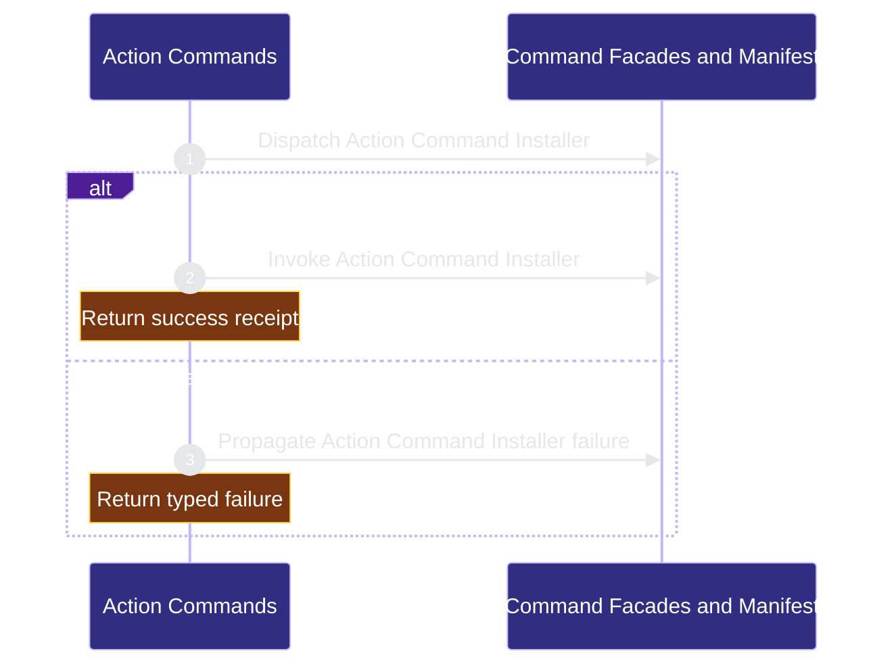
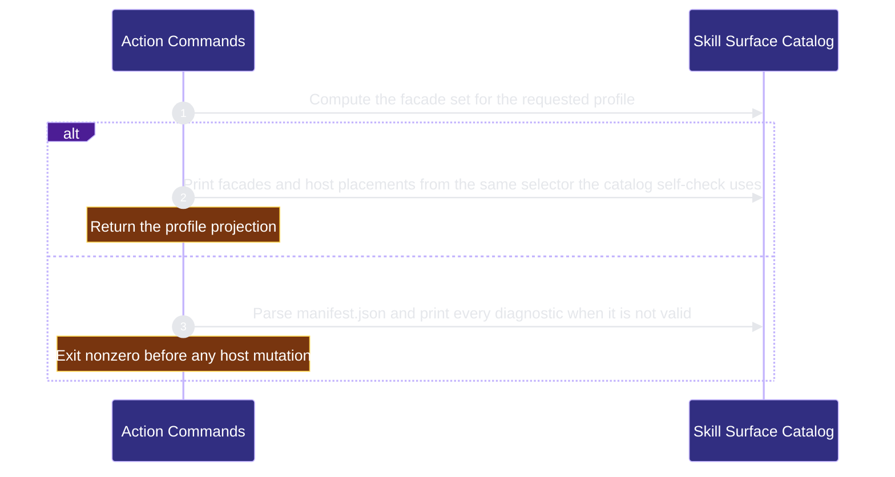

# public-surface/action-commands 架构文档
<!-- BEGIN ARCHCONTEXT:generated target="projection_target.entity.capability-public-surface-action-commands" rendererVersion="archcontext.docs-renderer/v6" outputDigest="sha256:69a1420fd2d8f9eb8155c6cc2381f6b563f164933d8a80730df0c4aba76f4cce" -->
> **狀態**:`active`
> **Capability ID**:`capability.public-surface.action-commands`(kind `capability`)
> **Matched Prefixes**:`assets/skill-commands/**`、`assets/skills/**`、`assets/skill-version.json`、`.claude/.skill-version`、`src/core/skill-surface/**`、`scripts/skill-surface-select.ts`、`scripts/run-skill-routing-eval.ts`、`scripts/check-skill-version.ts`
> **Local Contracts**:`AGENTS.md`、`CLAUDE.md`
> **事實優先級**:倉庫當前狀態 > 本文檔機器區 > 本文檔人工區。機器區(引言、§1、§2)由 ArchContext 從架構模型與源碼度量投影生成,手改會在下次投影被覆蓋。本文檔不記錄出處;本次投影所驗證的 commit 見 `docs/architecture/.projection-manifest.json`。

Defines the user-facing action command skill surface, the bundled skill packages and the skill-surface catalog that projects them.

## 1. P1:能力架構地圖

### 1.1 架構圖

- Proof: `proven` (`sha256:e5d3cbf83106534be399b61d9040ffed117f794fcd9d6302cd342253a347f07f`).
- Semantic nodes: `4`; declared relations: `4`.

### 1.2 模組職責表

| 宣告入口 | 錨點 | 職責 |
| --- | --- | --- |
| `entrypoint.action-commands.primary` | `src/cli/commands/init.ts#installExternalSkills` | `sink.action-commands.primary` → `src/cli/commands/init.ts#loadSkillSurfaceCatalog` |

組件入口:

| 組件 | 宣告入口 | 錨點 | 職責 |
| --- | --- | --- | --- |
| `component.action-commands.skill-surface-catalog` | `entrypoint.action-commands.profile-projection` | `scripts/skill-surface-select.ts#main` | `sink.action-commands.facades-for-profile` → `src/core/skill-surface/catalog.ts#facadesForProfile` |
| `component.action-commands.skill-surface-catalog` | `entrypoint.action-commands.profile-projection` | `scripts/skill-surface-select.ts#loadCatalog` | `sink.action-commands.parse-catalog` → `src/core/skill-surface/catalog.ts#parseSkillSurfaceCatalog` |

### 1.3 規模信號

- 規模量級:`50–100` 個文件 / `5000–10000` 行
- 匹配前綴:`assets/skill-commands/**`、`assets/skills/**`、`assets/skill-version.json`、`.claude/.skill-version`、`src/core/skill-surface/**`、`scripts/skill-surface-select.ts`、`scripts/run-skill-routing-eval.ts`、`scripts/check-skill-version.ts`
- 推導:掃描 `source.include` 減 `source.exclude`,跳過 `.git/` 與 `node_modules/`,再按 1–2–5 階梯分桶。精確計數不入本文檔:量級足以回答「這個能力有多大」,而逐行計數會讓覆蓋範圍內任何一次源碼改動都改寫本文檔。

### 1.4 依賴邊界

出向關係:

- `calls` → `component.action-commands.primary` — Install action command skills
- `calls` → `component.action-commands.skill-surface-catalog` — Select the facade and host placement projection for a profile

入向關係:

- 無。

組件出向關係:

- `component.action-commands.bundled-skills`:
  - 無。
- `component.action-commands.primary`:
  - `depends-on` → `component.action-commands.bundled-skills` — Name bundled skill packages as manifest package sources
- `component.action-commands.skill-surface-catalog`:
  - `reads` → `component.action-commands.primary` — Read manifest.json as the single catalog authority

### 1.5 組件結構

| 組件 | 名稱 | 規模量級 | 宣告入口 |
| --- | --- | --- | --- |
| `component.action-commands.bundled-skills` | Bundled Skill Packages | `20–50` 個文件 / `2000–5000` 行 | 未宣告 |
| `component.action-commands.primary` | Command Facades and Manifest | `10–20` 個文件 / `1000–2000` 行 | 未宣告 |
| `component.action-commands.skill-surface-catalog` | Skill Surface Catalog | `5–10` 個文件 / `2000–5000` 行 | `entrypoint.action-commands.profile-projection` |

## 2. P2:端到端數據流

> **Proof**: `proven` (`sha256:e5d3cbf83106534be399b61d9040ffed117f794fcd9d6302cd342253a347f07f`); selectors `3/3`.

<!-- END ARCHCONTEXT:generated target="projection_target.entity.capability-public-surface-action-commands" -->
## 3. P3：设计决策与不变量

用户选择的是意图（plan、check、ship、architecture）。执行步骤属于 CLI 和 hooks。本 capability 只拥有意图的目录、目录背后的技能包，以及把目录投影到各 host 的选择器。

### 3.1 必须保持的不变量

1. **manifest 是唯一的发现权威。** `assets/skill-commands/manifest.json` 声明全部 22 个 package、两个 profile 和三个 host（claude、codex、pi）的投影。其余表示都是投影。
2. **声明的投影必须等于计算的投影。** `expectedProjections` 是声明。catalog 用同一个 selector 重新计算 facade、external skill 和 host placement。二者不等就报 `PROJECTION_MISMATCH`（`src/core/skill-surface/catalog.ts:760-790`）。selector 只有一份实现，导出的 selector 与内部自检共用（`catalog.ts:214-215` 的注释）。
3. **catalog 是纯函数。** `catalog.ts` 没有 import，不碰文件系统和进程。调用方负责读取 `manifest.json`（`catalog.ts:1-6`）。`profile-components.ts` 是 profile 组件表的唯一来源，installer 只是再导出（`src/cli/installer/install-profile.ts:35`、`:76`）。
4. **shell 不复制选择逻辑。** 同步脚本调用一次 `scripts/skill-surface-select.ts profile-projection`，用它的输出决定 facade 与 host placement。
5. **内部步骤永远不是公共命令。** `hooks-init`、`docs-init`、`create-project-dirs` 列在 `nonPublicInternalSteps`（`manifest.json:485-489`）。`tests/action-command-skills.test.ts:84`、`:267` 钉住这一点。
6. **写 host skill 目录之前先证明归属。** 同步脚本只接受三种证明：指向包内目标的 symlink、三项全中的 owner marker（`owner`、`surface`、`content_hash`），或与包内源逐字节相同的目录。最后一种是 marker 引入前的一次性迁移分支（`scripts/sync-codex-installed-copies.sh:182-203`）。两个 host 根目录的 `preflight_skill_root` 在任何写入之前执行（`:406-407`）。未知或被改动的目录让整个同步以 exit 1 结束。
7. **facade 必须编排多个 CLI 能力，或携带超出单个命令的领域规则。** 只给一个 CLI 子命令改名的 skill 不允许。每个 engine verb 一个 skill 也不允许。`repo-harness-chatgpt` 是 ChatGPT engine 唯一的 facade（`assets/skill-commands/CLAUDE.md:14-16`）。
8. **退役是数据。** `retiredPackages` 有 20 条记录。每条指向替代者，或者是 `null`（`repo-harness-autoplan`、`codex-review`）。它不参与投影，只回答"这个名字去哪了"，并给出清理动作和历史指纹。

### 3.2 关键权衡

| 决策 | 权衡 |
| --- | --- |
| `expectedProjections` 手写并按顺序比较（`catalog.ts:202` 的 `arraysEqual`） | 新命令默认不可发现，必须显式加入投影表。代价是到 50 个以上 package 时，每次插入都要改三张表，`PROJECTION_MISMATCH` 会变成例行修补。 |
| `kind: judge` 的 `merge-gate` 用空 `hosts` 和空 `profiles` 表示"不可选" | 所有 selector 已经按这两个字段过滤，不需要新增 `installable: false`。代价是读者要知道空数组的含义。 |
| 只有 `minimal` 和 `full` 两个 profile | 默认发现面小而稳定。代价是出现第三类用户时，压力先落在 profile 词表上。 |
| `tests/action-command-skills.test.ts` 用 `toContain` 钉住 facade 措辞 | boundary 不会被悄悄放宽。代价是每次改 prose 都要同步改测试。 |
| 同步脚本对每个带 marker 的目标重算 `managed_tree_hash`（`sync-codex-installed-copies.sh:121`） | 归属证明不依赖时间戳。代价是 facade 数量增长时，每次 `init` 的哈希成本线性增长。 |

### 3.3 组件拆分（2026-10-11）

数据来源：`archctx refactor scan --json`（archctx 0.7.0）。组件 footprint 写在各 component 节点的 `source.include` 里。

| 组件 | footprint | 文件 / 行 | 职责 |
| --- | --- | --- | --- |
| `component.action-commands.primary`（Command Facades and Manifest） | `assets/skill-commands/**` | 13 / 1094 | manifest 与薄 facade |
| `component.action-commands.bundled-skills` | `assets/skills/**` | 34 / 2340 | manifest 以 `source` 指向的技能包 |
| `component.action-commands.skill-surface-catalog` | `src/core/skill-surface/**`、`scripts/skill-surface-select.ts`、`scripts/run-skill-routing-eval.ts`、`scripts/check-skill-version.ts`、`assets/skill-version.json`、`.claude/.skill-version` | 7 / 3339 | 解析目录、计算投影、检查 skill 版本 |

依赖方向：catalog 读取 primary 的 `manifest.json`。primary 的 manifest 以 `source` 字段指向 bundled-skills 的包目录（例如 `manifest.json:34`）。bundled-skills 不调用任何组件。

catalog 的消费者分布在多个 capability：`src/cli/commands/init.ts` 和 `global-runtime.ts`、`src/cli/installer/install-profile.ts` 和 `skill-projection.ts`、`src/cli/commands/doctor.ts`、`src/core/upgrade/legacy-inventory.ts`、`src/cli/commands/setup-snapshot.ts`、`src/effects/strategy/skill.ts`。只有 strategy-reflection 的入向 relation 已声明，其他由各自的分组声明。

`.claude/.skill-version` 和 `assets/skill-version.json` 是版本 pin，由 `scripts/check-skill-version.ts` 检查。它们与 catalog 一起变化，所以放在 catalog 组件。

### 3.4 开放问题

- `scripts/run-skill-routing-eval.ts`（1603 行）调用 evals-checks 的 `scripts/run-skill-evals.ts`。它归 catalog 还是归 evals-checks？归属提议 §1d 放在本 capability，理由是"Skill surface"。这个选择的置信度没有记录。
- `scripts/skill-surface-select.ts` 动态 import `src/cli/installer/install-profile.ts`（hook-adapters）来计算树哈希。catalog 组件因此依赖 hook-adapters。这是否应该改为依赖一个共享的树哈希模块？没有记录。

## 4. 历史决策记录（append-only）

改写前的 `docs/architecture/modules/public-surface/action-commands.md`（`# Architecture Module: public-surface/command-facades`，91 行，含 `## P1 Map` / `## P2 Trace` / `## P3 Decision` / `## Optimization Backlog`）**不含任何带日期的章节**，因此本 ledger 从空开始。后续每条带日期的决策在此追加，逐字保留原文，不改写、不翻译。

_（暂无条目）_

### 2026-10-11 组件拆分与归属扩展

- 本 capability 拆成三个组件：primary（Command Facades and Manifest）、bundled-skills、skill-surface-catalog。
- capability include 增加原本没有归属的路径：`assets/skills/**`、`src/core/skill-surface/**`、三个 skill 脚本和两个版本 pin 文件。没有删除任何条目。
- 新增 flow `flow.action-commands.profile-projection`。它证明 `skill-surface-select.ts` 的 profile 投影路径和 manifest 无效时的拒绝路径。

## 5. Optimization Backlog

- Add an eval case whenever a new command changes routing behavior.
- Keep command facades thin; move policy into scripts, manifests, or reference configs.
- 集成步骤添加了到 skill-surface-catalog 的入向 relation：hook-adapters host-installer、global-runtime-reconciliation 的 primary、release-packaging 与 cli-root，以及 contract-assets template-projection。
- 回边（不声明）：`scripts/skill-surface-select.ts:64-84` 动态导入 hook-adapters 的 `install-profile.ts` 与 global-runtime-reconciliation 的 `skill-tree-integrity.ts`。`scripts/check-skill-version.ts:15` 导入 contract-assets 的 `scripts/workflow-contract.ts`。入向边更多（hook-adapters 12 对 5，global-runtime-reconciliation 11 对 2，contract-assets 5 对 3）。
- `expectedProjections` 超过约 50 个 package 时，评估从 package 条目派生投影表。派生会削弱"新命令默认不可发现"，需要一次显式决策。
