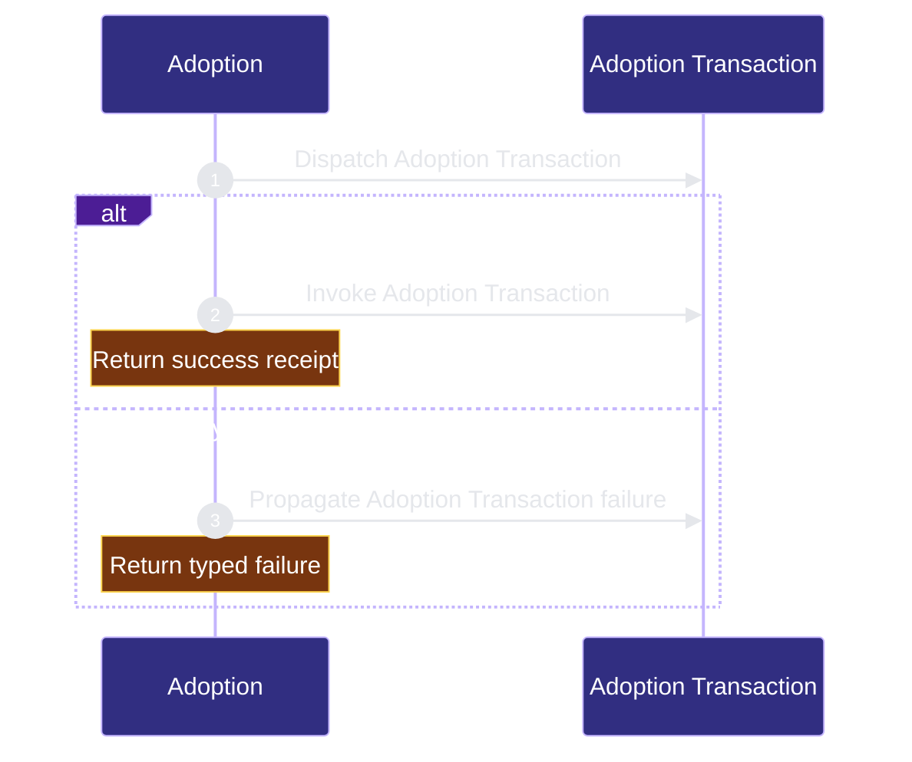

# public-surface/adoption 架构文档
<!-- BEGIN ARCHCONTEXT:generated target="projection_target.entity.capability-public-surface-adoption" sourceDigest="sha256:b142a04872b9b07f03e484e47d2c04898b17853d551e66f23920ef81a6e2d211" rendererVersion="archcontext.docs-renderer/v5" outputDigest="sha256:9e1f3dfe4e96d039898f65566b3afd06ef91675b371fea3ce51eb5a8e74edb4c" -->
> **狀態**:`active`
> **Capability ID**:`capability.public-surface.adoption`(kind `capability`)
> **Matched Prefixes**:`src/cli/commands/adoption-plan.ts`、`src/core/adoption/**`、`src/effects/fs-transaction.ts`、`src/effects/path-safety.ts`、`tests/cli/adoption-plan.test.ts`、`tests/fixtures/adoption/**`、`src/cli/repo-adoption/**`、`src/cli/commands/migrate.ts`
> **Local Contracts**:`AGENTS.md`、`CLAUDE.md`
> **事實優先級**:倉庫當前狀態 > 本文檔機器區 > 本文檔人工區。機器區(引言、§1、§2)由 ArchContext 從架構模型與源碼度量投影生成,手改會在下次投影被覆蓋。本文檔不記錄出處;本次投影所驗證的 commit 見 `docs/architecture/.projection-manifest.json`。

Plans and applies repository adoption through the canonical filesystem transaction boundary.

## 1. P1:能力架構地圖

### 1.1 架構圖


- Proof: `proven` (`sha256:10dbfde8a2200fc50316ccffa30c6730cecbe1b0f9c1579db07c0681af104316`).
- Semantic nodes: `2`; declared relations: `1`.

### 1.2 模組職責表

| 宣告入口 | 錨點 | 職責 |
| --- | --- | --- |
| `entrypoint.adoption.primary` | `src/cli/commands/adoption-plan.ts#runAdoptionApply` | `sink.adoption.primary` → `src/effects/fs-transaction.ts#applyAdoptionPlan` |

組件入口:

- 組件均未宣告 `source.entrypoints`。

### 1.3 規模信號

- 規模量級:`20–50` 個文件 / `5000–10000` 行
- 匹配前綴:`src/cli/commands/adoption-plan.ts`、`src/core/adoption/**`、`src/effects/fs-transaction.ts`、`src/effects/path-safety.ts`、`tests/cli/adoption-plan.test.ts`、`tests/fixtures/adoption/**`、`src/cli/repo-adoption/**`、`src/cli/commands/migrate.ts`
- 推導:掃描 `source.include` 減 `source.exclude`,跳過 `.git/` 與 `node_modules/`,再按 1–2–5 階梯分桶。精確計數不入本文檔:量級足以回答「這個能力有多大」,而逐行計數會讓覆蓋範圍內任何一次源碼改動都改寫本文檔。

### 1.4 依賴邊界

出向關係:

- `calls` → `component.adoption.primary` — Apply repository adoption

入向關係:

- `calls` ← `component.contract-assets.template-projection` — Plan and apply the transactional adoption for repository init
- `calls` ← `capability.runtime-harness.evidence-ledger` — Resolve blob and log paths inside the repository with the shared path-safety helper
- `calls` ← `component.global-runtime-reconciliation.cli-root` — Register the adoption-plan command and run the adoption plan for the setup check
- `calls` ← `component.global-runtime-reconciliation.primary` — Classify retired surfaces with the adoption fingerprints and back up removals in an FsTransaction manifest under the target lock
- `calls` ← `component.hook-adapters.host-installer` — Share the managed hook command fingerprints with the adoption migration
- `calls` ← `component.hook-adapters.session-lifecycle` — Check the one-release run summary cleanup paths with the shared path safety rules

組件出向關係:

- `component.adoption.primary`:
  - 無。

### 1.5 組件結構

| 組件 | 名稱 | 規模量級 | 宣告入口 |
| --- | --- | --- | --- |
| `component.adoption.primary` | Adoption Transaction | 未宣告 `source.include` | 未宣告 |

## 2. P2:端到端數據流

> **Proof**: `proven` (`sha256:10dbfde8a2200fc50316ccffa30c6730cecbe1b0f9c1579db07c0681af104316`); selectors `1/1`.


<!-- END ARCHCONTEXT:generated target="projection_target.entity.capability-public-surface-adoption" -->
## 3. P3：设计决策与不变量

### 3.1 必须保持的不变量

1. **单一事实源。** `assets/workflow-contract.v1.json` 和 `standard-plan.ts` 的默认值定义 canonical 字节。plan、manifest、registry 和 Markdown 视图都是投影。
2. **规划层无副作用。** `src/core/adoption/**` 不 import `src/effects/**`。`planAdoption`（`src/core/adoption/plan.ts:22`）只读文件系统。`--dry-run` 的输出和 apply 执行的是同一个 operation 模型。
3. **前置条件在规划期固化。** 每个 operation 带 `expectedContentHash` 或 `expectedAbsent`（`src/core/adoption/operations.ts:27`、`:29`）。规划与执行之间若有并发编辑，执行失败，不覆盖。
4. **回滚策略在规划期固化。** `rollbackMetadataForOperation`（`src/core/adoption/rollback.ts:11`）为每个 operation 生成回滚说明。`--dry-run` 输出因此也是一份回滚说明书。
5. **executor 只有一个调用点。** `applyAdoptionPlan` 在 `src/` 中只被 `src/cli/commands/adoption-plan.ts:150` 调用。
6. **失败关闭。** 非法路径、哈希不符、归属不明、不支持的 kind 都让流程停止或告警。流程不靠扩大删除范围继续。
7. **保护用户归属。** `.gitignore` 只改受管区块（`src/core/adoption/managed-block.ts:54`）。hook 配置只删 repo-harness 自有的命令对象（`managed-hook-config.ts:49-53`）。known-generated 清理只删字节匹配声明指纹的文件。
8. **manifest 与文件效果同属一个事务。** manifest 写入失败，事务整体失败（`src/effects/fs-transaction.ts:561`）。回滚只碰本事务拥有的目标，apply 之后的用户编辑不会被覆盖。
9. **self-host apply 保持关闭。** `runAdoptionApply` 对 `mode === "self-host"` 返回 `self_host_review_required`（`adoption-plan.ts:138-146`）。`standard-plan.ts:841-842` 的不可执行 `runCheck` 是第二道防线。
10. **目标仓库必须是明确的 Git 工作树。** `validateRepoAdoptionTarget` 拒绝 HOME，也拒绝不在 Git 工作树内的 cwd（`src/cli/repo-adoption/target.ts`）。`init` 和 `adoption-plan` 共用这一个校验。

### 3.2 关键权衡

| 决策 | 权衡 |
| --- | --- |
| 规划与执行分离，所有条件判断前移到规划期 | 消除"预演说改 A，实际改了 B"。代价是 `standard-plan.ts` 涨到 850 行，十几个 `add*Operations` 步骤共享一个按顺序填充的数组。 |
| 每个目标一个 `O_EXCL` 文件锁（`withTargetLock`，`fs-transaction.ts:226`），没有全事务锁 | 两个并发 `init` 不会覆盖同一个文件。代价是它们可以交错出"一半来自事务 A、一半来自事务 B"的仓库状态。 |
| 每次写入都把原字节完整备份到 `.ai/harness/backups/fs-transaction/`（`fs-transaction.ts:32`） | 回滚总能恢复原内容。代价是这个目录没有保留期或 GC，单调增长。 |
| 全量 preflight 后串行执行 | 执行前一次性发现问题。代价是 operation 增多后时间窗变长，"target content changed after planning"更常见。可用性先下降，正确性不变。 |

### 3.3 10x 规模下先垮的点

1. **preflight 与 apply 之间的时间窗**（见 §3.2）。
2. **锁粒度。** 10x 并发下，事务交错是第一个真正的正确性缺口。
3. **备份体积**（见 §3.2）。
4. **`standard-plan.ts` 的顺序耦合。** 再加几类迁移，步骤顺序会变成隐式契约。拆分的触发条件是出现第二个独立的 plan producer。行数本身不是触发条件。

### 3.4 刻意不做的事

- 不为 `mergeJson`（`operations.ts:60`）补 executor。没有 producer 就没有需求。这个类型是历史遗留。如需清理，应作为独立工作包删除类型。
- 不引入独立 workspace package。本 capability 与 CLI 同包发布，没有第二个独立消费者。
- 不加 shell 兼容 apply 路径、experimental apply flag 或第二套 plan parser。

### 3.5 与专题文档的关系

`docs/architecture/transactional-adoption-planner.md` 是本 capability 的主题设计文档（HRD-09 legacy 退役、不变量清单、恢复语义）。与源码复验后的两处补充：

- 该文的 P1 说 `standard-plan.ts` 被 `init` 与 `runInit()` 共同消费。源码中两者都经过 `planAdoption`。`planAdoption` 对 self-host 源码 checkout 有短路分支，这时 `standard-plan.ts` 不被调用。
- 该文没有记录 `runAdoptionApply` 对 self-host 的显式阻断（§3.1 第 9 条）。

### 3.6 归属与开放问题（2026-10-11）

- include 增加原本没有归属的 `src/cli/repo-adoption/**` 和 `src/cli/commands/migrate.ts`。没有删除任何条目。
- `repo-harness migrate`（`src/cli/commands/migrate.ts`）删除 repo 级旧 hook adapter。它与 `init` 共用 `core/adoption/managed-hook-config.ts` 的识别逻辑。它的写入用逐文件备份加原子写（`migrate.ts:14-18`），不经过 `applyAdoptionPlan`。这是 §3.1 第 5 条之外的第二条写入路径。它是有意保留的独立迁移命令，还是应该并入 FsTransaction？没有记录。
- `src/effects/path-safety.ts` 被 `src/core/evidence/` 和 `src/effects/evidence/` 下的 7 个文件 import（归属提议 §7 风险 3）。这条反向依赖会在 evidence-ledger 建立后成为一条进入本 capability 的跨 capability 边。它是否应该移到共享位置？没有记录。

---

## 4. 历史决策记录（append-only）

此前版本的 `docs/architecture/modules/public-surface/adoption.md` 不含任何带日期的决策章节，因此本节目前为空。后续所有带日期的决策条目在此按时间追加，原文保留、不得改写。

### 2026-10-11 归属扩展与 P3 复核

- include 增加 `src/cli/repo-adoption/**` 和 `src/cli/commands/migrate.ts`。
- P3 改为"必须保持的不变量 / 关键权衡"结构，并按当前源码更新行号（`standard-plan.ts` 850 行，`withTargetLock` 在 `fs-transaction.ts:226`）。

---

## 5. Verification

```bash
bun test tests/cli/adoption-plan.test.ts
bun run check:type
bun src/cli/index.ts init --repo . --dry-run
```

## Optimization Backlog

- 决定 `repo-harness migrate` 是否并入 FsTransaction（见 §3.6）。
- 在 arch-context#296 之后，删除与 evals-checks 重复的测试条目（`tests/cli/adoption-plan.test.ts`、`tests/fixtures/adoption/**`），`verification` 命令保持不变。
