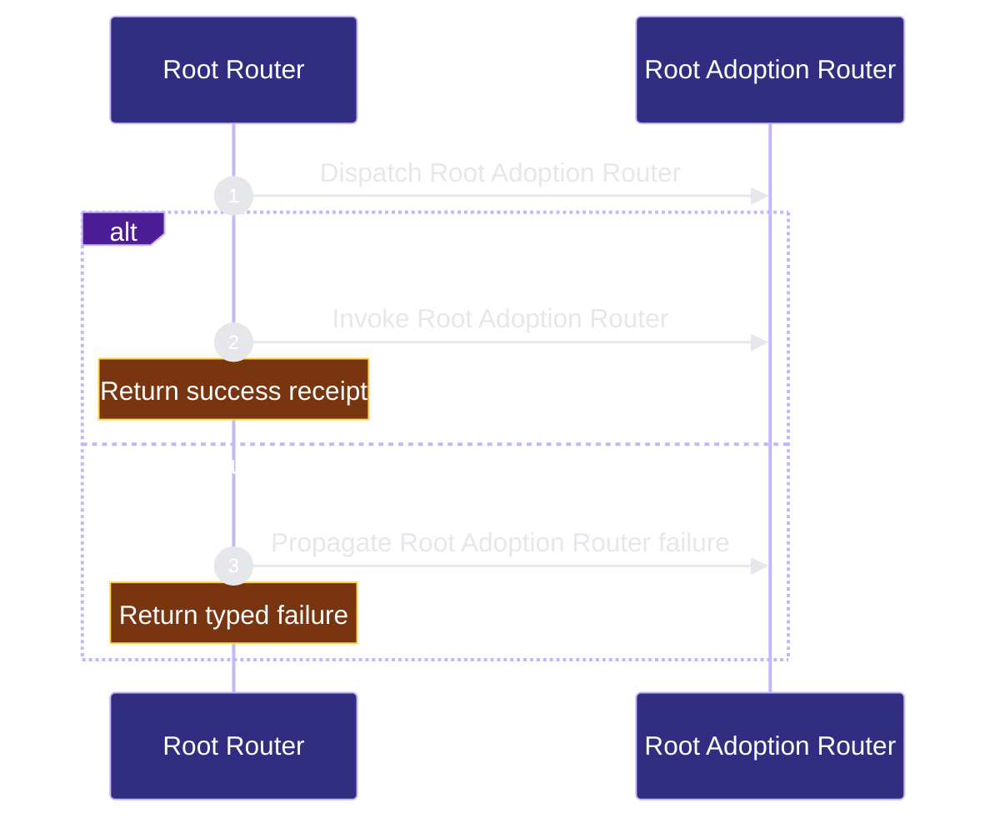

# public-surface/root-router 架构文档
<!-- BEGIN ARCHCONTEXT:generated target="projection_target.entity.capability-public-surface-root-router" sourceDigest="sha256:403073375c00d5903b6fd1661307287416ab031674500100c5ca779c320647ff" rendererVersion="archcontext.docs-renderer/v5" outputDigest="sha256:54de3adbee51d2321750d692c6a63b9ce3c1871c91282d491ec56ced218b0a72" -->
> **狀態**:`active`
> **Capability ID**:`capability.public-surface.root-router`(kind `capability`)
> **Matched Prefixes**:`SKILL.md`、`references/pm-boundary.md`、`README.md`、`AGENTS.md`、`CLAUDE.md`、`docs/spec.md`、`README.es.md`、`README.fr.md`、`README.ja.md`、`README.zh-CN.md`、`references/arch/**`、`src/cli/commands/docs.ts`
> **Local Contracts**:`AGENTS.md`、`CLAUDE.md`
> **事實優先級**:倉庫當前狀態 > 本文檔機器區 > 本文檔人工區。機器區(引言、§1、§2)由 ArchContext 從架構模型與源碼度量投影生成,手改會在下次投影被覆蓋。本文檔不記錄出處;本次投影所驗證的 commit 見 `docs/architecture/.projection-manifest.json`。

Routes repository-level product and agent context into capability-specific contracts.

## 1. P1:能力架構地圖

### 1.1 架構圖

- Proof: `proven` (`sha256:d0ae54672447b74f61fc71d824e589eb5120a92e9b1b031830eecbba139c3f59`).
- Semantic nodes: `2`; declared relations: `1`.

### 1.2 模組職責表

| 宣告入口 | 錨點 | 職責 |
| --- | --- | --- |
| `entrypoint.root-router.primary` | `src/cli/commands/adoption-plan.ts#runAdoptionPlan` | `sink.root-router.primary` → `src/cli/commands/adoption-plan.ts#createPlan` |

### 1.3 規模信號

- 規模量級:`10–20` 個文件 / `5000–10000` 行
- 匹配前綴:`SKILL.md`、`references/pm-boundary.md`、`README.md`、`AGENTS.md`、`CLAUDE.md`、`docs/spec.md`、`README.es.md`、`README.fr.md`、`README.ja.md`、`README.zh-CN.md`、`references/arch/**`、`src/cli/commands/docs.ts`
- 推導:掃描 `source.include` 減 `source.exclude`,跳過 `.git/` 與 `node_modules/`,再按 1–2–5 階梯分桶。精確計數不入本文檔:量級足以回答「這個能力有多大」,而逐行計數會讓覆蓋範圍內任何一次源碼改動都改寫本文檔。

### 1.4 依賴邊界

出向關係:

- `calls` → `component.root-router.primary` — Route root initialization

入向關係:

- 無。

## 2. P2:端到端數據流

> **Proof**: `proven` (`sha256:d0ae54672447b74f61fc71d824e589eb5120a92e9b1b031830eecbba139c3f59`); selectors `1/1`.

<!-- END ARCHCONTEXT:generated target="projection_target.entity.capability-public-surface-root-router" -->
## 3. P3：设计决策与不变量

工作流里可由机器检查的不变量太多，prose 无法保持它们正确。所以 policy 放在 contract、script 和 test 里。根文档只做路由和定向。`SKILL.md` 只给命令名和 reference 名，协议在被指向的文件里。

### 3.1 必须保持的不变量

1. **根 router 有 2048 字节的常驻预算。** 每个 host 在每个 session 选择动作之前都加载 `SKILL.md`。测试注释写明这是常驻成本预算，不是风格规则（`tests/bootstrap-files.test.ts:48-52`）。当前正文 1999 字节（含 frontmatter）。
2. **五个动作封闭。** setup、plan、execute、verify、handoff 的序号和加粗格式被逐字断言。新增公开命令不能变成第六个动作，只能挂在现有动作下作为 facade。
3. **状态权威唯一。** `repo-harness state resolve --json` 是唯一入口。其他文件只在这个 JSON 指向时才读。router 不缓存也不复述状态。
4. **`AGENTS.md` 与 `CLAUDE.md` 是两份独立的普通文件，共享规则逐字相同。** 两个文件在 host 专属章节（`## Codex` 与 `## Claude Code`）之前的部分必须相等（`tests/bootstrap-files.test.ts:160-162`）。两者不能是 symlink，也不能用 `@` 引用对方（`:153-155`）。PR #486 恢复了这个形状。
5. **内部步骤不是公共命令。** `hooks-init`、`docs-init`、`create-project-dirs` 永远不公开。
6. **专用 skill 不进入隐式发现。** `repo-harness-setup`、`repo-harness-architecture`、`repo-harness-chatgpt`、`repo-harness-strategy` 的 `profiles: []` 加上 `cli-reference` 或 `explicit-setup` 的 discoverability，使它们只能经 router 或显式安装到达。
7. **没有兼容回落。** install state 从 protocol 1 到 2 只有一条显式迁移路径（`--migrate-profile-state`）。越界一律失败。

### 3.2 关键权衡

| 决策 | 权衡 |
| --- | --- |
| router 做薄，细节放到 `references/*.md` 和 reference configs | 常驻上下文小，并且与命令数无关。代价是 agent 要多读一次被指向的文件。 |
| 公开命令要在 manifest、README 和 `tests/action-command-skills.test.ts` 三处同步 | 新命令不会悄悄进入默认发现面。代价是每个新命令有固定的摩擦。 |
| `AGENTS.md` 与 `CLAUDE.md` 重复共享规则，不互相引用（PR #486） | 每个 host 可以独立读懂自己的文件。代价是共享规则有两份，靠测试保持一致。历史 inspection 仍按全文差异给出 `root-agent-context-divergent` advisory（PR #486 风险段）。 |
| 规划只有一个生命周期所有者：父 agent | `geju` 在 contract 之前扩展设计空间。P1/P2/P3 和最终计划仍由父 agent 负责。不需要依赖 host 的外部规划门。 |

### 3.3 10x 规模下先垮的点

先垮的是发现面，文件大小不会先垮。公开命令从约 10 个涨到 100 个时：

- `SKILL.md` 不受影响。五个动作是常数，2048 字节预算与命令数无关。
- `manifest.json#expectedProjections` 先出问题。它手写三张表（facade、external skill、host placement），覆盖 2 个 profile 和 3 个 host。命令数增长后，要么手写维护失败，要么改成从 package 条目派生。派生会削弱"新命令默认不可发现"。
- `retiredPackages` 只增不减（当前 20 条）。它最终会比 `packages` 本身大。

### 3.4 已知漂移

| 项 | 声明 | 工作树事实 | 判定 |
| --- | --- | --- | --- |
| verify 命令形态 | `docs/spec.md:58`、`:182` 规定 canonical helper 调用是 `repo-harness run <helper>` | `README.md:117` 写 `bash scripts/check-task-workflow.sh` | 本自托管仓库两种都能运行。README 是下游读者的入口，它展示的是非 canonical 形态。 |
| 本文旧版的 workstream 漂移 | 旧版引用 `.ai/context/capabilities.json` 声明的 `tasks/workstreams/public-surface/root-router` | `.ai/context/capabilities.json` 已不存在；`.ai/context/context-map.json:92` 只声明 `tasks/workstreams/**/*.md` 模式 | 旧条目失效，已删除。 |

### 3.5 归属与开放问题（2026-10-11）

- include 增加原本没有归属的路径：四个 README 译本、`references/arch/**` 和 `src/cli/commands/docs.ts`。没有删除任何条目。
- `src/cli/commands/docs.ts` 列出并读取 `assets/reference-configs/*.md`（`docs.ts:15`）。归属提议说它解析 `references/*.md`，这与源码不符。它的数据归 contract-assets。命令归本 capability，是因为 `repo-harness docs` 是面向用户的文档入口。这个选择的置信度是 MEDIUM。
- `references/arch/**`（7 个技术栈推荐文档，来自 2026-03-19 的初始提交）在仓库里没有任何引用者。它应该保留为 router 的参考材料，还是退役？没有记录。
- `SKILL.md` 指向 `references/bot-control.md`、`references/dot-pm-control.md` 和 `references/handoff.md`。这些文件和 `references/` 下其他松散文档目前没有归属。`references/pm-boundary.md` 归本 capability，`references/pm-operations.md` 归 pm-dispatch。

## 4. 历史决策记录（append-only）

本文件在 main@13686d8d 之前没有带日期的章节。为不丢失既有判断，以下逐字保留改写前版本（`docs/architecture/modules/public-surface/root-router.md`）的 P1 / P2 / P3 全文，英文原文不翻译。

<!-- BEGIN verbatim: pre-rewrite root-router.md, P1/P2/P3 -->

### Pre-rewrite `## P1 Map`

The root router is the human and agent entrypoint for this plugin. `SKILL.md`
defines when the skill is used and exactly five semantic actions: setup, plan,
execute, verify, and handoff. Its body is capped at 2KB. `README.md` owns first-run operator
guidance. `AGENTS.md` and `CLAUDE.md` define the self-hosted repo workflow for
both Codex and Claude. `docs/spec.md` owns the stable product outcome.

Strong dependencies:

- `scripts/inspect-project-state.ts` for state classification.
- `assets/workflow-contract.v1.json` for the machine-readable contract.
- `docs/reference-configs/agentic-development-flow.md` for routing detail that should not bloat root docs.

Weak dependencies:

- `repo-harness install --profile <profile>` owns first-run global bootstrap;
  the closed vocabulary is `minimal|full`, and full is the default.
- `repo-harness uninstall` previews/applies owned user-configuration cleanup via `--dry-run`/`--json`, restores receipted configuration fragments, and reports unresolved ownership with a nonzero partial result. Existing profile ownership governs file removal; static history and third-party packages remain.
- `repo-harness init` owns repo-local harness adoption and refresh.
- `geju` is a pre-contract framing skill; repo-harness has no external knowledge-CLI runtime or readiness dependency. This self-host repo vendors CodeGraph as a dev dependency while downstream generated repos keep global MCP setup explicit unless policy opts in.

Out of scope:

- Runtime hook implementation.
- Migration internals.
- Product scaffold details after initial harness attachment.

### Pre-rewrite `## P2 Trace`

Concrete route: user explicitly asks for setup -> root `SKILL.md` selects setup
-> `repo-harness install` selects full and plans CLI, effective state, guards,
handoff, adapters, planning integrations, agent fleet, verifier, cross-model
acceptance, and release gates -> `--dry-run` lists install/skip/remove -> apply
persists protocol-2 `~/.repo-harness/install-state.json`. Explicit
`--profile minimal` selects the 7-hook baseline; full selects 11. Legacy
protocol-1 state is rejected outside `--migrate-profile-state`.

Concrete route: user asks for an existing repo install -> root `SKILL.md`
selects the setup action -> `repo-harness-setup` (init mode) routes to
`repo-harness init --repo <repo>` ->
the command runs `inspect-project-state.ts --repo <repo> --format text` -> if no
legacy state is found, `repo-harness init --repo <repo>`
installs or refreshes the workflow -> repo-local checks verify the target repo.

Concrete route: user asks for product discovery or a complex/design architecture
plan -> the parent agent invokes `geju` before a contract exists -> the parent
completes P1 architecture mapping, P2 concrete tracing, and P3 design judgment
with its own repo/runtime capabilities -> it reconciles the evidence and freezes
the accepted thesis, falsifier, and execution boundary into the file-backed plan
and contract. The captured contract, not a live planning provider, owns execution.

For global bootstrap, the input source of truth is the selected host target and
brain root, not the current directory. For repo-local adoption, the source of
truth is the target repo path, not the user's wording. The first repo-local type
transformation is repo filesystem state into `mode`,
`legacy_contract_version`, `drift_signals`, `required_decisions`, and
`upgrade_plan`. The final output is either a configured host runtime or a
file-backed harness plus verification report.

Error paths:

- Missing cwd/repo path stops before mutation.
- Legacy docs route to migration before template refresh.
- Missing JSON runtime fails strict workflow verification.

### Pre-rewrite `## P3 Decision`

The root router is intentionally thin because the workflow has too many
machine-checked invariants to keep correct in prose. The invariant is that
policy lives in contracts, scripts, and tests; root docs only route and orient.

Planning has one lifecycle owner: the parent agent. `geju` expands the design
space before capture, while P1/P2/P3 and the final plan remain parent-owned.
This removes a host-dependent external planning gate without weakening the
file-backed approval, scope, review, or verification boundaries.

At 10x command count, this layer fails first through discovery overload. The
five-action router and profile-bounded installed facades keep specialized CLI
commands available without making them default model context.

<!-- END verbatim -->

**改写时的复验批注**（对上述原文，逐条对源码核对）：

- P1 的 5 个 prefix、2KB 上限、strong/weak dependency 列表——**全部复验通过**。
- P2 第一条 route（install profile / 7-hook / 11-hook / protocol-2 / 遗留拒绝）——**全部复验通过**。
- P2 第二条 route 中"`repo-harness init --repo <repo>` -> the command runs `inspect-project-state.ts`"——**与源码冲突**。`src/cli/**` 对 `inspect-project-state` 零引用；该探测是 `repo-harness-setup` 的 Shared Preflight 第 ② 步（`assets/skills/repo-harness-setup/SKILL.md:16`），发生在 mode selection **之前**、`init` 调用**之前**。所有者与时序两处都不同，正确形态见 §2.1。
- P3 的三段判断——**复验通过**，§3 在其基础上补了 manifest 组合爆炸这个具体的 10x 失效机制。

### 2026-10-11 归属扩展与 P3 复核

- include 增加 `README.es.md`、`README.fr.md`、`README.ja.md`、`README.zh-CN.md`、`references/arch/**` 和 `src/cli/commands/docs.ts`。
- §3.1 第 4 条按 PR #486 和 `tests/bootstrap-files.test.ts:160-162` 改写：两个 host 契约只要求共享规则相同，不再要求整个文件逐字节相同。

## Optimization Backlog

- Keep the root router body at or below 2KB and default installed discovery at five actions or fewer.
- If another public command is added, update `assets/skill-commands/manifest.json`, README, and `tests/action-command-skills.test.ts` in the same slice.
- `references/*.md` 中 10 个没有归属的松散文档等待 arch-context#296 或 `source.exclude` 支持。目录 glob `references/**` 会让 `references/pm-operations.md`（pm-dispatch）变成重复归属。按用户决定，不用显式文件列表绕过。
- 决定 `references/arch/**` 保留还是退役（见 §3.5）。
