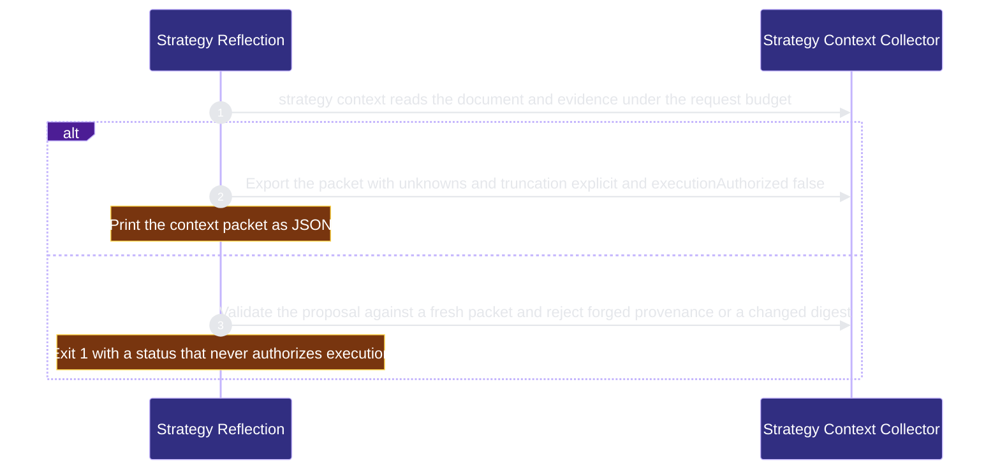

# public-surface/strategy-reflection 架構文檔

<!-- BEGIN ARCHCONTEXT:generated target="projection_target.entity.capability-public-surface-strategy-reflection" sourceDigest="sha256:e07250fd6952588b54aa5e51f498564fb60f2e2af484666e0caef821d8dc7001" rendererVersion="archcontext.docs-renderer/v5" outputDigest="sha256:971d8ac50490cf393e68eac9171c33da868cc4d69e4e4be68f86c7a7097d4876" -->
> **狀態**:`active`
> **Capability ID**:`capability.public-surface.strategy-reflection`(kind `capability`)
> **Matched Prefixes**:`src/core/strategy/**`、`src/effects/strategy/**`、`src/cli/commands/strategy.ts`、`docs/strategy/**`
> **Local Contracts**:`AGENTS.md`、`CLAUDE.md`
> **事實優先級**:倉庫當前狀態 > 本文檔機器區 > 本文檔人工區。機器區(引言、§1、§2)由 ArchContext 從架構模型與源碼度量投影生成,手改會在下次投影被覆蓋。本文檔不記錄出處;本次投影所驗證的 commit 見 `docs/architecture/.projection-manifest.json`。

Collects a bounded strategy context packet and validates inert strategic proposals on explicit request.

## 1. P1:能力架構地圖

### 1.1 架構圖

- Proof: `proven` (`sha256:168920c6c345980dec6497acbf74ca00c85486f701afc1313b76a583f1ad264d`).
- Semantic nodes: `2`; declared relations: `1`.

### 1.2 模組職責表

| 宣告入口 | 錨點 | 職責 |
| --- | --- | --- |
| `entrypoint.strategy-reflection.primary` | `src/cli/commands/strategy.ts#buildStrategyCommand` | `sink.strategy-reflection.primary` → `src/effects/strategy/context.ts#collectStrategyContext`、`sink.strategy-reflection.validate` → `src/effects/strategy/context.ts#validateStrategyRequest` |

組件入口:

- 組件均未宣告 `source.entrypoints`。

### 1.3 規模信號

- 規模量級:`5–10` 個文件 / `500–1000` 行
- 匹配前綴:`src/core/strategy/**`、`src/effects/strategy/**`、`src/cli/commands/strategy.ts`、`docs/strategy/**`
- 推導:掃描 `source.include` 減 `source.exclude`,跳過 `.git/` 與 `node_modules/`,再按 1–2–5 階梯分桶。精確計數不入本文檔:量級足以回答「這個能力有多大」,而逐行計數會讓覆蓋範圍內任何一次源碼改動都改寫本文檔。

### 1.4 依賴邊界

出向關係:

- `calls` → `component.strategy-reflection.primary` — Collect strategy context and validate a proposal

入向關係:

- `calls` ← `component.global-runtime-reconciliation.cli-root` — Register the strategy command

組件出向關係:

- `component.strategy-reflection.primary`:
  - `calls` → `component.action-commands.skill-surface-catalog` — Read the skill catalog to keep the strategy skill explicit-setup before projection
  - `reads` → `capability.workflow-engine.workflow-state` — Resolve effective state read-only for strategy context

### 1.5 組件結構

| 組件 | 名稱 | 規模量級 | 宣告入口 |
| --- | --- | --- | --- |
| `component.strategy-reflection.primary` | Strategy Context Collector | `5–10` 個文件 / `500–1000` 行 | 未宣告 |

## 2. P2:端到端數據流

> **Proof**: `proven` (`sha256:168920c6c345980dec6497acbf74ca00c85486f701afc1313b76a583f1ad264d`); selectors `2/2`.

<!-- END ARCHCONTEXT:generated target="projection_target.entity.capability-public-surface-strategy-reflection" -->

## 3. P3:設計決策與不變量

### 3.1 必须保持的不变量

1. **策略数据是惰性数据。** `StrategyPacket` 和 `Validation` 的 `executionAuthorized` 字段类型是字面量 `false`（`src/core/strategy/contracts.ts:20`、`:33`）。没有函数能产生 `true`。最好的结果是 `reviewable`，它的理由文本是"Owner and Bot review required"（`contracts.ts:121`）。CLI 的错误输出也带 `executionAuthorized: false`（`src/cli/commands/strategy.ts:8`）。
2. **只在显式请求时运行。** 本 capability 默认关闭。`strategy status` 只检查 `docs/strategy/context.json` 是否存在，不读文档，也不读 lesson（`src/effects/strategy/context.ts:227`）。skill 必须保持 `profiles: []` 和 `discoverability: explicit-setup`，否则投影直接失败（`src/effects/strategy/skill.ts:16`）。
3. **一个请求只有一份 IO 预算。** 提议、文档、Git 历史、Effective State 和最终复核共用同一个 `StrategyReader`（`context.ts:304-310`）。默认上限是单文件 64 KiB、总量 1 MiB、输出 128 KiB；repository pilot 是 128 KiB、4 MiB、5 秒（`context.ts:12-15`）。超出预算就失败，不跳过输入。
4. **只读仓库内的普通文件。** 路径不能是绝对路径，不能含 `..` 或 `.git`。任何一级是 symlink 就拒绝，中间目录是嵌套仓库也拒绝（`context.ts:25-44`）。
5. **证据要同时对上工作树和历史。** 每条 evidence 的 SHA-256 必须等于工作树内容，也必须等于记录的 Git revision 中的 blob（`context.ts:191-203`）。对不上的证据进入 `unknowns`，不进入 `sources`。
6. **收集结束前复核一次。** 文档、HEAD、每条已证明的证据、选中的 memory 正文、提议文件和 Effective State 都重读一次。任何一项变化都抛 `StrategySourceDriftError`，CLI 报告 `stale`（`context.ts:285-289`）。
7. **Effective State 观测是只读的。** 观测只允许一组只读 Git 子命令，并拒绝 `--output`、`--ext-diff`、`--textconv` 等参数（`context.ts:173-180`）。观测失败时 `stateRevision` 记为 `unavailable`，并写入 `unknowns`。它不让整个请求失败（`context.ts:215-224`）。
8. **memory 正文按需加载。** 只有 `--load` 显式列出的 active memory 才读取正文，最多 8 条（`context.ts:239`、`:267`）。其他 memory 只给摘要，标注 `authority: unverified_summary`。
9. **输出不藏截断。** 包超出输出上限时先丢 memory，再丢正文，并设置 `truncated: true`。它从不输出半个 JSON（`context.ts:279-282`）。

### 3.2 关键权衡

| 决策 | 权衡 |
| --- | --- |
| 固定的读取上限，超出即失败 | 结果有界，并且可以复现。代价是大仓库的 pilot 跑不完。PR #604 记录：真实仓库 pilot 读到 `docs/CHANGELOG.md`（193,534 字节）时在 128 KiB 单文件上限处失败。2026-10-09 所有者决定不提高上限，接受这次失败关闭的结果。 |
| 提议校验只做结构与出处检查，`semanticConsistency` 恒为 `unknown` | 校验器不假装理解策略内容。代价是 `reviewable` 只表示"可以给人和 Bot 审"，不表示提议正确。 |
| 上下文 digest 绑定所有选择字段 | 旧 digest 上的提议一定得到 `stale`。代价是任何源文件改动都会让在途提议失效。 |
| 作为独立的小 capability（约 0.7k 行） | 惰性提议这条不变量有自己的入口、存储和测试。先例是 refactor-program（"never executes a refactor"）。代价是多一个 capability 节点。归属提议 §7 的另一方案是并入 action-commands。 |

### 3.3 组件与依赖

本 capability 只有一个组件 `component.strategy-reflection.primary`（Strategy Context Collector），7 个文件共 709 行。

出向调用：
- 到 action-commands 的 skill-surface-catalog 组件：`projectStrategySkill` 读取 manifest，检查 strategy skill 仍是 explicit-setup（`skill.ts:14-16`）。已声明为 relation。
- 到 Effective State：`resolveEffectiveStateReadOnly`（`src/effects/state/resolve-effective-state.ts`）和 `readonly-observation.ts`。这两个文件归 workflow-state。集成步骤声明了 primary → workflow-state（`reads`）。

### 3.4 开放问题

- `src/effects/strategy/wake.ts` 的 `exportStrategyWakePacket` 在 `src/` 和 `scripts/` 中没有调用方，只有 `tests/strategy.test.ts` 使用它。它是为后续 Bot wake 集成保留的边界，还是应该退役？没有记录。
- 本仓库没有 `docs/strategy/context.json`，只有 `docs/strategy/repository-pilot.json`。所以 `strategy status` 在本仓库返回 `enabled: false`。PR #604 要求合并后在 main 上重跑一次 pilot。是否已经重跑？没有记录。

## 4. 歷史決策記錄(append-only)

### 2026-10-11 建立 capability 节点

- 新建 `capability.public-surface.strategy-reflection`、`component.strategy-reflection.primary`、两条 relation 和 `flow.strategy-reflection.primary`。用户决定它与 chatgpt-browser 各自独立。
- include 使用目录 glob：`src/core/strategy/**`、`src/effects/strategy/**`、`docs/strategy/**`，以及单文件 `src/cli/commands/strategy.ts`。这些路径之前都没有归属。
- `assets/skills/repo-harness-strategy/**` 归 action-commands 的 bundled-skills 组件。
- flow 证明 `strategy` 命令 → `collectStrategyContext` 的导出路径，以及 `validateStrategyRequest` 的拒绝路径。

## Optimization Backlog

- 集成步骤已添加 relation：`component.strategy-reflection.primary` → `capability.workflow-engine.workflow-state`（`context.ts:2-3` import `readonly-observation.ts` 和 `resolve-effective-state.ts`）。
- 决定 `exportStrategyWakePacket` 保留还是退役（见 §3.4）。
