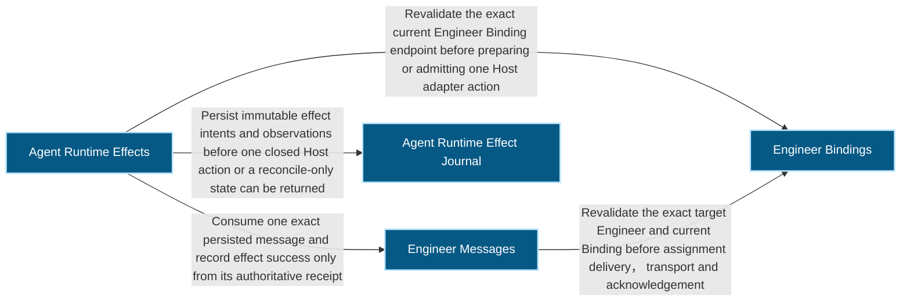
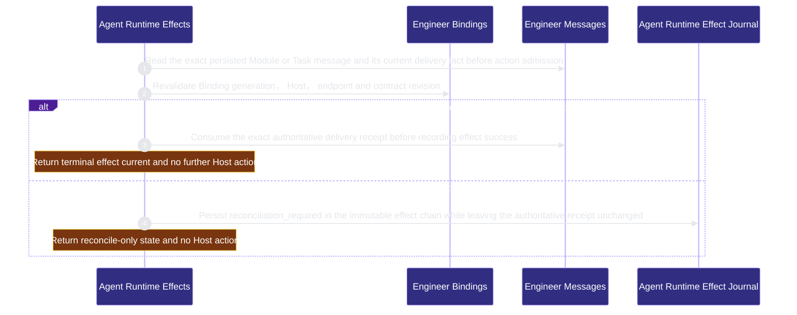

# runtime-harness/agent-runtime-effects 架構文檔

<!-- BEGIN ARCHCONTEXT:generated target="projection_target.entity.capability-runtime-harness-agent-runtime-effects" sourceDigest="sha256:c451447e81ced39ae55f91f7c45d6aa93a43d2fd8ce3bf8c2392945aaecf5b7a" rendererVersion="archcontext.docs-renderer/v5" outputDigest="sha256:05bb813d0046812ed3fa5e997131b49fd669e812f34af1a63d2207cbe344e98e" -->
> **狀態**:`active`
> **Capability ID**:`capability.runtime-harness.agent-runtime-effects`(kind `capability`)
> **Matched Prefixes**:`src/core/engineers/agent-runtime-effect.ts`、`src/effects/engineers/agent-runtime-effect-store.ts`、`src/effects/engineers/agent-runtime-feature.ts`、`src/effects/engineers/agent-runtime-adapters/**`
> **Local Contracts**:`src/core/engineers/AGENTS.md`、`src/core/engineers/CLAUDE.md`
> **事實優先級**:倉庫當前狀態 > 本文檔機器區 > 本文檔人工區。機器區(引言、§1、§2)由 ArchContext 從架構模型與源碼度量投影生成,手改會在下次投影被覆蓋。本文檔不記錄出處;本次投影所驗證的 commit 見 `docs/architecture/.projection-manifest.json`。

Owns the provider-neutral, at-most-once Agent Runtime Effect V2 boundary for the closed Herdr CLI Agent adapter, covering inbox notification and durable task-offer wake.

## 1. P1:能力架構地圖

### 1.1 架構圖

- Proof: `proven` (`sha256:e466b6ca52dfbcc6e27d20584f7a353fe21bfee2b1694a9816130e992db82187`).
- Semantic nodes: `4`; declared relations: `4`.

### 1.2 模組職責表

| 宣告入口 | 錨點 | 職責 |
| --- | --- | --- |
| `entrypoint.agent-runtime-effects.prepare` | `src/effects/engineers/agent-runtime-effect-store.ts#currentBinding` | `sink.agent-runtime-effects.current-binding` → `src/effects/engineers/binding-store.ts#readEngineerBindingStatus` |
| `entrypoint.agent-runtime-effects.prepare` | `src/effects/engineers/agent-runtime-effect-store.ts#moduleReference` | `sink.agent-runtime-effects.persisted-message` → `src/effects/engineers/module-inbox.ts#readModuleMessageDelivery` |
| `entrypoint.agent-runtime-effects.prepare` | `src/effects/engineers/agent-runtime-effect-store.ts#taskEndpointAndReference` | `sink.agent-runtime-effects.persisted-task-message` → `src/effects/fleet/task-inbox.ts#readTaskMessageDelivery` |
| `entrypoint.agent-runtime-effects.wake` | `src/effects/engineers/agent-runtime-effect-store.ts#recordEngineerOfferSnapshot` | `sink.agent-runtime-effects.offer-wake-decision` → `src/core/engineers/agent-runtime-effect.ts#decideAgentRuntimeOfferWake` |
| `entrypoint.agent-runtime-effects.wake` | `src/effects/engineers/agent-runtime-effect-store.ts#recordAgentRuntimeControllerStep` | `sink.agent-runtime-effects.controller-step-receipt` → `src/core/engineers/agent-runtime-effect.ts#buildAgentRuntimeControllerStepReceipt` |
| `entrypoint.agent-runtime-effects.start` | `src/effects/engineers/agent-runtime-effect-store.ts#startAgentRuntimeEffect` | `sink.agent-runtime-effects.started-observation` → `src/core/engineers/agent-runtime-effect.ts#buildAgentRuntimeEffectObservation` |
| `entrypoint.agent-runtime-effects.observe` | `src/effects/engineers/agent-runtime-effect-store.ts#observeAgentRuntimeEffect` | `sink.agent-runtime-effects.reconciliation-observation` → `src/core/engineers/agent-runtime-effect.ts#buildAgentRuntimeEffectObservation` |
| `entrypoint.agent-runtime-effects.observe` | `src/effects/engineers/agent-runtime-effect-store.ts#receiptEvidence` | `sink.agent-runtime-effects.receipt-evidence` → `src/effects/engineers/module-inbox.ts#readModuleMessageDelivery` |

### 1.3 規模信號

- 規模量級:`2–5` 個文件 / `1000–2000` 行
- 匹配前綴:`src/core/engineers/agent-runtime-effect.ts`、`src/effects/engineers/agent-runtime-effect-store.ts`、`src/effects/engineers/agent-runtime-feature.ts`、`src/effects/engineers/agent-runtime-adapters/**`
- 推導:掃描 `source.include` 減 `source.exclude`,跳過 `.git/` 與 `node_modules/`,再按 1–2–5 階梯分桶。精確計數不入本文檔:量級足以回答「這個能力有多大」,而逐行計數會讓覆蓋範圍內任何一次源碼改動都改寫本文檔。

### 1.4 依賴邊界

出向關係:

- `calls` → `capability.runtime-harness.engineer-bindings` — Revalidate the exact current Engineer Binding endpoint before preparing or admitting one Host adapter action
- `calls` → `capability.runtime-harness.engineer-messages` — Consume one exact persisted message and record effect success only from its authoritative receipt
- `calls` → `capability.runtime-harness.engineer-scheduling` — Validate the whole offers document with the scheduling validator before a wake is armed
- `calls` → `component.agent-runtime-effects.journal` — Persist immutable effect intents and observations before one closed Host action or a reconcile-only state can be returned
- `calls` → `capability.runtime-harness.mcp-sidecar` — Read the strict repo registry and the authorization revision for the wake fence

入向關係:

- `calls` ← `capability.runtime-harness.engineering-overlay` — Observe exact current runtime-effect and reconciliation states without executing or repairing an effect
- `calls` ← `capability.runtime-harness.mcp-sidecar` — Expose read-only runtime capability and current-effect projections to the authenticated Engineer without Host mutation authority

## 2. P2:端到端數據流

> **Proof**: `proven` (`sha256:e466b6ca52dfbcc6e27d20584f7a353fe21bfee2b1694a9816130e992db82187`); selectors `4/4`.

<!-- END ARCHCONTEXT:generated target="projection_target.entity.capability-runtime-harness-agent-runtime-effects" -->

## 3. P3:設計決策與不變量

### 3.1 必须保持的不变量

1. **每个 Host 动作之前，先落盘 intent 和 `effect_started`。** 一个 intent 最多放行一次 Host adapter 动作（capability responsibilities；§3.7）。
2. **只认精确回执。** 通知成功只认该消息的持久化 inbox 回执。wake 成功只认绑定到 effect control reference 的 `ControllerStepReceiptV2`。进程退出码本身不算证据（§3.4，`assertAgentRuntimeReceiptKindForOperation`，`src/core/engineers/agent-runtime-effect.ts:445`）。
3. **结果不明时进入 `reconciliation_required`，不重试、不回退。** 该状态只接受 `unknown` 或 `receipt_missing` 失败（`agent-runtime-effect.ts:403`）。Herdr adapter 在超时、截断或未知错误时返回 `unknown`，从不重放（`herdr-cli-agent.ts`）。
4. **adapter 集合是封闭的。** 唯一的 adapter 是 `herdr-cli-agent`（`agent-runtime-effect.ts:29`、`:245`）。Herdr 只收到有界的 control reference，从不收到消息正文或通用命令。
5. **wake 是提示，不是授权。** wake 不携带 claim token、Lease、Task 或 offer 正文。醒来的控制器重新读取当前 offers，并只通过普通调度入口获取工作（capability notes；§3.4）。
6. **每个 Binding 同时最多一个非终态 wake。** 被取代的 wake 写终态 `superseded`（§3.6）。
7. **所有 wake 变更的锁顺序是 wake → effect。** ledger 读取发生在锁内，是唯一的线性化点（§3.7）。
8. **V1 存储没有迁移回执时拒绝新写入。** 存在 Provider Thread V1 存储而没有 `migrations/v1.json` 时，capability 记录、prepare 和 offer 快照记录都失败（`agent-runtime-effect-store.ts:215-217`、`:221`、`:277`、`:662`）。

### 3.2 关键权衡

| 决策 | 权衡 |
| --- | --- |
| notify 和 wake 共用一条 effect 链（§3.3） | 不新增 daemon，状态机只有一个。代价是 intent 要按 operation 区分 subject，回执种类要双向封闭。 |
| 每次 start 在落盘后再读一次跨权威 fence（§3.7） | Binding、capability 或授权在检查和落盘之间变化时不会放行动作。代价是 start 多一次读取，失败时写 `observed_failure`。 |
| 重放按身份比对，不按字节比对（§3.8） | intent 写入后、ledger 发布前崩溃不会让 wake 永久冲突。代价是"同一身份"的判定规则必须严格，其余差异仍 fail closed。 |
| 定时轮询只在控制器策略显式开启时使用 | 运行时默认不轮询（`agent-runtime-effect-store.ts:452-453`）。能力不支持 wake 且策略未开启时直接报 `capability_unsupported`（`:700`）。代价是控制器必须自己声明轮询策略。 |
| 只保留 Herdr adapter | Codex App 线程后端已退役（`4889f762`，2026-09-30）。代价是没有 Herdr 的环境没有任何 runtime 动作通道。 |

### 3.3 两个 operation 共用一条 effect 链（#281）

`AgentRuntimeOperation` 从 `notify_inbox` 扩展为 `notify_inbox | wake_for_offer`。两者走同一条 intent → effect_started → observation → current 链，没有另起一套 daemon。intent 按 operation 区分 subject：`notify_inbox` 带 `message_ref`，`wake_for_offer` 带 `wake_ref`（repository_id、authorization_revision、snapshot_revision 和封闭的 reason）。Engineer、Binding ID、generation 和 contract revision 只由 `endpoint_fence` 绑定一次。`wake_ref` 不重复携带它们，避免同一事实在一份 intent 里有两个权威。protocol 仍是 2。已有 `notify_inbox` intent 的 canonical 字节没有变化。

### 3.4 wake 是提示，不是授权

wake 的 Host 动作只带 `repo-harness-wake:` 前缀的有界 control reference、repository_id、snapshot_revision 和 reason。它不含 claim token、Lease、Task 或 offer 正文。成功只认 `ControllerStepReceiptV2`。该回执绑定这个 effect 的 control reference、Engineer 与 Binding fence，以及控制器实际重读到的 snapshot revision。消息投递回执和进程退出码都不能结案（`assertAgentRuntimeReceiptKindForOperation` 在两个方向都封闭）。醒来的控制器重读当前 offers 和授权。snapshot 已过期或已空时是 no-op，但仍算一次已送达的 wake。

### 3.5 offers 文档来自外部权威，先验证再使用

`recordEngineerOfferSnapshot` 收到的 `EngineerOffersV1` 是调度权威的产物，不是可信输入。进入 ledger 之前，它先通过 `validateEngineerOffersDocument`（调度 core 唯一的整份文档校验器，与 `validateEngineerOffer` 并列；`src/core/engineers/scheduling.ts:734`）。校验内容：封闭键集，每个 offer 和 exclusion 都合法且属于本文档，`snapshot_revision` 按相同 basis 重算。摘要覆盖数组本身，所以改字段、换顺序或伪造 revision 都在这里失败。通过之后再检查两道 fence。文档的 `repository_id` 必须等于本 worktree 解析出的注册仓库。每个 offer 的 `binding_id`、`binding_generation` 和 `engineer_contract_revision` 必须等于**当前** Binding。旧 Binding generation 收集的 snapshot 只会被拒绝，不会被重新绑定到当前 Binding。

### 3.6 每个 Binding 一个 wake 指针

`wakes/<sha256(engineer\0binding\0generation)>.json` 是该 Binding 的持久 ledger。它保存上一次消费的 offer 投影、唯一的 pending wake 指针和 coalescing 窗口。

- 只有 empty → eligible 这个确切转换会 arm wake。同一个 snapshot 重复观测不写盘。
- 换到另一个仍有 eligible 工作的 snapshot 都算 due，包括 A → B 这种原本就 eligible 的变化。
- 更新的 snapshot 只在旧 wake 尚未 start 时取代它。新 wake 继承原来的 `requested_at` 和 `coalesce_until`，所以窗口有界，不会被连续变化一直推后。
- 已 start 的 wake 不被取代，也不会开第二个并行 wake。
- wake 执行期间记录的 snapshot 保持未消费。ledger 不把它写成已观察。只有 offer 权威在该 wake 结束后再次记录它，它才会触发 wake。这是 `engineer runtime-effect wake-record-offers` 调用方的责任（`src/cli/commands/engineer.ts:629`；PR #558 修复了相关缺陷）。
- 被取代的 intent 在自己的链上写入终态 `superseded`（只能从 `intent_persisted` 到达）。它不会停在 `intent_persisted` 等 ledger 指针来解释。所以每个 Binding 任何时刻只有一个非终态 wake。Board 投影不读 ledger 也与指针一致。重启一个 superseded wake 会明确报错，不会静默无动作。
- idempotency key 绑定 snapshot 和前一份 ledger 摘要。崩溃重放看到同一份未发布的前驱，沿用同一把 key。A → B → A 回到旧 snapshot 是新的转换，得到新的 wake，不会指回已 superseded 的 effect（PR #558）。
- 没有无限重试面。同一次转换的 idempotency key 固定。失败后除非 offers 再次变化，否则不会自动重来。retry 属于 attempt receipt 的权威。

### 3.7 wake 的线性化点只有一个

wake ledger 锁和 per-effect 锁以前各自独立，supersession 与 start 之间有 TOCTOU：observer 读完旧 effect 后放锁，starter 可以在新 ledger 发布前启动旧 wake。现在**所有** wake 变更（arm、supersede、start、observe、controller-step receipt）都先取 per-Binding wake 锁，再取 effect 锁。锁顺序全局单向：wake → effect。`assertWakeStartable`（`agent-runtime-effect-store.ts:608`）在该锁内读 ledger，所以这次读取就是线性化点，不是提示。`startAgentRuntimeEffect` 先无锁读取 intent（只写一次并 fsync，不可变），再决定是否取 wake 锁。

跨权威的 fence（Binding、capability observation、authorization revision）不受这把锁保护。它们可能在检查通过之后、`effect_started` 落盘之前提交。所以 start 在追加之后**再读一次**同样的 fence。不成立时写 `observed_failure`（`binding_stale`、`capability_unsupported` 或 `authorization_stale`），并返回 `action: null`。Host 动作只在 fence 于落盘前和落盘后都成立时才交出。

### 3.8 崩溃重放不会卡死一个 wake

intent 先写，ledger 后发布。两者之间崩溃时，`created_at` 使用本 store 的时钟，逐字节比对会让同一个 snapshot 的重放永久冲突。所以重放比对的是**身份**，不是字节：同一把 idempotency key、同一个 endpoint fence、同一个 wake subject 即视为同一个 intent 并继续。其余情况仍然 fail closed。

### 3.9 订阅面在 effect 层

`listDueOfferWakes` 和 `subscribeToOfferWakes`（`agent-runtime-effect-store.ts:802`）读取 ledger 和 effect current。时钟由调用方提供，返回有界事件。非交互控制器不经过 CLI 也可以消费。ledger 用原子替换发布，读取不取锁，所以不会反向持有 effect 锁再去取 wake 锁。

### 3.10 组件与关系（2026-10-11）

| 节点 | footprint | 说明 |
| --- | --- | --- |
| `component.agent-runtime-effects.journal` | `src/effects/engineers/agent-runtime-effect-store.ts` | 不可变 intent 与 observation 链、current 修复、wake ledger、V1 迁移回执检查 |
| capability 自身 | `agent-runtime-effect.ts`（core）、`agent-runtime-feature.ts`、`agent-runtime-adapters/**` | schema、feature 开关、Herdr adapter |

对外关系：`engineer-bindings`（当前 Binding）、`engineer-messages`（持久化消息与回执）、`engineer-scheduling`（offers 文档校验，2026-10-11 新增）、`mcp-sidecar`（严格 repo registry 与授权 revision，2026-10-11 新增）。

需要集成阶段补上的关系：Herdr adapter → `src/effects/terminal/herdr.ts`（预计 `task-agent-host`）；store → `src/core/fleet/*`、`src/effects/fleet/task-inbox.ts`（预计 `task-fleet`）；store → `src/effects/state/coordination-lease-store.ts`（预计 `workflow-state`）；store → git 与 locking 原语（预计 `execution-primitives`）。

### 3.11 开放问题

- V1 迁移命令已在 PR #514 删除（`6fa21238`：store 减少 86 行，`engineer.ts` 减少 9 行）。但 `assertMigrationReady` 仍在 V1 存储存在且没有回执时拒绝写入（§3.1 第 8 条）。一个仍有 V1 存储的仓库现在没有命令能生成回执。这种仓库是否还存在？恢复路径是什么？没有记录。

## 4. 歷史決策記錄(append-only)

- 2026-09-12:漂移卡 `runtime-harness-agent-runtime-effects` 歸檔為 Resolved。觸發事件是 2026-09-09T02:02 對 `src/effects/engineers/agent-runtime-adapters/herdr-cli-agent.ts` 的編輯,該次改動由 `d8c082b1` 落地,同一個 commit 已同步改寫 `capability.runtime-harness.agent-runtime-effects.yaml` 的 summary 與 adapter 責任行、本文檔機器區,以及 `src/core/engineers/{AGENTS,CLAUDE}.md`;`source.include` 前綴、宣告入口與依賴邊界均未變動,因此不需要額外 snapshot。

- 2026-10-11：capability 节点改正为只有 `herdr-cli-agent` adapter（Codex App 线程后端在 `4889f762` 退役），并把 V1 迁移职责改写为迁移回执检查（迁移命令在 PR #514 删除）。新增 journal 组件 footprint，以及到 `engineer-scheduling` 和 `mcp-sidecar` 的关系。§3 改为简体中文，并补充 §3.1 不变量和 §3.2 权衡；原 §3.1-§3.7 的内容移到 §3.3-§3.9，含义不变。

## Optimization Backlog

- 本 capability 的 summary 和 responsibilities 曾在 adapter 退役后仍写着 codex-app-thread 和 V1 迁移命令。2026-10-11 已改正。以后删除 adapter 或命令时，同一个 PR 需要更新 capability 节点。
- V1 迁移回执检查（§3.11）。如果确认没有仓库还保留 V1 存储，可以删除 `assertMigrationReady` 和 `PROVIDER_THREAD_EFFECT_V1_RELATIVE_ROOT`；否则需要恢复一个迁移入口。
- `agent-runtime-effect-store.ts` 有 815 行，wake ledger 与通用 effect 链在同一个文件里。wake 部分可以独立成文件，但锁顺序（§3.7）必须保持在一处可见。

