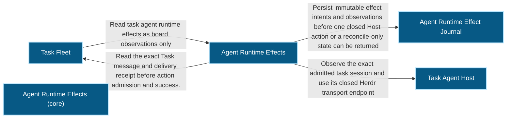
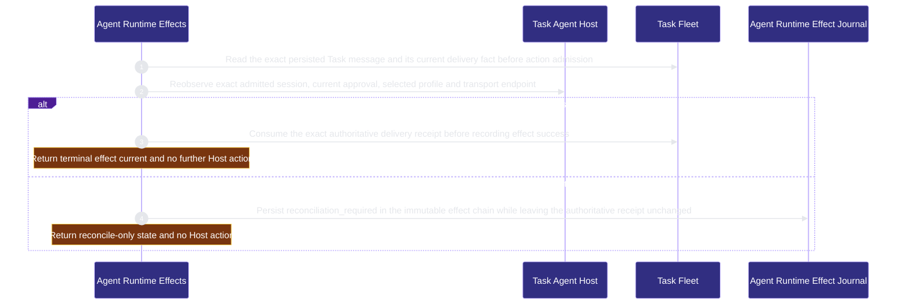

<!-- BEGIN ARCHCONTEXT:generated target="projection_target.entity.capability-runtime-harness-agent-runtime-effects" rendererVersion="archcontext.docs-renderer/v6" outputDigest="sha256:0f1f7bed73e3db0ec59486c636b6a104ca052e0da88c555abe4d36ed8b90d94f" -->
> **狀態**:`active`
> **Capability ID**:`capability.runtime-harness.agent-runtime-effects`(kind `capability`)
> **Matched Prefixes**:`src/effects/engineers/agent-runtime-effect-store.ts`、`src/effects/engineers/agent-runtime-feature.ts`、`src/effects/engineers/agent-runtime-adapters/**`
> **Local Contracts**:`src/core/engineers/AGENTS.md`、`src/core/engineers/CLAUDE.md`
> **事實優先級**:倉庫當前狀態 > 本文檔機器區 > 本文檔人工區。機器區(引言、§1、§2)由 ArchContext 從架構模型與源碼度量投影生成,手改會在下次投影被覆蓋。本文檔不記錄出處;本次投影所驗證的 commit 見 `docs/architecture/.projection-manifest.json`。

Owns admitted session-bound, at-most-once Agent Runtime Effect V2 for the closed Herdr CLI adapter, inbox notification and durable offer wake.

## 1. P1:能力架構地圖

### 1.1 架構圖

- Proof: `proven` (`sha256:16f5ab6d0f1fea46cd4c2e21ba39bfb9daff8cd61b7ae312d871ab3079cb0253`).
- Semantic nodes: `5`; declared relations: `4`.

### 1.2 模組職責表

| 宣告入口 | 錨點 | 職責 |
| --- | --- | --- |
| `entrypoint.agent-runtime-effects.prepare` | `src/effects/engineers/agent-runtime-effect-store.ts#observeAgentRuntimeEndpoint` | `sink.agent-runtime-effects.current-session` → `src/effects/terminal/task-session-reader.ts#readTaskAgent` |
| `entrypoint.agent-runtime-effects.prepare` | `src/effects/engineers/agent-runtime-effect-store.ts#messageDelivery` | `sink.agent-runtime-effects.persisted-task-message` → `src/effects/fleet/task-inbox.ts#readTaskMessageDelivery` |
| `entrypoint.agent-runtime-effects.wake` | `src/effects/engineers/agent-runtime-effect-store.ts#recordEngineerOfferSnapshot` | `sink.agent-runtime-effects.offer-wake-decision` → `src/core/engineers/agent-runtime-effect.ts#decideAgentRuntimeOfferWake` |
| `entrypoint.agent-runtime-effects.wake` | `src/effects/engineers/agent-runtime-effect-store.ts#recordAgentRuntimeControllerStep` | `sink.agent-runtime-effects.controller-step-receipt` → `src/core/engineers/agent-runtime-effect.ts#buildAgentRuntimeControllerStepReceipt` |
| `entrypoint.agent-runtime-effects.start` | `src/effects/engineers/agent-runtime-effect-store.ts#startAgentRuntimeEffect` | `sink.agent-runtime-effects.started-observation` → `src/core/engineers/agent-runtime-effect.ts#buildAgentRuntimeEffectObservation` |
| `entrypoint.agent-runtime-effects.observe` | `src/effects/engineers/agent-runtime-effect-store.ts#observeAgentRuntimeEffect` | `sink.agent-runtime-effects.reconciliation-observation` → `src/core/engineers/agent-runtime-effect.ts#buildAgentRuntimeEffectObservation` |
| `entrypoint.agent-runtime-effects.observe` | `src/effects/engineers/agent-runtime-effect-store.ts#messageDelivery` | `sink.agent-runtime-effects.receipt-evidence` → `src/effects/fleet/task-inbox.ts#readTaskMessageDelivery` |

組件入口:

- 組件均未宣告 `source.entrypoints`。

### 1.3 規模信號

- 規模量級:`2–5` 個文件 / `500–1000` 行
- 匹配前綴:`src/effects/engineers/agent-runtime-effect-store.ts`、`src/effects/engineers/agent-runtime-feature.ts`、`src/effects/engineers/agent-runtime-adapters/**`
- 推導:掃描 `source.include` 減 `source.exclude`,跳過 `.git/` 與 `node_modules/`,再按 1–2–5 階梯分桶。精確計數不入本文檔:量級足以回答「這個能力有多大」,而逐行計數會讓覆蓋範圍內任何一次源碼改動都改寫本文檔。

### 1.4 依賴邊界

出向關係:

- `calls` → `capability.runtime-harness.engineer-bindings` — Use canonical engineer JSON and digest helpers for profile evidence; do not resolve a legacy binding endpoint
- `calls` → `capability.runtime-harness.engineer-scheduling` — Validate the whole offers document with the scheduling validator before a wake is armed
- `calls` → `external.herdr` — Start Herdr CLI agents for agent runtime effects.
- `calls` → `component.agent-runtime-effects.journal` — Persist immutable effect intents and observations before one closed Host action or a reconcile-only state can be returned
- `calls` → `capability.runtime-harness.mcp-sidecar` — Read the strict repo registry and the authorization revision for the wake fence
- `calls` → `capability.runtime-harness.task-agent-host` — Observe the exact admitted task session and use its closed Herdr transport endpoint
- `calls` → `capability.organization.task-fleet` — Read the exact Task message and delivery receipt before action admission and success.

入向關係:

- `calls` ← `capability.runtime-harness.engineering-overlay` — Observe exact current runtime-effect and reconciliation states without executing or repairing an effect
- `depends-on` ← `capability.verification.evals-checks` — Test Agent Runtime Effects behavior through its source modules.
- `calls` ← `capability.runtime-harness.mcp-sidecar` — Expose read-only runtime capability and current-effect projections to the authenticated Engineer without Host mutation authority
- `calls` ← `capability.organization.task-fleet` — Read task agent runtime effects as board observations only

組件出向關係:

- `component.agent-runtime-effects.core-layer`:
  - 無。
- `component.agent-runtime-effects.journal`:
  - `calls` → `capability.workflow-engine.execution-primitives` — Hold exclusive directory locks under the Git common directory

### 1.5 組件結構

| 組件 | 名稱 | 規模量級 | 宣告入口 |
| --- | --- | --- | --- |
| `component.agent-runtime-effects.core-layer` | Agent Runtime Effects (core) | `1–2` 個文件 / `500–1000` 行 | 未宣告 |
| `component.agent-runtime-effects.journal` | Agent Runtime Effect Journal | `1–2` 個文件 / `500–1000` 行 | 未宣告 |

## 2. P2:端到端數據流

> **Proof**: `proven` (`sha256:16f5ab6d0f1fea46cd4c2e21ba39bfb9daff8cd61b7ae312d871ab3079cb0253`); selectors `4/4`.

<!-- END ARCHCONTEXT:generated target="projection_target.entity.capability-runtime-harness-agent-runtime-effects" -->
