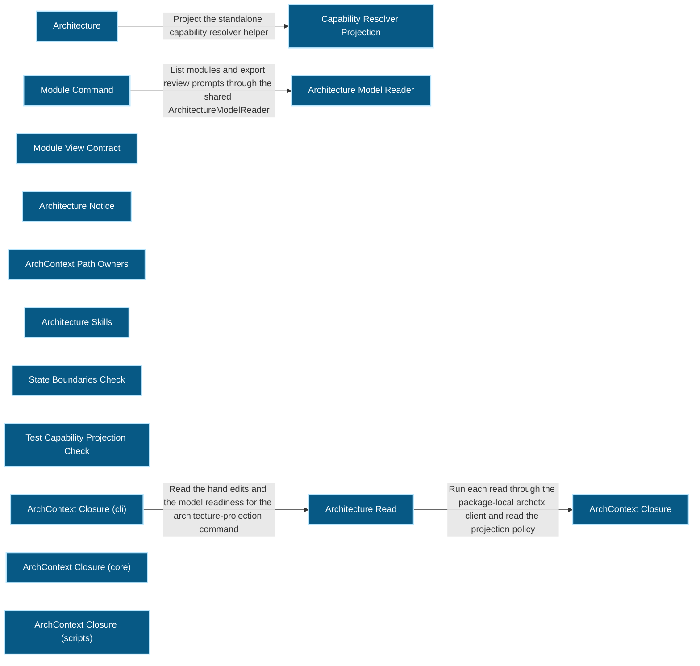
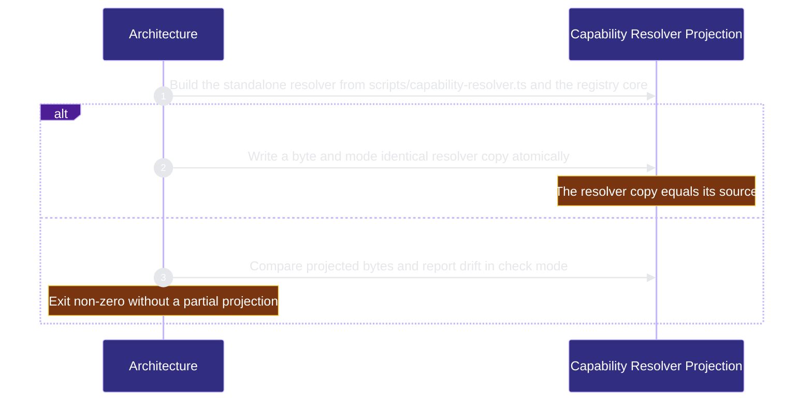

# runtime-harness/architecture 架構文檔

<!-- BEGIN ARCHCONTEXT:generated target="projection_target.entity.capability-runtime-harness-architecture" rendererVersion="archcontext.docs-renderer/v6" outputDigest="sha256:7481e9410dcb10894cc0de3329787c0ea8883653ce35676cf6e25f5198e965be" -->
> **狀態**:`active`
> **Capability ID**:`capability.runtime-harness.architecture`(kind `capability`)
> **Matched Prefixes**:`src/effects/architecture/**`、`src/core/architecture/projection.ts`、`src/core/architecture/module-view.ts`、`src/core/review/module-review-prompt.ts`、`src/cli/commands/module.ts`、`src/cli/hook/agent-notice.ts`、`scripts/axr5-archctx-clean-room.ts`、`scripts/check-state-boundaries.ts`、`scripts/project-test-capabilities.ts`、`scripts/sync-helper-sources.ts`、`assets/skills/repo-harness-archimap/**`、`assets/skill-commands/repo-harness-architecture/**`、`docs/verification/**`
> **Local Contracts**:`AGENTS.md`、`CLAUDE.md`
> **事實優先級**:倉庫當前狀態 > 本文檔機器區 > 本文檔人工區。機器區(引言、§1、§2)由 ArchContext 從架構模型與源碼度量投影生成,手改會在下次投影被覆蓋。本文檔不記錄出處;本次投影所驗證的 commit 見 `docs/architecture/.projection-manifest.json`。

The Architecture plugin: the package-local archctx closure, the architecture reads, the projection, debt and setup commands, the hook notice, the architecture Checks and the architecture skills.

## 1. P1:能力架構地圖

### 1.1 架構圖

- Proof: `proven` (`sha256:e133f9085972096212457e328719c4d194f587b013c9ccafb184c93f662e8770`).
- Semantic nodes: `15`; declared relations: `4`.

### 1.2 模組職責表

| 宣告入口 | 錨點 | 職責 |
| --- | --- | --- |
| `entrypoint.architecture.helper-projection` | `scripts/sync-helper-sources.ts#main` | `sink.architecture.capability-projection` → `scripts/sync-helper-sources.ts#buildCapabilityProjection`、`sink.architecture.projection-write` → `src/effects/source-projection.ts#writeProjectionFileAtomic`、`sink.architecture.projection-compare` → `src/effects/source-projection.ts#sameProjectionBytes` |
| `entrypoint.architecture.writer` | `src/cli/commands/architecture-projection-actions.ts#publish` | `sink.architecture.writer` → `src/effects/architecture/projection-writer.ts#runArchitectureWriter` |

組件入口:

- 組件均未宣告 `source.entrypoints`。

### 1.3 規模信號

- 規模量級:`20–50` 個文件 / `5000–10000` 行
- 匹配前綴:`src/effects/architecture/**`、`src/core/architecture/projection.ts`、`src/core/architecture/module-view.ts`、`src/core/review/module-review-prompt.ts`、`src/cli/commands/module.ts`、`src/cli/hook/agent-notice.ts`、`scripts/axr5-archctx-clean-room.ts`、`scripts/check-state-boundaries.ts`、`scripts/project-test-capabilities.ts`、`scripts/sync-helper-sources.ts`、`assets/skills/repo-harness-archimap/**`、`assets/skill-commands/repo-harness-architecture/**`、`docs/verification/**`
- 排除前綴:`src/effects/architecture/capability-resolver.ts`
- 推導:掃描 `source.include` 減 `source.exclude`,跳過 `.git/` 與 `node_modules/`,再按 1–2–5 階梯分桶。精確計數不入本文檔:量級足以回答「這個能力有多大」,而逐行計數會讓覆蓋範圍內任何一次源碼改動都改寫本文檔。

### 1.4 依賴邊界

出向關係:

- `calls` → `component.architecture.helper-projection` — Project the standalone capability resolver helper

入向關係:

- 無。

組件出向關係:

- `component.architecture.helper-projection`:
  - 無。
- `component.architecture.model-reader`:
  - `reads` → `capability.workflow-engine.contract-assets` — Plugin → core: decode the capability registry from the native context and resolve changed paths to capability owners
  - `depends-on` → `capability.runtime-harness.evidence-ledger` — Plugin → core: canonicalize the dirty worktree digest and the stale citations of a review prompt
  - `reads` → `component.execution-primitives.repository-registry` — Plugin → core: resolve the registered repository id of the read checkout
- `component.architecture.module-cli`:
  - `calls` → `component.architecture.model-reader` — List modules and export review prompts through the shared ArchitectureModelReader
- `component.architecture.module-view`:
  - `depends-on` → `capability.verification.acceptance-review` — Plugin → core: apply the shared review finding rules in module review prompts
  - `depends-on` → `capability.runtime-harness.evidence-ledger` — Plugin → core: canonicalize module review prompt digests
  - `depends-on` → `component.execution-primitives.secret-patterns` — Plugin → core: refuse module review context that contains a secret
- `component.architecture.notice`:
  - 無。
- `component.architecture.owners`:
  - 無。
- `component.architecture.skills`:
  - 無。
- `component.architecture.state-boundaries-check`:
  - 無。
- `component.architecture.test-projection-check`:
  - 無。
- `component.global-runtime-reconciliation.archctx-closure`:
  - `calls` → `capability.workflow-engine.execution-primitives` — Run the archctx binary through the process runner
  - `calls` → `component.global-runtime-reconciliation.global-configuration` — Read the architecture section through the global configuration store
  - `calls` → `capability.runtime-harness.hook-adapters` — Write the private global configuration through the installer ownership writer
  - `reads` → `capability.workflow-engine.workflow-state` — Read the capability ownership type for archctx resolve results
- `component.global-runtime-reconciliation.archctx-closure-cli`:
  - `calls` → `component.global-runtime-reconciliation.architecture-read` — Read the hand edits and the model readiness for the architecture-projection command
- `component.global-runtime-reconciliation.archctx-closure-core`:
  - 無。
- `component.global-runtime-reconciliation.archctx-closure-scripts`:
  - 無。
- `component.global-runtime-reconciliation.architecture-read`:
  - `calls` → `component.global-runtime-reconciliation.archctx-closure` — Run each read through the package-local archctx client and read the projection policy

### 1.5 組件結構

| 組件 | 名稱 | 規模量級 | 宣告入口 |
| --- | --- | --- | --- |
| `component.architecture.helper-projection` | Capability Resolver Projection | `1–2` 個文件 / `200–500` 行 | 未宣告 |
| `component.architecture.model-reader` | Architecture Model Reader | `1–2` 個文件 / `200–500` 行 | 未宣告 |
| `component.architecture.module-cli` | Module Command | `1–2` 個文件 / `50–100` 行 | 未宣告 |
| `component.architecture.module-view` | Module View Contract | `2–5` 個文件 / `200–500` 行 | 未宣告 |
| `component.architecture.notice` | Architecture Notice | `1–2` 個文件 / `200–500` 行 | 未宣告 |
| `component.architecture.owners` | ArchContext Path Owners | `2–5` 個文件 / `200–500` 行 | 未宣告 |
| `component.architecture.skills` | Architecture Skills | `5–10` 個文件 / `1000–2000` 行 | 未宣告 |
| `component.architecture.state-boundaries-check` | State Boundaries Check | `1–2` 個文件 / `1000–2000` 行 | 未宣告 |
| `component.architecture.test-projection-check` | Test Capability Projection Check | `1–2` 個文件 / `100–200` 行 | 未宣告 |
| `component.global-runtime-reconciliation.archctx-closure` | ArchContext Closure | `10–20` 個文件 / `1000–2000` 行 | 未宣告 |
| `component.global-runtime-reconciliation.archctx-closure-cli` | ArchContext Closure (cli) | `5–10` 個文件 / `200–500` 行 | 未宣告 |
| `component.global-runtime-reconciliation.archctx-closure-core` | ArchContext Closure (core) | `1–2` 個文件 / `200–500` 行 | 未宣告 |
| `component.global-runtime-reconciliation.archctx-closure-scripts` | ArchContext Closure (scripts) | `1–2` 個文件 / `200–500` 行 | 未宣告 |
| `component.global-runtime-reconciliation.architecture-read` | Architecture Read | `1–2` 個文件 / `200–500` 行 | 未宣告 |

## 2. P2:端到端數據流

> **Proof**: `proven` (`sha256:e133f9085972096212457e328719c4d194f587b013c9ccafb184c93f662e8770`); selectors `3/3`.

<!-- END ARCHCONTEXT:generated target="projection_target.entity.capability-runtime-harness-architecture" -->

## 3. P3:設計決策與不變量

## 4. 歷史決策記錄(append-only)

## Optimization Backlog
