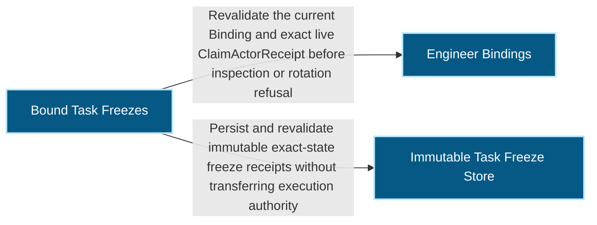
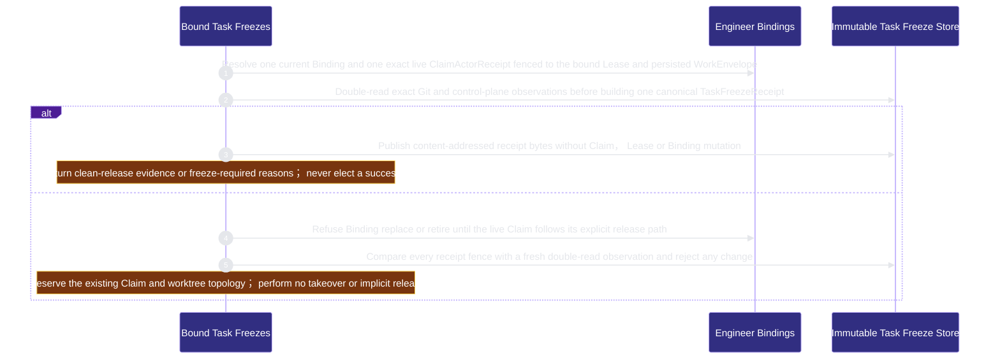

# runtime-harness/bound-task-freezes 架構文檔

<!-- BEGIN ARCHCONTEXT:generated target="projection_target.entity.capability-runtime-harness-bound-task-freezes" sourceDigest="sha256:50bf95c298d1eb462bd2b05a273f7a34ea8be649f18ea2562b25433e1462eca5" rendererVersion="archcontext.docs-renderer/v5" outputDigest="sha256:557ff7976d47c8f901ab758192325809b7d4808fa7cb991eadba32878cb0e89e" -->
> **狀態**:`active`
> **Capability ID**:`capability.runtime-harness.bound-task-freezes`(kind `capability`)
> **Matched Prefixes**:`src/core/engineers/task-freeze.ts`、`src/effects/engineers/task-freeze-store.ts`、`src/effects/engineers/bound-task-rotation.ts`
> **Local Contracts**:`AGENTS.md`、`CLAUDE.md`
> **事實優先級**:倉庫當前狀態 > 本文檔機器區 > 本文檔人工區。機器區(引言、§1、§2)由 ArchContext 從架構模型與源碼度量投影生成,手改會在下次投影被覆蓋。本文檔不記錄出處;本次投影所驗證的 commit 見 `docs/architecture/.projection-manifest.json`。

Freezes exact live Claim, Binding, WorkEnvelope and Git observations while refusing Session rotation that would imply dirty-task transfer.

## 1. P1:能力架構地圖

### 1.1 架構圖

- Proof: `proven` (`sha256:7d292675a7cc468a54552f59363baa784657098859f7ac88ecbba67364b5db4c`).
- Semantic nodes: `3`; declared relations: `2`.

### 1.2 模組職責表

| 宣告入口 | 錨點 | 職責 |
| --- | --- | --- |
| `entrypoint.bound-task-freezes.inspect` | `src/effects/engineers/task-freeze-store.ts#readCurrentTaskFreezeBinding` | `sink.bound-task-freezes.binding-current` → `src/effects/engineers/binding-store.ts#readEngineerBindingStatus` |
| `entrypoint.bound-task-freezes.inspect` | `src/effects/engineers/task-freeze-store.ts#inspectBoundTaskLocked` | `sink.bound-task-freezes.receipt-schema` → `src/core/engineers/task-freeze.ts#buildTaskFreezeReceipt` |
| `entrypoint.bound-task-freezes.persist` | `src/effects/engineers/task-freeze-store.ts#inspectBoundTaskLocked` | `sink.bound-task-freezes.immutable-store` → `src/effects/engineers/task-freeze-store.ts#persistTaskFreezeReceipt` |
| `entrypoint.bound-task-freezes.verify` | `src/effects/engineers/task-freeze-store.ts#verifyTaskFreeze` | `sink.bound-task-freezes.stale-compare` → `src/core/engineers/task-freeze.ts#taskFreezeReceiptChangedFields` |
| `entrypoint.bound-task-freezes.rotation-refusal` | `src/effects/engineers/bound-task-rotation.ts#assertNoLiveClaimForBindingRotation` | `sink.bound-task-freezes.live-claim` → `src/effects/engineers/claim-actor-store.ts#listLiveClaimActorReceiptsForEngineer` |

### 1.3 規模信號

- 規模量級:`2–5` 個文件 / `500–1000` 行
- 匹配前綴:`src/core/engineers/task-freeze.ts`、`src/effects/engineers/task-freeze-store.ts`、`src/effects/engineers/bound-task-rotation.ts`
- 推導:掃描 `source.include` 減 `source.exclude`,跳過 `.git/` 與 `node_modules/`,再按 1–2–5 階梯分桶。精確計數不入本文檔:量級足以回答「這個能力有多大」,而逐行計數會讓覆蓋範圍內任何一次源碼改動都改寫本文檔。

### 1.4 依賴邊界

出向關係:

- `calls` → `capability.runtime-harness.engineer-bindings` — Revalidate the current Binding and exact live ClaimActorReceipt before inspection or rotation refusal
- `calls` → `component.bound-task-freezes.primary` — Persist and revalidate immutable exact-state freeze receipts without transferring execution authority

入向關係:

- `calls` ← `capability.runtime-harness.collaboration` — Prove a handoff's bound_task execution context against the persisted TaskFreeze receipt it names, on publish and again on every read, so a caller-supplied Claim and Lease generation is never projected as a fact

## 2. P2:端到端數據流

> **Proof**: `proven` (`sha256:7d292675a7cc468a54552f59363baa784657098859f7ac88ecbba67364b5db4c`); selectors `5/5`.

<!-- END ARCHCONTEXT:generated target="projection_target.entity.capability-runtime-harness-bound-task-freezes" -->

## 3. P3:設計決策與不變量

### 3.1 必须保持的不变量

1. **冻结不转移执行权。** 冻结收据只记录状态。它没有后继者、current 指针或执行转换（`component.bound-task-freezes.primary` 的模型摘要）。后续动作由 Human 在封闭选项中选择，并重新校验全部冻结主体（`plans/prds/20260824-1653-bound-task-freeze-handoff.prd.md` Module 2）。
2. **Binding 轮换不转移 Lease。** `assertNoLiveClaimForBindingRotation` 在 Engineer 仍有 live Claim 时拒绝轮换。它也在任一 Lease 分类为 `unknown` 时拒绝，因为无法证明轮换安全（`src/effects/engineers/bound-task-rotation.ts:9-29`）。binding-store 在三个转换路径调用它（`src/effects/engineers/binding-store.ts:408`、`:526`、`:565`）。
3. **冻结读取必须两次一致。** `inspectBoundTaskLocked` 在任务锁内读两次快照。两次字节不同就返回 `task_freeze_changed_during_read`（`src/effects/engineers/task-freeze-store.ts:288-301`）。`createTaskFreeze` 在外层持 Engineer Binding 锁（`task-freeze-store.ts:383-394`）。
4. **只冻结唯一的 live Claim。** 没有 live Claim 返回 `task_freeze_claim_missing`，多于一个返回 `task_freeze_claim_ambiguous`（`task-freeze-store.ts:283-284`）。
5. **untracked 清单不是内容载体。** 收据只带 untracked 清单的摘要，并显式写 `untracked_inventory_is_content_carrier: false`（`src/core/engineers/task-freeze.ts:64`、`:233`）。P0 不能重建或转移 untracked 字节。
6. **收据按内容寻址、只创建一次。** 同一身份已有不同字节时返回 `task_freeze_conflict`（`task-freeze-store.ts:365-381`）。`verifyTaskFreeze` 对比当前状态，任何字段变化都返回 `task_freeze_stale`（`task-freeze-store.ts:418-427`）。

### 3.2 关键权衡

| 决策 | 权衡 |
| --- | --- |
| 只批准冻结与读模型，不提供接管路径 | 不会出现静默的脏工作转移；代价是 Session 轮换遇到脏工作时需要 Human 处理（PRD Quick-Read Card：silent dirty transfer 0） |
| 校验状态（`checks_state`）复用 verification contract 和 acceptance 证据检查 | 冻结记录的验证状态与交付门一致；代价是本能力依赖 `src/effects/evidence/verification-execution.ts`、`src/effects/review/diff-fingerprint.ts` 和 `scripts/acceptance-receipt.ts`（`task-freeze-store.ts:121-140`） |
| 轮换守卫放在本能力，由 binding-store 调用 | 轮换规则与冻结规则在一处；代价是 engineer-bindings 反向依赖本能力，形成双向边（见 Backlog） |

### 3.3 开放问题

- PRD 把 untracked/diff 内容载体和单一后继者选举列为单独的批准阻塞项（PRD Unknowns）。源码中没有相关实现。它们是否仍在计划中，没有记录。

## 4. 歷史決策記錄(append-only)

| 日期 | 决策 | 依据 |
| --- | --- | --- |
| 2026-08-26 | 完成 ME-4A：脏工作拒绝、`TaskFreezeReceiptV1`、过期检测和 Human 选项，不提供接管 | commit `b65e7535`；`plans/archive/plan-20260826-1247-me4a-bound-task-freeze-handoff.md`；Human 批准 `event.user-approval-20260826-me4a-architecture`（PRD） |

## Optimization Backlog

- after arch-context#296：`task-freeze.ts`、`task-freeze-store.ts` 和 `bound-task-rotation.ts` 同时被 engineer-bindings 的 `src/{core,effects}/engineers/**` 认领。目标单一所有者是本能力（`ownership-proposal` §2）。
- 反向边证据：`binding-store.ts:45` 导入 `bound-task-rotation.ts`，engineer-bindings 因此依赖本能力，而本能力也依赖 engineer-bindings。可选重构：把 `assertNoLiveClaimForBindingRotation` 作为参数注入 binding 转换，或把它移到 engineer-bindings。当前不声明这条 relation。
- 本能力调用 `src/effects/state/coordination-lease-store.ts` 的 `listLeaseReads`、`scripts/acceptance-receipt.ts` 的 `inspectAcceptanceEvidence` 和 `src/effects/evidence/verification-execution.ts`。集成步骤声明了 bound-task-freezes → workflow-state、→ acceptance-review（`reads`）、→ evidence-ledger 与 → execution-primitives。到 task-fleet 只有 `WorkEnvelopeV1` 类型导入，没有声明。
