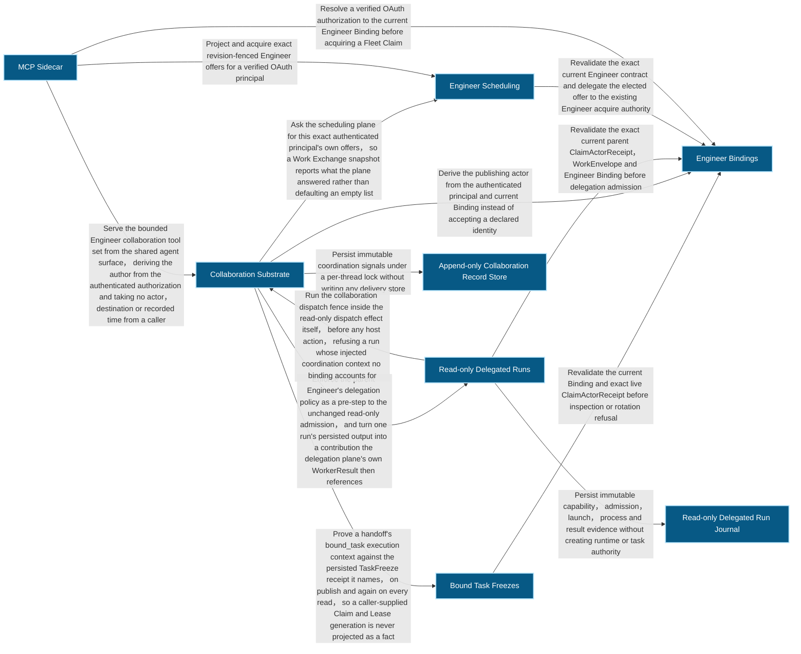
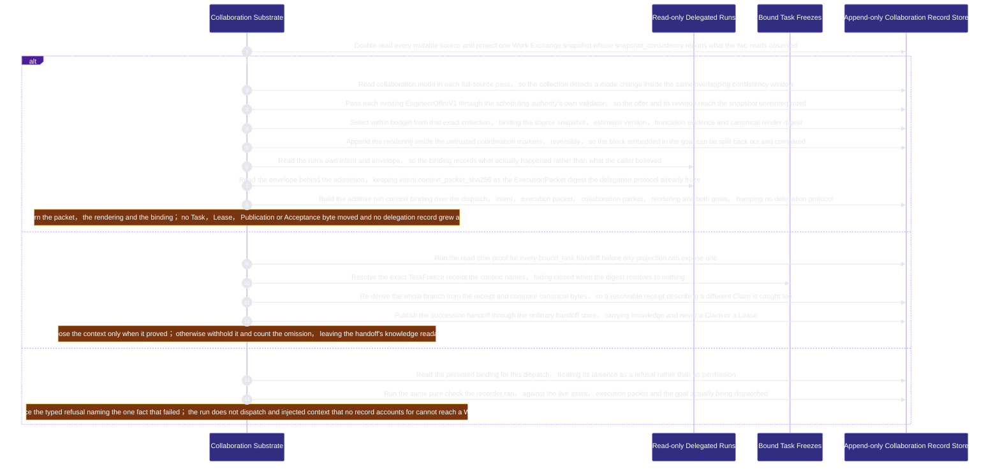
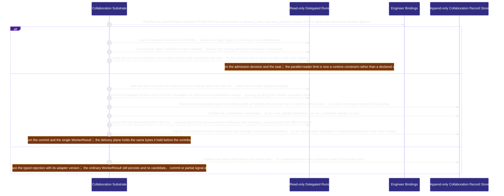
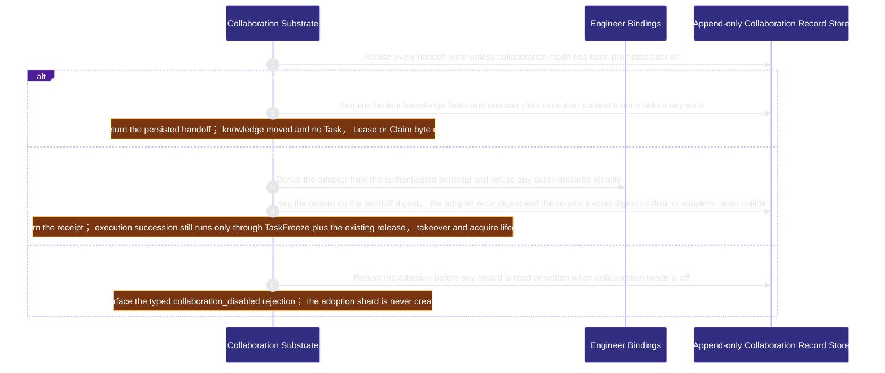
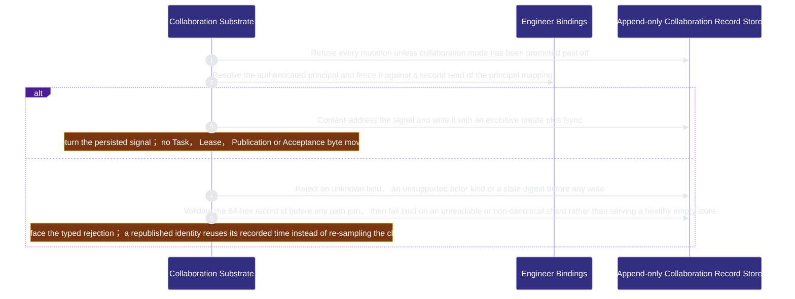

# runtime-harness/collaboration 架構文檔

<!-- BEGIN ARCHCONTEXT:generated target="projection_target.entity.capability-runtime-harness-collaboration" sourceDigest="sha256:51a7e39ad8905951932e13285c49bfd146d008d1acfe684f5bfc960f273e3d88" rendererVersion="archcontext.docs-renderer/v5" outputDigest="sha256:f72f21d5cd6d7eaf45e1af0da2e1c72ab8bcc71db99aeea6616b04f3478dd190" -->
> **狀態**:`active`
> **Capability ID**:`capability.runtime-harness.collaboration`(kind `capability`)
> **Matched Prefixes**:`src/core/collaboration/**`、`src/effects/collaboration/**`、`src/cli/commands/collaboration.ts`、`scripts/c9-collaboration-dispatch-runner.ts`
> **Local Contracts**:`AGENTS.md`、`CLAUDE.md`
> **事實優先級**:倉庫當前狀態 > 本文檔機器區 > 本文檔人工區。機器區(引言、§1、§2)由 ArchContext 從架構模型與源碼度量投影生成,手改會在下次投影被覆蓋。本文檔不記錄出處;本次投影所驗證的 commit 見 `docs/architecture/.projection-manifest.json`。

Publishes append-only coordination signals, work-state handoffs, non-exclusive adoption receipts and delegated-Worker contribution commits over one shared create-once store substrate, enforces the parent Engineer's delegation policy at admission time as a pre-step to the existing read-only delegation, and reads that substrate back into one collaborative Work Exchange snapshot and one bounded context packet whose delivery into a delegated run is fenced by a required run-context binding, with Host-derived identity and recorded time and zero Task, Lease, Publication or Acceptance authority.

## 1. P1:能力架構地圖

### 1.1 架構圖

- Proof: `proven` (`sha256:a29c0962e3b8eb03ef543478a03d91e8ca5e592977141b7a2e4a8300376b7570`).
- Semantic nodes: `8`; declared relations: `13`.

### 1.2 模組職責表

| 宣告入口 | 錨點 | 職責 |
| --- | --- | --- |
| `entrypoint.collaboration.publish` | `src/effects/collaboration/signal-store.ts#publishCoordinationSignal` | `sink.collaboration.mutation-gate` → `src/effects/collaboration/feature-flag.ts#assertCollaborationMutationEnabled`、`sink.collaboration.signal-schema` → `src/core/collaboration/signal.ts#buildCoordinationSignal` |
| `entrypoint.collaboration.actor-derivation` | `src/effects/collaboration/actor.ts#resolveModuleEngineerActor` | `sink.collaboration.authenticated-principal` → `src/effects/engineers/principal.ts#resolveEngineerPrincipal` |
| `entrypoint.collaboration.read` | `src/effects/collaboration/record-store.ts#readCollaborationRecord` | `sink.collaboration.record-path-guard` → `src/effects/collaboration/record-store.ts#collaborationRecordPath` |
| `entrypoint.collaboration.durable-publish` | `src/effects/collaboration/record-store.ts#publishCollaborationRecordDurably` | `sink.collaboration.staging-name` → `src/effects/collaboration/record-store.ts#collaborationStagingName` |
| `entrypoint.collaboration.handoff-publish` | `src/effects/collaboration/handoff-store.ts#publishWorkStateHandoff` | `sink.collaboration.handoff-mutation-gate` → `src/effects/collaboration/feature-flag.ts#assertCollaborationMutationEnabled`、`sink.collaboration.handoff-schema` → `src/core/collaboration/handoff.ts#buildWorkStateHandoff` |
| `entrypoint.collaboration.handoff-adoption` | `src/effects/collaboration/adoption-store.ts#adoptWorkStateHandoff` | `sink.collaboration.adoption-mutation-gate` → `src/effects/collaboration/feature-flag.ts#assertCollaborationMutationEnabled`、`sink.collaboration.adoption-actor` → `src/effects/collaboration/actor.ts#resolveCollaborationActor` |
| `entrypoint.collaboration.adoption-identity` | `src/core/collaboration/adoption.ts#handoffAdoptionReceiptId` | `sink.collaboration.adoption-triple` → `src/core/collaboration/adoption.ts#deriveHandoffAdoptionReceiptId` |
| `entrypoint.collaboration.admission-bridge` | `src/effects/collaboration/admission-bridge.ts#admitCollaborationDelegation` | `sink.collaboration.parent-delegation-policy` → `src/effects/engineers/profile-store.ts#loadEngineerProfile`、`sink.collaboration.tracked-role-profile` → `src/effects/engineers/delegated-run-store.ts#loadLogicalReadOnlyRoleProfile` |
| `entrypoint.collaboration.admission-window` | `src/effects/collaboration/admission-bridge.ts#admitInsideWindow` | `sink.collaboration.existing-admission` → `src/effects/engineers/delegated-run-store.ts#admitReadOnlyDelegation`、`sink.collaboration.seat-creation` → `src/effects/engineers/delegated-run-store.ts#prepareDelegatedRun` |
| `entrypoint.collaboration.contribution-collect` | `src/effects/collaboration/contribution-collector.ts#collectCollaborationContribution` | `sink.collaboration.persisted-provider-output` → `src/effects/collaboration/provider-output-adapter.ts#readContributionDraftFromPersistedOutput`、`sink.collaboration.delegated-worker-actor` → `src/effects/collaboration/actor.ts#resolveDelegatedWorkerActor` |
| `entrypoint.collaboration.contribution-publish` | `src/effects/collaboration/contribution-collector.ts#publishContribution` | `sink.collaboration.contribution-candidate` → `src/effects/collaboration/signal-store.ts#publishCoordinationSignal`、`sink.collaboration.contribution-commit` → `src/core/collaboration/contribution.ts#buildCollaborationContributionCommit`、`sink.collaboration.single-worker-result` → `src/effects/engineers/delegated-run-store.ts#collectDelegatedRunResult` |
| `entrypoint.collaboration.provider-output` | `src/effects/collaboration/provider-output-adapter.ts#parseContributionDraftFromStdout` | `sink.collaboration.draft-schema` → `src/core/collaboration/contribution.ts#validateCollaborationContributionDraft` |
| `entrypoint.collaboration.contribution-visibility` | `src/effects/collaboration/contribution-store.ts#listContributedSignalIds` | `sink.collaboration.committed-only` → `src/effects/collaboration/contribution-store.ts#listCollaborationContributionCommits` |
| `entrypoint.collaboration.succession` | `src/effects/collaboration/succession.ts#resolveBoundTaskSuccession` | `sink.collaboration.freeze-receipt-read` → `src/effects/engineers/task-freeze-store.ts#readTaskFreezeReceipt`、`sink.collaboration.freeze-derived-context` → `src/effects/collaboration/succession.ts#boundTaskExecutionContext` |
| `entrypoint.collaboration.succession-publish` | `src/effects/collaboration/succession.ts#publishBoundTaskSuccessionHandoff` | `sink.collaboration.succession-handoff-publish` → `src/effects/collaboration/handoff-store.ts#publishWorkStateHandoff` |
| `entrypoint.collaboration.work-exchange` | `src/effects/collaboration/work-exchange.ts#collectCollaborativeWorkExchange` | `sink.collaboration.exchange-projection` → `src/core/collaboration/work-exchange.ts#buildCollaborativeWorkExchangeSnapshot` |
| `entrypoint.collaboration.exchange-source-read` | `src/effects/collaboration/work-exchange.ts#readAllSources` | `sink.collaboration.exchange-mode` → `src/effects/collaboration/feature-flag.ts#readCollaborationMode` |
| `entrypoint.collaboration.execution-context-proof` | `src/effects/collaboration/work-exchange.ts#proveExecutionContexts` | `sink.collaboration.read-time-succession-proof` → `src/effects/collaboration/succession.ts#resolveBoundTaskSuccession` |
| `entrypoint.collaboration.exchange-offer-projection` | `src/core/collaboration/work-exchange.ts#projectExistingEngineerOffer` | `sink.collaboration.existing-offer-authority` → `src/core/engineers/scheduling.ts#validateEngineerOffer` |
| `entrypoint.collaboration.context-delivery` | `src/effects/collaboration/context-delivery.ts#deliverCollaborationContext` | `sink.collaboration.context-packet-build` → `src/core/collaboration/context-packet.ts#buildCollaborationContextPacket`、`sink.collaboration.untrusted-goal-composition` → `src/core/collaboration/run-binding.ts#composeCollaborationGoal` |
| `entrypoint.collaboration.run-context-read` | `src/effects/collaboration/context-delivery.ts#readLiveRun` | `sink.collaboration.live-run-status` → `src/effects/engineers/delegated-run-store.ts#readDelegatedRunStatus`、`sink.collaboration.live-run-envelope` → `src/effects/engineers/delegated-run-store.ts#readDelegationEnvelope` |
| `entrypoint.collaboration.run-binding-record` | `src/effects/collaboration/context-delivery.ts#recordCollaborationRunContextBinding` | `sink.collaboration.run-binding-build` → `src/core/collaboration/run-binding.ts#buildCollaborationRunContextBinding` |
| `entrypoint.collaboration.dispatch-fence` | `src/effects/collaboration/context-delivery.ts#assertCollaborationDispatchBinding` | `sink.collaboration.binding-fence-check` → `src/core/collaboration/run-binding.ts#checkCollaborationRunContextBinding`、`sink.collaboration.persisted-binding-read` → `src/effects/collaboration/context-delivery.ts#readCollaborationRunContextBinding` |
| `entrypoint.collaboration.dispatch-guard` | `src/effects/collaboration/context-delivery.ts#fenceCollaborationDispatch` | `sink.collaboration.dispatch-intent` → `src/effects/collaboration/context-delivery.ts#collaborationDispatchIntent`、`sink.collaboration.dispatch-binding-assert` → `src/effects/collaboration/context-delivery.ts#assertCollaborationDispatchBinding` |
| `entrypoint.collaboration.agent-surface-read` | `src/effects/collaboration/agent-surface.ts#collect` | `sink.collaboration.surface-exchange-collect` → `src/effects/collaboration/work-exchange.ts#collectCollaborativeWorkExchange` |
| `entrypoint.collaboration.agent-surface-offers` | `src/effects/collaboration/agent-surface.ts#resolveSurfacePrincipal` | `sink.collaboration.surface-principal` → `src/effects/engineers/principal.ts#resolveEngineerPrincipal` |
| `entrypoint.collaboration.agent-surface-offers` | `src/effects/collaboration/agent-surface.ts#collect` | `sink.collaboration.surface-offer-authority` → `src/effects/engineers/scheduling.ts#collectEngineerOffers` |
| `entrypoint.collaboration.agent-surface-publish` | `src/effects/collaboration/agent-surface.ts#collaborationSignalPost` | `sink.collaboration.surface-signal-publish` → `src/effects/collaboration/signal-store.ts#publishCoordinationSignal` |
| `entrypoint.collaboration.agent-surface-publish` | `src/effects/collaboration/agent-surface.ts#collaborationHandoffPublish` | `sink.collaboration.surface-handoff-publish` → `src/effects/collaboration/handoff-store.ts#publishWorkStateHandoff` |
| `entrypoint.collaboration.agent-surface-publish` | `src/effects/collaboration/agent-surface.ts#collaborationHandoffAdopt` | `sink.collaboration.surface-handoff-adopt` → `src/effects/collaboration/adoption-store.ts#adoptWorkStateHandoff` |
| `entrypoint.collaboration.agent-surface-packet` | `src/effects/collaboration/agent-surface.ts#collaborationPacketBuild` | `sink.collaboration.surface-mutation-gate` → `src/effects/collaboration/feature-flag.ts#assertCollaborationMutationEnabled`、`sink.collaboration.surface-context-delivery` → `src/effects/collaboration/context-delivery.ts#deliverCollaborationContext` |
| `entrypoint.collaboration.command-family` | `src/cli/commands/collaboration.ts#exchangeAction` | `sink.collaboration.command-exchange` → `src/effects/collaboration/agent-surface.ts#collaborationExchangeView` |
| `entrypoint.collaboration.command-family` | `src/cli/commands/collaboration.ts#postAction` | `sink.collaboration.command-signal-post` → `src/effects/collaboration/agent-surface.ts#collaborationSignalPost` |
| `entrypoint.collaboration.command-family` | `src/cli/commands/collaboration.ts#packetBuildAction` | `sink.collaboration.command-packet-build` → `src/effects/collaboration/agent-surface.ts#collaborationPacketBuild` |
| `entrypoint.collaboration.shared-mechanics` | `src/core/collaboration/signal.ts#buildCoordinationSignal` | `sink.collaboration.actor-union` → `src/core/collaboration/common.ts#validateCollaborationActorRef` |

### 1.3 規模信號

- 規模量級:`20–50` 個文件 / `5000–10000` 行
- 匹配前綴:`src/core/collaboration/**`、`src/effects/collaboration/**`、`src/cli/commands/collaboration.ts`、`scripts/c9-collaboration-dispatch-runner.ts`
- 推導:掃描 `source.include` 減 `source.exclude`,跳過 `.git/` 與 `node_modules/`,再按 1–2–5 階梯分桶。精確計數不入本文檔:量級足以回答「這個能力有多大」,而逐行計數會讓覆蓋範圍內任何一次源碼改動都改寫本文檔。

### 1.4 依賴邊界

出向關係:

- `calls` → `capability.runtime-harness.bound-task-freezes` — Prove a handoff's bound_task execution context against the persisted TaskFreeze receipt it names, on publish and again on every read, so a caller-supplied Claim and Lease generation is never projected as a fact
- `calls` → `capability.runtime-harness.delegated-runs` — Enforce the parent Engineer's delegation policy as a pre-step to the unchanged read-only admission, and turn one run's persisted output into a contribution the delegation plane's own WorkerResult then references
- `calls` → `capability.runtime-harness.engineer-bindings` — Derive the publishing actor from the authenticated principal and current Binding instead of accepting a declared identity
- `calls` → `capability.runtime-harness.engineer-scheduling` — Ask the scheduling plane for this exact authenticated principal's own offers, so a Work Exchange snapshot reports what the plane answered rather than defaulting an empty list
- `calls` → `capability.workflow-engine.execution-primitives` — Hold exclusive directory locks under the Git common directory
- `calls` → `component.collaboration.primary` — Persist immutable coordination signals under a per-thread lock without writing any delivery store

入向關係:

- `calls` ← `capability.runtime-harness.delegated-runs` — Run the collaboration dispatch fence inside the read-only dispatch effect itself, before any host action, refusing a run whose injected coordination context no binding accounts for
- `calls` ← `component.global-runtime-reconciliation.cli-root` — Register the collaboration command
- `calls` ← `capability.runtime-harness.mcp-sidecar` — Serve the bounded Engineer collaboration tool set from the shared agent surface, deriving the author from the authenticated authorization and taking no actor, destination or recorded time from a caller
- `calls` ← `component.operator.primary` — Collect the collaborative Work Exchange for one registered repository
- `depends-on` ← `component.operator.view-projections` — Project Work Exchange, handoff and context packet records with the collaboration validators

## 2. P2:端到端數據流

> **Proof**: `proven` (`sha256:a29c0962e3b8eb03ef543478a03d91e8ca5e592977141b7a2e4a8300376b7570`); selectors `49/49`.

```mermaid
%%{init: {"theme":"base","themeVariables":{"background":"#0d1117","actorBkg":"#312e81","actorBorder":"#c4b5fd","actorTextColor":"#ffffff","signalColor":"#e5e7eb","signalTextColor":"#e5e7eb","labelBoxBkgColor":"#4c1d95","labelBoxBorderColor":"#c4b5fd","labelTextColor":"#ffffff","noteBkgColor":"#78350f","noteBorderColor":"#fcd34d","noteTextColor":"#ffffff","sequenceNumberColor":"#ffffff"}}}%%
sequenceDiagram
  autonumber
  participant p2_collaboration_50c48bca as Collaboration Substrate
  participant p2_collaboration_store_5c827af5 as Append-only Collaboration Record Store
  participant p2_engineer_mcp_97bc42c0 as MCP Sidecar
  participant p2_delegated_runs_6de9843b as Read-only Delegated Runs
  participant p2_scheduling_authority_0fce7315 as Engineer Scheduling
  participant p2_delegated_run_store_75dc2bad as Read-only Delegated Run Journal
  p2_collaboration_50c48bca->>p2_scheduling_authority_0fce7315: Resolve the authenticated principal before collection and on each offer read
  p2_collaboration_50c48bca->>p2_scheduling_authority_0fce7315: Ask the scheduling plane what this exact authenticated principal could pick up， so an empty offer list means the plane answered rather than that nobody asked
  alt A Module Engineer reads the exchange and publishes bounded records whose author the Host derived， with every payload marked untrusted
  p2_collaboration_50c48bca->>p2_collaboration_store_5c827af5: Collect the same double-read exchange the Host reads， so the surface adds no cache and no second answer that could disagree with snapshot_sha256
  p2_collaboration_50c48bca->>p2_collaboration_store_5c827af5: Serve the command family from the shared surface， so the CLI restates none of the actor， destination or marking rules
  p2_engineer_mcp_97bc42c0->>p2_collaboration_50c48bca: Serve the same surface to the closed Engineer tool inventory， which carries no arbitrary write， generic shell， acquire， publication， acceptance or merge tool
  p2_collaboration_50c48bca->>p2_collaboration_store_5c827af5: Publish through the store that derives the author from the authorization， with no parameter anywhere that would accept a caller-declared actor
  p2_collaboration_50c48bca->>p2_collaboration_store_5c827af5: Reject an undeclared key on the wire before publishing， so an identity claim is refused with the field named rather than silently dropped
  p2_collaboration_50c48bca->>p2_collaboration_store_5c827af5: Record adoption as an identity statement that grants no Task， Claim or Lease， so distinct adopters never exclude one another
    Note over p2_collaboration_50c48bca: Return the payload with its mode and its untrusted-coordination marking； no Task， Lease， Publication or Acceptance byte moved
  else A packet build is refused while collaboration.mode is off， and reads keep answering so the flag stays observable
  p2_collaboration_50c48bca->>p2_collaboration_store_5c827af5: Apply the mutation gate at the first boundary a caller can trigger a packet write from， since C6 built delivery as a Host step inside an already-gated round
  p2_collaboration_50c48bca->>p2_collaboration_store_5c827af5: Return C6's rendering verbatim with its untrusted markers intact， rather than re-emitting them from a second producer
    Note over p2_collaboration_50c48bca: Surface the typed refusal with the flag's own reason； a repository that has not opted in cannot grow collaboration state through this surface
  else A dispatch carrying injected coordination context that no binding accounts for is refused before the host action
  p2_collaboration_50c48bca->>p2_collaboration_store_5c827af5: Decide from Host-owned state whether this dispatch is a collaboration dispatch， treating a persisted binding and an untrusted marker in the goal as equally sufficient
  p2_collaboration_50c48bca->>p2_collaboration_store_5c827af5: Re-run the whole binding check against the live run for a collaboration dispatch， and let a delegation-only run through untouched
  p2_delegated_runs_6de9843b->>p2_delegated_run_store_75dc2bad: Call the one exported dispatch from the command adapter， which carries no collaboration pre-step of its own and no second opinion about which runs need a binding
  p2_delegated_runs_6de9843b->>p2_collaboration_50c48bca: Run the fence as the first statement under the dispatch lock， so no caller reaches the host action by forgetting a pre-step and the fence decides on the same locked view the host action is taken from
    Note over p2_delegated_runs_6de9843b: Surface the typed refusal naming the one fact that failed； injected context that no record accounts for cannot reach a Worker
  end
```

<!-- END ARCHCONTEXT:generated target="projection_target.entity.capability-runtime-harness-collaboration" -->

## 3. P3:設計決策與不變量

### 3.1 必须保持的不变量

1. **两个平面，一个方向。** 交付平面（Work Graph → EngineerOffer → Claim/Lease → WorkEnvelope → Publication → Acceptance）是权威。协作平面只读它，从不写它。C0 的 D1 冻结了这条边界（`docs/researches/20260829-c0-collaboration-two-plane-authority-freeze.md`）。`tests/unit/collaboration-authority-baseline.test.ts:680-726` 守住方向：交付平面目录中只有 `delegated-run-store.ts` 可以导入一个协作符号 `fenceCollaborationDispatch`。
2. **协作平面对 Task、Lease、Publication、Acceptance 的字节影响为 0。** Child PRD A 记录的核心风险是协作 store 退化成第二个调度器。防线是上面的导入方向断言，加上 store 零交付写入的 before/after 摘要证据。
3. **身份只能由服务端派生。** publish 的输入没有 actor 字段。actor 由 `resolveEngineerPrincipal()` 从已认证主体推导，然后再读一次主体映射，两次不一致就 fail closed（`src/effects/collaboration/actor.ts:70-84`）。wire union 只有 `module_engineer` 和 `delegated_worker`，因为只有这两类有不可变的服务端 provenance。`human_operator` 和 `native_subagent` 不进 union，也不留占位分支。
4. **记录时间是判别联合，并且对重试稳定。** delegated 贡献取该次运行精确的持久化观测时间。直接发布在第一次 idempotency 事件中冻结时钟。store 只在创建记录的分支读时钟；比较分支用已持久化的值重建候选。先采样时钟再查存在性，会让一次幂等重试看起来像 payload 冲突。
5. **每条记录一个不可变文件。** 同 id 同 payload 幂等，不同 payload 显式冲突。store 不可读时 fail loud，不退化成健康的空集。
6. **supersede 只在同一 actor lineage 内。** Module Engineer 的 lineage 是 `engineer_id`；delegated Worker 的 lineage 是 `worker_run_ref_sha256`。重新绑定是同一个持久 Engineer 换届，两次 delegated run 是两个参与者。
7. **`collaboration.mode` 默认 `off`。** 升级顺序是 `off -> shadow -> active`，不跳级。策略文件不可解析或值不在封闭集合中时 fail closed（`src/effects/collaboration/feature-flag.ts:2-52`）。
8. **注入的协作上下文必须有 run-context binding。** `fenceCollaborationDispatch` 在 delegated-runs 的 dispatch 锁内执行，拒绝没有 binding 记录的注入上下文（PR #289）。
9. **`src/core/collaboration/common.ts` 在 C1 之后冻结。** C2-C9 只消费，不修改。

### 3.2 关键权衡

| 决策 | 权衡 |
| --- | --- |
| 准入桥是既有只读委派之前的一步，不改动 delegated-runs 的准入 | delegated-runs 保持唯一的准入权威；代价是协作能力依赖 delegated-runs 的 11 处导入 |
| dispatch fence 放进 delegated-runs 的效果内部 | 没有可绕过的 dispatch 入口；代价是形成 collaboration 与 delegated-runs 的双向 relation，只由精确例外的测试约束 |
| C9 canary 后不建持久的同能力 `EngineerSeatV2` | 实测：treatment 12 条有用发现对 baseline 9 条，输入 token 是 3.51 倍；继任者重启只在三例中的一例超过 baseline 首次有用延迟（PR #229；`deploy/release-checklists/260830-collaboration-canary-decision.md`）。代价是多席协作保持关闭 |
| 共享机制（actor、scope ref、证据引用、记录身份、时间来源）在 C1 冻结 | 后续行为只增加，不改共享语义；代价是修正共享缺陷需要新的协议版本 |

### 3.3 10x 规模下先坏的点

- per-thread 锁让同一 thread 的写入串行。单 thread 的高频写入先撞到锁等待。磁盘不是先出现的瓶颈。thread 之间互不阻塞，所以扩展方向是 thread 数量。
- `listCoordinationSignals()` 是全量扫描（`src/effects/collaboration/signal-store.ts:117-119`）。投影需要它时，要绑定来源集合的摘要。缓存永远不能成为权威。

### 3.4 组件状态

本能力有 28 个源文件、约 8.6k 行（含 `scripts/c9-collaboration-dispatch-runner.ts`），低于拆分阈值。只有 `component.collaboration.primary` 一个组件。超过 10k 行时，按记录存储、委派贡献、Work Exchange 与上下文投递、代理入口四部分拆分（`ownership-proposal` §5）。

## 4. 歷史決策記錄(append-only)

| 日期 | 決策 | 依據 |
| --- | --- | --- |
| 2026-08-29 | 建立 `capability.runtime-harness.collaboration`,協作平面與交付平面分離 | `docs/researches/20260829-c0-collaboration-two-plane-authority-freeze.md` D1-D12 |
| 2026-08-29 | `ArtifactRefV1` 複用 `WorkerResultV1.evidence_refs` 的同一個校驗器,不引入第二個等價引用類型 | D8;`src/core/engineers/delegation.ts` 的 `validateWorkerEvidenceRefs()` |
| 2026-08-29 | store 根、鎖策略與 canonical JSON 複用既有 `repo-harness/<domain>/v1` 慣例與既有鎖原語,不寫第二個序列化器 | D9 |
| 2026-08-30 | C1-C9 落地：signal store、thread/hotspot 投影、handoff 与 adoption、委派贡献与准入桥、TaskFreeze 继任、Work Exchange 与上下文投递、代理入口 | PR #223 至 #229 |
| 2026-08-30 | 持久的同能力 `EngineerSeatV2` 判定为 NO-GO | PR #229；`deploy/release-checklists/260830-collaboration-canary-decision.md` |
| 2026-09-03 | dispatch fence 移入 `dispatchDelegatedRun()`，删除 CLI 和 C9 runner 的前置步骤 | PR #289（closes #278） |
| 2026-10-11 | include 新增 `scripts/c9-collaboration-dispatch-runner.ts`。它是 `tests/effects/collaboration-dispatch-fence-composed.test.ts` 使用的组合 dispatch 入口 | G4b 架构模型变更 |

## Optimization Backlog

- C2 的 thread/hotspot 投影如果需要缓存，缓存必须绑定来源集合的摘要，并在不匹配时重算。
- `listCoordinationSignals()` 读全量。真实 signal 量级测出来之后，再决定是否分片。C9 canary 工具已在 PR #512 退役，目前没有在用的量级测量。
- 本能力 9 个文件（8 个 core、`src/effects/collaboration/provider-output-adapter.ts`）调用 engineer-messages 所有的 `src/core/messages/mechanics.ts`（共享校验原语）。当前不声明 collaboration → engineer-messages 的 relation，归属见 engineer-messages 的 Backlog。
- 本能力调用 `src/effects/{locking,git}`。集成步骤声明了 collaboration → execution-primitives。没有声明 collaboration → workflow-state：`classifyPasses` 是 `src/effects/collaboration/work-exchange.ts:144` 的本地函数，本能力没有导入 `src/effects/state/` 的语句。原来的边是 CodeGraph 的同名误解析。
- operator 通过 `src/effects/operator/collaboration.ts` 调用 `collectCollaborativeWorkExchange`。operator 已经声明 `relation.operator.http-reader.collaboration` 与 `relation.operator.view-projections.collaboration`。
