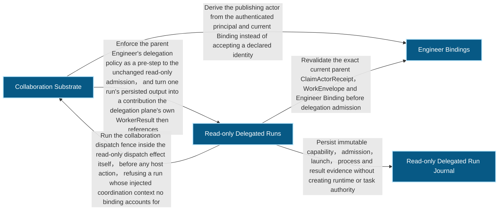
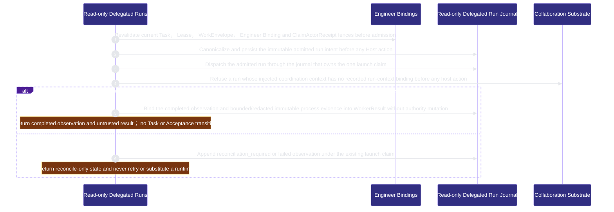

# runtime-harness/delegated-runs 架構文檔

<!-- BEGIN ARCHCONTEXT:generated target="projection_target.entity.capability-runtime-harness-delegated-runs" sourceDigest="sha256:792ad21d062cf1a1ed7b74a62da4c9b1cba72ae82a9b9457e68e4978692afed3" rendererVersion="archcontext.docs-renderer/v5" outputDigest="sha256:d6821aef7f07fe624417f5ed1a59826e48538df102f3bfa61d2667c7918082bc" -->
> **狀態**:`active`
> **Capability ID**:`capability.runtime-harness.delegated-runs`(kind `capability`)
> **Matched Prefixes**:`src/core/engineers/delegation.ts`、`src/effects/engineers/delegated-run-store.ts`、`src/cli/commands/delegation.ts`、`scripts/me2b-runtime-admission-canary.ts`
> **Local Contracts**:`AGENTS.md`、`CLAUDE.md`
> **事實優先級**:倉庫當前狀態 > 本文檔機器區 > 本文檔人工區。機器區(引言、§1、§2)由 ArchContext 從架構模型與源碼度量投影生成,手改會在下次投影被覆蓋。本文檔不記錄出處;本次投影所驗證的 commit 見 `docs/architecture/.projection-manifest.json`。

Admits one logical Role Profile against current Engineer authority and journals at most one Codex CLI read-only host action as untrusted evidence.

## 1. P1:能力架構地圖

### 1.1 架構圖

- Proof: `proven` (`sha256:8c5bdc6bd99cff95b2c0921cbc38d57c225a56ae1de5fd4288e79bb221cfe27f`).
- Semantic nodes: `4`; declared relations: `5`.

### 1.2 模組職責表

| 宣告入口 | 錨點 | 職責 |
| --- | --- | --- |
| `entrypoint.delegated-runs.dispatch-command` | `src/cli/commands/delegation.ts#dispatchDelegatedRunCommand` | `sink.delegated-runs.dispatch-host-action` → `src/effects/engineers/delegated-run-store.ts#dispatchDelegatedRun` |
| `entrypoint.delegated-runs.dispatch-effect` | `src/effects/engineers/delegated-run-store.ts#dispatchDelegatedRun` | `sink.delegated-runs.collaboration-dispatch-fence` → `src/effects/collaboration/context-delivery.ts#fenceCollaborationDispatch` |
| `entrypoint.delegated-runs.parent-authority` | `src/effects/engineers/delegated-run-store.ts#validateDelegationParent` | `sink.delegated-runs.parent-authority` → `src/effects/engineers/claim-actor-store.ts#validateClaimActorReceiptLive` |
| `entrypoint.delegated-runs.intent` | `src/effects/engineers/delegated-run-store.ts#persistIntent` | `sink.delegated-runs.intent-schema` → `src/core/engineers/delegation.ts#canonicalDelegatedRunIntentBytes` |
| `entrypoint.delegated-runs.observation` | `src/effects/engineers/delegated-run-store.ts#appendObservation` | `sink.delegated-runs.observation` → `src/core/engineers/delegation.ts#buildDelegatedRunObservation` |
| `entrypoint.delegated-runs.result` | `src/effects/engineers/delegated-run-store.ts#persistResult` | `sink.delegated-runs.worker-result` → `src/core/engineers/delegation.ts#canonicalWorkerResultBytes` |

### 1.3 規模信號

- 規模量級:`2–5` 個文件 / `2000–5000` 行
- 匹配前綴:`src/core/engineers/delegation.ts`、`src/effects/engineers/delegated-run-store.ts`、`src/cli/commands/delegation.ts`、`scripts/me2b-runtime-admission-canary.ts`
- 推導:掃描 `source.include` 減 `source.exclude`,跳過 `.git/` 與 `node_modules/`,再按 1–2–5 階梯分桶。精確計數不入本文檔:量級足以回答「這個能力有多大」,而逐行計數會讓覆蓋範圍內任何一次源碼改動都改寫本文檔。

### 1.4 依賴邊界

出向關係:

- `calls` → `capability.runtime-harness.collaboration` — Run the collaboration dispatch fence inside the read-only dispatch effect itself, before any host action, refusing a run whose injected coordination context no binding accounts for
- `calls` → `capability.runtime-harness.engineer-bindings` — Revalidate the exact current parent ClaimActorReceipt, WorkEnvelope and Engineer Binding before delegation admission
- `calls` → `component.delegated-runs.primary` — Persist immutable capability, admission, launch, process and result evidence without creating runtime or task authority

入向關係:

- `calls` ← `capability.runtime-harness.collaboration` — Enforce the parent Engineer's delegation policy as a pre-step to the unchanged read-only admission, and turn one run's persisted output into a contribution the delegation plane's own WorkerResult then references
- `calls` ← `capability.runtime-harness.verified-context` — Revalidate existing immutable WorkerRunRef, process receipt, WorkerResult and evidence blobs as untrusted checkpoint inputs

## 2. P2:端到端數據流

> **Proof**: `proven` (`sha256:8c5bdc6bd99cff95b2c0921cbc38d57c225a56ae1de5fd4288e79bb221cfe27f`); selectors `6/6`.

<!-- END ARCHCONTEXT:generated target="projection_target.entity.capability-runtime-harness-delegated-runs" -->

## 3. P3:設計決策與不變量

### 3.1 必须保持的不变量

1. **只读能力由观测证明，不由声明证明。** 准入要求冻结的 Codex CLI capability receipt：可执行文件的真实路径、版本和字节都被记录（`delegated-run-store.ts:306-316`）。dispatch 时再次核对路径、字节、版本、受保护范围和 Role Profile 字节（`delegated-run-store.ts:918-921`）。任何一项变化都 fail closed。PRD 记录了原因：native `explorer` 的 TOML 声明 `sandbox_mode = "read-only"`，但真实写入成功了（`plans/prds/20260824-1653-read-only-delegation-admission.prd.md` Canary Decision）。
2. **准入先持久化证据，再判定。** `admitReadOnlyDelegation` 先写 profile、capability、packet 和 envelope，再比较 parent、Binding、Role Profile、capability 和 packet 的每一个 fence（`delegated-run-store.ts:728-758`）。不匹配产生 terminal `rejected` 收据。rejected 收据从不创建 intent 或 Host 动作。
3. **一个 launch claim 最多换一次 Host 动作。** dispatch 发现已有 launch claim，或状态不是 `intent_persisted`，就只追加 `reconciliation_required` 观测，不重试，也不换 runtime（`delegated-run-store.ts:876-885`、`:910-917`）。
4. **WorkerResult 是不可信证据。** 结果只在 `completed` 且前后快照相同时收集。每个 run 只能有一个结果，第二个不同结果显式冲突（`delegated-run-store.ts:983-1010`）。结果不改变 Task、Lease、Publication 或 Acceptance。
5. **协作 fence 在 dispatch 效果内部执行。** `fenceCollaborationDispatch` 是 dispatch 锁内的第一条语句（`delegated-run-store.ts:887-908`）。源码注释写明理由：调用点前置步骤会被忘记，非 CLI 控制器可以直接到达 `dispatchDelegatedRun()`。
6. **交付平面到协作平面只有这一条边。** `tests/unit/collaboration-authority-baseline.test.ts:680-726` 扫描 `src/core` 和 `src/effects` 下的交付平面目录。它把例外固定为一个文件、一个导入符号、一次引用。新增任何其他依赖都会让该扫描失败。CLI `src/cli/commands/delegation.ts:5` 只导入 `CollaborationError`，用于映射错误，不在扫描范围内。

### 3.2 关键权衡

| 决策 | 权衡 |
| --- | --- |
| 只接受一次性 Codex CLI `:read-only` 载体，拒绝 native 子代理 | 换来可观测的只读证明；代价是绑定一个 Host 版本，Host 升级后要重新冻结 capability（PRD Feasibility Boundary） |
| 写入型 Worker（ME-2B）保持关闭 | 2026-08-26 的 canary 没有观测到动态 Parent 撤销和效果时主体（`tasks/todos.md:37`，commit `af1734f3`）。代价是 Module Engineer 只能用只读委派；重开条件写在 todos 中 |
| 协作 fence 放进 dispatch 效果，形成 delegated-runs 与 collaboration 的双向边 | 消除未设防的 dispatch 入口（PR #289，issue #278）；代价是交付平面依赖协作平面一个符号，由 authority baseline 测试精确约束 |
| 丢失确认后只做 reconcile | 不会产生第二次 Host 动作；代价是需要人工或后续工具处理 `reconciliation_required` |

### 3.3 10x 规模下先坏的点

- 每个 dispatch 持有一个按 dispatch id 分的锁（`delegated-run-store.ts:437`）。不同 run 之间不竞争。
- `delegated-run-store.ts` 有 1,034 行，承担准入、能力验证、dispatch、观测和结果五个职责。它是本能力最先需要拆分的文件。目前没有测得的性能压力。

### 3.4 开放问题

- capability receipt 绑定一个 `codex-cli` 版本。Host 自动升级后，所有已准入但未 dispatch 的 run 会变成 `delegated_run_capability_stale`。源码和 PRD 都没有记录重新冻结的操作步骤。

## 4. 歷史決策記錄(append-only)

| 日期 | 决策 | 依据 |
| --- | --- | --- |
| 2026-08-26 | 完成 ME-2A 只读委派准入，拒绝 native 子代理作为只读载体 | commit `7e8d3560`；`plans/archive/plan-20260826-0257-me2a-me3b-readonly-delegation.md` |
| 2026-08-26 | ME-2B 写入型准入判定为 no-go，canary 要求观测到 Host 强制执行 | commits `af1734f3`、`7b007ee3`；`scripts/me2b-runtime-admission-canary.ts` |
| 2026-08-28 | 把子进程环境和类型化拒绝绑定进证据链 | commit `de4026f7` |
| 2026-09-03 | 协作 fence 移入 `dispatchDelegatedRun()`，删除 CLI 和 C9 的前置步骤 | PR #289（closes #278） |
| 2026-10-11 | 本能力 include 新增 `scripts/me2b-runtime-admission-canary.ts`；P2 flow 增加 dispatch 和协作 fence 两步 | G4b 架构模型变更 |

## Optimization Backlog

- `delegated-run-store.ts` 依赖 `src/effects/fleet/acquire.ts` 的 `WorkEnvelopeV1` 类型、`src/effects/evidence/{blob-store,paths}.ts` 和 `src/effects/process-runner.ts`。这些文件当前无主。task-fleet、evidence-ledger 和 execution-primitives 落地后，补上对应 relation。
- `delegated-run-store.ts`（1,034 行）可按准入、dispatch、结果拆分。拆分前先确认测试 `tests/unit/me2a-me3b-readonly-delegation.test.ts` 覆盖每个 crash 边界。
- 共享校验原语 `src/core/messages/mechanics.ts` 被 `delegation.ts` 和 `delegated-run-store.ts` 调用。归属问题见 engineer-messages 的 Backlog。
