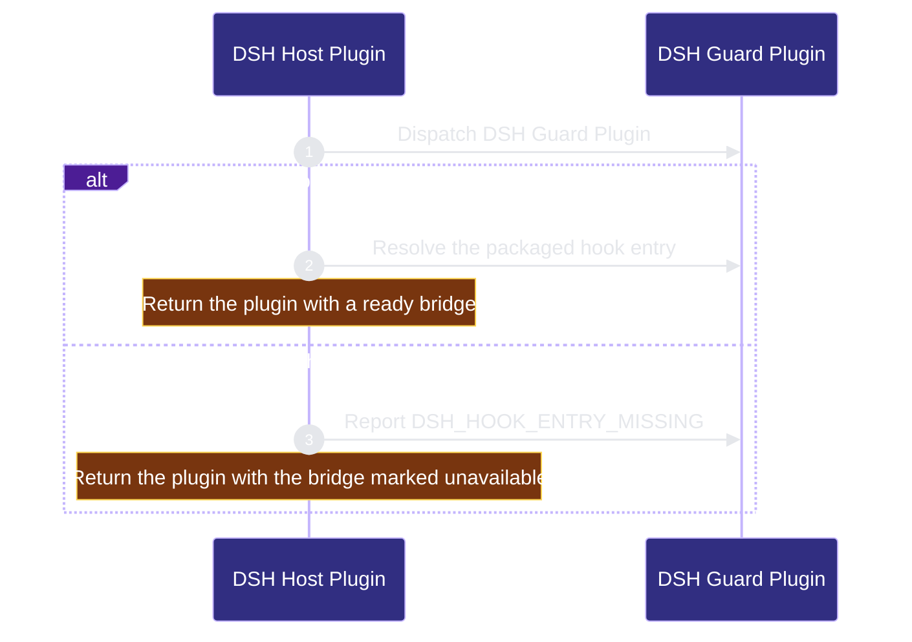

# runtime-harness/dsh-host 架構文檔

<!-- BEGIN ARCHCONTEXT:generated target="projection_target.entity.capability-runtime-harness-dsh-host" rendererVersion="archcontext.docs-renderer/v6" outputDigest="sha256:a967e2bead523995cc0467e7a5f444ea39680cf72b8055e124acfc86400c3f03" -->
> **狀態**:`active`
> **Capability ID**:`capability.runtime-harness.dsh-host`(kind `capability`)
> **Matched Prefixes**:`src/dsh/**`
> **Local Contracts**:`AGENTS.md`、`CLAUDE.md`
> **事實優先級**:倉庫當前狀態 > 本文檔機器區 > 本文檔人工區。機器區(引言、§1、§2)由 ArchContext 從架構模型與源碼度量投影生成,手改會在下次投影被覆蓋。本文檔不記錄出處;本次投影所驗證的 commit 見 `docs/architecture/.projection-manifest.json`。

Runs the repo-harness guard inside DeepSeek Harness (DSH) as a Cordis plugin and shows its denials in the DSH client.

## 1. P1:能力架構地圖

### 1.1 架構圖

- Proof: `proven` (`sha256:272b6135e2c9106db1f3641c19e8dd70aacc92b9bb2130cd1da3154ba559d9f3`).
- Semantic nodes: `2`; declared relations: `1`.

### 1.2 模組職責表

| 宣告入口 | 錨點 | 職責 |
| --- | --- | --- |
| `entrypoint.dsh-host.plugin` | `src/dsh/plugin.ts#createDshPlugin` | `sink.dsh-host.hook-bridge` → `src/dsh/bridge.ts#resolveDshBridge` |

組件入口:

- 組件均未宣告 `source.entrypoints`。

### 1.3 規模信號

- 規模量級:`5–10` 個文件 / `500–1000` 行
- 匹配前綴:`src/dsh/**`
- 推導:掃描 `source.include` 減 `source.exclude`,跳過 `.git/` 與 `node_modules/`,再按 1–2–5 階梯分桶。精確計數不入本文檔:量級足以回答「這個能力有多大」,而逐行計數會讓覆蓋範圍內任何一次源碼改動都改寫本文檔。

### 1.4 依賴邊界

出向關係:

- `depends-on` → `capability.runtime-harness.hook-adapters` — Run DSH tool calls through the shared hook bridge, route registry and hook protocol.
- `calls` → `component.dsh-host.primary` — Guard a DSH tool call

入向關係:

- `depends-on` ← `capability.verification.evals-checks` — Test DSH Host Plugin behavior through its source modules.

組件出向關係:

- `component.dsh-host.primary`:
  - 無。

### 1.5 組件結構

| 組件 | 名稱 | 規模量級 | 宣告入口 |
| --- | --- | --- | --- |
| `component.dsh-host.primary` | DSH Guard Plugin | 未宣告 `source.include` | 未宣告 |

## 2. P2:端到端數據流

> **Proof**: `proven` (`sha256:272b6135e2c9106db1f3641c19e8dd70aacc92b9bb2130cd1da3154ba559d9f3`); selectors `1/1`.

<!-- END ARCHCONTEXT:generated target="projection_target.entity.capability-runtime-harness-dsh-host" -->

## 3. P3:設計決策與不變量

## 4. 歷史決策記錄(append-only)

## Optimization Backlog
