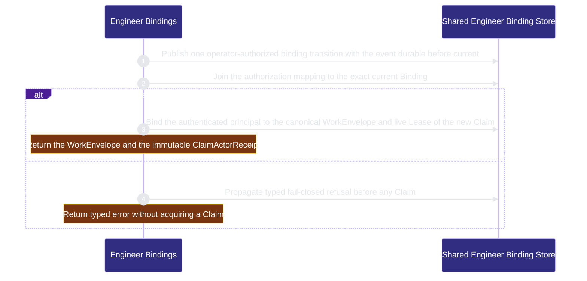

# runtime-harness/engineer-bindings 架構文檔

<!-- BEGIN ARCHCONTEXT:generated target="projection_target.entity.capability-runtime-harness-engineer-bindings" sourceDigest="sha256:6dfe0ebc11aa2ff612fe0dbe69f776ac4074edb8180b3b45318cb26c048ec1f4" rendererVersion="archcontext.docs-renderer/v5" outputDigest="sha256:8cf5face425b146f62a00de64d30436726d36cd9205675eddb25a4317e58a8dc" -->
> **狀態**:`active`
> **Capability ID**:`capability.runtime-harness.engineer-bindings`(kind `capability`)
> **Matched Prefixes**:`agents/engineers/**`、`src/core/engineers/**`、`src/effects/engineers/**`、`src/cli/commands/engineer.ts`
> **Local Contracts**:`AGENTS.md`、`CLAUDE.md`
> **事實優先級**:倉庫當前狀態 > 本文檔機器區 > 本文檔人工區。機器區(引言、§1、§2)由 ArchContext 從架構模型與源碼度量投影生成,手改會在下次投影被覆蓋。本文檔不記錄出處;本次投影所驗證的 commit 見 `docs/architecture/.projection-manifest.json`。

Defines tracked Module Engineer contracts, current Binding authority, authenticated principal mapping, and immutable Claim actor provenance.

## 1. P1:能力架構地圖

### 1.1 架構圖

- Proof: `proven` (`sha256:8880eb9b31d191dff30547d88f4be31efc14f7a607fdea2169b2aecf9ab02a04`).
- Semantic nodes: `2`; declared relations: `1`.

### 1.2 模組職責表

| 宣告入口 | 錨點 | 職責 |
| --- | --- | --- |
| `entrypoint.engineer-bindings.operator-cli` | `src/cli/commands/engineer.ts#buildEngineerCommand` | `sink.engineer-bindings.shared-store` → `src/effects/engineers/binding-store.ts#bindEngineer` |
| `entrypoint.engineer-bindings.principal-resolution` | `src/effects/engineers/principal.ts#resolveEngineerPrincipal` | `sink.engineer-bindings.current-binding` → `src/effects/engineers/binding-store.ts#readEngineerBindingStatus` |
| `entrypoint.engineer-bindings.acquire` | `src/effects/engineers/acquire.ts#acquireEngineerTask` | `sink.engineer-bindings.fleet-acquire` → `src/effects/fleet/acquire.ts#acquireFleetTask`、`sink.engineer-bindings.claim-actor-receipt` → `src/effects/engineers/claim-actor-store.ts#publishClaimActorReceipt` |
| `entrypoint.engineer-bindings.acquire` | `src/effects/engineers/acquire.ts#acquireEngineerTaskLocked` | `sink.engineer-bindings.claim-actor-build` → `src/core/engineers/principal-claim.ts#buildClaimActorReceipt` |

### 1.3 規模信號

- 規模量級:`20–50` 個文件 / `10k–20k` 行
- 匹配前綴:`agents/engineers/**`、`src/core/engineers/**`、`src/effects/engineers/**`、`src/cli/commands/engineer.ts`
- 推導:掃描 `source.include` 減 `source.exclude`,跳過 `.git/` 與 `node_modules/`,再按 1–2–5 階梯分桶。精確計數不入本文檔:量級足以回答「這個能力有多大」,而逐行計數會讓覆蓋範圍內任何一次源碼改動都改寫本文檔。

### 1.4 依賴邊界

出向關係:

- `calls` → `capability.workflow-engine.execution-primitives` — Hold exclusive directory locks under the Git common directory
- `calls` → `component.engineer-bindings.primary` — Publish one operator-authorized Engineer binding transition
- `calls` → `capability.workflow-engine.workflow-state` — Process Sprint dependencies and release Sprint leases for bound engineer tasks

入向關係:

- `calls` ← `capability.runtime-harness.agent-runtime-effects` — Revalidate the exact current Engineer Binding endpoint before preparing or admitting one Host adapter action
- `calls` ← `capability.runtime-harness.bound-task-freezes` — Revalidate the current Binding and exact live ClaimActorReceipt before inspection or rotation refusal
- `calls` ← `capability.runtime-harness.collaboration` — Derive the publishing actor from the authenticated principal and current Binding instead of accepting a declared identity
- `calls` ← `capability.runtime-harness.delegated-runs` — Revalidate the exact current parent ClaimActorReceipt, WorkEnvelope and Engineer Binding before delegation admission
- `calls` ← `capability.runtime-harness.engineer-messages` — Revalidate the exact target Engineer and current Binding before assignment delivery, transport and acknowledgement
- `calls` ← `capability.runtime-harness.engineer-scheduling` — Revalidate the exact current Engineer contract and delegate the elected offer to the existing Engineer acquire authority
- `calls` ← `capability.runtime-harness.engineering-overlay` — Observe exact current Profile, Binding and live ClaimActor revisions without mutating their stores
- `calls` ← `component.global-runtime-reconciliation.cli-root` — Register the engineer command
- `calls` ← `capability.runtime-harness.interface-change` — Revalidate the exact current Binding for every Engineer-owned transition
- `calls` ← `capability.runtime-harness.mcp-sidecar` — Resolve a verified OAuth authorization to the current Engineer Binding before acquiring a Fleet Claim
- `calls` ← `capability.organization.task-fleet` — Validate principal claims and claim actor receipts before a steer reply is recorded
- `calls` ← `capability.runtime-harness.verified-context` — Revalidate Engineer decision actors against the exact current active Binding fence
- `calls` ← `capability.runtime-harness.work-demand` — Revalidate the exact current requester Binding for Engineer-owned transitions

## 2. P2:端到端數據流

> **Proof**: `proven` (`sha256:8880eb9b31d191dff30547d88f4be31efc14f7a607fdea2169b2aecf9ab02a04`); selectors `3/3`.

<!-- END ARCHCONTEXT:generated target="projection_target.entity.capability-runtime-harness-engineer-bindings" -->

## 3. P3:設計決策與不變量

### 3.1 必须保持的不变量

1. **Profile 和 SOP 是 Git index 跟踪的行为契约。** 文件系统中存在不构成权威。`.archcontext/model/nodes/*.yaml` 仍是 capability 路径、入口、接口和检查的唯一权威。contract revision 哈希完整的、通过 schema 校验的所选节点。Profile 只保存 `capability_id` 引用。
2. **`<git-common-dir>/repo-harness/engineers/v1/` 是唯一的 Binding 权威。** linked worktree 共享它。`current.json` 决定当前状态。event 只提供不可变审计，以及同一 idempotency key 的定向恢复。
3. **只有本地 Human operator CLI 能写 Binding。** bootstrap capsule 是只读上下文。它不携带 Principal、凭据、Claim、Lease、Publication、Acceptance 或任务变更权威（ME-0A）。
4. **event 先于 current 持久化。** 每次变更在每个 Engineer 一个的独占锁内执行：校验 current 和 CAS fence；用 `O_EXCL|O_NOFOLLOW` 创建不可变 event（`src/effects/engineers/binding-store.ts:323`）；fsync event 和 events 目录；用 temp+fsync+rename 发布 current；最后 fsync Engineer 目录。任何模糊状态或 symlink 都 fail closed。
5. **同一请求的重试复用首次 event 冻结的值。** binding ID、时间戳和目标 contract revision 都来自首次 event。operation fingerprint 不含服务端派生的目标 revision，所以 Profile 演进不会阻断已持久化 event 的崩溃恢复。Provider、thread 或 host 等请求字段变化仍返回 `idempotency_conflict`（`binding-store.ts:367`、`:466`）。
6. **`replace` 在 `created_at` 退休上一个 Binding。** 旧 event 中的 binding 保留事件时的状态，不是第二个 current 权威。generation 0 的 genesis 不落盘。有 event 而没有 current 时，status 视为损坏；只有该精确转换的重试可以补完 genesis 崩溃窗口。
7. **陈旧空锁的恢复只对 Engineer 调用方开启。** 超过 30 秒后，重新校验祖先目录、目录 inode 和空目录，再用 `rmdir` 作为 fence。暂停的原创建者恢复后，仍要通过唯一 token 所有权检查。其他共享锁调用方保持默认的 fail-closed 语义。
8. **OAuth `authorizationId` 只选择主体映射候选。** 每个 Engineer 命令都重新读取当前 Binding，并核对仓库、Engineer ID、binding ID、generation 和 contract revision。映射不能延长已撤销或已替换 Binding 的生命周期（ME-0B）。
9. **Lease 回答"谁拥有执行"，ClaimActorReceipt 回答"哪个已认证主体触发了 Claim"。** 收据必须与完整规范化 WorkEnvelope 摘要，以及 live Lease 的 claim ID、generation、task revision、worktree、branch 和 unit 一致。
10. **Engineer acquire 复用 canonical Fleet acquire。** 收据发布失败时，只释放刚返回且仍为 live 的那个 Claim。Claim 已被替换或释放失败都 fail closed，并保留已创建的 worktree 供恢复（`src/effects/engineers/acquire.ts:163-178`）。
11. **其他 engineer-* 能力在 Binding 锁内重新校验 Binding。** interface-change、work-demand 和 bound-task-freezes 都先取 `withEngineerBindingLock`（`binding-store.ts:498`），再取自己的锁。锁顺序是 Binding 在外。

### 3.2 关键权衡

| 决策 | 权衡 |
| --- | --- |
| 每个 Engineer 一个目录，Profile 和节点全量扫描 | 简单、可审计、不需要第二个索引权威；一次 list 只读一次 Git index、只解析一次 ArchContext 注册表。代价是 10x 时先遇到扫描和目录数量的成本 |
| 用户级主体映射使用单锁和线性扫描 | 没有数据库或缓存权威；代价是 10x 时先出现授权查找和锁竞争 |
| Engineer acquire 不复制 Fleet acquire，只在其外包一层收据 | 没有第二个 Claim 权威；代价是本能力依赖 Fleet 和 Sprint 的释放命令（`acquire.ts:19`、`:71`） |

### 3.3 10x 规模下先坏的点

- Profile 和节点扫描以及目录数量先受压。锁和 CAS 的正确性不受规模影响。主体映射的线性查找和单锁竞争紧随其后。在测得真实竞争之前，不引入数据库、缓存权威、后台修复或批量协议。

## 4. 歷史決策記錄(append-only)

### 2026-08-24 ME-0A authority foundation

- Approved work-package: `plans/plan-20260824-2126-me0a-engineer-profile-binding.md`.
- Accepted architecture change: `changeset.plan-20260824-2126-me0a-engineer-profile-binding`, bound to archived external approval `event.review-20260824-2050-persistent-module-engineer-me0a-approval`.
- EngineerPrincipal, Session mutation, ClaimActorReceipt, delegation, messaging, Worker Host, Provider lifecycle, handoff, Human Board, and remote access remain separate Draft children and receive no authority from this module.

### 2026-08-25 ME-0B principal and claim actor

- Approved work-package: `plans/plan-20260825-0029-me0b-engineer-principal-claim-actor.md`.
- Accepted architecture change: `changeset.plan-20260825-0029-me0b-engineer-principal-claim-actor`, bound to Human approval `event.review-20260825-0029-me0b-engineer-principal-claim-actor-approval`; the final residual refresh covered `verified-flow-proof-changed` for `capability.runtime-harness.engineer-bindings` and `capability.runtime-harness.mcp-sidecar`.
- EngineerPrincipal and ClaimActorReceipt are now in scope; Provider adapters, Session lifecycle, Worker Host, Work Package Graph, delegation, messaging, writer grant, handoff, interface request, Human Board, and remote access remain separate children.

### 2026-10-11 P2 flow 改为三个不同步骤

- P2 flow 原来三个步骤都是同一个 selector。现在分别是：operator CLI 发布 Binding，主体解析读取当前 Binding，`acquireEngineerTaskLocked` 构建 ClaimActorReceipt。

## Optimization Backlog

- after arch-context#296：本能力的 `src/core/engineers/**` 和 `src/effects/engineers/**` 与 9 个具体能力重叠，共 25 个文件。目标是把这两个通配符换成本能力自己的 11 个代码文件加 `src/core/engineers/{AGENTS,CLAUDE}.md`，`agents/engineers/**` 和 `src/cli/commands/engineer.ts` 保留（`ownership-proposal` §2）。每个重叠文件的目标所有者：
  - agent-runtime-effects：`agent-runtime-effect.ts`、`agent-runtime-effect-store.ts`、`agent-runtime-feature.ts`、`agent-runtime-adapters/**`。
  - bound-task-freezes：`task-freeze.ts`、`task-freeze-store.ts`、`bound-task-rotation.ts`。
  - delegated-runs：`delegation.ts`、`delegated-run-store.ts`。
  - engineering-overlay：两个 `engineering-overlay.ts`。
  - engineer-messages：`module-message.ts`、`module-inbox.ts`。
  - engineer-scheduling：`scheduling.ts`（core 和 effects）、`dependency-authority.ts`、`scheduling-acquire.ts`、`scheduling-acquire-next.ts`。
  - interface-change：`interface-change.ts`、`interface-change-store.ts`。
  - verified-context：`verified-context.ts`、`verified-context-store.ts`。
  - work-demand：`work-demand.ts`、`work-demand-store.ts`、`work-demand-materialization.ts`。
- 反向边证据（不声明为 relation）：`src/cli/commands/engineer.ts`（831 行）是 engineer 命令族的组合根。它调用 engineer-scheduling、bound-task-freezes、work-demand、engineer-messages、engineering-overlay 和 agent-runtime-effects，而这些能力都依赖本能力。可选重构：把各子命令移到所属能力，或把 `engineer.ts` 作为单独的命令面组件。
- 反向边证据：`binding-store.ts:45` 导入 bound-task-freezes 的 `bound-task-rotation.ts`；`src/core/engineers/automation-attempt.ts` 导入 engineer-scheduling 的类型。
- 本能力调用 `src/effects/fleet/acquire.ts`（`acquireFleetTask`、`resumeReclaimedFleetWork`）和 `src/effects/state/coordination-sprint.ts`。集成步骤声明了 engineer-bindings → workflow-state 与 → execution-primitives。没有声明 engineer-bindings → task-fleet：`relation.task-fleet.engineer-bindings` 已经声明反向，且反向边更多（14 条对 5 条）。本方向是回边。
- 声明的 selector `entrypoint.engineer-bindings.acquire#acquireEngineerTask` 的两个 sink 在 CodeGraph 中没有直接 `calls` 边（经由注入的依赖调用）。P2 flow 改用 `acquireEngineerTaskLocked → buildClaimActorReceipt`。
