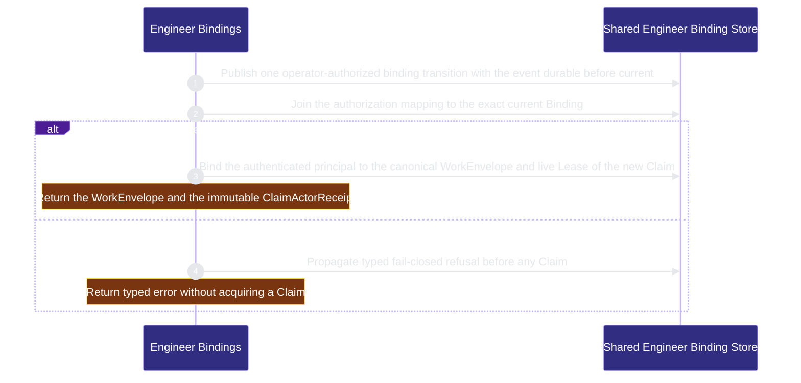

# runtime-harness/engineer-bindings 架構文檔

<!-- BEGIN ARCHCONTEXT:generated target="projection_target.entity.capability-runtime-harness-engineer-bindings" rendererVersion="archcontext.docs-renderer/v6" outputDigest="sha256:c8da8286ae545f632c88b02e931447b0539af3566b12cf33cc33790057ce8c2b" -->
> **狀態**:`active`
> **Capability ID**:`capability.runtime-harness.engineer-bindings`(kind `capability`)
> **Matched Prefixes**:`agents/engineers/**`、`src/core/engineers/**`、`src/effects/engineers/**`、`src/cli/commands/engineer.ts`
> **Local Contracts**:`AGENTS.md`、`CLAUDE.md`
> **事實優先級**:倉庫當前狀態 > 本文檔機器區 > 本文檔人工區。機器區(引言、§1、§2)由 ArchContext 從架構模型與源碼度量投影生成,手改會在下次投影被覆蓋。本文檔不記錄出處;本次投影所驗證的 commit 見 `docs/architecture/.projection-manifest.json`。

Defines tracked Module Engineer contracts, current Binding authority, authenticated principal mapping, and immutable Claim actor provenance.

## 1. P1:能力架構地圖

### 1.1 架構圖

- Proof: `proven` (`sha256:af61082437f1e931f6d7315ef188ada25e0a75f9b8a30710390e28586667937b`).
- Semantic nodes: `2`; declared relations: `1`.

### 1.2 模組職責表

| 宣告入口 | 錨點 | 職責 |
| --- | --- | --- |
| `entrypoint.engineer-bindings.operator-cli` | `src/cli/commands/engineer.ts#buildEngineerCommand` | `sink.engineer-bindings.shared-store` → `src/effects/engineers/binding-store.ts#bindEngineer` |
| `entrypoint.engineer-bindings.principal-resolution` | `src/effects/engineers/principal.ts#resolveEngineerPrincipal` | `sink.engineer-bindings.current-binding` → `src/effects/engineers/binding-store.ts#readEngineerBindingStatus` |
| `entrypoint.engineer-bindings.acquire` | `src/effects/engineers/acquire.ts#acquireEngineerTask` | `sink.engineer-bindings.fleet-acquire` → `src/effects/fleet/acquire.ts#acquireFleetTask`、`sink.engineer-bindings.claim-actor-receipt` → `src/effects/engineers/claim-actor-store.ts#publishClaimActorReceipt` |
| `entrypoint.engineer-bindings.acquire` | `src/effects/engineers/acquire.ts#acquireEngineerTaskLocked` | `sink.engineer-bindings.claim-actor-build` → `src/core/engineers/principal-claim.ts#buildClaimActorReceipt` |

組件入口:

- 組件均未宣告 `source.entrypoints`。

### 1.3 規模信號

- 規模量級:`10–20` 個文件 / `2000–5000` 行
- 匹配前綴:`agents/engineers/**`、`src/core/engineers/**`、`src/effects/engineers/**`、`src/cli/commands/engineer.ts`
- 排除前綴:`src/core/engineers/agent-runtime-effect.ts`、`src/effects/engineers/agent-runtime-adapters/**`、`src/effects/engineers/agent-runtime-effect-store.ts`、`src/effects/engineers/agent-runtime-feature.ts`、`src/core/engineers/delegation.ts`、`src/effects/engineers/delegated-run-store.ts`、`src/core/engineers/engineering-overlay.ts`、`src/core/engineers/scheduling.ts`、`src/effects/engineers/dependency-authority.ts`、`src/effects/engineers/engineering-overlay.ts`、`src/effects/engineers/scheduling-acquire-next.ts`、`src/effects/engineers/scheduling-acquire.ts`、`src/effects/engineers/scheduling.ts`
- 推導:掃描 `source.include` 減 `source.exclude`,跳過 `.git/` 與 `node_modules/`,再按 1–2–5 階梯分桶。精確計數不入本文檔:量級足以回答「這個能力有多大」,而逐行計數會讓覆蓋範圍內任何一次源碼改動都改寫本文檔。

### 1.4 依賴邊界

出向關係:

- `calls` → `capability.workflow-engine.execution-primitives` — Hold exclusive directory locks under the Git common directory
- `calls` → `component.engineer-bindings.primary` — Publish one operator-authorized Engineer binding transition
- `calls` → `capability.workflow-engine.workflow-state` — Process Sprint dependencies and release Sprint leases for bound engineer tasks

入向關係:

- `calls` ← `capability.runtime-harness.agent-runtime-effects` — Revalidate the exact current Engineer Binding endpoint before preparing or admitting one Host adapter action
- `calls` ← `capability.runtime-harness.delegated-runs` — Revalidate the exact current parent ClaimActorReceipt, WorkEnvelope and Engineer Binding before delegation admission
- `calls` ← `capability.runtime-harness.engineer-scheduling` — Revalidate the exact current Engineer contract and delegate the elected offer to the existing Engineer acquire authority
- `calls` ← `capability.runtime-harness.engineering-overlay` — Observe exact current Profile, Binding and live ClaimActor revisions without mutating their stores
- `calls` ← `component.global-runtime-reconciliation.cli-root` — Register the engineer command
- `calls` ← `capability.runtime-harness.mcp-sidecar` — Resolve a verified OAuth authorization to the current Engineer Binding before acquiring a Fleet Claim
- `calls` ← `capability.organization.task-fleet` — Validate principal claims and claim actor receipts before a steer reply is recorded

組件出向關係:

- `component.engineer-bindings.primary`:
  - 無。

### 1.5 組件結構

| 組件 | 名稱 | 規模量級 | 宣告入口 |
| --- | --- | --- | --- |
| `component.engineer-bindings.primary` | Shared Engineer Binding Store | 未宣告 `source.include` | 未宣告 |

## 2. P2:端到端數據流

> **Proof**: `proven` (`sha256:af61082437f1e931f6d7315ef188ada25e0a75f9b8a30710390e28586667937b`); selectors `3/3`.

<!-- END ARCHCONTEXT:generated target="projection_target.entity.capability-runtime-harness-engineer-bindings" -->

## 3. P3: Retained read invariants

- Profile and SOP files must be tracked. The capability model owns the referenced capability contract.
- Linked worktrees read the same binding store below the Git common directory.
- `readEngineerBindingStatus` validates the current record and its immutable event. It never repairs a missing or corrupt record.
- An absent store returns a generation-zero observation without writing files. An event without its current record remains corrupt.
- `readClaimActorReceipt` validates canonical historical bytes. Live receipt listing checks the exact claim ID, generation and task revision. An unknown Lease stays unavailable.
- The operator shows existing bindings only. It cannot create, replace or retire a binding.
- Engineer CLI, OAuth principal registration, acquisition and binding writers are retired. The runtime endpoint and operator readers remain.

## 4. 歷史決策記錄(append-only)

### 2026-08-24 ME-0A authority foundation

- Approved work-package: `plans/plan-20260824-2126-me0a-engineer-profile-binding.md`.
- Accepted architecture change: `changeset.plan-20260824-2126-me0a-engineer-profile-binding`, bound to archived external approval `event.review-20260824-2050-persistent-module-engineer-me0a-approval`.
- EngineerPrincipal, Session mutation, ClaimActorReceipt, delegation, messaging, Worker Host, Provider lifecycle, handoff, Human Board, and remote access remain separate Draft children and receive no authority from this module.

### 2026-08-25 ME-0B principal and claim actor

- Approved work-package: `plans/plan-20260825-0029-me0b-engineer-principal-claim-actor.md`.
- Accepted architecture change: `changeset.plan-20260825-0029-me0b-engineer-principal-claim-actor`, bound to Human approval `event.review-20260825-0029-me0b-engineer-principal-claim-actor-approval`; the final residual refresh covered `verified-flow-proof-changed` for `capability.runtime-harness.engineer-bindings` and `capability.runtime-harness.mcp-sidecar`.
- EngineerPrincipal and ClaimActorReceipt are now in scope; Provider adapters, Session lifecycle, Worker Host, Work Package Graph, delegation, messaging, writer grant, handoff, interface request, Human Board, and remote access remain separate children.

### 2026-10-11 P2 flow 改为三个不同步骤

- P2 flow 原来三个步骤都是同一个 selector。现在分别是：operator CLI 发布 Binding，主体解析读取当前 Binding，`acquireEngineerTaskLocked` 构建 ClaimActorReceipt。
