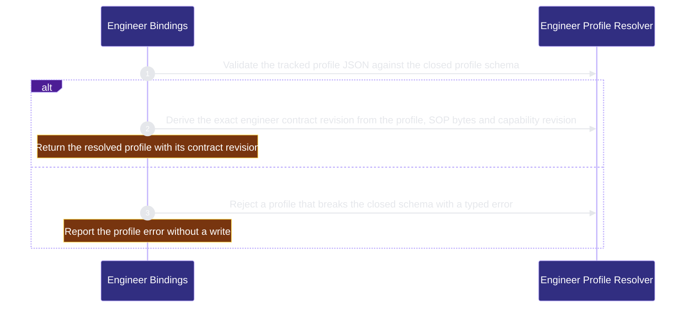

# runtime-harness/engineer-bindings 架構文檔

<!-- BEGIN ARCHCONTEXT:generated target="projection_target.entity.capability-runtime-harness-engineer-bindings" rendererVersion="archcontext.docs-renderer/v6" outputDigest="sha256:6f59c6d5a55b404619bc26a654ded07ee49fb0ab52796e967b199672214b36f5" -->
> **狀態**:`active`
> **Capability ID**:`capability.runtime-harness.engineer-bindings`(kind `capability`)
> **Matched Prefixes**:`agents/engineers/**`、`src/core/engineers/**`、`src/effects/engineers/**`、`src/effects/profiles/profile-store.ts`
> **Local Contracts**:`AGENTS.md`、`CLAUDE.md`
> **事實優先級**:倉庫當前狀態 > 本文檔機器區 > 本文檔人工區。機器區(引言、§1、§2)由 ArchContext 從架構模型與源碼度量投影生成,手改會在下次投影被覆蓋。本文檔不記錄出處;本次投影所驗證的 commit 見 `docs/architecture/.projection-manifest.json`。

Resolves tracked capability-backed Engineer Profile and SOP contracts and retains historical principal mapping and Claim Actor codecs.

## 1. P1:能力架構地圖

### 1.1 架構圖

- Proof: `proven` (`sha256:19d61b99be0fab7e230acbba892a41aa4c718e2aae6353123b0ad868cfa30cc5`).
- Semantic nodes: `2`; declared relations: `1`.

### 1.2 模組職責表

| 宣告入口 | 錨點 | 職責 |
| --- | --- | --- |
| `entrypoint.engineer-bindings.profile` | `src/effects/profiles/profile-store.ts#readProfileFile` | `sink.engineer-bindings.validate-profile` → `src/core/engineers/profile-binding.ts#validateModuleEngineerProfile`、`sink.engineer-bindings.contract-revision` → `src/core/engineers/profile-binding.ts#engineerContractRevision` |

組件入口:

- 組件均未宣告 `source.entrypoints`。

### 1.3 規模信號

- 規模量級:`5–10` 個文件 / `500–1000` 行
- 匹配前綴:`agents/engineers/**`、`src/core/engineers/**`、`src/effects/engineers/**`、`src/effects/profiles/profile-store.ts`
- 排除前綴:`src/core/engineers/agent-runtime-effect.ts`、`src/effects/engineers/agent-runtime-adapters/**`、`src/effects/engineers/agent-runtime-effect-store.ts`、`src/effects/engineers/agent-runtime-feature.ts`、`src/core/engineers/engineering-overlay.ts`、`src/core/engineers/scheduling.ts`、`src/effects/engineers/dependency-authority.ts`、`src/effects/engineers/engineering-overlay.ts`、`src/effects/engineers/scheduling.ts`
- 推導:掃描 `source.include` 減 `source.exclude`,跳過 `.git/` 與 `node_modules/`,再按 1–2–5 階梯分桶。精確計數不入本文檔:量級足以回答「這個能力有多大」,而逐行計數會讓覆蓋範圍內任何一次源碼改動都改寫本文檔。

### 1.4 依賴邊界

出向關係:

- `calls` → `capability.workflow-engine.execution-primitives` — List tracked Engineer profile and SOP paths through the shared Git runner
- `depends-on` → `capability.workflow-engine.contract-assets` — Resolve capability contracts for Engineer profiles.
- `depends-on` → `capability.runtime-harness.evidence-ledger` — Use canonical evidence JSON and evidence types for profiles and historical principal records.
- `depends-on` → `capability.runtime-harness.global-runtime-reconciliation` — Read the architecture model for Engineer profiles.
- `calls` → `component.engineer-bindings.primary` — Resolve and validate tracked Engineer profiles

入向關係:

- `calls` ← `capability.runtime-harness.agent-runtime-effects` — Use canonical engineer JSON and digest helpers for profile evidence; do not resolve a legacy binding endpoint
- `calls` ← `capability.runtime-harness.engineer-scheduling` — Resolve declared graph capabilities through the Engineer profile authority reader
- `calls` ← `capability.runtime-harness.engineering-overlay` — Use canonical engineer JSON and digest helpers for admitted overlay evidence without reading legacy binding or ClaimActor stores
- `depends-on` ← `capability.verification.evals-checks` — Test Engineer Bindings behavior through its source modules.
- `calls` ← `component.global-runtime-reconciliation.cli-root` — Register the engineer command
- `depends-on` ← `capability.runtime-harness.operator` — Use claim identity types for task activity.
- `calls` ← `capability.organization.task-fleet` — Validate principal claims and claim actor receipts before a steer reply is recorded

組件出向關係:

- `component.engineer-bindings.primary`:
  - 無。

### 1.5 組件結構

| 組件 | 名稱 | 規模量級 | 宣告入口 |
| --- | --- | --- | --- |
| `component.engineer-bindings.primary` | Engineer Profile Resolver | 未宣告 `source.include` | 未宣告 |

## 2. P2:端到端數據流

> **Proof**: `proven` (`sha256:19d61b99be0fab7e230acbba892a41aa4c718e2aae6353123b0ad868cfa30cc5`); selectors `2/2`.

<!-- END ARCHCONTEXT:generated target="projection_target.entity.capability-runtime-harness-engineer-bindings" -->

## 3. P3: Retained read invariants

- Profile and SOP files must be tracked. The capability model owns the referenced capability contract.
- A session selects an engineer profile only through explicit admitted metadata: the engineer ID and its exact contract revision.
- `src/core/engineers/principal-claim.ts` keeps the historical principal mapping and Claim Actor codecs. They validate canonical historical bytes. No reader resolves a lease owner.
- Engineer CLI, OAuth principal registration, acquisition, the binding store reader, the claim actor store and all binding writers are removed. Stored bytes below the Git common directory stay in place.

## 4. 歷史決策記錄(append-only)

### 2026-08-24 ME-0A authority foundation

- The original implementation plan is not tracked. The requirement is in `plans/prds/20260824-1653-engineer-profile-binding-projection.prd.md`.
- Accepted architecture change: `changeset.plan-20260824-2126-me0a-engineer-profile-binding`, bound to archived external approval `event.review-20260824-2050-persistent-module-engineer-me0a-approval`.
- EngineerPrincipal, Session mutation, ClaimActorReceipt, delegation, messaging, Worker Host, Provider lifecycle, handoff, Human Board, and remote access remain separate Draft children and receive no authority from this module.

### 2026-08-25 ME-0B principal and claim actor

- Approved work-package: [archived plan-20260825-0029-me0b-engineer-principal-claim-actor.md](https://github.com/Ancienttwo/repo-harness/blob/ed438b88e71e8f7d1c753163d2a27bf7225e9d4c/plans/plan-20260825-0029-me0b-engineer-principal-claim-actor.md).
- Accepted architecture change: `changeset.plan-20260825-0029-me0b-engineer-principal-claim-actor`, bound to Human approval `event.review-20260825-0029-me0b-engineer-principal-claim-actor-approval`; the final residual refresh covered `verified-flow-proof-changed` for `capability.runtime-harness.engineer-bindings` and `capability.runtime-harness.mcp-sidecar`.
- EngineerPrincipal and ClaimActorReceipt are now in scope; Provider adapters, Session lifecycle, Worker Host, Work Package Graph, delegation, messaging, writer grant, handoff, interface request, Human Board, and remote access remain separate children.

### 2026-10-11 P2 flow 改为三个不同步骤

- P2 flow 原来三个步骤都是同一个 selector。现在分别是：operator CLI 发布 Binding，主体解析读取当前 Binding，`acquireEngineerTaskLocked` 构建 ClaimActorReceipt。
