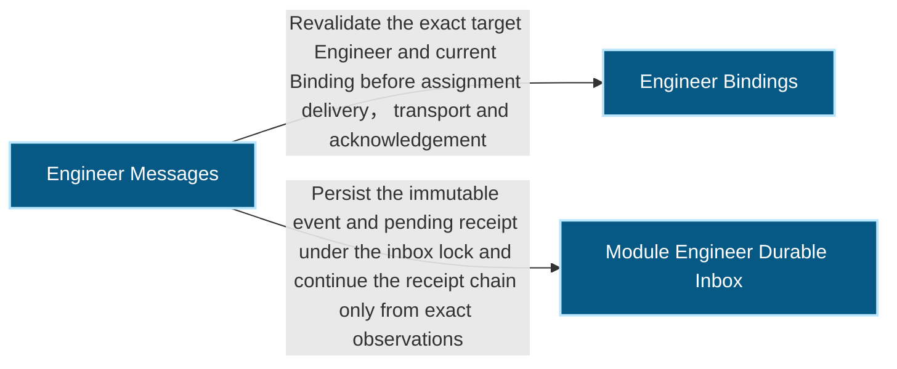
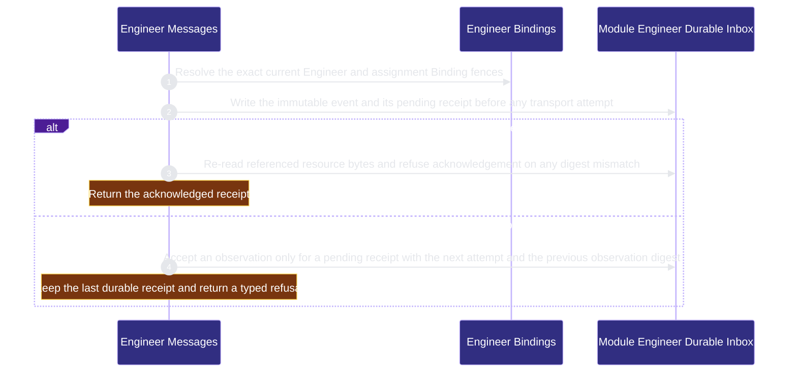

# runtime-harness/engineer-messages 架構文檔

<!-- BEGIN ARCHCONTEXT:generated target="projection_target.entity.capability-runtime-harness-engineer-messages" sourceDigest="sha256:1944ab7de47c999cd74b3552389abfcc5db3cc3540ccfbad2c545a275edd91cc" rendererVersion="archcontext.docs-renderer/v5" outputDigest="sha256:aadbe347c8a2a0945d0fd7dec12f56ef84b144bd340dae3c4f36394403f20e13" -->
> **狀態**:`active`
> **Capability ID**:`capability.runtime-harness.engineer-messages`(kind `capability`)
> **Matched Prefixes**:`src/core/messages/mechanics.ts`、`src/core/engineers/module-message.ts`、`src/effects/engineers/module-inbox.ts`
> **Local Contracts**:`AGENTS.md`、`CLAUDE.md`
> **事實優先級**:倉庫當前狀態 > 本文檔機器區 > 本文檔人工區。機器區(引言、§1、§2)由 ArchContext 從架構模型與源碼度量投影生成,手改會在下次投影被覆蓋。本文檔不記錄出處;本次投影所驗證的 commit 見 `docs/architecture/.projection-manifest.json`。

Persists closed Module Engineer messages and binding-fenced delivery state before any optional Agent Runtime effect.

## 1. P1:能力架構地圖

### 1.1 架構圖

- Proof: `proven` (`sha256:30a9d2f080cd2e5d1f2b9b0e8650925ea865ea5ea94d5d9492a6bdce4fb0f3c9`).
- Semantic nodes: `3`; declared relations: `2`.

### 1.2 模組職責表

| 宣告入口 | 錨點 | 職責 |
| --- | --- | --- |
| `entrypoint.engineer-messages.send` | `src/effects/engineers/module-inbox.ts#sendModuleMessage` | `sink.engineer-messages.current-binding` → `src/effects/engineers/binding-store.ts#readEngineerBindingStatus` |
| `entrypoint.engineer-messages.send` | `src/effects/engineers/module-inbox.ts#persistEventAndReceipt` | `sink.engineer-messages.pending-receipt` → `src/core/engineers/module-message.ts#buildModuleMessageDeliveryReceipt` |
| `entrypoint.engineer-messages.acknowledge` | `src/effects/engineers/module-inbox.ts#acknowledgeModuleMessage` | `sink.engineer-messages.resource-bytes` → `src/effects/engineers/module-inbox.ts#verifyModuleMessageResources` |
| `entrypoint.engineer-messages.binding-fence` | `src/effects/engineers/module-inbox.ts#validateTarget` | `sink.engineer-messages.binding-fence` → `src/effects/engineers/binding-store.ts#readEngineerBindingStatus` |
| `entrypoint.engineer-messages.external-delivery-observation` | `src/effects/engineers/module-inbox.ts#recordModuleMessageDeliveryObservation` | `sink.engineer-messages.delivery-receipt` → `src/core/engineers/module-message.ts#applyModuleMessageObservation` |
| `entrypoint.engineer-messages.external-delivery-observation` | `src/effects/engineers/module-inbox.ts#appendObservation` | `sink.engineer-messages.observation-chain` → `src/core/engineers/module-message.ts#applyModuleMessageObservation` |

### 1.3 規模信號

- 規模量級:`2–5` 個文件 / `1000–2000` 行
- 匹配前綴:`src/core/messages/mechanics.ts`、`src/core/engineers/module-message.ts`、`src/effects/engineers/module-inbox.ts`
- 推導:掃描 `source.include` 減 `source.exclude`,跳過 `.git/` 與 `node_modules/`,再按 1–2–5 階梯分桶。精確計數不入本文檔:量級足以回答「這個能力有多大」,而逐行計數會讓覆蓋範圍內任何一次源碼改動都改寫本文檔。

### 1.4 依賴邊界

出向關係:

- `calls` → `capability.runtime-harness.engineer-bindings` — Revalidate the exact target Engineer and current Binding before assignment delivery, transport and acknowledgement
- `calls` → `component.engineer-messages.primary` — Persist the immutable event and pending receipt under the inbox lock and continue the receipt chain only from exact observations

入向關係:

- `calls` ← `capability.runtime-harness.agent-runtime-effects` — Consume one exact persisted message and record effect success only from its authoritative receipt
- `calls` ← `capability.runtime-harness.engineering-overlay` — Observe pending and failed delivery facts from the existing ME-1C event and receipt authority
- `calls` ← `capability.runtime-harness.mcp-sidecar` — Expose authenticated Engineer message send, list and acknowledgement without granting generic Fleet or Provider authority

## 2. P2:端到端數據流

> **Proof**: `proven` (`sha256:30a9d2f080cd2e5d1f2b9b0e8650925ea865ea5ea94d5d9492a6bdce4fb0f3c9`); selectors `4/4`.

<!-- END ARCHCONTEXT:generated target="projection_target.entity.capability-runtime-harness-engineer-messages" -->

## 3. P3:設計決策與不變量

### 3.1 必须保持的不变量

1. **先持久化，再投递。** `sendModuleMessage` 在 inbox 锁内先校验目标 Binding，再写不可变 event 和 `pending` 收据，最后才尝试可选的 transport（`src/effects/engineers/module-inbox.ts:530-556`）。transport 失败只让收据保持 `pending`。PRD 的核心指标是重要消息 100% 先持久化（`plans/prds/20260824-1653-engineer-coordination-messages.prd.md`）。
2. **收据链只能按顺序延伸。** 观测只接受 `pending` 收据，且 `attempt` 必须加一、`previous_observation_digest` 必须等于上一条观测（`src/core/engineers/module-message.ts:442-465`）。其他情况返回 `module_message_transition_invalid`。
3. **旧 Binding 不能接收新的 assignment 消息。** 接收时，若 assignment 消息的 Binding id、generation 或 contract revision 与当前主体不一致，`pending` 和 `delivered` 收据都转为 `superseded`（`module-inbox.ts:677-692`）。源码注释写明理由：这样收据不会在轮换后滞留。
4. **确认前重新读取资源字节。** `acknowledgeModuleMessage` 先校验主体和 assignment fence，再调用 `verifyModuleMessageResources`。资源必须在其所属根目录下，且不能越出仓库（`module-inbox.ts:746-763`、`:716-728`）。
5. **消息正文不是权威。** Decision 和 Interface 记录保持各自的权威。Provider 聊天只带有界摘要和内容寻址的引用（PRD Hard constraint）。
6. **Task Inbox 的 wire 格式不变。** 共享机制从 `src/core/fleet/task-message.ts` 提取到 `src/core/messages/mechanics.ts`（commit `4b7c76a1`）。PRD 要求在既有 Task Inbox 黄金测试下提取，并且不改变 Task wire 字节（PRD Approved implementation）。

### 3.2 关键权衡

| 决策 | 权衡 |
| --- | --- |
| native transport 是注入的可选加速器 | 正确性不依赖 Provider 的发送 API；代价是没有 transport 时，消息要等接收方拉取 |
| 共享机制只抽象校验和摘要，不抽象主题或载荷 | 不会出现一个"万能"消息 schema；代价是每个协议各自定义封闭的 event 类型 |
| 每个 Engineer 一个 inbox 锁 | 不同 Engineer 互不阻塞；代价是同一 Engineer 的发送、接收和确认串行 |

### 3.3 10x 规模下先坏的点

- `receiveModuleInbox` 在锁内遍历该 Engineer 的全部事件和收据（`module-inbox.ts:669-704`）。单个 Engineer 的消息数量增长后，接收先变慢，并延长同一锁上的发送等待。

## 4. 歷史決策記錄(append-only)

| 日期 | 决策 | 依据 |
| --- | --- | --- |
| 2026-08-25 | 建立 ME-1C 持久化 module inbox，从 Task Inbox 提取共享消息机制 | commit `4b7c76a1`；`plans/archive/plan-20260825-1443-me1c-engineer-coordination-messages.md` |
| 2026-10-11 | 模型补上 capability → `component.engineer-messages.primary` 的 relation；P2 flow 改为持久化、确认和收据链拒绝三个不同步骤 | G4b 架构模型变更 |

## Optimization Backlog

- after arch-context#296：`module-message.ts` 和 `module-inbox.ts` 同时被 engineer-bindings 的 `src/{core,effects}/engineers/**` 认领。目标单一所有者是本能力（`ownership-proposal` §2）。
- `src/core/messages/mechanics.ts` 是共享的封闭协议校验和规范摘要原语。它被 collaboration、delegated-runs、interface-change、work-demand、engineer-scheduling、verified-context、agent-runtime-effects、engineer-bindings 和 `src/core/fleet/` 调用（`git grep -l messages/mechanics -- src` 列出 24 个文件）。如果每个调用方都声明到本能力的 relation，模型会把一个校验原语表示成消息依赖。当前不声明这些 relation。建议的单一所有者是 evidence-ledger（它已包含 `src/core/evidence/canonical-json.ts`，本文件只是对它的包装）。这需要 Human 决定。
- 声明的 selector `entrypoint.engineer-messages.send#sendModuleMessage → readEngineerBindingStatus` 和 `entrypoint.engineer-messages.external-delivery-observation#recordModuleMessageDeliveryObservation → applyModuleMessageObservation` 在 CodeGraph 中没有直接 `calls` 边。P2 flow 改用有直接边的 `validateTarget` 和 `appendObservation`。旧 selector 保留，没有被任何 flow 使用。
