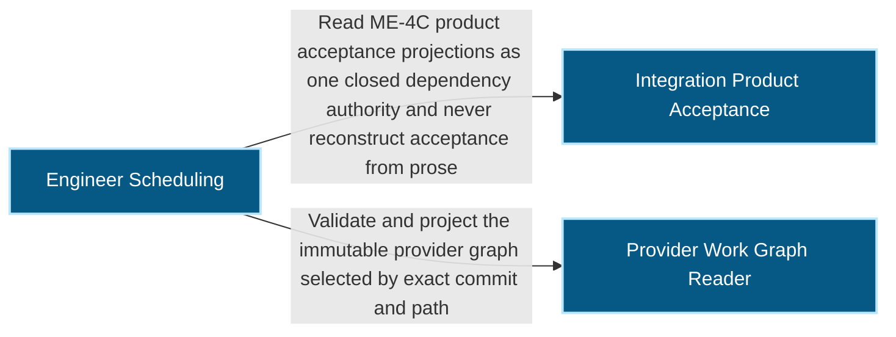
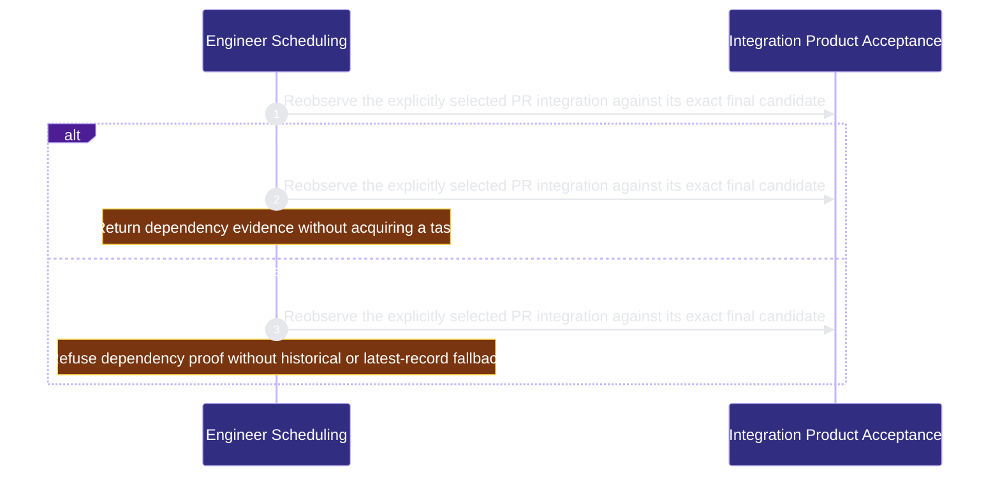

# runtime-harness/engineer-scheduling 架構文檔

<!-- BEGIN ARCHCONTEXT:generated target="projection_target.entity.capability-runtime-harness-engineer-scheduling" rendererVersion="archcontext.docs-renderer/v6" outputDigest="sha256:2693b1d53e6eb47c14a0799c0016415bb307ce182d57d186d42a3f0dfc6e2839" -->
> **狀態**:`active`
> **Capability ID**:`capability.runtime-harness.engineer-scheduling`(kind `capability`)
> **Matched Prefixes**:`src/core/engineers/scheduling.ts`、`src/effects/engineers/dependency-authority.ts`、`src/effects/engineers/scheduling.ts`
> **Local Contracts**:`AGENTS.md`、`CLAUDE.md`
> **事實優先級**:倉庫當前狀態 > 本文檔機器區 > 本文檔人工區。機器區(引言、§1、§2)由 ArchContext 從架構模型與源碼度量投影生成,手改會在下次投影被覆蓋。本文檔不記錄出處;本次投影所驗證的 commit 見 `docs/architecture/.projection-manifest.json`。

Projects explicitly selected immutable provider WorkGraph V2 and exact dependency evidence for operator observations.

## 1. P1:能力架構地圖

### 1.1 架構圖



- Proof: `proven` (`sha256:d232cf094cc6cdc8842c33d0e3b9b77e78da007eece332ecccc8a4d21a96dbf6`).
- Semantic nodes: `3`; declared relations: `2`.

### 1.2 模組職責表

| 宣告入口 | 錨點 | 職責 |
| --- | --- | --- |
| `entrypoint.engineer-scheduling.graph` | `src/effects/engineers/scheduling.ts#readProviderWorkGraph` | `sink.engineer-scheduling.graph` → `src/core/engineers/scheduling.ts#projectProviderWorkGraph` |
| `entrypoint.engineer-scheduling.dependency-readers` | `src/effects/engineers/dependency-authority.ts#defaultDependencyAuthorityReaders` | `sink.engineer-scheduling.product-acceptance` → `src/effects/integration/product-acceptance.ts#observeSelectedPullRequest` |

組件入口:

- 組件均未宣告 `source.entrypoints`。

### 1.3 規模信號

- 規模量級:`2–5` 個文件 / `1000–2000` 行
- 匹配前綴:`src/core/engineers/scheduling.ts`、`src/effects/engineers/dependency-authority.ts`、`src/effects/engineers/scheduling.ts`
- 推導:掃描 `source.include` 減 `source.exclude`,跳過 `.git/` 與 `node_modules/`,再按 1–2–5 階梯分桶。精確計數不入本文檔:量級足以回答「這個能力有多大」,而逐行計數會讓覆蓋範圍內任何一次源碼改動都改寫本文檔。

### 1.4 依賴邊界

出向關係:

- `calls` → `capability.verification.acceptance-review` — Compute the acceptance authority fingerprint for a dependency
- `calls` → `capability.runtime-harness.engineer-bindings` — Resolve declared graph capabilities through the Engineer profile authority reader
- `calls` → `capability.workflow-engine.execution-primitives` — Hold exclusive directory locks under the Git common directory
- `depends-on` → `capability.runtime-harness.mcp-sidecar` — Read registered repository identity for scheduling.
- `reads` → `capability.runtime-harness.integration-acceptance` — Read ME-4C product acceptance projections as one closed dependency authority and never reconstruct acceptance from prose
- `calls` → `component.engineer-scheduling.primary` — Validate and project the immutable provider graph selected by exact commit and path
- `reads` → `capability.organization.publication` — Read cached publication receipts as dependency authority
- `reads` → `capability.workflow-engine.workflow-state` — Read the canonical target ref for provider PR dependency and scheduling evidence

入向關係:

- `calls` ← `capability.runtime-harness.agent-runtime-effects` — Validate the whole offers document with the scheduling validator before a wake is armed
- `depends-on` ← `capability.runtime-harness.engineering-overlay` — Resolve the registered repository before reading the overlay.
- `depends-on` ← `capability.verification.evals-checks` — Test Engineer Scheduling behavior through its source modules.
- `reads` ← `component.operator.primary` — Read the tracked work graph projection for the Planning view

組件出向關係:

- `component.engineer-scheduling.primary`:
  - 無。

### 1.5 組件結構

| 組件 | 名稱 | 規模量級 | 宣告入口 |
| --- | --- | --- | --- |
| `component.engineer-scheduling.primary` | Provider Work Graph Reader | `2–5` 個文件 / `1000–2000` 行 | 未宣告 |

## 2. P2:端到端數據流

> **Proof**: `proven` (`sha256:d232cf094cc6cdc8842c33d0e3b9b77e78da007eece332ecccc8a4d21a96dbf6`); selectors `1/1`.


<!-- END ARCHCONTEXT:generated target="projection_target.entity.capability-runtime-harness-engineer-scheduling" -->

## 3. P3: Retained graph and dependency reads

- The graph reader reads the Sprint and its graph carrier from the same canonical commit. It preserves the task ID and task revision.
- A missing carrier gives an unclassified result. The reader validates the complete carrier schema, referenced authorities and declared capabilities.
- `dependency-authority.ts` reads the owning Sprint, acceptance, publication and integration evidence. A readable negative result is unsatisfied. Missing, unreadable or unauthorized evidence stays unavailable.
- Dependency evidence remains bound to its declared revision. Cross-repository reads use the current authorized registry snapshot.
- The operator consumes these observations. Offer collection, scheduling acquire and acquire-next are retired.

## 4. 歷史決策記錄(append-only)

- 2026-08-25: Human approved `changeset.plan-20260825-1149-me1a-engineer-scheduling-schema` via `event.review-20260825-1149-me1a-engineer-scheduling-schema-approval`. The fixed-point projection proves the exact `delegateScheduledEngineerAcquire` → `acquireEngineerTask` selector and the MCP → scheduling capability boundary.
- 2026-09-04：依赖状态改为从收据权威解析（PR #298）；增加有界的自动化尝试重试（PR #307）。
- 2026-09-06：尝试结果改为封闭集合，并执行重试准入（commit `dbce6cc2`）。
- PR #617：repo-harness 只提供工具和证据，调度由 Bot 负责。CLI 内的尝试写入方被删除。
- 2026-10-11：模型新增 capability → `component.engineer-scheduling.primary` 和 engineer-scheduling → integration-acceptance（`reads`）两条 relation。P2 flow 增加依赖权威读取和 offer 重新校验两步，失败分支改为过期 offer 拒绝。


## Provider graph V2

Planning reads GitHub issue observations and admitted execution sessions. A tracked
V2 graph adds work package metadata. It does not supply task status or execution
permission. Each package selects canonical REST repository and issue IDs. The
reader refuses V1 Sprint mappings instead of guessing a provider task.

The board reads the default carrier path `PROVIDER_WORK_GRAPH_PATH`
(`src/effects/engineers/scheduling.ts:16`) at the policy target commit.
For an explicit carrier, use:

```sh
repo-harness operator planning --repository-id repo_0123456789abcdef --graph-path .ai/harness/work-graph.v2.json --graph-commit <full-commit-oid>
```

The selected commit must contain the graph, acceptance policies, rollback files,
and local dependency selectors with their declared byte digests. Cross-repository
edges use registered repository paths and each target's policy commit. Missing
provider mappings return `needs_provider_graph`. They do not create local tasks.

`tests/fixtures/provider-work-graph-v2/graph.json` is an authored example. Its
repository and issue IDs are test data. Replace them with observed REST IDs and
compute digests from the actual referenced files before use. Runtime execution
uses `admitted_session`; a lost admission is `admission_changed` in retry metadata.

`provider_closed` observes GitHub twice and requires one exact stable issue. Module,
publication, and product edges retain their protected admission, acceptance,
waiver, and integration proof checks. Integration selectors use protocol 3 with
`provider_repository_id` and `issue_id`; local Sprint IDs are not accepted.
