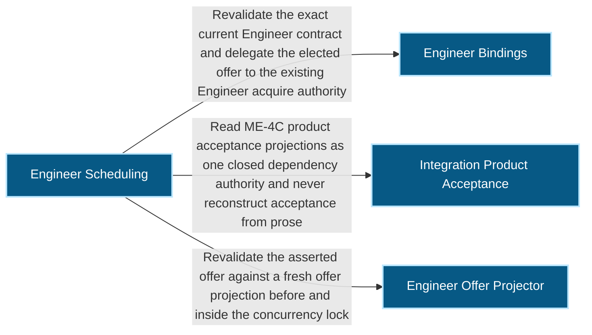
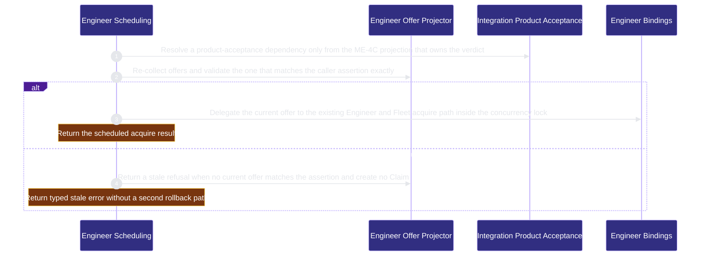

# runtime-harness/engineer-scheduling 架構文檔

<!-- BEGIN ARCHCONTEXT:generated target="projection_target.entity.capability-runtime-harness-engineer-scheduling" rendererVersion="archcontext.docs-renderer/v6" outputDigest="sha256:4f53bd97ae47dbcacb49498657f2594635a1facdf5be8c4a802b6d616710af67" -->
> **狀態**:`active`
> **Capability ID**:`capability.runtime-harness.engineer-scheduling`(kind `capability`)
> **Matched Prefixes**:`src/core/engineers/scheduling.ts`、`src/effects/engineers/dependency-authority.ts`、`src/effects/engineers/scheduling.ts`、`src/effects/engineers/scheduling-acquire.ts`、`src/effects/engineers/scheduling-acquire-next.ts`
> **Local Contracts**:`AGENTS.md`、`CLAUDE.md`
> **事實優先級**:倉庫當前狀態 > 本文檔機器區 > 本文檔人工區。機器區(引言、§1、§2)由 ArchContext 從架構模型與源碼度量投影生成,手改會在下次投影被覆蓋。本文檔不記錄出處;本次投影所驗證的 commit 見 `docs/architecture/.projection-manifest.json`。

Projects explicit same-commit Work Package graphs into revision-fenced Module Engineer offers and revalidates one offer under repository concurrency before delegated acquisition.

## 1. P1:能力架構地圖

### 1.1 架構圖

- Proof: `proven` (`sha256:69e5e3cb3cda2c3c20adf2709a4359fe97647b1f706bb677739a39c1951e8a77`).
- Semantic nodes: `4`; declared relations: `3`.

### 1.2 模組職責表

| 宣告入口 | 錨點 | 職責 |
| --- | --- | --- |
| `entrypoint.engineer-scheduling.offers` | `src/effects/engineers/scheduling.ts#collectEngineerOffers` | `sink.engineer-scheduling.current-binding` → `src/effects/engineers/binding-store.ts#readEngineerBindingStatus`、`sink.engineer-scheduling.dependency-authority` → `src/effects/engineers/dependency-authority.ts#resolveDependencyObservation` |
| `entrypoint.engineer-scheduling.acquire` | `src/effects/engineers/scheduling-acquire.ts#delegateScheduledEngineerAcquire` | `sink.engineer-scheduling.engineer-acquire` → `src/effects/engineers/acquire.ts#acquireEngineerTask` |
| `entrypoint.engineer-scheduling.acquire` | `src/effects/engineers/scheduling-acquire.ts#selectCurrentOffer` | `sink.engineer-scheduling.offer-revalidation` → `src/core/engineers/scheduling.ts#validateEngineerOffer` |
| `entrypoint.engineer-scheduling.dependency-readers` | `src/effects/engineers/dependency-authority.ts#defaultDependencyAuthorityReaders` | `sink.engineer-scheduling.product-acceptance` → `src/effects/integration/product-acceptance.ts#listProductAcceptanceProjections` |
| `entrypoint.engineer-scheduling.acquire-next` | `src/effects/engineers/scheduling-acquire-next.ts#acquireNextScheduledEngineerTask` | `sink.engineer-scheduling.acquire-next-offers` → `src/effects/engineers/scheduling.ts#collectEngineerOffers`、`sink.engineer-scheduling.acquire-next-exact` → `src/effects/engineers/scheduling-acquire.ts#acquireScheduledEngineerTask` |

組件入口:

- 組件均未宣告 `source.entrypoints`。

### 1.3 規模信號

- 規模量級:`5–10` 個文件 / `2000–5000` 行
- 匹配前綴:`src/core/engineers/scheduling.ts`、`src/effects/engineers/dependency-authority.ts`、`src/effects/engineers/scheduling.ts`、`src/effects/engineers/scheduling-acquire.ts`、`src/effects/engineers/scheduling-acquire-next.ts`
- 推導:掃描 `source.include` 減 `source.exclude`,跳過 `.git/` 與 `node_modules/`,再按 1–2–5 階梯分桶。精確計數不入本文檔:量級足以回答「這個能力有多大」,而逐行計數會讓覆蓋範圍內任何一次源碼改動都改寫本文檔。

### 1.4 依賴邊界

出向關係:

- `calls` → `capability.verification.acceptance-review` — Compute the acceptance authority fingerprint for a dependency
- `calls` → `capability.runtime-harness.engineer-bindings` — Revalidate the exact current Engineer contract and delegate the elected offer to the existing Engineer acquire authority
- `calls` → `capability.workflow-engine.execution-primitives` — Hold exclusive directory locks under the Git common directory
- `reads` → `capability.runtime-harness.integration-acceptance` — Read ME-4C product acceptance projections as one closed dependency authority and never reconstruct acceptance from prose
- `calls` → `component.engineer-scheduling.primary` — Revalidate the asserted offer against a fresh offer projection before and inside the concurrency lock
- `reads` → `capability.organization.publication` — Read cached publication receipts as dependency authority
- `calls` → `capability.organization.task-fleet` — Collect fleet offers for the scheduling acquire path
- `reads` → `capability.workflow-engine.workflow-state` — Project canonical Sprint tasks into the work graph

入向關係:

- `calls` ← `capability.runtime-harness.agent-runtime-effects` — Validate the whole offers document with the scheduling validator before a wake is armed
- `calls` ← `capability.runtime-harness.collaboration` — Ask the scheduling plane for this exact authenticated principal's own offers, so a Work Exchange snapshot reports what the plane answered rather than defaulting an empty list
- `calls` ← `capability.runtime-harness.interface-change` — Verify target-Engineer materialization against the exact tracked ME-1A Work Graph projection at one Git commit
- `calls` ← `capability.runtime-harness.mcp-sidecar` — Project and acquire exact revision-fenced Engineer offers for a verified OAuth principal
- `reads` ← `component.operator.primary` — Read the tracked work graph projection for the Planning view
- `calls` ← `capability.runtime-harness.work-demand` — Validate the accepted Work Package against the same-commit canonical Sprint and Work Graph

組件出向關係:

- `component.engineer-scheduling.primary`:
  - 無。

### 1.5 組件結構

| 組件 | 名稱 | 規模量級 | 宣告入口 |
| --- | --- | --- | --- |
| `component.engineer-scheduling.primary` | Engineer Offer Projector | 未宣告 `source.include` | 未宣告 |

## 2. P2:端到端數據流

> **Proof**: `proven` (`sha256:69e5e3cb3cda2c3c20adf2709a4359fe97647b1f706bb677739a39c1951e8a77`); selectors `3/3`.

<!-- END ARCHCONTEXT:generated target="projection_target.entity.capability-runtime-harness-engineer-scheduling" -->

## 3. P3:設計決策與不變量

### 3.1 必须保持的不变量

1. **Canonical Sprint 行是唯一的 Task 身份权威。** 同一 commit 的 `.work-graph.v1.json` 兄弟文件拥有调度元数据和派生的 Work Package revision。它不改变 `task_id` 或 `task_revision`。
2. **Work Graph 的 lane 是封闭的。** 没有 carrier 表示 `unclassified`。`generic-v1` 必须显式声明且没有 Work Package。`engineering-v2` 必须完整覆盖 Sprint 行且没有未知语义键（`src/core/engineers/scheduling.ts:408-414`）。
3. **Offer 不授予权威。** Offer 绑定 graph、Work Package、Task、Profile、Binding、Fleet offer、依赖、并发和授权观测。任一观测变化，offer 就过期。
4. **仓库并发由一个 Git common dir 锁选举。** `acquireScheduledEngineerTask` 在锁外和锁内各调用一次 `selectCurrentOffer`，两次都必须匹配调用方的断言，然后同步调用既有的 Engineer/Fleet acquire（`src/effects/engineers/scheduling-acquire.ts:123-150`）。ME-1A 不创建第二个 Claim、Lease、assignment 或回滚权威。
5. **依赖状态只从拥有该结论的权威解析。** `src/effects/engineers/dependency-authority.ts` 是唯一的只读解析器。权威是 canonical Sprint 行、exact-subject AcceptanceReceipt、Lease publication 指针加不可变 PublicationReceipt 和 integration 观测、以及 ME-4C product acceptance 投影。可读的否定结果是 `unsatisfied`。缺失、不可读、未授权或不支持的权威是 `authority_unavailable`（`dependency-authority.ts:15`、`:71`）。调度从不从 prose、路径、分支名或 Git 拓扑重建结论。
6. **需要 acceptance 结论的依赖边自带封闭的 `acceptance_authority` 引用。** 该引用绑定 revision，并在读取权威之前对同一 canonical commit 证明。过期的声明是 `authority_unavailable`，不是通过（`scheduling.ts:46`、`:299-308`）。
7. **`authority_revision` 是规范化证据投影的摘要。** 移动的收据、目标 revision 或注册表授权都会改变依赖 revision，并使断言它的 offer 过期。跨仓库依赖只通过当前已采纳的读写注册表快照解析，不从 Work Graph 文本取仓库路径。
8. **`acquire-next` 只消费 offer 文档的既有顺序。** 它在内部构造精确断言，再走普通的 scheduled acquire。Git common dir 中的收据把主体、封闭过滤器、尝试上限和结果绑定到一个 idempotency key。崩溃后遗留的 pending 收据要求 reconcile，不冒险再次 claim（`src/effects/engineers/scheduling-acquire-next.ts:76`、`:117`）。
9. **Work Graph 的 `retry_policy` 是唯一的重试策略权威。** Work Package revision 和 offer revision 都绑定它。尝试日志（`src/core/engineers/automation-attempt.ts`）只记录执行证据，从不改写 Task 状态或优先级。只有策略列出的失败类别，在确定的退避期限之后，才能重新进入普通的 offer 和 Lease 路径。
10. **Lease 活性是证据，不是抢占权威。** 自动回收在同一 Lease 锁内重读 owner、续约、Binding、runtime 和 publication 证据，并在既有的递增代际抢占之前消费一个精确的 `reclaimable` 收据（`src/core/state/lease-liveness.ts:10`）。不可读或缺失的证据投影为 `liveness_unproven`，交给 operator。这条规则属于 workflow-state，本能力只消费它。

### 3.2 关键权衡

| 决策 | 权衡 |
| --- | --- |
| 依赖解析器是一个封闭的只读适配器集合 | 不会出现第二个 acceptance 或 publication 结论；代价是本能力读取 publication、integration-acceptance 和 `scripts/acceptance-receipt.ts`，依赖面宽 |
| 选择 offer 时在锁外先过滤，锁内再确认 | 锁持有时间短；代价是每次 acquire 收集两次 offer |
| 删除 CLI 内的控制器（PR #617，Bot 负责调度） | repo-harness 不再写尝试记录（`recordTaskAutomationAttemptStart` 在 `src/` 和 `scripts/` 中没有调用方）。offer 在 Bot 记录尝试之前读不到重试历史 |

### 3.3 10x 规模下先坏的点

- 全量的注册表、Profile 和收据扫描，以及锁持有时间，会先出问题。P0 有意让这些成本保持线性并可观测。在测量证明需要之前，不引入索引、守护进程、缓存或数据库。

## 4. 歷史決策記錄(append-only)

- 2026-08-25: Human approved `changeset.plan-20260825-1149-me1a-engineer-scheduling-schema` via `event.review-20260825-1149-me1a-engineer-scheduling-schema-approval`. The fixed-point projection proves the exact `delegateScheduledEngineerAcquire` → `acquireEngineerTask` selector and the MCP → scheduling capability boundary.
- 2026-09-04：依赖状态改为从收据权威解析（PR #298）；增加有界的自动化尝试重试（PR #307）。
- 2026-09-06：尝试结果改为封闭集合，并执行重试准入（commit `dbce6cc2`）。
- PR #617：repo-harness 只提供工具和证据，调度由 Bot 负责。CLI 内的尝试写入方被删除。
- 2026-10-11：模型新增 capability → `component.engineer-scheduling.primary` 和 engineer-scheduling → integration-acceptance（`reads`）两条 relation。P2 flow 增加依赖权威读取和 offer 重新校验两步，失败分支改为过期 offer 拒绝。

## Optimization Backlog

- after arch-context#296：`scheduling.ts`、`dependency-authority.ts`、`scheduling.ts`（effects）、`scheduling-acquire.ts` 和 `scheduling-acquire-next.ts` 同时被 engineer-bindings 的 `src/{core,effects}/engineers/**` 认领。目标单一所有者是本能力（`ownership-proposal` §2）。
- 反向边证据：`src/cli/commands/sprint.ts` 调用本能力的 `readProjectedWorkGraphAt` 和 `resolveRegisteredRepoForWorktree`，`src/effects/state/sprint-schema-migration.ts` 调用 `schedulingCarrierPath`。本能力又依赖 `src/core/state/coordination-identity.ts`。集成按边数声明 engineer-scheduling → workflow-state（9 条边对 8 条）。sprint 方向是回边，作为重构输入，不声明。
- `resolveRegisteredRepoForWorktree` 被 engineering-overlay、agent-runtime-effects 和 `sprint.ts` 调用。它的职责是解析仓库注册表，与调度无关。建议移到 `src/effects/repo-registry.ts` 的所有者。
- 声明的 selector `entrypoint.engineer-scheduling.offers#collectEngineerOffers` 的两个 sink 和 `entrypoint.engineer-scheduling.acquire-next` 的两个 sink 在 CodeGraph 中没有直接 `calls` 边（经由注入的依赖调用）。P2 flow 改用有直接边的 `selectCurrentOffer` 和 `defaultDependencyAuthorityReaders`。
- 依赖解析器读取 `src/effects/publication/**` 和 `scripts/acceptance-receipt.ts`。集成步骤声明了 engineer-scheduling → publication（`reads`）、→ acceptance-review、→ task-fleet 与 → execution-primitives。
