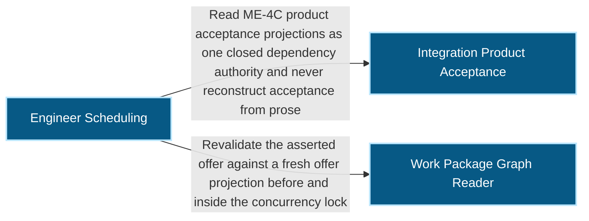
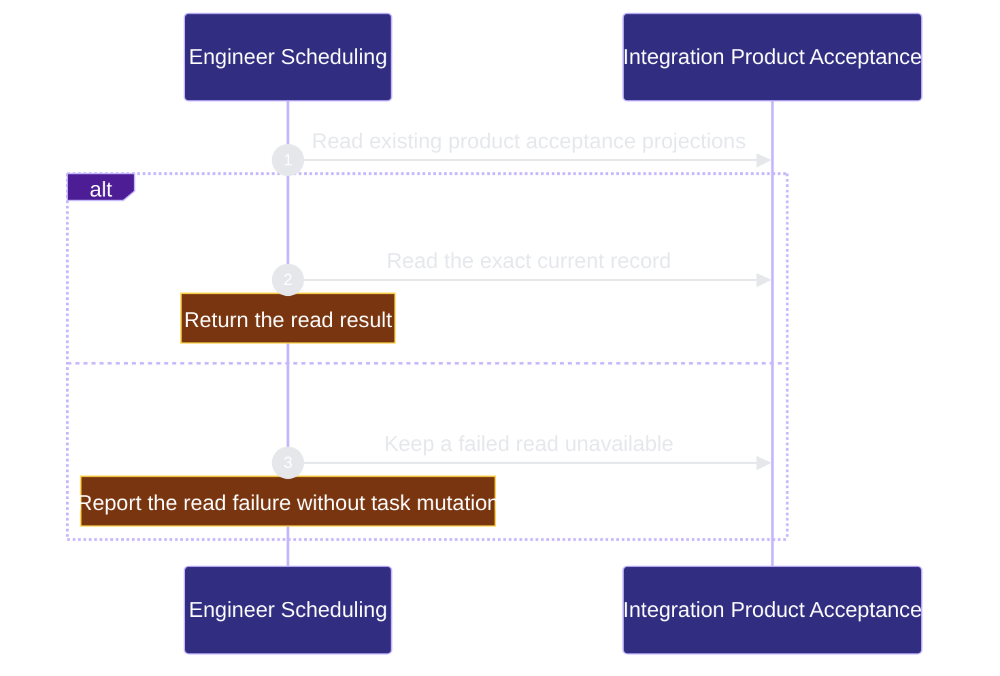

# runtime-harness/engineer-scheduling 架構文檔

<!-- BEGIN ARCHCONTEXT:generated target="projection_target.entity.capability-runtime-harness-engineer-scheduling" rendererVersion="archcontext.docs-renderer/v6" outputDigest="sha256:5c289bf8d26af2ebf727577861707afea153f1067151bc5f61b5c78c23c324a5" -->
> **狀態**:`active`
> **Capability ID**:`capability.runtime-harness.engineer-scheduling`(kind `capability`)
> **Matched Prefixes**:`src/core/engineers/scheduling.ts`、`src/effects/engineers/dependency-authority.ts`、`src/effects/engineers/scheduling.ts`
> **Local Contracts**:`AGENTS.md`、`CLAUDE.md`
> **事實優先級**:倉庫當前狀態 > 本文檔機器區 > 本文檔人工區。機器區(引言、§1、§2)由 ArchContext 從架構模型與源碼度量投影生成,手改會在下次投影被覆蓋。本文檔不記錄出處;本次投影所驗證的 commit 見 `docs/architecture/.projection-manifest.json`。

Projects retained Work Package graphs and dependency observations for operator reads.

## 1. P1:能力架構地圖

### 1.1 架構圖

- Proof: `proven` (`sha256:1766e60eb87646f1cd074a8e53b93607a57040cd714b47e49c1346f493dad8fd`).
- Semantic nodes: `3`; declared relations: `2`.

### 1.2 模組職責表

| 宣告入口 | 錨點 | 職責 |
| --- | --- | --- |
| `entrypoint.engineer-scheduling.graph` | `src/effects/engineers/scheduling.ts#readTrackedWorkGraphProjectionAt` | `sink.engineer-scheduling.graph` → `src/core/engineers/scheduling.ts#projectWorkGraph` |
| `entrypoint.engineer-scheduling.dependency-readers` | `src/effects/engineers/dependency-authority.ts#defaultDependencyAuthorityReaders` | `sink.engineer-scheduling.product-acceptance` → `src/effects/integration/product-acceptance.ts#listProductAcceptanceProjections` |

組件入口:

- 組件均未宣告 `source.entrypoints`。

### 1.3 規模信號

- 規模量級:`2–5` 個文件 / `1000–2000` 行
- 匹配前綴:`src/core/engineers/scheduling.ts`、`src/effects/engineers/dependency-authority.ts`、`src/effects/engineers/scheduling.ts`
- 推導:掃描 `source.include` 減 `source.exclude`,跳過 `.git/` 與 `node_modules/`,再按 1–2–5 階梯分桶。精確計數不入本文檔:量級足以回答「這個能力有多大」,而逐行計數會讓覆蓋範圍內任何一次源碼改動都改寫本文檔。

### 1.4 依賴邊界

出向關係:

- `calls` → `capability.verification.acceptance-review` — Compute the acceptance authority fingerprint for a dependency
- `calls` → `capability.runtime-harness.engineer-bindings` — Resolve declared graph capabilities through the Engineer profile authority reader
- `calls` → `capability.workflow-engine.execution-primitives` — Hold exclusive directory locks under the Git common directory
- `reads` → `capability.runtime-harness.integration-acceptance` — Read ME-4C product acceptance projections as one closed dependency authority and never reconstruct acceptance from prose
- `calls` → `component.engineer-scheduling.primary` — Revalidate the asserted offer against a fresh offer projection before and inside the concurrency lock
- `reads` → `capability.organization.publication` — Read cached publication receipts as dependency authority
- `reads` → `capability.workflow-engine.workflow-state` — Project canonical Sprint tasks into the work graph

入向關係:

- `calls` ← `capability.runtime-harness.agent-runtime-effects` — Validate the whole offers document with the scheduling validator before a wake is armed
- `reads` ← `component.operator.primary` — Read the tracked work graph projection for the Planning view

組件出向關係:

- `component.engineer-scheduling.primary`:
  - 無。

### 1.5 組件結構

| 組件 | 名稱 | 規模量級 | 宣告入口 |
| --- | --- | --- | --- |
| `component.engineer-scheduling.primary` | Work Package Graph Reader | 未宣告 `source.include` | 未宣告 |

## 2. P2:端到端數據流

> **Proof**: `proven` (`sha256:1766e60eb87646f1cd074a8e53b93607a57040cd714b47e49c1346f493dad8fd`); selectors `1/1`.

<!-- END ARCHCONTEXT:generated target="projection_target.entity.capability-runtime-harness-engineer-scheduling" -->

## 3. P3: Retained graph and dependency reads

- The graph reader reads the Sprint and its graph carrier from the same canonical commit. It preserves the task ID and task revision.
- A missing carrier gives an unclassified result. The reader validates the complete carrier schema, referenced authorities and declared capabilities.
- `dependency-authority.ts` reads the owning Sprint, acceptance, publication and integration evidence. A readable negative result is unsatisfied. Missing, unreadable or unauthorized evidence stays unavailable.
- Dependency evidence remains bound to its declared revision. Cross-repository reads use the current authorized registry snapshot.
- The operator consumes these observations. Offer collection, scheduling acquire and acquire-next are retired.

## 4. 歷史決策記錄(append-only)

- 2026-08-25: Human approved `changeset.plan-20260825-1149-me1a-engineer-scheduling-schema` via `event.review-20260825-1149-me1a-engineer-scheduling-schema-approval`. The fixed-point projection proves the exact `delegateScheduledEngineerAcquire` → `acquireEngineerTask` selector and the MCP → scheduling capability boundary.
- 2026-09-04：依赖状态改为从收据权威解析（PR #298）；增加有界的自动化尝试重试（PR #307）。
- 2026-09-06：尝试结果改为封闭集合，并执行重试准入（commit `dbce6cc2`）。
- PR #617：repo-harness 只提供工具和证据，调度由 Bot 负责。CLI 内的尝试写入方被删除。
- 2026-10-11：模型新增 capability → `component.engineer-scheduling.primary` 和 engineer-scheduling → integration-acceptance（`reads`）两条 relation。P2 flow 增加依赖权威读取和 offer 重新校验两步，失败分支改为过期 offer 拒绝。
