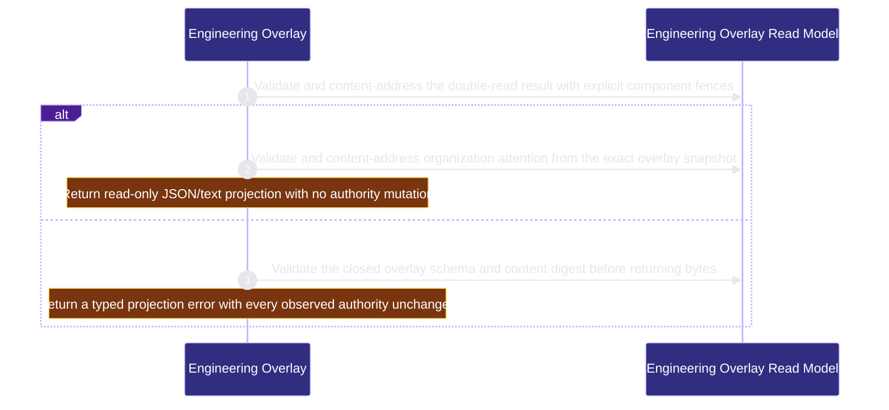

# runtime-harness/engineering-overlay 架構文檔

<!-- BEGIN ARCHCONTEXT:generated target="projection_target.entity.capability-runtime-harness-engineering-overlay" sourceDigest="sha256:f9ab4635d72a1716c09c6070af18e58da67bdbb87773350d6986680dfaf7988e" rendererVersion="archcontext.docs-renderer/v5" outputDigest="sha256:9bae1e0d6199be40d080e00c13cb97f3ef8cb4d1068a029af5dc7c58716edd66" -->
> **狀態**:`active`
> **Capability ID**:`capability.runtime-harness.engineering-overlay`(kind `capability`)
> **Matched Prefixes**:`src/core/engineers/engineering-overlay.ts`、`src/effects/engineers/engineering-overlay.ts`
> **Local Contracts**:`AGENTS.md`、`CLAUDE.md`
> **事實優先級**:倉庫當前狀態 > 本文檔機器區 > 本文檔人工區。機器區(引言、§1、§2)由 ArchContext 從架構模型與源碼度量投影生成,手改會在下次投影被覆蓋。本文檔不記錄出處;本次投影所驗證的 commit 見 `docs/architecture/.projection-manifest.json`。

Projects Profile, Binding, Claim, message and Agent Runtime observations into exact read-only Engineer and organization-attention views without changing Fleet lifecycle authority.

## 1. P1:能力架構地圖

### 1.1 架構圖

- Proof: `proven` (`sha256:559d4d6312038098e0a8c276d4ab6185a5e2de6b144811876a09e78aaa920604`).
- Semantic nodes: `2`; declared relations: `1`.

### 1.2 模組職責表

| 宣告入口 | 錨點 | 職責 |
| --- | --- | --- |
| `entrypoint.engineering-overlay.collect` | `src/effects/engineers/engineering-overlay.ts#collectEngineeringBoard` | `sink.engineering-overlay.binding` → `src/effects/engineers/binding-store.ts#readEngineerBindingStatus`、`sink.engineering-overlay.claim` → `src/effects/engineers/claim-actor-store.ts#listLiveClaimActorReceiptsForEngineer`、`sink.engineering-overlay.messages` → `src/effects/engineers/module-inbox.ts#observeModuleInboxSummary`、`sink.engineering-overlay.runtime-effects` → `src/effects/engineers/agent-runtime-effect-store.ts#observeAgentRuntimeEffects`、`sink.engineering-overlay.schema` → `src/core/engineers/engineering-overlay.ts#buildEngineeringOverlaySnapshot` |
| `entrypoint.engineering-overlay.attention` | `src/core/engineers/engineering-overlay.ts#projectOrganizationAttention` | `sink.engineering-overlay.attention-schema` → `src/core/engineers/engineering-overlay.ts#validateOrganizationAttentionSnapshot` |
| `entrypoint.engineering-overlay.overlay-schema` | `src/core/engineers/engineering-overlay.ts#buildEngineeringOverlaySnapshot` | `sink.engineering-overlay.overlay-validation` → `src/core/engineers/engineering-overlay.ts#validateEngineeringOverlaySnapshot` |

### 1.3 規模信號

- 規模量級:`2–5` 個文件 / `500–1000` 行
- 匹配前綴:`src/core/engineers/engineering-overlay.ts`、`src/effects/engineers/engineering-overlay.ts`
- 推導:掃描 `source.include` 減 `source.exclude`,跳過 `.git/` 與 `node_modules/`,再按 1–2–5 階梯分桶。精確計數不入本文檔:量級足以回答「這個能力有多大」,而逐行計數會讓覆蓋範圍內任何一次源碼改動都改寫本文檔。

### 1.4 依賴邊界

出向關係:

- `calls` → `capability.runtime-harness.agent-runtime-effects` — Observe exact current runtime-effect and reconciliation states without executing or repairing an effect
- `calls` → `capability.runtime-harness.engineer-bindings` — Observe exact current Profile, Binding and live ClaimActor revisions without mutating their stores
- `calls` → `capability.runtime-harness.engineer-messages` — Observe pending and failed delivery facts from the existing ME-1C event and receipt authority
- `calls` → `component.engineering-overlay.primary` — Validate and content-address the read-only Engineer and organization-attention projections

入向關係:

- 無。

## 2. P2:端到端數據流

> **Proof**: `proven` (`sha256:559d4d6312038098e0a8c276d4ab6185a5e2de6b144811876a09e78aaa920604`); selectors `3/3`.

<!-- END ARCHCONTEXT:generated target="projection_target.entity.capability-runtime-harness-engineering-overlay" -->

## 3. P3:設計決策與不變量

### 3.1 必须保持的不变量

1. **只读。** 本能力不保存 status 或当前 owner，不推导 Fleet 列，不提供 mutation 入口（`plans/prds/20260824-1653-engineering-overlay-control-board.prd.md` Hard constraint）。它只读取 Profile、Binding、live Claim、消息摘要和 runtime effect 五个组件。
2. **每个组件读两次，混合代际的快照不能标为 stable。** `collectEngineeringBoard` 做两次读取，逐组件比较修订号。任一组件不可读，结果为 `degraded`；任一组件两次不同，结果为 `changed_during_read`；否则为 `stable`（`src/effects/engineers/engineering-overlay.ts:245-284`）。
3. **Profile 权威丢失时返回空的 degraded 投影。** 任一次读取丢失 Profile 权威，两次读取都收敛到同一个空花名册（`engineering-overlay.ts:272-280`、`:189-191`）。一个存活的读取不能补回花名册。
4. **组织 attention 是封闭集合。** 原因只有五种，每种对应一个固定 owner：`binding_missing`、`binding_stale`、`engineer_contract_revision_changed`、`message_delivery_failed`、`runtime_reconciliation_required`（`src/core/engineers/engineering-overlay.ts:376-394`、`:415-417`）。
5. **三个视图语义独立。** `sprint graph`、`fleet board` 和 `engineer board` 可以并排显示，但不能合并成一个状态字段（PRD Product Direction）。
6. **当前工作树必须是精确注册的仓库。** 否则返回 `engineering_overlay_repository_unregistered`（`engineering-overlay.ts:253-258`）。

### 3.2 关键权衡

| 决策 | 权衡 |
| --- | --- |
| 双读加逐组件修订号，不锁住全部权威 | 读取不阻塞任何写入方；代价是并发写入时只能报告 `changed_during_read`，调用方需要重读 |
| 依赖通过 `dependencies()` 注入（`engineering-overlay.ts:41-44`、`:85-88`） | 测试可以在两次读取之间注入修改；代价是 CodeGraph 看不到对 Binding、Claim、消息和 runtime effect 的直接调用，P2 flow 无法证明这些步骤（见 Backlog） |
| 先交付 CLI/JSON 读模型，Human Board 页面后置 | 页面不能先于同一读模型的独立批准（PRD Suggested next step）；operator 后来通过 `src/effects/operator/collaboration.ts` 读取这个模型 |

### 3.3 10x 规模下先坏的点

- 每次投影对五个组件各读两次，Engineer 数量越多，读取放大越大。并发写入越频繁，`changed_during_read` 出现越多。源码中没有重试上限，重读由调用方决定。

## 4. 歷史決策記錄(append-only)

| 日期 | 决策 | 依据 |
| --- | --- | --- |
| 2026-08-26 | 建立 ME-1B Engineering Overlay 读模型和组织 attention 快照 | commit `e0dab6f6`；`plans/archive/plan-20260825-2339-me1b-engineering-overlay.md` |
| 2026-08-31 | 增加 `runtime_effects` 组件和 `runtime_reconciliation_required` attention | PR #230（commit `4f7cb37e`） |
| 2026-09-04 | `runtime_effects` 增加只观测的 wake 计数（pending、delivered、failed、reconciliation_required）。Agent Runtime effect journal 仍是权威 | PR #297（commit `ab6cc8a0`） |

## Optimization Backlog

- after arch-context#296：`src/core/engineers/engineering-overlay.ts` 和 `src/effects/engineers/engineering-overlay.ts` 同时被 engineer-bindings 的 `src/{core,effects}/engineers/**` 认领。目标单一所有者是本能力（`ownership-proposal` §2）。
- `COMPONENT_ORDER` 在 core（`src/core/engineers/engineering-overlay.ts:19`）和 effects（`src/effects/engineers/engineering-overlay.ts:243`）各定义一次。effects 可以从 core 导入，保持一个来源。
- 声明的 sink（`readEngineerBindingStatus`、`listLiveClaimActorReceiptsForEngineer`、`observeModuleInboxSummary`、`observeAgentRuntimeEffects`）都经由注入的依赖调用，CodeGraph 没有直接 `calls` 边。到 engineer-bindings、engineer-messages 和 agent-runtime-effects 的 relation 因此只有 P1 证据，P2 只证明了 schema 步骤。
- `collectEngineeringBoard` 调用 engineer-scheduling 的 `resolveRegisteredRepoForWorktree` 解析注册仓库（`engineering-overlay.ts:255`）。它的职责是解析仓库注册表，与调度无关。当前不声明 engineering-overlay → engineer-scheduling 的 relation。建议把该函数移到仓库注册表的所有者。
- operator 读取本能力（`src/effects/operator/collaboration.ts:15-16`）。operator 已经声明 `relation.operator.http-reader.engineering-overlay`。
- 集成时没有发现本能力到 execution-primitives 的导入。模型不声明该关系。
