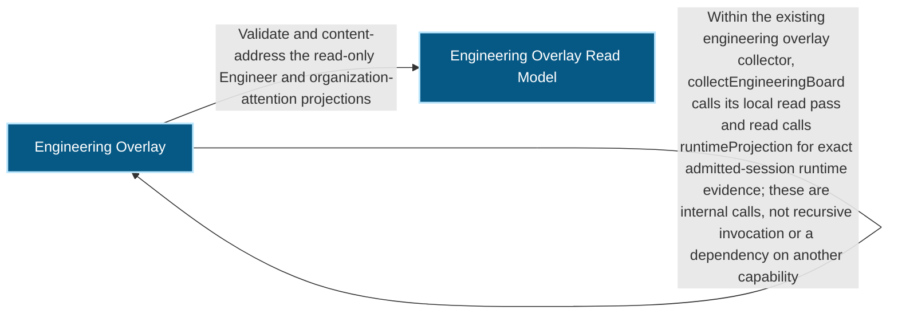
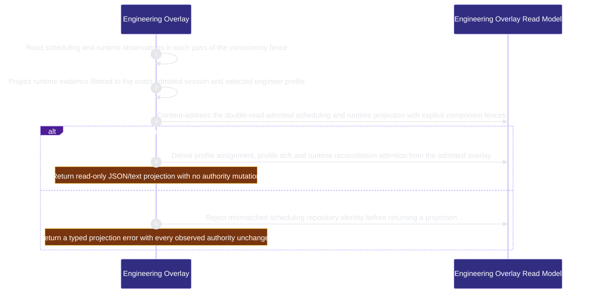

<!-- BEGIN ARCHCONTEXT:generated target="projection_target.entity.capability-runtime-harness-engineering-overlay" rendererVersion="archcontext.docs-renderer/v6" outputDigest="sha256:b340fe89a41a8adfb042428870b19ef0dcaf69c4cf3db88ffa97b26a01114930" -->
> **狀態**:`active`
> **Capability ID**:`capability.runtime-harness.engineering-overlay`(kind `capability`)
> **Matched Prefixes**:`src/core/engineers/engineering-overlay.ts`、`src/effects/engineers/engineering-overlay.ts`
> **Local Contracts**:`AGENTS.md`、`CLAUDE.md`
> **事實優先級**:倉庫當前狀態 > 本文檔機器區 > 本文檔人工區。機器區(引言、§1、§2)由 ArchContext 從架構模型與源碼度量投影生成,手改會在下次投影被覆蓋。本文檔不記錄出處;本次投影所驗證的 commit 見 `docs/architecture/.projection-manifest.json`。

Projects provider scheduling, independently selected engineer profiles and exact admitted runtime evidence into read-only engineering and organization attention views.

## 1. P1:能力架構地圖

### 1.1 架構圖

- Proof: `proven` (`sha256:7023b090b91e614a2bea236966b60d2fab8861a0dc87dd4fdc3a7e7fce4deac0`).
- Semantic nodes: `2`; declared relations: `2`.

### 1.2 模組職責表

| 宣告入口 | 錨點 | 職責 |
| --- | --- | --- |
| `entrypoint.engineering-overlay.collect` | `src/effects/engineers/engineering-overlay.ts#collectEngineeringBoard` | `sink.engineering-overlay.read-pass` → `src/effects/engineers/engineering-overlay.ts#read`、`sink.engineering-overlay.schema` → `src/core/engineers/engineering-overlay.ts#buildAdmittedEngineeringOverlay`、`sink.engineering-overlay.attention-schema` → `src/core/engineers/engineering-overlay.ts#projectAdmittedOrganizationAttention` |
| `entrypoint.engineering-overlay.collect` | `src/effects/engineers/engineering-overlay.ts#read` | `sink.engineering-overlay.runtime-projection` → `src/effects/engineers/engineering-overlay.ts#runtimeProjection` |
| `entrypoint.engineering-overlay.overlay-schema` | `src/core/engineers/engineering-overlay.ts#buildAdmittedEngineeringOverlay` | `sink.engineering-overlay.overlay-validation` → `src/core/engineers/engineering-overlay.ts#invalid`、`sink.engineering-overlay.overlay-digest` → `src/core/engineers/profile-binding.ts#canonicalEngineerJson` |

組件入口:

- 組件均未宣告 `source.entrypoints`。

### 1.3 規模信號

- 規模量級:`2–5` 個文件 / `500–1000` 行
- 匹配前綴:`src/core/engineers/engineering-overlay.ts`、`src/effects/engineers/engineering-overlay.ts`
- 推導:掃描 `source.include` 減 `source.exclude`,跳過 `.git/` 與 `node_modules/`,再按 1–2–5 階梯分桶。精確計數不入本文檔:量級足以回答「這個能力有多大」,而逐行計數會讓覆蓋範圍內任何一次源碼改動都改寫本文檔。

### 1.4 依賴邊界

出向關係:

- `calls` → `capability.runtime-harness.agent-runtime-effects` — Observe exact current runtime-effect and reconciliation states without executing or repairing an effect
- `calls` → `capability.runtime-harness.engineer-bindings` — Use canonical engineer JSON and digest helpers for admitted overlay evidence without reading legacy binding or ClaimActor stores
- `depends-on` → `capability.runtime-harness.engineer-scheduling` — Resolve the registered repository before reading the overlay.
- `depends-on` → `capability.runtime-harness.mcp-sidecar` — Read the repository registry for overlay observations.
- `calls` → `capability.runtime-harness.engineering-overlay` — Within the existing engineering overlay collector, collectEngineeringBoard calls its local read pass and read calls runtimeProjection for exact admitted-session runtime evidence; these are internal calls, not recursive invocation or a dependency on another capability
- `calls` → `component.engineering-overlay.primary` — Validate and content-address the read-only Engineer and organization-attention projections

入向關係:

- `calls` ← `capability.runtime-harness.engineering-overlay` — Within the existing engineering overlay collector, collectEngineeringBoard calls its local read pass and read calls runtimeProjection for exact admitted-session runtime evidence; these are internal calls, not recursive invocation or a dependency on another capability
- `depends-on` ← `capability.verification.evals-checks` — Test Engineering Overlay behavior through its source modules.
- `reads` ← `component.operator.primary` — Collect the engineering board for the Organization view

組件出向關係:

- `component.engineering-overlay.primary`:
  - 無。

### 1.5 組件結構

| 組件 | 名稱 | 規模量級 | 宣告入口 |
| --- | --- | --- | --- |
| `component.engineering-overlay.primary` | Engineering Overlay Read Model | `1–2` 個文件 / `200–500` 行 | 未宣告 |

## 2. P2:端到端數據流

> **Proof**: `proven` (`sha256:7023b090b91e614a2bea236966b60d2fab8861a0dc87dd4fdc3a7e7fce4deac0`); selectors `5/5`.

<!-- END ARCHCONTEXT:generated target="projection_target.entity.capability-runtime-harness-engineering-overlay" -->
