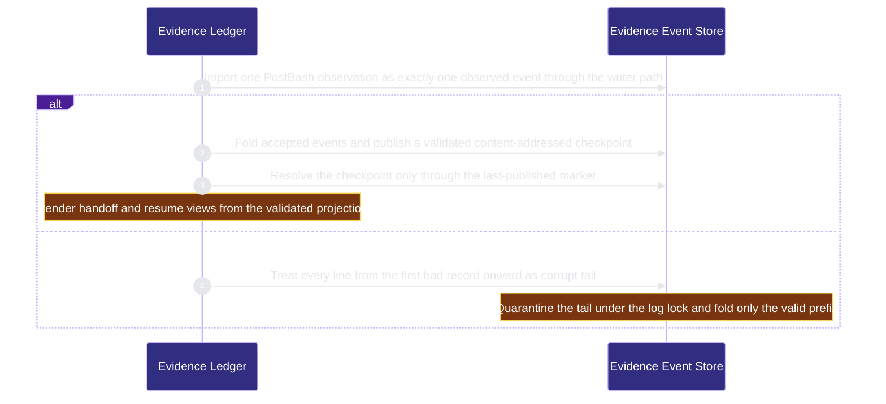

# runtime-harness/evidence-ledger 架構文檔

<!-- BEGIN ARCHCONTEXT:generated target="projection_target.entity.capability-runtime-harness-evidence-ledger" sourceDigest="sha256:0f85d4e50d8bb2b85daae8167bc9fbac459085dc69172fba04fbb6adac21fd97" rendererVersion="archcontext.docs-renderer/v5" outputDigest="sha256:26ec828ce56d6d438a096ea05b184f8bd1278693cc6e95d4772b156a4ca63a82" -->
> **狀態**:`active`
> **Capability ID**:`capability.runtime-harness.evidence-ledger`(kind `capability`)
> **Matched Prefixes**:`src/core/evidence/**`、`src/effects/evidence/**`、`scripts/evidence-gc.ts`、`scripts/recovery-view-cli.ts`、`scripts/prepare-handoff.sh`、`scripts/prepare-codex-handoff.sh`、`scripts/codex-handoff-resume.sh`
> **Local Contracts**:`AGENTS.md`、`CLAUDE.md`
> **事實優先級**:倉庫當前狀態 > 本文檔機器區 > 本文檔人工區。機器區(引言、§1、§2)由 ArchContext 從架構模型與源碼度量投影生成,手改會在下次投影被覆蓋。本文檔不記錄出處;本次投影所驗證的 commit 見 `docs/architecture/.projection-manifest.json`。

Appends and folds the per-worktree harness evidence event log, stores write-once blobs and checkpoints, imports observed and attested evidence and materializes handoff and resume recovery views.

## 1. P1:能力架構地圖

### 1.1 架構圖

- Proof: `proven` (`sha256:ade70552e67b3d2441f7eed4047bed83c5a4a00ee9ecff7aa9ed24f550f85b74`).
- Semantic nodes: `2`; declared relations: `1`.

### 1.2 模組職責表

| 宣告入口 | 錨點 | 職責 |
| --- | --- | --- |
| `entrypoint.evidence-ledger.post-bash` | `src/effects/evidence/post-bash-importer.ts#importPostBashObservation` | `sink.evidence-ledger.append` → `src/effects/evidence/event-log.ts#appendEvidenceEvent` |
| `entrypoint.evidence-ledger.checkpoint` | `src/effects/evidence/checkpoint-store.ts#publishCheckpointFromLedger` | `sink.evidence-ledger.accepted-events` → `src/effects/evidence/event-log.ts#readAcceptedEvents` |
| `entrypoint.evidence-ledger.recovery` | `src/effects/evidence/recovery-materializer.ts#resolveRecoveryEvidence` | `sink.evidence-ledger.last-checkpoint` → `src/effects/evidence/checkpoint-store.ts#resolveLastPublishedCheckpoint` |
| `entrypoint.evidence-ledger.log-read` | `src/effects/evidence/event-log.ts#readLogSnapshot` | `sink.evidence-ledger.corrupt-tail` → `src/core/evidence/fold.ts#findCorruptTail` |

組件入口:

- 組件均未宣告 `source.entrypoints`。

### 1.3 規模信號

- 規模量級:`20–50` 個文件 / `5000–10000` 行
- 匹配前綴:`src/core/evidence/**`、`src/effects/evidence/**`、`scripts/evidence-gc.ts`、`scripts/recovery-view-cli.ts`、`scripts/prepare-handoff.sh`、`scripts/prepare-codex-handoff.sh`、`scripts/codex-handoff-resume.sh`
- 推導:掃描 `source.include` 減 `source.exclude`,跳過 `.git/` 與 `node_modules/`,再按 1–2–5 階梯分桶。精確計數不入本文檔:量級足以回答「這個能力有多大」,而逐行計數會讓覆蓋範圍內任何一次源碼改動都改寫本文檔。

### 1.4 依賴邊界

出向關係:

- `calls` → `capability.public-surface.adoption` — Resolve blob and log paths inside the repository with the shared path-safety helper
- `calls` → `component.evidence-ledger.primary` — Append fold and checkpoint evidence events through one writer path

入向關係:

- `calls` ← `component.acceptance-review.primary` — Canonicalize review records and load verification execution results
- `calls` ← `capability.runtime-harness.bound-task-freezes` — Evaluate the verification contract in the frozen task worktree
- `writes` ← `capability.runtime-harness.delegated-runs` — Store delegated run payloads in the evidence blob store
- `calls` ← `component.evals-checks.primary` — Validate and execute verification plans through the evidence verification modules
- `calls` ← `component.global-runtime-reconciliation.archctx-closure` — Canonicalize architecture closure records
- `calls` ← `component.hook-adapters.edit-guards` — Import post-bash observations as evidence
- `calls` ← `component.hook-adapters.session-lifecycle` — Build recovery context and handoff from checkpoint evidence
- `calls` ← `capability.runtime-harness.pipeline-ledger` — Validate original verification execution provenance before admitting evidence
- `calls` ← `capability.runtime-harness.pm-dispatch` — Hash coding session records with the evidence canonical JSON
- `calls` ← `capability.organization.publication` — Append lifecycle journal records through the durable evidence append primitive
- `calls` ← `component.refactor-program.archctx-provider` — Canonicalize refactor provider records
- `calls` ← `capability.runtime-harness.task-agent-host` — Hash request context and result bytes with the evidence canonical JSON
- `calls` ← `capability.organization.task-fleet` — Reuse canonical JSON and durable atomic append for task message records
- `calls` ← `component.workflow-state.continuation-ledger` — Append attempt ledger lines durably
- `calls` ← `component.workflow-state.coordination-plane` — Write lease and topology records durably through the atomic append primitive
- `calls` ← `component.workflow-state.primary` — Evaluate the verification contract for effective state

組件出向關係:

- `component.evidence-ledger.primary`:
  - `calls` → `capability.workflow-engine.execution-primitives` — Hold exclusive directory locks under the Git common directory and read the virtual tree

### 1.5 組件結構

| 組件 | 名稱 | 規模量級 | 宣告入口 |
| --- | --- | --- | --- |
| `component.evidence-ledger.primary` | Evidence Event Store | `20–50` 個文件 / `5000–10000` 行 | 未宣告 |

## 2. P2:端到端數據流

> **Proof**: `proven` (`sha256:ade70552e67b3d2441f7eed4047bed83c5a4a00ee9ecff7aa9ed24f550f85b74`); selectors `4/4`.

<!-- END ARCHCONTEXT:generated target="projection_target.entity.capability-runtime-harness-evidence-ledger" -->

## 3. P3:設計決策與不變量

### 3.1 必须保持的不变量

1. **先 genesis，后 append。** 第一次 append 之前必须有 genesis 记录，否则 fail closed（`src/effects/evidence/event-log.ts:2-6`、`:54-58`）。每个事件都经过 `buildEvidenceEvent` 这一条构造路径（`event-log.ts:99-101`）。
2. **损坏尾部截断，不跳过。** 第一条无法解析的记录之后的所有行都是损坏尾部。系统从不跳过损坏的中间记录再继续（`src/core/evidence/fold.ts:92-97`）。
3. **修复持有日志锁。** Genesis、append 与尾部修复共用一个按 ledger 的锁。修复在锁内重读，先写隔离副本，再截断（`event-log.ts:20-24`、`:140-152`，#547）。只读观察不能修复（`event-log.ts:159`）。
4. **Accepted 集合是纯函数。** 全序是 append 位置。按幂等键去重，先出现者胜。被 supersede 的事件排除（`fold.ts:112-118`）。
5. **信任等级默认拒绝。** 没有显式允许时，`external_attested` 对门禁等同 `observed`（`src/core/evidence/types.ts:13`）。PostBash importer 只产生 `observed` 事件（`src/effects/evidence/post-bash-importer.ts:4-11`）。Attested import 只有两条映射：`external_pass` → `external_attested`，`user_waiver` → `human_acceptance`（`src/effects/evidence/attested-import.ts:2-7`）。
6. **Payload 与 blob 二选一。** 每个事件恰好有其中一个（`types.ts:41-45`）。Blob 按 sha256 命名，只写一次，不解引用 symlink（`src/effects/evidence/blob-store.ts:2-5`、`:32`）。
7. **秘密从不以原文落盘。** 脱敏按构造拒绝（`src/core/evidence/redaction.ts:2-6`）。
8. **Checkpoint 只经 marker 解析。** 发布在一个 staged 事务中验证后原子 rename。`last-published` marker 是唯一权威。读者从不按 mtime 或文件名扫描（`src/effects/evidence/checkpoint-store.ts:1-22`）。
9. **恢复视图单跳。** 视图中的每条证据都来自已验证的 checkpoint 投影。工作流上下文每次从仓库重新读取（`src/effects/evidence/recovery-materializer.ts:10-16`）。Handoff 已有两个 producer，禁止第三个（PRD `plans/prds/20260822-0405-fleet-acquire-publication-readiness.prd.md:53`）。

### 3.2 关键权衡

| 决策 | 权衡 |
| --- | --- |
| 截断损坏尾部，不跳过后继续 | Replay 可重现。代价：坏行之后的合法行也离开 accepted 集合。它们进入隔离副本，不被删除 |
| 干净读取不加锁，只有修复加锁（#547） | 读路径成本低。代价：修复必须在锁内重读 |
| 退役 `checks/latest.json` 链（#523） | 证据只有一个来源。代价：调用方必须给出显式的原生报告 |
| Checkpoint 保留只在成功发布时运行，另有按需的 `evidence-gc`（#405） | Ledger 被重置的仓库仍可回收积压（#405 记录过 9.7 GB）。代价：回收需要操作员触发 |
| Verification-plan 执行器暂留本能力（brief 规则 6） | 不新增显式文件列表来绕过缺失的 `source.exclude`。代价：本能力同时包含存储与执行器 |

### 3.3 组件

| 组件 | 文件 / 行 | 职责 |
| --- | --- | --- |
| `component.evidence-ledger.primary` | 28 / 6,313 | 事件日志、fold、blob、脱敏、checkpoint、importer、恢复视图、verification-plan 执行器 |

该组件可展开。其中 `verification-plan.ts` 与 `verification-execution.ts` 共 2 个文件、1,499 行。

### 3.4 未决问题

- 当前源码没有说明为什么 PostBash 与 attested importer 各自保留私有的 git 与 contract 辅助函数，只说明不导入已退役的 producer（`post-bash-importer.ts:13-17`）。合并这些辅助函数是否安全，需要 owner 判断。

## 4. 歷史決策記錄(append-only)

### 从无 owner 到独立能力 (2026-10-11)

- P1：`src/core/evidence/**` 与 `src/effects/evidence/**` 此前没有 capability owner。
- P2：协议来自 EPC 计划的冻结决策 D1-D9（`plans/archive/20260722-0001-evidence-projection-convergence.sprint.md`）。
- P3：Ownership proposal 把两个 verification-plan 文件分给 evals-checks。Registry 不支持 `source.exclude`。这次变更把两个目录整体交给本能力，拆分推迟到 arch-context#296 之后。

## Optimization Backlog

- **After arch-context#296：拆出 verification-plan。** 把 `src/core/evidence/verification-plan.ts` 与 `src/effects/evidence/verification-execution.ts` 移给 evals-checks（ownership proposal §4.6）。之后 pipeline-ledger 的出处验证关系改指 evals-checks。
- **与 workflow-state 的双向依赖（重构证据）。** `event-log.ts` 通过 `src/effects/state/readonly-observation.ts` 读文件。State 代码也导入 evidence。集成按边数决定方向：workflow-state → evidence-ledger 28 条边，evidence-ledger → workflow-state 21 条边。模型只声明 workflow-state → evidence-ledger。本方向是回边，不声明。
- **共享的 path-safety 原语。** `src/effects/path-safety.ts` 属于 adoption，本能力有 6 个导入。候选：移到 execution-primitives。
- **到 acceptance-review 的回边。** `src/effects/evidence/post-bash-importer.ts:29` 导入 `src/effects/review/diff-fingerprint.ts` 的 `uniqueSorted`。acceptance-review → evidence-ledger 有 17 条边，本方向只有 2 条。模型只声明 acceptance-review → evidence-ledger。候选：把 `uniqueSorted` 移到本 capability 或 execution-primitives。
- **到 hook-adapters 的回边。** `scripts/evidence-gc.ts:19` 动态导入 `src/effects/run-summary-retention.ts`。hook-adapters 的 session-lifecycle 与 edit-guards 调用本 capability。模型不声明本方向。
