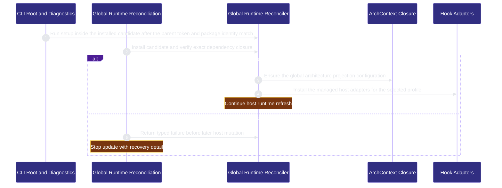

# runtime-harness/global-runtime-reconciliation 架構文檔

<!-- BEGIN ARCHCONTEXT:generated target="projection_target.entity.capability-runtime-harness-global-runtime-reconciliation" sourceDigest="sha256:43624a70f54814d6bd1b4039665497606857aa91bbb599e68131ac0bc604fa11" rendererVersion="archcontext.docs-renderer/v5" outputDigest="sha256:a4f6500ea7f99b50ab10dc77ced27c78a0148906d36081b8a6721f7412374302" -->
> **狀態**:`active`
> **Capability ID**:`capability.runtime-harness.global-runtime-reconciliation`(kind `capability`)
> **Matched Prefixes**:`package.json`、`bun.lock`、`src/cli/index.ts`、`src/cli/commands/global-runtime.ts`、`scripts/check-managed-runtime.ts`、`scripts/sync-codex-installed-copies.sh`、`src/effects/architecture/**`、`tests/cli/global-runtime-init.test.ts`、`tests/cli/global-runtime.test.ts`、`tests/architecture-projection-provider.test.ts`、`assets/reference-configs/external-tooling.md`、`docs/reference-configs/external-tooling.md`、`docs/reference-configs/install-profiles.md`、`src/cli/runtime/**`、`src/cli/tty-prompt.ts`、`src/cli/commands/validators.ts`、`src/cli/commands/doctor.ts`、`src/cli/commands/init-hook.ts`、`src/cli/commands/upgrade.ts`、`src/core/upgrade/**`、`src/effects/runtime/node-candidates.ts`、`src/effects/runtime/protected-helper-platform.ts`、`src/effects/skill-tree-integrity.ts`、`src/effects/configuration/**`、`src/core/architecture/projection.ts`、`src/cli/commands/architecture-projection.ts`、`src/cli/commands/architecture-configuration.ts`、`scripts/axr5-archctx-clean-room.ts`、`src/core/release/**`、`src/effects/release/**`、`scripts/check-npm-release.sh`、`scripts/check-release-published.sh`、`scripts/check-tarball-install-smoke.sh`、`scripts/check-pi-package-smoke.ts`、`scripts/sync-pi-package.ts`、`scripts/runtime-evidence-receipt.ts`、`install.sh`、`install.ps1`、`tsconfig.json`
> **Local Contracts**:`AGENTS.md`、`CLAUDE.md`
> **事實優先級**:倉庫當前狀態 > 本文檔機器區 > 本文檔人工區。機器區(引言、§1、§2)由 ArchContext 從架構模型與源碼度量投影生成,手改會在下次投影被覆蓋。本文檔不記錄出處;本次投影所驗證的 commit 見 `docs/architecture/.projection-manifest.json`。

Reconciles the installed repo-harness runtime, its mandatory ArchContext closure, and profile-owned external tooling.

## 1. P1:能力架構地圖

### 1.1 架構圖

```mermaid
flowchart LR
  p1_capability_runtime_harness_global_runtime_reconciliation_401730e8["Global Runtime Reconciliation"]:::component
  p1_capability_runtime_harness_hook_adapters_75a11743["Hook Adapters"]:::component
  p1_component_global_runtime_reconciliation_archctx_closure_1b9b31b7["ArchContext Closure"]:::component
  p1_component_global_runtime_reconciliation_cli_root_389856ab["CLI Root and Diagnostics"]:::component
  p1_component_global_runtime_reconciliation_primary_d41cdd38["Global Runtime Reconciler"]:::component
  p1_component_global_runtime_reconciliation_release_packaging_b4257d9e["Release Packaging"]:::component
  p1_component_global_runtime_reconciliation_archctx_closure_1b9b31b7 -->|"Write the private global configuration through the installer ownership writer"| p1_capability_runtime_harness_hook_adapters_75a11743
  p1_component_global_runtime_reconciliation_cli_root_389856ab -->|"Register the architecture-projection command"| p1_component_global_runtime_reconciliation_archctx_closure_1b9b31b7
  p1_component_global_runtime_reconciliation_cli_root_389856ab -->|"Register the install and status and security and hook commands and run host transactions with the install profile"| p1_capability_runtime_harness_hook_adapters_75a11743
  p1_component_global_runtime_reconciliation_cli_root_389856ab -->|"Register the update and upgrade commands and run the setup inside the candidate runtime"| p1_component_global_runtime_reconciliation_primary_d41cdd38
  p1_capability_runtime_harness_global_runtime_reconciliation_401730e8 -->|"Reconcile and verify the selected global runtime closure"| p1_component_global_runtime_reconciliation_primary_d41cdd38
  p1_component_global_runtime_reconciliation_primary_d41cdd38 -->|"Configure the global architecture projection and verify the archctx daemon handshake"| p1_component_global_runtime_reconciliation_archctx_closure_1b9b31b7
  p1_component_global_runtime_reconciliation_primary_d41cdd38 -->|"Install host adapters and project skills through the install profile under the host lock"| p1_capability_runtime_harness_hook_adapters_75a11743
  p1_component_global_runtime_reconciliation_release_packaging_b4257d9e -->|"Smoke the packed tarball CLI and hook binaries in a clean app"| p1_component_global_runtime_reconciliation_cli_root_389856ab
  classDef actor fill:#111827,color:#ffffff,stroke:#f9fafb,stroke-width:2px
  classDef component fill:#075985,color:#ffffff,stroke:#bae6fd,stroke-width:2px
  classDef datastore fill:#3f6212,color:#ffffff,stroke:#d9f99d,stroke-width:2px
  classDef external fill:#7c2d12,color:#ffffff,stroke:#fed7aa,stroke-width:2px
```

- Proof: `proven` (`sha256:124dd2a23751ef1571f8d0a8a63aede2548b3d3812e1701cbdfd04a724f30024`).
- Semantic nodes: `6`; declared relations: `8`.

### 1.2 模組職責表

| 宣告入口 | 錨點 | 職責 |
| --- | --- | --- |
| `entrypoint.global-runtime-reconciliation.update` | `src/cli/commands/global-runtime.ts#runGlobalRuntimeSetup` | `sink.global-runtime-reconciliation.readback` → `src/cli/commands/global-runtime.ts#reconcileManagedRuntime`、`sink.global-runtime-reconciliation.architecture-configuration` → `src/cli/commands/architecture-configuration.ts#ensureGlobalArchitectureProjection` |
| `entrypoint.global-runtime-reconciliation.update` | `src/cli/commands/global-runtime.ts#installHostAdapters` | `sink.global-runtime-reconciliation.host-adapters` → `src/cli/commands/install.ts#runInstall` |
| `entrypoint.global-runtime-reconciliation.candidate-readback` | `src/cli/commands/global-runtime.ts#verifyInstalledManagedRuntime` | `sink.global-runtime-reconciliation.candidate-readback` → `src/cli/commands/global-runtime.ts#reconcileManagedRuntime` |

### 1.3 規模信號

- 規模量級:`20–50` 個文件 / `10k–20k` 行
- 匹配前綴:`package.json`、`bun.lock`、`src/cli/index.ts`、`src/cli/commands/global-runtime.ts`、`scripts/check-managed-runtime.ts`、`scripts/sync-codex-installed-copies.sh`、`src/effects/architecture/**`、`tests/cli/global-runtime-init.test.ts`、`tests/cli/global-runtime.test.ts`、`tests/architecture-projection-provider.test.ts`、`assets/reference-configs/external-tooling.md`、`docs/reference-configs/external-tooling.md`、`docs/reference-configs/install-profiles.md`、`src/cli/runtime/**`、`src/cli/tty-prompt.ts`、`src/cli/commands/validators.ts`、`src/cli/commands/doctor.ts`、`src/cli/commands/init-hook.ts`、`src/cli/commands/upgrade.ts`、`src/core/upgrade/**`、`src/effects/runtime/node-candidates.ts`、`src/effects/runtime/protected-helper-platform.ts`、`src/effects/skill-tree-integrity.ts`、`src/effects/configuration/**`、`src/core/architecture/projection.ts`、`src/cli/commands/architecture-projection.ts`、`src/cli/commands/architecture-configuration.ts`、`scripts/axr5-archctx-clean-room.ts`、`src/core/release/**`、`src/effects/release/**`、`scripts/check-npm-release.sh`、`scripts/check-release-published.sh`、`scripts/check-tarball-install-smoke.sh`、`scripts/check-pi-package-smoke.ts`、`scripts/sync-pi-package.ts`、`scripts/runtime-evidence-receipt.ts`、`install.sh`、`install.ps1`、`tsconfig.json`
- 推導:掃描 `source.include` 減 `source.exclude`,跳過 `.git/` 與 `node_modules/`,再按 1–2–5 階梯分桶。精確計數不入本文檔:量級足以回答「這個能力有多大」,而逐行計數會讓覆蓋範圍內任何一次源碼改動都改寫本文檔。

### 1.4 依賴邊界

出向關係:

- `calls` → `component.global-runtime-reconciliation.primary` — Reconcile and verify the selected global runtime closure

入向關係:

- `calls` ← `component.hook-adapters.host-installer` — Report architecture projection readiness in status
- `calls` ← `component.hook-adapters.primary` — Write host output through the shared blocking writer
- `calls` ← `component.refactor-program.archctx-provider` — Run the pinned package-local archctx CLI through the shared architecture provider

## 2. P2:端到端數據流

> **Proof**: `proven` (`sha256:124dd2a23751ef1571f8d0a8a63aede2548b3d3812e1701cbdfd04a724f30024`); selectors `4/4`.

<!-- END ARCHCONTEXT:generated target="projection_target.entity.capability-runtime-harness-global-runtime-reconciliation" -->

## 3. P3:設計決策與不變量

### 3.1 必须保持的不变量

1. **必选闭包先验证，后改 host。** `runGlobalRuntimeSetup` 按固定顺序执行步骤。Bun 版本、受保护 helper 平台、CLI 安装与依赖回读任一失败，函数立即返回（`global-runtime.ts:1462-1483`）。架构投影配置失败也立即返回（`global-runtime.ts:1502-1504`）。host adapter、skill、agent fleet 都在这些检查之后。
2. **回读只认精确版本。** `reconcileManagedRuntime` 从 Bun 全局包根读回 repo-harness、archctx、archctx-contracts 和 CodeGraph 的版本。不一致即失败。它不自动卸载重装。理由写在报错里：重装失败会删掉正在工作的 CLI（`global-runtime.ts:524`）。
3. **update 的后半段只由新包执行。** 安装新包的进程已经加载了旧模块。依赖回读成功后，只有候选包的绝对入口可以写 managed runtime 表面（`global-runtime.ts:1495`）。候选入口 `runCandidateRuntimeReconciliation` 要求父事务的 token，并核对包根、版本和包摘要（`index.ts:294`、`index.ts:305`）。它不取全局 runtime 锁，因为父进程持有锁和事务（`index.ts:282`）。PR #628 把遗留检查也改成在新包里运行，原因相同：旧解析器读不了新目录格式。
4. **archctx 只通过包内 CLI 和精确版本运行。** `ARCHCTX_REQUIRED_VERSION` 是唯一的能力检查（`src/core/architecture/projection.ts:14`、`:55`；PR #617）。Node 运行时按三级顺序选择：`REPO_HARNESS_NODE_BIN`、PATH、受信任候选扫描。每一级都检查 `ARCHCONTEXT_NODE_RANGE`，全部失败时 fail closed（`archctx-provider.ts:103-110`）。
5. **daemon 维护不回滚已验证的包。** update 中 daemon 检查失败时，该步骤记为 `skipped` 并说明原因。已安装并回读成功的包保留（`global-runtime.ts:1486-1490`）。严格的 `verifyInstalledManagedRuntime` 仍然把 daemon 失败判为失败（`global-runtime.ts:557-558`）。
6. **诊断命令不改任何东西。** `doctor` 和 `init-hook`（`setup check`）只读（文件头 `doctor.ts:1-7`、`init-hook.ts:1-8`）。修复动作只出现在 `update`、`install`、`upgrade` 这类显式命令里。
7. **apply 自己接受 major change。** `architecture-projection apply` 在同一次调用里接受 ArchContext 报告的 major change。人的关口是 PR review。丢失响应时读回已提交的 apply，不重复 apply（`projection-apply.ts:24-30`；PR #617）。
8. **发布前先确认版本不存在。** `check-npm-release.sh` 先跑 `check:hooks` 和 `check:helpers`，再查询 npm。版本已存在时拒绝发布（`check-npm-release.sh:24-30`）。

### 3.2 关键权衡

| 决策 | 权衡 |
| --- | --- |
| 回读失败时不自动重装 | 不会因为重装失败而失去 CLI。代价是用户要按提示手动执行 `bun remove -g` 和 `bun add -g`（`global-runtime.ts:524`）。 |
| 候选包接管 update 后半段 | 新目录格式和新 schema 由新代码解析，避免旧模块误读（PR #628 的事故）。代价是多一个进程和一次 token 交接。 |
| daemon 失败降级为 `skipped` | 包升级不会因为共享 daemon 的维护问题回退，避免 hoisted 依赖停在新版本而 CLI 回到旧版本。代价是 update 成功时 daemon 可能还没就绪，要等下一次严格检查发现。 |
| CLI 根集中在 `index.ts` | 所有命令在一个 commander 程序里注册（`buildProgram`，`index.ts:500`），帮助和选项校验一致。代价是 `index.ts` 引用约 26 个 capability 的命令模块，成为单一 SCC 的原因之一（见 §3.3 和 Backlog）。 |
| update 事务放在 CLI 根 | `runTransactionalProfileProjection` 和 `runTransactionalRuntimeRefresh` 在 `index.ts` 里开启 host 事务并捕获配置还原点。代价是 CLI 根同时承担路由和事务，文件有 911 行。 |
| 发布门禁用 shell 脚本 | 门禁逻辑一个脚本两种模式（`--prepublish` 与完整模式），不分叉。代价是 CodeGraph 看不到 shell 调用，`release-packaging → cli-root` 关系只能凭文本证据声明（`check-tarball-install-smoke.sh:131-132`）。 |

### 3.3 组件拆分（2026-10-11）

数据来源：`archctx refactor scan --json`（archctx 0.7.0）。footprint 写在各 component 节点的 `source.include` 里。

| 组件 | footprint 摘要 | 文件 / 行 | 职责 |
| --- | --- | --- | --- |
| `component.global-runtime-reconciliation.primary`（Global Runtime Reconciler） | `commands/global-runtime.ts`、`src/cli/runtime/**`、`protected-helper-platform.ts`、`skill-tree-integrity.ts`、`commands/upgrade.ts`、`src/core/upgrade/**`、`check-managed-runtime.ts`、`sync-codex-installed-copies.sh`、`install.sh`、`install.ps1` | 11 / 4516 | 有序 setup、依赖回读、候选交接、遗留表面清理 |
| `component.global-runtime-reconciliation.cli-root`（CLI Root and Diagnostics） | `src/cli/index.ts`、`tty-prompt.ts`、`commands/{validators,doctor,init-hook}.ts` | 5 / 2540 | 命令树、update 事务、选项校验、只读诊断 |
| `component.global-runtime-reconciliation.archctx-closure`（ArchContext Closure） | `src/effects/architecture/**`、`core/architecture/projection.ts`、`commands/architecture-{projection,configuration}.ts`、`src/effects/configuration/**`、`node-candidates.ts`、`axr5-archctx-clean-room.ts` | 10 / 1434 | 包内 archctx、Node 选择、投影 apply、模型读取、全局配置 |
| `component.global-runtime-reconciliation.release-packaging`（Release Packaging） | `package.json`、`bun.lock`、`tsconfig.json`、`src/{core,effects}/release/**`、6 个发布脚本 | 11 / 2323 | 发布门禁、tarball 冒烟、Pi 包投影、runtime 证据回执 |

与归属提议 §5 的两处偏差：

- `src/effects/configuration/**` 归 archctx-closure。它唯一的调用方是 `architecture-configuration.ts` 和 `projection-config.ts`（CodeGraph imports 边）。
- `src/effects/runtime/node-candidates.ts` 归 archctx-closure。它为 archctx 选择 Node。另一个调用方是 contract-assets 的 `helper-runner.ts`。放在 primary 会让 archctx-closure 与 primary 互相调用。

组件之间的关系：

| 关系 | 证据 |
| --- | --- |
| cli-root → primary | `runCandidateRuntimeReconciliation` 调用 `runGlobalRuntimeSetup`（`index.ts:308`）；注册 update 与 upgrade |
| cli-root → archctx-closure | `buildProgram` 调用 `buildArchitectureProjectionCommand`（`index.ts:862`） |
| primary → archctx-closure | `runGlobalRuntimeSetup` 调用 `ensureGlobalArchitectureProjection`（`global-runtime.ts:1502`）；`inspectManagedDaemonRuntime` 调用 `verifyArchctxDaemonRuntime`（`:534`） |
| release-packaging → cli-root | tarball 冒烟安装后运行 `repo-harness` 和 `repo-harness-hook`（`check-tarball-install-smoke.sh:131-132`；shell，无 CodeGraph 边） |

组件到其他 capability 的关系（生成区 §1.4 不显示组件级出向关系）：

| 来源组件 | 目标 capability | 证据 |
| --- | --- | --- |
| primary | `hook-adapters` | `installHostAdapters` 调用 `runInstall`（`global-runtime.ts:672`）；install-profile、skill-projection、runtime-host-lock |
| primary | `public-surface.adoption` | `upgrade.ts` 使用 FsTransaction manifest 与 `withTargetLock`；`legacy-inventory.ts` 使用 adoption 指纹 |
| primary | `workflow-engine.contract-assets` | `syncCrossReviewSkills`（`global-runtime.ts:1610`） |
| primary | `verification.codegraph-readiness` | `configureCodegraph`（`global-runtime.ts:1432`） |
| archctx-closure | `hook-adapters` | `writePrivateConfiguration`（`architecture-configuration.ts:15`） |
| archctx-closure | `mcp-sidecar` | `model-reader.ts` 引用 `effects/repo-registry.ts` |
| cli-root | 14 个已有 capability | `buildProgram` 注册各命令（`index.ts:804-869`）：hook-adapters、adoption、contract-assets、codegraph-readiness、pm-dispatch、mcp-sidecar、refactor-program、operator、engineer-bindings、delegated-runs、collaboration、verified-context、interface-change、external-source-intake |

CLI 根的扇出是真实的组合根结构，所以如实建模。`index.ts` 另外注册约 15 个命令文件（state、sprint、fleet、publication、pipeline、task-agent、herdr、review、chatgpt、strategy、integration、docs、brain、run、migrate、tools）。集成步骤补上了这些命令的关系：workflow-state（state、sprint）、task-fleet、publication、pipeline-ledger、task-agent-host（task-agent、herdr）、acceptance-review（review）、chatgpt-browser、strategy-reflection、integration-acceptance 与 root-router（docs）。brain 与 run 归 contract-assets，migrate 归 adoption，tools 归 codegraph-readiness。

反向边（未声明为关系，记入 Backlog）：

- primary → cli-root：`global-runtime.ts` 从 `doctor.ts` 引用 `compareVersions` 和 `readLatestPackageVersion`（`global-runtime.ts:100`、`:222`、`:568`）。
- archctx-closure → primary：`architecture-configuration.ts:8` 只引用类型 `GlobalRuntimeStep`。

### 3.4 开放问题

- `scripts/axr5-archctx-clean-room.ts` 归入 archctx-closure 的依据只有文件名和归属提议 §1d。它是否仍被 CI 或发布流程调用？没有记录。
- `package.json` 的版本被多个模块直接读取（`model-reader.ts:14`、`status.ts:37`、`install-profile.ts:1333`、`src/cli/mcp/version.ts:5`）。这些读取没有建模为关系。是否需要一个版本读取入口？没有记录。

## 4. 歷史決策記錄(append-only)

### 依赖回读与安全对账（2026-08-11，PR #176）

- `ee33d127` 引入受管工具链的安全对账和受保护的 Node 权威。

### update 绑定候选包（2026-09-04）

- `8aee832d` 把 runtime 对账绑定到已安装的候选包。commit 没有正文。原因见 §3.1 第 3 条的代码注释。

### daemon 维护需要批准（2026-10-01）

- `eeb4cff5` 让过期的 archctx daemon 维护先请求批准。commit 没有正文，具体批准路径没有记录。

### 工具与证据，Bot 调度（2026-10-11，PR #617）

- 删除自动投影队列、自动 apply 模式和 failure gate 设置。全局架构配置只接受 `manual` 或 `disabled`。`update` 和 `init` 一次性迁移旧配置段。
- `architecture-projection apply` 在同一次调用里接受 major change，删除 acceptance store。
- 投影结果用 archctx-contracts 的 schema 解码，删除本地解码器。精确版本 pin 是唯一能力检查。

### 遗留检查在新包中运行（2026-10-11，PR #628）

- update 通过已安装包的入口运行 `upgrade --json`。检查失败时打印警告和下一条命令，保留刷新的退出码。
- 遗留检查读取未脱敏的 stdout，缓冲上限 1 MiB。只打印解析出的数量，警告里的错误文本仍然脱敏。

### 组件拆分（2026-10-11）

- 一个 ChangeSet 增加 3 个组件（cli-root、archctx-closure、release-packaging）、26 条关系，并给 `component.global-runtime-reconciliation.primary` 加 footprint。
- capability include 增加了此前无归属的 runtime、upgrade、release、配置、诊断和架构命令文件（归属提议 §1b、§1c、§1d、§1e）。现有 include 条目一条未删。
- `flow.global-runtime-reconciliation.primary` 增加 cli-root → primary 的候选交接步骤，成功分支增加 primary → archctx-closure 和 primary → hook-adapters。全部 selector 都是 CodeGraph 直接调用。

## Optimization Backlog

- **CLI 根是单一 SCC 的原因之一。** `src/cli/index.ts` 引用约 26 个 capability 的命令模块，而多个 capability 又通过 `src/cli/runtime/write-all-sync.ts`、`src/core/architecture/projection.ts` 等文件回到本 capability。组合根本身合理。可以做的是让被别人依赖的叶子文件离开组合根所在的 capability：`write-all-sync.ts` 移到 `execution-primitives`，`core/architecture/projection.ts` 的策略类型与 archctx 版本 pin 移到被依赖方。
- **`index.ts` 同时是路由和事务。** 911 行里有命令注册和 `runTransactional*` 事务函数。把事务函数移到 primary 组件，可以让 cli-root 只剩注册。需要先确认事务函数没有依赖 commander 状态。
- **`global-runtime.ts` 有 1,631 行。** setup 步骤、外部 skill 安装、Waza 规则同步、CodeGraph 配置都在一个文件里。按步骤族拆分前需要改动频率证据。
- **反向边：** primary → cli-root（`doctor.ts` 的版本比较函数）。把 `compareVersions`、`readLatestPackageVersion` 移到 primary 或一个版本工具模块即可去掉。archctx-closure → primary 只有类型引用（`GlobalRuntimeStep`），可以把类型移到 `src/cli/runtime/`。
- **多归属文件。** 3 个测试文件和 3 个 reference config 仍在本 capability 的 include 里，与 evals-checks、contract-assets 重叠。按用户决定，等 arch-context#296 和 resolver 改动后再收窄。
- **集成没有声明的方向。** archctx-closure → contract-assets（`model-reader.ts` 读 capability registry，7 条边）与 archctx-closure → operator（4 条边）没有声明。contract-assets → 本 capability（25 条边）与 operator → 本 capability（12 条边）已经声明，且边更多。cli-root → execution-primitives 只有类型导入（`src/cli/index.ts:102-104`），没有声明。
- **与 contract-assets 的已声明双向关系。** cli-root 与 primary → contract-assets（21 条边）和 contract-assets template-projection → 本 capability（25 条边）都已声明。按边数，本 capability 的方向是回边。集成不删除分组已声明的关系。是否删除是开放问题。
