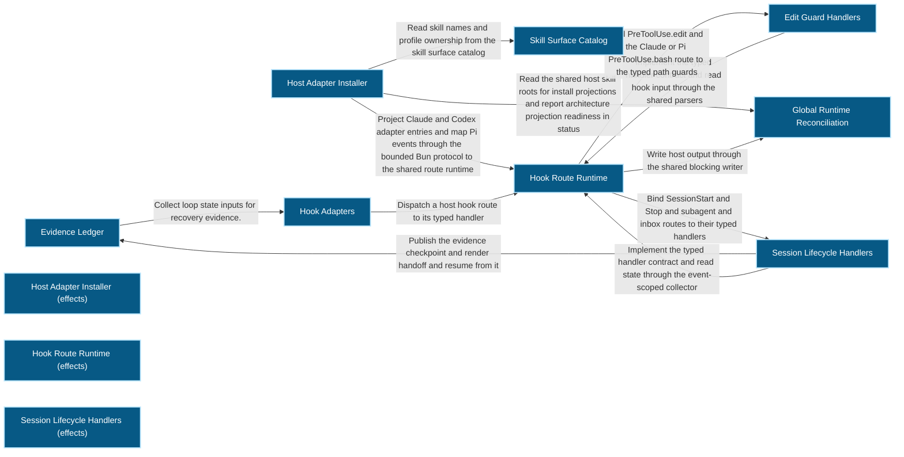
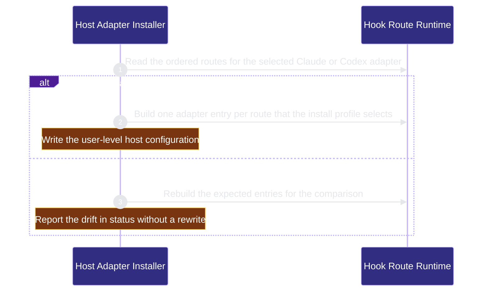
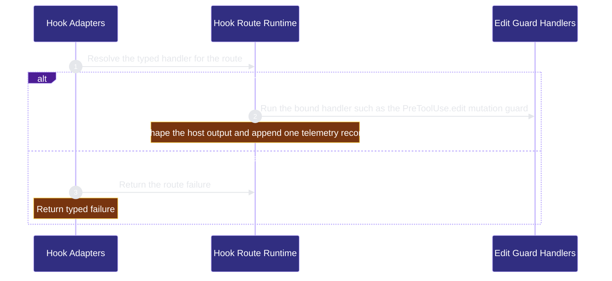
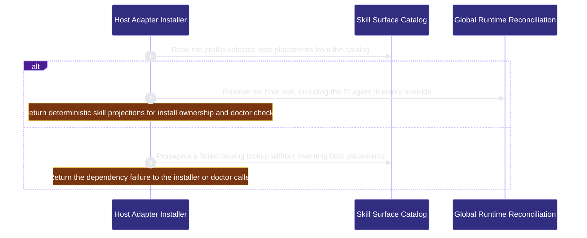
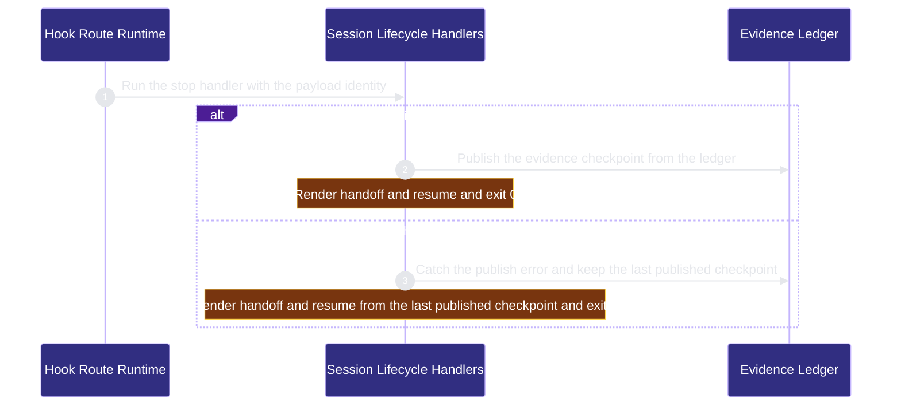

# runtime-harness/hook-adapters 架构文档
<!-- BEGIN ARCHCONTEXT:generated target="projection_target.entity.capability-runtime-harness-hook-adapters" rendererVersion="archcontext.docs-renderer/v6" outputDigest="sha256:978da2913309ac448bbfb1dc5afde7f62285ca460e0c4d58b005942eda0a830e" -->
> **狀態**:`active`
> **Capability ID**:`capability.runtime-harness.hook-adapters`(kind `capability`)
> **Matched Prefixes**:`src/cli/hook/**`、`src/cli/installer/**`、`src/pi/**`、`src/effects/managed-tree.ts`、`src/cli/hook-entry.ts`、`src/effects/loop/**`、`src/effects/segmented-log.ts`、`src/effects/run-summary-retention.ts`、`src/cli/commands/install.ts`、`src/cli/commands/status.ts`、`src/cli/commands/security.ts`
> **Local Contracts**:`src/cli/hook/AGENTS.md`、`src/cli/hook/CLAUDE.md`
> **事實優先級**:倉庫當前狀態 > 本文檔機器區 > 本文檔人工區。機器區(引言、§1、§2)由 ArchContext 從架構模型與源碼度量投影生成,手改會在下次投影被覆蓋。本文檔不記錄出處;本次投影所驗證的 commit 見 `docs/architecture/.projection-manifest.json`。

Installs and runs typed Claude, Codex and Pi host hook routes.

## 1. P1:能力架構地圖

### 1.1 架構圖



- Proof: `proven` (`sha256:78f997cf9761e716018af744e105ec7cd0a82729defa37fa17b64c84ec2c3078`).
- Semantic nodes: `11`; declared relations: `11`.

### 1.2 模組職責表

| 宣告入口 | 錨點 | 職責 |
| --- | --- | --- |
| `entrypoint.hook-adapters.primary` | `src/cli/hook/runtime.ts#runHook` | `sink.hook-adapters.primary` → `src/cli/hook/handler-registry.ts#getHandlerForRoute` |

組件入口:

| 組件 | 宣告入口 | 錨點 | 職責 |
| --- | --- | --- | --- |
| `component.hook-adapters.host-installer` | `entrypoint.hook-adapters.managed-entries` | `src/cli/installer/managed-entries.ts#buildManagedHooks` | `sink.hook-adapters.routes-for-host` → `src/cli/hook/route-registry.ts#routesForHost` |
| `component.hook-adapters.host-installer` | `entrypoint.hook-adapters.pi-extension` | `src/pi/extension.ts#repoHarnessPi` | `sink.hook-adapters.pi-registration` → `src/pi/extension.ts#registerPiHooks` |
| `component.hook-adapters.host-installer` | `entrypoint.hook-adapters.skill-projection` | `src/cli/installer/skill-projection.ts#expectedSkillProjections` | `sink.hook-adapters.skill-placements` → `src/core/skill-surface/catalog.ts#hostSkillPlacements`、`sink.hook-adapters.skill-root` → `src/effects/host-skill-roots.ts#hostSkillRoot` |
| `component.hook-adapters.primary` | `entrypoint.hook-adapters.handler-bindings` | `src/cli/hook/handler-registry.ts#handlers` | `sink.hook-adapters.mutation-guard` → `src/cli/hook/mutation-guard.ts#runMutationGuard`、`sink.hook-adapters.stop-handler` → `src/cli/hook/stop-handler.ts#runStopHandler` |
| `component.hook-adapters.session-lifecycle` | `entrypoint.hook-adapters.stop` | `src/cli/hook/stop-handler.ts#runStopHandler` | `sink.hook-adapters.evidence-checkpoint` → `src/effects/evidence/checkpoint-store.ts#publishCheckpointFromLedger` |

### 1.3 規模信號

- 規模量級:`20–50` 個文件 / `5000–10000` 行
- 匹配前綴:`src/cli/hook/**`、`src/cli/installer/**`、`src/pi/**`、`src/effects/managed-tree.ts`、`src/cli/hook-entry.ts`、`src/effects/loop/**`、`src/effects/segmented-log.ts`、`src/effects/run-summary-retention.ts`、`src/cli/commands/install.ts`、`src/cli/commands/status.ts`、`src/cli/commands/security.ts`
- 推導:掃描 `source.include` 減 `source.exclude`,跳過 `.git/` 與 `node_modules/`,再按 1–2–5 階梯分桶。精確計數不入本文檔:量級足以回答「這個能力有多大」,而逐行計數會讓覆蓋範圍內任何一次源碼改動都改寫本文檔。

### 1.4 依賴邊界

出向關係:

- `deployed-on` → `process.hook` — Hook adapters run in the per-event hook process.
- `depends-on` → `capability.verification.acceptance-review` — Read the diff fingerprint for mutation guards.
- `depends-on` → `capability.runtime-harness.task-agent-host` — Resolve task role profiles during host installation.
- `calls` → `component.hook-adapters.primary` — Dispatch a host hook route to its typed handler

入向關係:

- `calls` ← `capability.verification.acceptance-review` — Admit at most one persistent semantic review session per work package through the circuit breaker
- `depends-on` ← `capability.public-surface.adoption` — Use installer setup during repository migration.
- `calls` ← `external.claude-code` — Claude Code runs the installed repo-harness hook command for each hook event.
- `depends-on` ← `capability.verification.codegraph-readiness` — Use host locks and configuration ownership for CodeGraph setup.
- `calls` ← `external.codex` — Codex runs the installed repo-harness hook command for each hook event.
- `calls` ← `component.contract-assets.template-projection` — Read the install profile and project skills during init
- `reads` ← `component.evals-checks.evals-and-benchmarks` — Read hook event telemetry records to measure hook cost in profile benchmarks
- `depends-on` ← `capability.runtime-harness.evidence-ledger` — Collect loop state inputs for recovery evidence.
- `calls` ← `component.global-runtime-reconciliation.archctx-closure` — Write the private global configuration through the installer ownership writer
- `calls` ← `component.global-runtime-reconciliation.cli-root` — Register the install and status and security and hook commands and run host transactions with the install profile
- `calls` ← `component.global-runtime-reconciliation.primary` — Install host adapters, project owned host skills, and register the Pi package from the installed candidate after mandatory setup succeeds
- `calls` ← `component.mcp-sidecar.host-setup` — Reuse installer configuration ownership receipts and the runtime host lock
- `reads` ← `component.operator.activity-feeds` — Read the hook route registry and install profile components for the Hooks and Agents pages
- `calls` ← `external.pi` — Pi loads the native extension, which sends mapped session, prompt and tool events to the same-package Bun hook process.
- `depends-on` ← `capability.runtime-harness.task-agent-host` — Use host installation commands for Herdr skill setup.

組件出向關係:

- `component.hook-adapters.edit-guards`:
  - `calls` → `capability.workflow-engine.execution-primitives` — Lock the circuit breaker records
  - `depends-on` → `component.hook-adapters.primary` — Implement the typed handler contract and read hook input through the shared parsers
  - `calls` → `capability.workflow-engine.workflow-state` — Canonicalize edit paths and resolve the owners of edited paths
- `component.hook-adapters.host-installer`:
  - `calls` → `capability.public-surface.adoption` — Share the managed hook command fingerprints with the adoption migration
  - `calls` → `capability.workflow-engine.execution-primitives` — Hold the runtime host transaction lock and resolve the Pi opt-in repository through the bounded shared Git runner
  - `calls` → `capability.runtime-harness.global-runtime-reconciliation` — Read the shared host skill roots for install projections and report architecture projection readiness in status
  - `calls` → `external.pi` — Use Pi list, install and remove for the exact package source, without writing Pi settings or bypassing trust.
  - `calls` → `component.hook-adapters.primary` — Project Claude and Codex adapter entries and map Pi events through the bounded Bun protocol to the shared route runtime
  - `calls` → `component.action-commands.skill-surface-catalog` — Read skill names and profile ownership from the skill surface catalog
- `component.hook-adapters.host-installer-effects`:
  - 無。
- `component.hook-adapters.primary`:
  - `calls` → `capability.workflow-engine.execution-primitives` — Run the process supervisor and group launcher entries
  - `calls` → `capability.workflow-engine.workflow-state` — Resolve effective state read-only at most once per hook event
  - `calls` → `component.hook-adapters.edit-guards` — Bind PreToolUse.edit and the Claude or Pi PreToolUse.bash route to the typed path guards
  - `calls` → `capability.runtime-harness.global-runtime-reconciliation` — Write host output through the shared blocking writer
  - `calls` → `component.hook-adapters.session-lifecycle` — Bind SessionStart and Stop and subagent and inbox routes to their typed handlers
- `component.hook-adapters.primary-effects`:
  - 無。
- `component.hook-adapters.session-lifecycle`:
  - `calls` → `capability.public-surface.adoption` — Check the one-release run summary cleanup paths with the shared path safety rules
  - `calls` → `capability.runtime-harness.evidence-ledger` — Publish the evidence checkpoint and render handoff and resume from it
  - `calls` → `capability.workflow-engine.execution-primitives` — Hold the native role evidence lock
  - `depends-on` → `component.hook-adapters.primary` — Implement the typed handler contract and read state through the event-scoped collector
  - `calls` → `capability.organization.task-fleet` — Render task inbox messages as untrusted session context
  - `calls` → `capability.workflow-engine.workflow-state` — Read Effective State snapshots, capability ownership and stored provider board slices for session context
- `component.hook-adapters.session-lifecycle-effects`:
  - 無。

### 1.5 組件結構

| 組件 | 名稱 | 規模量級 | 宣告入口 |
| --- | --- | --- | --- |
| `component.hook-adapters.edit-guards` | Edit Guard Handlers | `2–5` 個文件 / `500–1000` 行 | 未宣告 |
| `component.hook-adapters.host-installer` | Host Adapter Installer | `10–20` 個文件 / `2000–5000` 行 | `entrypoint.hook-adapters.managed-entries`、`entrypoint.hook-adapters.pi-extension`、`entrypoint.hook-adapters.skill-projection` |
| `component.hook-adapters.host-installer-effects` | Host Adapter Installer (effects) | `1–2` 個文件 / `50–100` 行 | 未宣告 |
| `component.hook-adapters.primary` | Hook Route Runtime | `5–10` 個文件 / `1000–2000` 行 | `entrypoint.hook-adapters.handler-bindings` |
| `component.hook-adapters.primary-effects` | Hook Route Runtime (effects) | `2–5` 個文件 / `200–500` 行 | 未宣告 |
| `component.hook-adapters.session-lifecycle` | Session Lifecycle Handlers | `5–10` 個文件 / `1000–2000` 行 | `entrypoint.hook-adapters.stop` |
| `component.hook-adapters.session-lifecycle-effects` | Session Lifecycle Handlers (effects) | `2–5` 個文件 / `200–500` 行 | 未宣告 |

## 2. P2:端到端數據流

> **Proof**: `proven` (`sha256:78f997cf9761e716018af744e105ec7cd0a82729defa37fa17b64c84ec2c3078`); selectors `7/7`.








<!-- END ARCHCONTEXT:generated target="projection_target.entity.capability-runtime-harness-hook-adapters" -->
## 3. P3：设计决策与不变量

### 3.1 必须保持的不变量

1. **一条公开 tuple → 一个 typed handler → 一个 host-output 边界。** `Route` 接口（`route-registry.ts:54`）根本没有 `scripts` 字段，结构上排除了第二 dispatcher。
2. **adapter 命令是信封，不是逻辑。** 任何写进 `~/.claude/settings.json` / `~/.codex/hooks.json` 的分支判断都是回归 —— host 配置无法被测试、无法被原子替换。
3. **ROUTES 顺序是稳定契约。** Codex 按 `(absolute-path, event-snake, i, j)` 哈希 adapter 条目，重排会重新弹出信任提示（`route-registry.ts:14-16`）。新增 route 只能追加。
4. **handler 不碰 fd。** typed `HookHandlerResult` 是 handler 的唯一出口。`hook-protocol.ts` 的 `HOST_RENDERERS` 表是唯一入海口。Claude 与 Codex 的输出语义差异只能在这张表里表达。
5. **opt-in marker 是硬门。** 没有 `.ai/harness/workflow-contract.json` 就静默退出 —— 装了 CLI 的用户在非 harness 仓库不应付出任何代价。
6. **没有 shell operator library。** [archived hooks](https://github.com/Ancienttwo/repo-harness/tree/13a589c0c07f886891add648f0a54852dede7323/assets/hooks) 已删除。operator helper 经 `repo-harness run <helper>` 运行，policy 路径由 `resolveHarnessPaths` 一处解析，failure log 用 edit guard 写入的同一个 `FAILURE_LOG_FILE`（#696）。
7. **遥测非安全权威，但消费者 fail-closed。** 字段缺失、畸形、重复或混协议时消费者必须停，不得补零。
8. **Hook 不做架构工作。** Hook 不记录架构漂移，不运行投影，不写 capability 块。架构更新在 PR 里显式完成：ChangeSet 加 `architecture-projection apply`。

### 3.2 关键权衡

| 决策 | 权衡 |
| --- | --- |
| 退役 routes 与 managed command 在同一 release 删除（#705） | Codex 只重新信任一次。旧 adapter 在 reinstall 前会收到 exit 2。 |
| 两条 subagent route 各有一个 handler（`return-channel`、`subagent-context`） | `PreToolUse.subagent` 只处理 Claude `Agent`。`SubagentStart.context` 只装进 Codex。runtime 统一检查 host。 |
| `hook-entry.ts` 与完整 commander CLI 分离 | 热路径不冷加载非 hook 命令模块（文件头 `:5` 明写理由），代价是子命令分派在 entry 里手写成一串 `if` |
| 删除 `workflow-state.sh`，helper 改调 TypeScript | 路径与 stem 只有一个 TypeScript 实现。代价：`prepare-handoff` 与 `summarize-failures` 现在需要 Bun，旧的 `hook-lib path` 下游调用方要改成 `repo-harness run <helper>` |
| 空 lifecycle hooks 已移除 | Scaffold 和 template assembly 直接执行各自任务。它们不再调用空 runner。 |

### 3.3 组件拆分（2026-10-11）

数据来源：`archctx refactor scan --json`（archctx 0.7.0）。footprint 写在各 component 节点的 `source.include` 里。archctx 校验 footprint。model reader 从 `archctx export native` 读模型，不再自己翻译 component 的 include（#739）。

| 组件 | footprint 摘要 | 文件 / 行 | 职责 |
| --- | --- | --- | --- |
| `component.hook-adapters.primary`（Hook Route Runtime） | `hook-entry.ts`、`hook/{runtime,route-registry,handler-registry,handler-contract,hook-input,hook-protocol,event-telemetry,session-context-budget}.ts`、`src/effects/loop/**`、`hook-event-log.ts` | 11 / 1037（2026-10-16） | route 表、handler 绑定、opt-in 检查、payload 与 identity 解析、host 渲染表、遥测与日志轮转 |
| `component.hook-adapters.edit-guards`（Edit Guard Handlers） | `hook/{mutation-guard,circuit-breaker}.ts` | 2 / 489（2026-10-16） | PreToolUse.edit 路径边界、semantic-review circuit breaker |
| `component.hook-adapters.session-lifecycle`（Session Lifecycle Handlers） | `hook/{session-context,stop-handler,return-channel,subagent-context,task-inbox-handler,board-slice-context,state-snapshot}.ts`、`run-summary-retention.ts` | 8 / 1373（2026-10-16） | SessionStart、Stop 恢复视图、subagent route、Task Inbox |
| `component.hook-adapters.host-installer`（Host Adapter Installer） | `src/cli/installer/**`、`commands/{install,status,security}.ts` | 14 / 3670（2026-10-16） | managed entries、install profile、status 与 security scan |

与归属提议 §5 的一处偏差，有源码证据：

- `session-context-budget.ts` 归 route-runtime。`runtime.ts` 的 `sessionOutput` 调用 `budgetSessionContext`（`runtime.ts:120`），`handler-contract.ts:3` 引用它的类型。SessionStart 预算是 host 输出整形的一部分（不变量 4）。按提议放进 session-lifecycle 会产生 runtime → handler 的反向边。

组件之间的关系：

| 关系 | 类型 | 证据 |
| --- | --- | --- |
| host-installer → route-runtime | calls | `buildManagedHooks` 调用 `routesForHost`（`managed-entries.ts:107`） |
| route-runtime → edit-guards | calls | `handlers` 绑定 `runMutationGuard`（`handler-registry.ts`）。`hook-entry.ts` 只分派 hook route、`state-snapshot` 与进程 supervisor |
| route-runtime → session-lifecycle | calls | `handlers` 绑定 `runStopHandler`、SessionStart、两个 subagent handler 与 inbox handler（`handler-registry.ts`） |
| edit-guards → route-runtime、session-lifecycle → route-runtime | depends-on | handler 实现 typed `HookHandlerResult` 契约。handler 从 `HookHandlerContext` 读取 `payload` 与 `identity`，并读取 event 级 `StateInputCollector`。handler 不读取 session、run 或 turn 的环境变量 |

组件到其他 capability 的关系（生成区 §1.4 不显示组件级出向关系，所以列在这里）：

| 关系 | 证据 |
| --- | --- |
| host-installer → `public-surface.adoption` | `managed-entries.ts`、`uninstall.ts` 引用 `core/adoption/managed-hook-config.ts` |
| host-installer → `global-runtime-reconciliation` | `status.ts:242` 调用 `inspectArchitectureProjectionReadiness` |
| route-runtime → `global-runtime-reconciliation` | `hook-entry.ts` 与 `runtime.ts` 用 `src/cli/runtime/write-all-sync.ts` 写 host 输出 |
| session-lifecycle → `public-surface.adoption` | `run-summary-retention.ts` 引用 `src/effects/path-safety.ts`。只有 `scripts/evidence-gc.ts` 调用它，这是一个版本的一次性清理 |

依赖方向说明：route-runtime 与两个 handler 组件之间有双向边。registry 组合 handler（calls），handler 实现 registry 的契约（depends-on）。这是插件式组合，不是层次倒置。如果以后要消除这个环，把 `handler-contract.ts` 与 `hook-input.ts` 移到一个叶子组件即可。目前没有证据说明这个环造成了问题。

host-installer 有 14 个文件、3670 行（2026-10-16），标记为 expandable。可以拆成 installer 与 asset projection 两块。现在不拆。

### 3.4 10x 规模下先垮的点

排序依据是本仓库自己的 dispatch 遥测 `.ai/harness/runs/hook-events.jsonl`：44,301 条记录，窗口 `2026-07-23T09:05Z` → `2026-08-20T08:26Z`，按 `event.route_id` 聚合 `metrics.elapsed_ms`。占比是该 route 在实测总 hook 墙钟时间中的份额，不是猜测。

| route | 调用数 | 时间占比 | p50 | p95 | p99 / max |
| --- | --- | --- | --- | --- | --- |
| `Stop.default` | 675 | 48.7% | 549ms | 18.4s | 24.4s / 27.4s |
| `PostToolUse.bash` | 16,398 | 26.7% | 52ms | 113ms | 244ms / 1.2s |
| `PreToolUse.edit` | 2,219 | 16.5% | 253ms | 437ms | 873ms / 10.9s |
| `SessionStart.default` | 492 | 4.6% | 304ms | 711ms | 1.2s / 2.1s |
| `PostToolUse.always` | 21,217 | 2.6% | 3.2ms | 11.2ms | — / 386ms |
| 其余 6 条 route 合计 | 3,300 | <1.0% | — | — | — |

按实测的可证伪顺序：

1. **Stop 的延迟工作。** 旧采样里 Stop 是唯一贴到硬上限的 route：675 次 Stop 里 93 次超过 5s、77 次超过 10s，p99 24.4s。当时的主要成本是架构 cascade 和投影 drain。二者已删除（2026-10-10）。refactor recommendation observer 也已移出 Stop（2026-10-10），改由 Bot 按需读取证据。#695 又删除了 journal pass、run summary、状态解析、readiness 行与 140 s deadline。Stop 现在只发布 checkpoint 并渲染 handoff 与 resume。需要重新采样，再判断 Stop 是否仍是最先垮的点。
2. **`PostToolUse.bash` 的单位成本 × 调用量。** p50 52ms 单看不贵，但它是第二高频 route（16,398 次），乘出来就是 26.7% 的总时间。它没有尾延迟问题（p99 244ms），垮的方式是稳态吞吐：命令密度上去后每次 Bash 调用都固定付这 50ms。#695 删除了 importer、输出捕获与 `post-bash-latest.json`，#705 又删除了 Claude/Codex 的这条 route。#766 删除了 Pi 的这条 route 与 command observer。现在没有这项成本。
3. **`PreToolUse.edit` 阻塞编辑热路径。** mutation-guard 是**同步前置**门，p50 253ms 直接计入用户可感知的编辑延迟，且 max 10.9s 说明它在状态解析退化时会长尾。#692 删除了状态解析、lease 检查、circuit breaker 与 advisory。现在只剩路径边界，以及 owned path 的一次 `git status`。需要重新采样。
4. **SessionStart 上下文预算（#693 已修正）。** 旧实现把五个 provider 拼成一整块 section，超预算时一起消失。现在每个 provider 是独立 section，各有 id 与 source。`budgetSessionContext` 按 priority 排序，保留 mandatory section，放不下的 optional section 变成 `[ContextRef:<id>] <source>` 指针。#770 删除了 resume 与 active-sprint 两个 provider。`[HarnessState]` 只保留 `references.resume` 指针。它不再输出 sprint 指针。延迟本身不是瓶颈（4.6%、p95 711ms）。
5. **只读解析的 stability 重读耗尽。** `runtime.ts` 的 `resolveHookEffectiveState` 是唯一的重试策略。它调用不取锁、不写状态的 `resolveEffectiveStateReadOnly`，最多三次（`EFFECTIVE_STATE_RESOLUTION_MAX_ATTEMPTS = 3`），只重试 `StateResolutionUnstableError`。一次 SessionStart 的快乐路径是两次解析，最坏十二次。2026-10-25 前 hook 走写路径，这两个数是三次和三十次。权威源被并发改写时，重试耗尽会把 SessionStart 推进 `[HarnessStateUnavailable]` 分支 —— 这是正确的 fail-closed，但用户侧表现为上下文突然消失。
6. **`install-profile.ts` 1,441 行的单点（2026-10-11 实测，旧版记录为 1,167 行）。** profile 组件矩阵继续增长时，这里是最先需要拆分的文件。不在 dispatch 热路径上。

两个 sink 不是同一个东西，早期版本把它们混为一谈：

- `.ai/harness/runs/hook-events.jsonl` 由 dispatcher 的 `createHookEventTelemetry().finalize`（`event-telemetry.ts`）在**每条 route** 完成后经 `appendSegmentedLog`（`src/effects/segmented-log.ts:92`）同步追加一条，因此它是上表的数据来源，也是唯一全 route 覆盖的写入。
- `.claude/.trace.jsonl` 的 writer `trace-observer.ts` 已删除（#695）。`PostToolUse.always` 已退役（#705）。

`PostToolUse.always` 确实是调用量最大的 route（21,217 次，超过 bash）。旧实测里它是**最便宜**的高频路径：p50 3.2ms、总占比 2.6%。#705 已删除这条 route。现在没有这项进程启动成本。

注意遥测本身的边界：`metrics.child_processes` 在全部 44,301 条记录里都是 `0`，它属于 `measurement.incomplete_metrics`，不能用来反推 Stop 的子进程数量；上表只依赖 `elapsed_ms` 这个被标记为 complete 的字段。

### 3.5 安装范围与归属

- #698 移除 `--location local`。CLI 在读取安装状态或取得 host lock 前拒绝该值。`src/cli/commands/install.ts` 也拒绝直接传入的 local 值。Claude target 只解析 user-level `~/.claude/settings.json`。Global uninstall 继续使用 ownership receipt。`AgentTarget` 接口保留，`Location` 只接受 `global`。
- 本文档旧版 P1 把 `standard-plan.ts` / `fs-transaction.ts` 列为本 capability 模块。[archived capabilities.json](https://github.com/Ancienttwo/repo-harness/blob/1eaf63019aadd2129376987957170d8310b35c3f/.ai/context/capabilities.json) 已不存在。registry 现在只读 `.archcontext/model/nodes/` 里的 capability 节点（`src/core/capabilities/registry.ts:643`）。`capability-resolver match` 把这两个文件解析到 `public-surface-adoption`（2026-10-11 实测）。它们仍是跨 capability 的一次性迁移依赖。dispatch 路径不消费它们的结论。

### 3.6 Typed durable-effect failure boundary (2026-08-14)

- P1: `src/cli/hook/handler-registry.ts` is the sole declaration point for
  bounded effect contracts. Only `mutation-observed` (one post-edit journal
  phase) and `stop` (handoff, resume, event, run-summary) declare one; every
  other typed handler remains uninstrumented rather than being inferred as
  effect-free. `src/cli/hook/runtime.ts` owns the invocation-local observation
  and removes handler-ID completeness branches.
- P2: existing post-commit observers feed an additive
  `effect_observation` field in `loop-engine-hook-event/v1`. A thrown targeted
  handler is recorded as `unknown_partial` when no observer phase was seen,
  `committed_partial` for an observed prefix, and `committed_complete` after
  the declared bounded phases. A successful no-op is `none_committed`.
  Telemetry is diagnostic only; the journal and Stop projection files remain
  recovery authority and the public `RunHookResult` vocabulary is unchanged.
- P3: the next host-delivered same-route event is the only production retry
  operation. Fault tests inject throws after each named post-commit phase and
  compare normalized durable artifacts with a no-fault baseline. Stop's append
  event uses a timestamp-free projection key over every non-volatile rendering
  input and compares only the latest Stop inside a bounded reconciliation
  window; an unprovable latest event fails closed as reconcile-required. This
  is handler-local idempotency, not a generic transaction or rollback layer.
  Missing observer evidence fails closed as unknown and never authorizes
  cleanup.
- 2026-10-13（#691）：effect contract、tracker 与 `effect_observation` 字段已删除。遥测协议升到 `loop-engine-hook-event/v2`，不再携带 steps、metrics、measurement 或 effect observation。恢复权威仍是 post-edit journal 与 Stop projection 的 handler 内幂等。
- 2026-10-13（#692、#695）：post-edit journal 已删除。Stop 的 events.jsonl 追加与 run summary 也已删除。Stop 只渲染 handoff 与 resume，每次替换整个文件，所以重试会收敛。

### 3.7 开放问题

- 已解决（#693）：SessionStart 不再调用 `runSecurityScan`。session-lifecycle 不再依赖 CLI 命令文件。
- `edit-guards` 与 `session-lifecycle` 依赖的 state、locking、evidence、fleet 模块目前没有归属。它们的关系等其他分组建立 `workflow-state`、`execution-primitives`、`evidence-ledger`、`task-fleet` 后再补。

## 4. 历史决策记录（append-only）

> 以下小节为既有文档原文逐字保留，未翻译、未改写。

### Frontend-scoped UX advisory (2026-07-21, PR #109)

The UserPromptSubmit advisory pair is split by scope: `bdd_feature_advice`
stays generic (any feature/implement intent → the `[BDD]` Given-When-Then
reminder), while `ux_feature_guard_advice` additionally requires a frontend/UI
noun — split ZH/EN sets with explicit English word boundaries so `build` and
`suite` can never match via the `ui` substring — evaluated against the
stripped prompt (`ctx.text`), so host-injected context cannot create UX
intent. The fact is echo-only by invariant: it gates the `[UXFeatureGuard]`
push in `prompt-handler.ts` and never enters routing or blocking decisions.
The noun sets expand only with a real missed-case fixture first
([archived prompt-intents.test.ts](https://github.com/Ancienttwo/repo-harness/blob/2ed904ae9555482b4c5750457c3faa8b7804484c/tests/cli/prompt-intents.test.ts) pins the positive/negative matrix).

### Edit safety and state context

The mutation guard checks paths and permissions without resolving Effective
State. Task contracts and check results grant no edit permission. SessionStart
and child context read state for context. The state has no readiness decision.

### HRD-09 typed-authority consolidation (原 P3 段落，逐字保留)

The invariant is one public tuple → one typed handler → one host-output
boundary. HRD-09 removes the old second authority in the same work-package:
the Bash host-event runtime and shims are deleted, while the operator helper is
retained as a projection because workflow-state parity still depends on its
contract. Keeping that helper does not keep a second dispatcher alive.

At 10x event volume, synchronous telemetry append contention or incomplete
measurement is the first expected failure. Telemetry is therefore
non-authoritative for safety, but evidence consumers fail closed when required
fields are missing, malformed, duplicated, or mixed-protocol.

### Migration to the typed authority (原 P2 段落，逐字保留)

```text
repo-harness init / runInit
  -> standard-plan (pure operation list)
  -> exact-hash retired-file checks + managed adapter stripping
  -> one FsTransaction apply + manifest
  -> user-level adapter projection remains the host boundary
```

The migration detector is scoped to this explicit transaction. A fingerprint
mismatch preserves the file and reports the mismatch. Custom sibling commands,
unknown events, and unrelated adapter blocks remain intact. Runtime dispatch
does not inspect legacy command shapes, so there is no dual-read path.

### Codex native agent authority (2026-08-11)

- P1: `agents/fleet/*.md` remains persona authority and installed Codex TOML is
  its deterministic projection. The hook runtime owns permission guidance,
  circuit limits, and evidence only; it does not select a second transport.
- P2: `/delegate` or `/parallel` may create bounded advisor state, but every
  official `SubagentStart` independently validates `agent_type`/`model` against
  the installed TOML and writes event-scoped evidence through
  `.ai/harness/delegation/native-role-routing.json` under a dedicated native
  evidence lock, independently from the advisor-state lock. Only the current
  scope is retained, bounded to its latest 32 observations.
  Persistence failure downgrades the child to `unverified`; evidence no longer
  depends on prompt-advisor state and in-memory validation cannot substitute for
  the durable observation.
- P3: native `spawn_agent` plus exact `agent_type` is the sole Codex fleet
  identity/lifecycle authority. Missing/default/mismatched evidence fails
  closed without App-thread, `codex-exec`, or main-thread fallback. Reasoning
  effort stays `configured_unverified` because the event exposes no such field.

### Stop-time git changed set as the architecture observation authority (2026-08-12)

- P1: [archived architecture-drift.ts](https://github.com/Ancienttwo/repo-harness/blob/942f3fca4195facb298ffc48dc5c7f3c804de8ce/src/cli/hook/architecture-drift.ts) owned the architecture changed set. The
  post-edit journal keeps only edit-time trigger payloads (contract
  verification, minimal change, checkpoint); its `dirty.architecture` bit and
  the `skipArchitectureCascade`/`eventIds`/`retainEventFiles` handshake with the
  projection drain are removed, not gated. A journal event only ever existed for
  a Claude Edit/Write tool call, so shell writes (the Codex worktree fleet
  shape) and apply_patch payloads were invisible to drift recording.
- P2: Stop computes `git diff --name-only --no-renames <cursor> HEAD` unioned
  with `git status --porcelain --untracked-files=all` (rename rows contribute
  both sides), canonicalizes every path through the same repo-relative filter
  the edit route uses, and hands one deterministic
  `ArchitectureProjectionSourceEvent` to `drainArchitectureProjectionJobs`. When
  projection is disabled the same path list drives `processArchitectureCascade`.
  `repo-harness architecture-projection drain --json` reads the same authority;
  its output schema is unchanged.
- P3: the cursor (`.ai/harness/state/architecture-drift-cursor.json`, a single
  slot following `session-run-identity.json`) advances to HEAD only on an
  acknowledged delivery, so retry-pending, dead-letter, and thrown failures
  replay the same range on the next Stop. For the disabled projection provider,
  acknowledgment covers the complete legacy cascade: the runner must resolve,
  every primary `architecture-queue` invocation must succeed, and every
  request-triggered `capability-context` follow-up
  must succeed. Stop remains advisory and reports a bounded diagnostic, while
  the manual drain exits non-zero; neither path advances the cursor after a
  partial cascade. Both callers persist a frozen legacy batch in
  `.ai/harness/state/architecture-drift-cascade.json` under the shared exclusive
  directory lock. Each complete path cascade advances its `completed` offset;
  timeout or failure retries the interrupted path, not the acknowledged prefix.
  The Git cursor advances only to the frozen batch HEAD once all paths finish;
  commits arriving during delivery remain in the next range. Pending working-tree
  edits are observed again by the next Stop. Malformed batch state fails closed,
  and historical paths are validated lexically, independent of the current target
  of completed paths. Each unfinished path must still resolve to its frozen name
  inside the repository immediately before delivery; retargeted or unsafe paths
  retain their offset and fail closed. All cursor writers (legacy, Stop, CLI and
  publication acknowledgement) use the same directory lock and expected-cursor
  comparison. Publication proof validation runs inside that transaction; the
  legacy holder uses the private held-lock writer rather than acquiring twice.
  An external cursor acknowledgement does not prove coverage of an old suffix:
  legacy recovery finishes that suffix first, preserves the external cursor,
  and observes its new range on the following window. A provider mode switch
  retains the legacy batch; only legacy delivery acknowledges its offsets.
  Stale empty locks from creation/release crashes use the existing identity-
  checked recovery protocol; fresh empty directories and live owners remain
  protected. This does not introduce a power-loss/fsync durability guarantee.
  A crash between an effect and its offset write may repeat that path:
  delivery is at least once. Subprocess cost still limits throughput, but a finite
  backlog whose individual cascades fit the budget makes progress across Stops.
  A missing or unresolvable cursor re-anchors at HEAD,
  processes working-tree entries only, and emits one stderr note instead of
  replaying history. Deletions stay in the feed:
  `architecture-queue record --file` classifies lexically and records a card for
  a path that no longer exists on disk. The cascade commands themselves are
  byte-identical -- only their input feed changed.

### Hooks stop doing architecture work (2026-10-10)

- P1: #483 removed the Stop drain. The queue, cursor, cascade and request-card
  helpers then had no automatic trigger. They are deleted, not gated. The
  entries above from 2026-08-12 describe that retired design.
- P2: the pull request is the architecture update unit. A responsibility change
  is an archctx model change plus `repo-harness architecture-projection apply`
  in the same branch.
- P3: this capability's primary flow is now route dispatch:
  `runHook` resolves one typed handler through `getHandlerForRoute`.

### 组件拆分与 footprint 归属（2026-10-11）

- P1：一个 ChangeSet 把本 capability 拆成 4 个组件。`component.hook-adapters.primary` 保留 id，改名为 Hook Route Runtime，并取得 footprint。新增 edit-guards、session-lifecycle、host-installer。
- P2：capability include 增加了此前无归属的文件：`src/core/loop/**`、`src/effects/loop/**`、`hook-work-budget.ts`、`hook-event-log.ts`、`run-summary-retention.ts`、`commands/{install,status,security,hook,prompt-guard-decision}.ts`、[archived sync-hook-sources.ts](https://github.com/Ancienttwo/repo-harness/blob/60744fb2389268d1ed2d068fd5b545cf52a1761e/scripts/sync-hook-sources.ts)。依据是归属提议 §1b、§1c、§1d：这些文件只被 `src/cli/hook/**` 或 installer 引用。
- P3：`flow.hook-adapters.primary` 的成功分支改为 route-runtime → edit-guards。新增 `flow.hook-adapters.stop`（Stop 消费 post-edit journal）和 `flow.hook-adapters.install`（route 表投影成 managed entries）。全部 selector 都是 CodeGraph 中的直接调用。

### Hook wave 2：删除没有读者的 hook 工作（2026-10-13）

- P1：#692 把 `PreToolUse.edit` 缩成路径边界检查。post-edit journal、minimal-change 模块、lease 检查与 advisory 已删除。#693 把 SessionStart 改成一个 read-mostly handler，各 section 独立。security sentinel、tooling advisory、worktree 提示与 run identity 生成已删除。#694 删除 prompt 分类器与 delegation state，四条 subagent route 各有一个 handler。#695 让 Stop 只发布 checkpoint 并渲染 handoff 与 resume。trace observer、PostBash importer 与 `hook-work-budget.ts` 已删除。
- P2：route tuple 不变。`PostToolUse.edit` 与 `PostToolUse.always` 绑定 no-op `retired-observer`，直到 #698。`flow.hook-adapters.stop` 改为 Stop → `publishCheckpointFromLedger`。hook identity 只来自 payload，缺失时为 null。2026-08-12 那条记录里的 post-edit journal 与 `session-run-identity.json` 都已不存在。
- P3：没有读者的工作不应该在热路径上付成本。hook 不再读 minimal_change policy。`minimal_change.mode` 只能是 `off` 或 `advice`。`enforce` 等其他值在 policy 校验时失败，state resolution 随之失败。旧的 circuit-breaker state 带退役 kind 时 fail closed，由 `evidence-gc` 一次性清理。

### Hook wave 3：删除 Pi host、delegation route 与 command observer（2026-10-16，#766）

- P1：Pi 不再是 hook、setup 或 skill host。Pi 扩展、Pi bridge、Pi 包投影与两个 Pi 包脚本已删除。Pi 只保留为 operator 的 runtime capture provider。Codex 的 `UserPromptSubmit.delegation` route 与 delegation advisor 已删除。`PostToolUse.bash` route 与 command observer 已删除。installer 不再保存 Codex hook 顺序确认状态。
- P2：`ROUTES` 现在有 6 条 tuple。Claude 装 5 条，Codex 装 5 条。`HOST_RENDERERS` 只有 Claude 与 Codex 两行。circuit breaker 只保留 `semantic-review` kind，`repair` 归入退役 kind。
- P3：删除没有 host 的路径，不保留兼容层。edit-guards 改名为 Edit Guard Handlers。release-packaging 不再读 skill catalog，所以它到 skill-surface-catalog 的关系已删除。

### Pi native hook host (2026-10-28, #1099)

The model assigns `src/pi/**` to `component.hook-adapters.host-installer`,
under `capability.runtime-harness.hook-adapters`. This keeps the native event
adapter and host installation in the existing host boundary. The route runtime
still owns the protocol renderer and typed dispatch. `external.pi` names the
host that loads the extension; the installer calls that host's package CLI.

`src/pi/extension.ts` maps Pi events into the existing route runtime. It calls
SessionStart once per session and delivers the cached context at the first
`before_agent_start` as a hidden custom message. The same prompt event calls
`UserPromptSubmit.inbox`; `handler-registry.ts` uses the shared notice collector
for both Codex and Pi. Edit and write map Pi's resolved `input.path` to
`tool_input.file_path`. Bash maps `input.command`. Direct and codemode nested
calls use the same `tool_call` boundary. `agent_settled`, including an aborted
run, calls Stop. Pi does not use either subagent route.

`src/pi/compat.ts` owns `MIN_PI_VERSION`. The session probe checks that floor
and loads Pi's own `resolveToCwd` from the SDK package directory. A missing
private export or an unsupported version makes an opted-in session unavailable
and blocks edit, write and bash with a fixed error code. A non-opt-in repository
stays inactive. There is no local path parser or upper version bound.
The opt-in probe uses `gitExecFileSync` from the shared Git runner with a
three-second timeout. A successful repository probe without the marker leaves
the session inactive. Git exit 128 with `not a git repository` or `detected
dubious ownership` also means inactive. The probe uses the C diagnostic locale
and accepts one absolute root path. A timeout, missing Git binary, any other
failed exit or malformed root output makes the session unknown and blocks edit,
write and bash with `PI_HOST_REPO_PROBE_FAILED`.
The first prompt reports that code as a hidden message; later prompts do not
repeat it. A new session or reload probes again.

The opt-in probe and hook child both use `withoutRepositorySelectingGitEnv`
from `src/effects/git/runner.ts`. This shared boundary removes inherited Git
repository selectors. Other Git configuration stays in the child environment.

`src/pi/hook-bridge.ts` starts this package's `dist/hook-entry.js` with Bun.
The child receives stdin JSON and `HOOK_HOST=pi`, after inherited `HOOK_*`,
`REPO_HARNESS_SOURCE_ROOT`, `REPO_HARNESS_HELPER_SOURCE_PATH` and
`REPO_HARNESS_TARGET_REPO_ROOT` are removed. Other hook configuration passes
through, including `REPO_HARNESS_HOME`. One protocol-1 object carries
the decision back. The limits are 16 MiB stdin, 1 MiB stdout and 30 seconds per
call. Child failure, invalid output, a timeout or a nonzero hook exit blocks
the mapped tool. Cancellation stops only owned hook children and never retries
an uncertain effect. Payload identity comes from Pi's session manager, a new
run ID per prompt and the tool call ID. Late results cannot admit a tool in a
replacement runtime. Existing hook telemetry records `host: "pi"`.

The bridge adds one process start per mapped event. Process startup is the first
expected throughput limit at higher call volume; telemetry supplies latency
evidence before an in-process design is considered. The extension covers no
Pi `powershell` on Windows, user `!`/`!!` shell, other-extension writes or third-party MCP writes.
Bash retains the literal-write tripwire's parsing limits. Later extensions can
still mutate arguments. The integration is not an OS sandbox.
`permission.updatedInput` blocks with `PI_HOST_UPDATED_INPUT_UNSUPPORTED` until
Pi input mutation has an approved contract. The private path resolver still
needs a public upstream export. The real-SDK tests use a scripted provider
fixture; real-provider acceptance belongs to parent integration.

Pi uses native package registration instead of a managed JSON adapter. The
existing managed-adapter flow therefore remains specific to Claude and Codex.
`flow.hook-adapters.skill-projection` records the separate direct calls from
`expectedSkillProjections` to the catalog's `hostSkillPlacements` and the shared
`hostSkillRoot`. The event-to-Bun handoff crosses a process boundary; the model
does not claim a direct CodeGraph call from the bridge to `runHook`.

## 5. 验证面

capabilities.json 的 `verification_hints`：

```bash
bun test tests/hook-runtime.test.ts tests/hook-contracts.test.ts tests/workflow-contract.test.ts
bash scripts/check-task-workflow.sh
```

本模块历史记录的补充验证命令：

- `bun test tests/cli/route-registry.test.ts tests/cli/hook.test.ts`
- `bun test tests/cli/route-registry.test.ts tests/subagent-handler.test.ts`
- `bun test tests/mutation-guard.test.ts`
- `bun test tests/stop-handler.test.ts tests/session-context.test.ts`
- `bun test tests/hook-contracts.test.ts tests/hook-protocol.test.ts`
- `bun run check:type`
- `bun src/cli/index.ts architecture-projection check --json`

## 6. Workstream

- `tasks/archive/gate-audit-20261003/workstreams/runtime-harness/hook-adapters/github-issues-158-159.md`

## Gate audit cutover

The event route registry remains the host adapter authority. Ordinary edits and Stop no longer require plan, contract, review or archive stages. Risk has two values, `routine` and `high`; high risk selects focused safety coverage and optional independent review. Path/private-area checks and shared-store token fencing remain enforced. Hooks observe architecture on demand and never queue per-edit drift or write capability blocks into agent instructions. Main publication consumes trusted current CI facts; host permission changes, unsafe deletion and production effects retain their explicit authorization boundaries.

## Optimization Backlog

- `install-profile.ts` 有 1,441 行，是本 capability 最大的文件。它同时承担 profile 计划、事务、ownership 记录和遗留迁移（`planLegacyInstallProfileMigration`、`beginInstallHostTransaction`、`recordVerifiedAgentFleetOwnership`）。拆分顺序需要改动频率证据，目前没有。
- route-runtime 与 handler 组件之间的环（§3.3）。如果 archctx 的环检测开始阻塞，把 handler 契约移到叶子组件。
- `write-all-sync.ts` 归 global-runtime-reconciliation，但 hook 热路径也用它。它造成 hook-adapters → global-runtime-reconciliation 的一条边，而 global-runtime-reconciliation 也调用 hook-adapters。这个 26 行的工具可以移到 `execution-primitives`（G2 新建），以去掉这条 capability 级回边。
- host-installer 与 edit-guards → acceptance-review 没有声明。`relation.acceptance-review.hook-adapters` 已经声明反向（review 命令调用 circuit breaker）。本方向有 5 条边，反向有 2 条。集成不新增反向关系。是否翻转方向是开放问题。

### Controlled native-session inbox delivery

Controlled review starts persist the native Claude session ID or Codex thread ID
reported by pinned OAR, bound to the immutable admitted task-session binding and
actual host process. A native SessionStart can precede that ready record: hooks
must not wait for readiness and cannot deliver task messages at that point.

Before a controlled request is published, the owner observes current provider
admission and reserves bounded inbox events without marking them delivered. An immutable
companion binds the request, native session, session-binding digest, protected
approval, and a 60-second expiry. Retry retains the same intent and expiry; it
never acquires a new approval or reuses another request's receipt. The OAR host
checks the digest, native identity, current local grant and session closure
before rendering the messages with the existing untrusted-message wrapper.
Only OAR's input-scoped accepted control observation permits the owned host to
write an exact consumption receipt. Transport ACK, reservation and rendering
alone do not mark delivery. The owner verifies that receipt against the published
request, started provider proof and OAR observation, then commits the existing
inbox ledger's `controlled_request` delivery with the exact request reference.
Unknown sends remain frozen and pending; recovery reconciles the same receipt
without replaying the prompt or allocating another round. A host crash before
positive proof cannot fabricate delivery, even if the actual send is uncertain.
The reviewer consumes context only; no inbox lock/receipt writes or additional
sandbox permissions are granted to it.

New controlled review sessions use the full existing campaign key as their task
label. Historical `review-*` sessions retain their identity and round budget and
report inbox delivery as unsupported until a new admitted session is created.
This path restores controlled pre-prompt delivery. It does not bind independent
native sessions, deliver during the first SessionStart, or establish a callback
for arbitrary mid-turn hook events. Ordinary hook notices remain independent.
