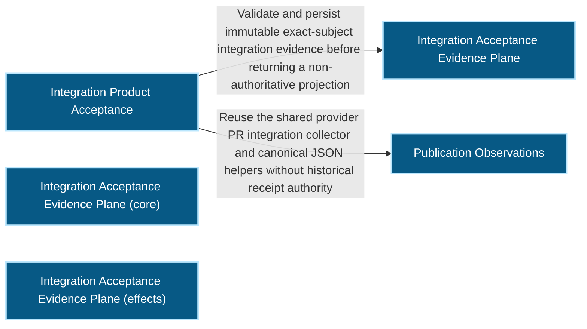
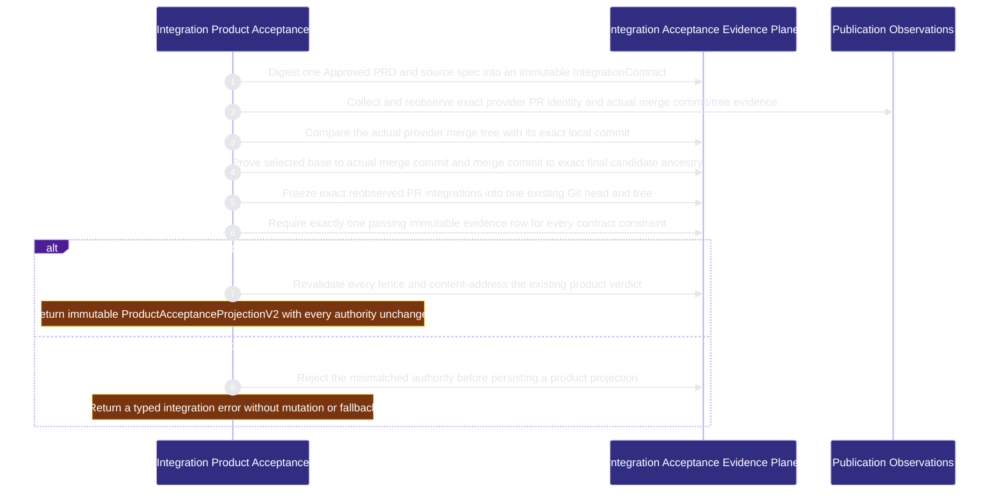

<!-- BEGIN ARCHCONTEXT:generated target="projection_target.entity.capability-runtime-harness-integration-acceptance" rendererVersion="archcontext.docs-renderer/v6" outputDigest="sha256:18d41c267499efee3f1d8bfc37b0fce9d0e47e84f090daf668527994360c0435" -->
> **狀態**:`active`
> **Capability ID**:`capability.runtime-harness.integration-acceptance`(kind `capability`)
> **Matched Prefixes**:`src/core/integration/product-acceptance.ts`、`src/effects/integration/product-acceptance.ts`、`src/cli/commands/integration.ts`
> **Local Contracts**:`AGENTS.md`、`CLAUDE.md`
> **事實優先級**:倉庫當前狀態 > 本文檔機器區 > 本文檔人工區。機器區(引言、§1、§2)由 ArchContext 從架構模型與源碼度量投影生成,手改會在下次投影被覆蓋。本文檔不記錄出處;本次投影所驗證的 commit 見 `docs/architecture/.projection-manifest.json`。

Binds approved requirement bytes, explicit canonical provider PR integration proofs, one exact Git candidate, evidence and the canonical acceptance receipt into immutable V2 product projections.

## 1. P1:能力架構地圖

### 1.1 架構圖

- Proof: `proven` (`sha256:0213bb5b958a9dc9fbcb37a0bcb81b3703994f7e58db6a40b7c07ec2de19b69e`).
- Semantic nodes: `5`; declared relations: `2`.

### 1.2 模組職責表

| 宣告入口 | 錨點 | 職責 |
| --- | --- | --- |
| `entrypoint.integration-acceptance.contract` | `src/effects/integration/product-acceptance.ts#createIntegrationContract` | `sink.integration-acceptance.contract-schema` → `src/core/integration/product-acceptance.ts#buildIntegrationContract` |
| `entrypoint.integration-acceptance.envelope` | `src/effects/integration/product-acceptance.ts#observeSelectedPullRequest` | `sink.integration-acceptance.local-merge-tree` → `src/effects/integration/product-acceptance.ts#treeForCommit`、`sink.integration-acceptance.local-ancestry` → `src/effects/integration/product-acceptance.ts#assertAncestor` |
| `entrypoint.integration-acceptance.envelope` | `src/effects/integration/product-acceptance.ts#buildCurrentEnvelope` | `sink.integration-acceptance.envelope-schema` → `src/core/integration/product-acceptance.ts#buildIntegrationEnvelope` |
| `entrypoint.integration-acceptance.publication-observation` | `src/effects/integration/product-acceptance.ts#observeSelectedPullRequest` | `sink.integration-acceptance.provider-integration` → `src/effects/publication/merge-readiness.ts#collectPullRequestIntegration` |
| `entrypoint.integration-acceptance.matrix` | `src/effects/integration/product-acceptance.ts#createAcceptanceMatrix` | `sink.integration-acceptance.matrix-schema` → `src/core/integration/product-acceptance.ts#assertCompletePassingMatrix` |
| `entrypoint.integration-acceptance.product` | `src/effects/integration/product-acceptance.ts#createProductAcceptanceProjection` | `sink.integration-acceptance.product-schema` → `src/core/integration/product-acceptance.ts#buildProductAcceptanceProjection` |
| `entrypoint.integration-acceptance.product-command` | `src/cli/commands/integration.ts#buildIntegrationCommand` | `sink.integration-acceptance.product-operation` → `src/effects/integration/product-acceptance.ts#createProductAcceptanceProjection` |
| `entrypoint.integration-acceptance.contract-canonical` | `src/core/integration/product-acceptance.ts#buildIntegrationContract` | `sink.integration-acceptance.contract-canonical` → `src/core/publication/publication-receipt.ts#stablePublicationJson` |
| `entrypoint.integration-acceptance.envelope-canonical` | `src/core/integration/product-acceptance.ts#buildIntegrationEnvelope` | `sink.integration-acceptance.envelope-canonical` → `src/core/publication/publication-receipt.ts#stablePublicationJson` |
| `entrypoint.integration-acceptance.matrix-canonical` | `src/core/integration/product-acceptance.ts#buildAcceptanceMatrix` | `sink.integration-acceptance.matrix-canonical` → `src/core/publication/publication-receipt.ts#stablePublicationJson` |
| `entrypoint.integration-acceptance.product-canonical` | `src/core/integration/product-acceptance.ts#buildProductAcceptanceProjection` | `sink.integration-acceptance.product-canonical` → `src/core/publication/publication-receipt.ts#stablePublicationJson` |

組件入口:

- 組件均未宣告 `source.entrypoints`。

### 1.3 規模信號

- 規模量級:`2–5` 個文件 / `1000–2000` 行
- 匹配前綴:`src/core/integration/product-acceptance.ts`、`src/effects/integration/product-acceptance.ts`、`src/cli/commands/integration.ts`
- 推導:掃描 `source.include` 減 `source.exclude`,跳過 `.git/` 與 `node_modules/`,再按 1–2–5 階梯分桶。精確計數不入本文檔:量級足以回答「這個能力有多大」,而逐行計數會讓覆蓋範圍內任何一次源碼改動都改寫本文檔。

### 1.4 依賴邊界

出向關係:

- `calls` → `component.integration-acceptance.primary` — Validate and persist immutable exact-subject integration evidence before returning a non-authoritative projection
- `reads` → `capability.organization.publication` — Reuse the shared provider PR integration collector and canonical JSON helpers without historical receipt authority

入向關係:

- `reads` ← `capability.runtime-harness.engineer-scheduling` — Read ME-4C product acceptance projections as one closed dependency authority and never reconstruct acceptance from prose
- `depends-on` ← `capability.verification.evals-checks` — Test Integration Product Acceptance behavior through its source modules.
- `calls` ← `component.global-runtime-reconciliation.cli-root` — Register the integration command

組件出向關係:

- `component.integration-acceptance.primary`:
  - `calls` → `capability.verification.acceptance-review` — Locate the acceptance receipt for an integration candidate
  - `calls` → `capability.workflow-engine.execution-primitives` — Resolve the Git common directory for integration records
- `component.integration-acceptance.primary-core`:
  - 無。
- `component.integration-acceptance.primary-effects`:
  - 無。

### 1.5 組件結構

| 組件 | 名稱 | 規模量級 | 宣告入口 |
| --- | --- | --- | --- |
| `component.integration-acceptance.primary` | Integration Acceptance Evidence Plane | `1–2` 個文件 / `200–500` 行 | 未宣告 |
| `component.integration-acceptance.primary-core` | Integration Acceptance Evidence Plane (core) | `1–2` 個文件 / `200–500` 行 | 未宣告 |
| `component.integration-acceptance.primary-effects` | Integration Acceptance Evidence Plane (effects) | `1–2` 個文件 / `500–1000` 行 | 未宣告 |

## 2. P2:端到端數據流

> **Proof**: `proven` (`sha256:0213bb5b958a9dc9fbcb37a0bcb81b3703994f7e58db6a40b7c07ec2de19b69e`); selectors `7/7`.

<!-- END ARCHCONTEXT:generated target="projection_target.entity.capability-runtime-harness-integration-acceptance" -->
