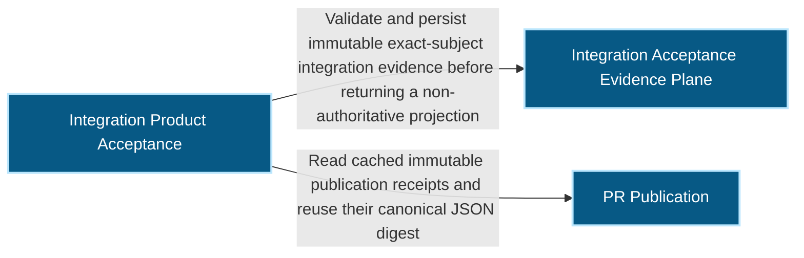
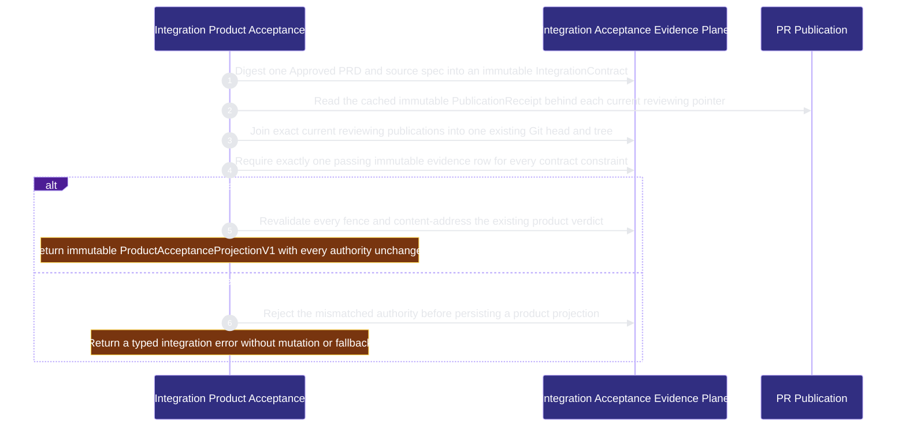

# runtime-harness/integration-acceptance 架構文檔

<!-- BEGIN ARCHCONTEXT:generated target="projection_target.entity.capability-runtime-harness-integration-acceptance" rendererVersion="archcontext.docs-renderer/v6" outputDigest="sha256:98217ca34aee950a6e7efbd0cfcf40d8eb6b6edbcb185a3dbc82ae1a690f2278" -->
> **狀態**:`active`
> **Capability ID**:`capability.runtime-harness.integration-acceptance`(kind `capability`)
> **Matched Prefixes**:`src/core/integration/product-acceptance.ts`、`src/effects/integration/product-acceptance.ts`、`src/cli/commands/integration.ts`
> **Local Contracts**:`AGENTS.md`、`CLAUDE.md`
> **事實優先級**:倉庫當前狀態 > 本文檔機器區 > 本文檔人工區。機器區(引言、§1、§2)由 ArchContext 從架構模型與源碼度量投影生成,手改會在下次投影被覆蓋。本文檔不記錄出處;本次投影所驗證的 commit 見 `docs/architecture/.projection-manifest.json`。

Binds Approved requirement bytes, current module publications, one existing Git candidate, exact evidence and the existing AcceptanceReceipt into immutable product-acceptance projections without creating merge or verdict authority.

## 1. P1:能力架構地圖

### 1.1 架構圖

- Proof: `proven` (`sha256:71a91f44f5cc2e16b65f31bc4a6c13e95a280db04db51b835ee8b0736bff35e1`).
- Semantic nodes: `3`; declared relations: `2`.

### 1.2 模組職責表

| 宣告入口 | 錨點 | 職責 |
| --- | --- | --- |
| `entrypoint.integration-acceptance.contract` | `src/effects/integration/product-acceptance.ts#createIntegrationContract` | `sink.integration-acceptance.contract-schema` → `src/core/integration/product-acceptance.ts#buildIntegrationContract` |
| `entrypoint.integration-acceptance.envelope` | `src/effects/integration/product-acceptance.ts#createIntegrationEnvelope` | `sink.integration-acceptance.lease` → `src/effects/state/coordination-lease-store.ts#readLease`、`sink.integration-acceptance.publication` → `src/effects/publication/publication-receipt.ts#readPublicationReceiptCache`、`sink.integration-acceptance.envelope-schema` → `src/core/integration/product-acceptance.ts#buildIntegrationEnvelope` |
| `entrypoint.integration-acceptance.publication-observation` | `src/effects/integration/product-acceptance.ts#observeSelectedPublication` | `sink.integration-acceptance.publication-cache` → `src/effects/publication/publication-receipt.ts#readPublicationReceiptCache` |
| `entrypoint.integration-acceptance.matrix` | `src/effects/integration/product-acceptance.ts#createAcceptanceMatrix` | `sink.integration-acceptance.matrix-schema` → `src/core/integration/product-acceptance.ts#assertCompletePassingMatrix` |
| `entrypoint.integration-acceptance.product` | `src/effects/integration/product-acceptance.ts#createProductAcceptanceProjection` | `sink.integration-acceptance.acceptance` → `scripts/acceptance-receipt.ts#verifyAcceptance`、`sink.integration-acceptance.product-schema` → `src/core/integration/product-acceptance.ts#buildProductAcceptanceProjection` |
| `entrypoint.integration-acceptance.contract-canonical` | `src/core/integration/product-acceptance.ts#buildIntegrationContract` | `sink.integration-acceptance.contract-canonical` → `src/core/publication/publication-receipt.ts#stablePublicationJson` |
| `entrypoint.integration-acceptance.envelope-canonical` | `src/core/integration/product-acceptance.ts#buildIntegrationEnvelope` | `sink.integration-acceptance.envelope-canonical` → `src/core/publication/publication-receipt.ts#stablePublicationJson` |
| `entrypoint.integration-acceptance.matrix-canonical` | `src/core/integration/product-acceptance.ts#buildAcceptanceMatrix` | `sink.integration-acceptance.matrix-canonical` → `src/core/publication/publication-receipt.ts#stablePublicationJson` |
| `entrypoint.integration-acceptance.product-canonical` | `src/core/integration/product-acceptance.ts#buildProductAcceptanceProjection` | `sink.integration-acceptance.product-canonical` → `src/core/publication/publication-receipt.ts#stablePublicationJson` |

組件入口:

- 組件均未宣告 `source.entrypoints`。

### 1.3 規模信號

- 規模量級:`2–5` 個文件 / `1000–2000` 行
- 匹配前綴:`src/core/integration/product-acceptance.ts`、`src/effects/integration/product-acceptance.ts`、`src/cli/commands/integration.ts`
- 推導:掃描 `source.include` 減 `source.exclude`,跳過 `.git/` 與 `node_modules/`,再按 1–2–5 階梯分桶。精確計數不入本文檔:量級足以回答「這個能力有多大」,而逐行計數會讓覆蓋範圍內任何一次源碼改動都改寫本文檔。

### 1.4 依賴邊界

出向關係:

- `calls` → `component.integration-acceptance.primary` — Validate and persist immutable exact-subject integration evidence before returning a non-authoritative projection
- `reads` → `capability.organization.publication` — Read cached immutable publication receipts and reuse their canonical JSON digest

入向關係:

- `reads` ← `capability.runtime-harness.engineer-scheduling` — Read ME-4C product acceptance projections as one closed dependency authority and never reconstruct acceptance from prose
- `calls` ← `component.global-runtime-reconciliation.cli-root` — Register the integration command

組件出向關係:

- `component.integration-acceptance.primary`:
  - `calls` → `capability.verification.acceptance-review` — Locate the acceptance receipt for an integration candidate
  - `calls` → `capability.workflow-engine.execution-primitives` — Resolve the Git common directory for integration records
  - `reads` → `capability.workflow-engine.workflow-state` — Read the task lease for the integration envelope

### 1.5 組件結構

| 組件 | 名稱 | 規模量級 | 宣告入口 |
| --- | --- | --- | --- |
| `component.integration-acceptance.primary` | Integration Acceptance Evidence Plane | `2–5` 個文件 / `1000–2000` 行 | 未宣告 |

## 2. P2:端到端數據流

> **Proof**: `proven` (`sha256:71a91f44f5cc2e16b65f31bc4a6c13e95a280db04db51b835ee8b0736bff35e1`); selectors `5/5`.

<!-- END ARCHCONTEXT:generated target="projection_target.entity.capability-runtime-harness-integration-acceptance" -->

## 3. P3:設計決策與不變量

### 3.1 必须保持的不变量

1. **组合候选是一个已存在的 Git commit 与 tree。** Envelope 证明 base 与每个选中的 publication head 都是该候选的祖先。本能力从不构造或排序合并（`tasks/archive/notes-20260826-0246-me4c-integration-product-acceptance.md`，PRD `plans/prds/20260824-1653-integration-product-acceptance.prd.md:21`）。
2. **`AcceptanceReceipt` 是唯一的产品裁决。** `ProductAcceptanceProjectionV1` 只验证并引用现有的 protocol-2 receipt。它不能签发、豁免、合并或改变验收状态（notes，PRD `:21`）。
3. **每个可变读取都绑定确切的字节与摘要。** 范围包括 Approved PRD 与 spec、仓库身份、当前 publication 指针、reviewing lease 观察、缓存的不可变 PublicationReceipt、Git refs 与 tree、matrix 证据与 target revision（notes）。
4. **只冻结当前 reviewing 的 publication。** 它们的不可变 receipt 必须包含在同一个确切的 commit 与 tree 中（capability responsibilities）。
5. **记录不可变且按内容寻址。** IntegrationContract、IntegrationEnvelope、AcceptanceMatrix 与 ProductAcceptanceProjection 存在 git common dir 下，没有可变的当前指针（notes，`src/effects/integration/product-acceptance.ts:340-345`）。
6. **拒绝 symlink 证据。** CLI 输入边界与仓库证据边界都拒绝词法与解析后的 symlink，防止之后重定向改变已冻结的主体（notes）。
7. **本能力不改任何权威。** CLI 只做 build、read 与 accept。它不构造合并，也不改 Task、Lease、Publication 或 Acceptance 状态（capability responsibilities）。

### 3.2 关键权衡

| 决策 | 权衡 |
| --- | --- |
| 不在本能力内构造合并候选 | Git 已拥有 commit 构造与排序。加入合并副作用会扩大权威与回滚范围（notes） |
| 不引入第二个产品裁决 | 已验证的 `AcceptanceReceipt` 是权威。第二个签发者会产生无法调和的双重事实（notes） |
| 不存可变的集成指针 | 内容寻址加显式 ID 足以支持有界的本地 CLI，也不引入新的协调平面（notes） |
| Accept 时重读并重新验证所有围栏 | 代价是重复的 Git 与文件系统读取。收益是陈旧的指针、证据、需求与候选都 fail closed（notes） |
| 复用 publication 的 `stablePublicationJson` 与 `publicationSha256` 计算摘要 | 摘要规则与 publication receipt 一致。代价：本能力依赖 publication 的 core 模块 |

### 3.3 消费方

- Engineer scheduling 的 dependency authority 读取本能力持久化的投影来回答 `product_accepted`（`docs/spec.md:255`，#298）。它从不重新计算产品裁决。

## 4. 歷史決策記錄(append-only)

### ME-4C 交付 (2026-08-26, `03db824d`)

- P3：组合候选、单一裁决与内容寻址这三条决定见 notes 的 Tradeoffs 表。

### CLI 归属与 publication 依赖进入模型 (2026-10-11)

- P1：`src/cli/commands/integration.ts` 此前没有 owner。它只调用本能力的模块。
- P3：这次变更把它加入 capability 与 primary 组件。Flow 增加读取 PublicationReceipt 缓存的一步，并声明 integration-acceptance → publication 关系。

## Optimization Backlog

- **一个已声明的 selector 无法证明。** `entrypoint.integration-acceptance.envelope` 声明 `createIntegrationEnvelope` → `readPublicationReceiptCache`。CodeGraph 没有这条直接 `calls` 边，真实调用者是私有函数 `observeSelectedPublication`。这次变更为 flow 新增了正确的入口，旧声明未改。下一次模型变更应删除或修正旧 sink。
- **验证命令不符合仓库约定。** Capability 的 verification 用 `bun test ... --timeout 60000`。仓库约定是 `bun run test:files <files> --timeout 60000 --max-concurrency 1`（`CLAUDE.md` Testing）。
