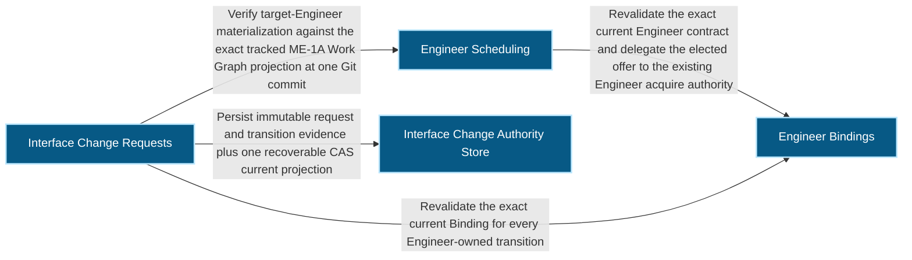
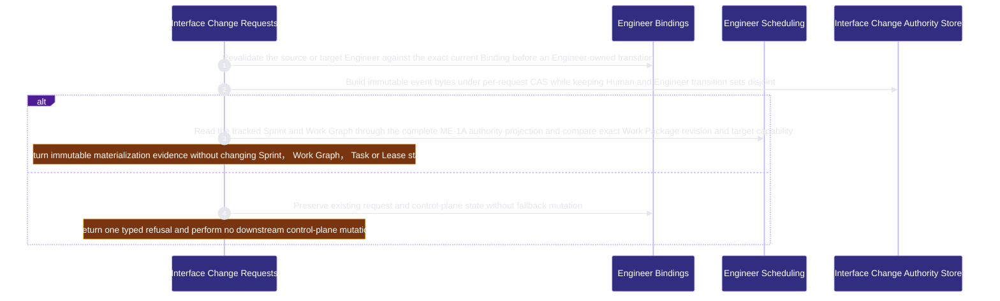

# runtime-harness/interface-change 架構文檔

<!-- BEGIN ARCHCONTEXT:generated target="projection_target.entity.capability-runtime-harness-interface-change" sourceDigest="sha256:ca373de475c2677957aa7916ac8760fbbb8331ae6695d22dbc72fe6851fb7fbd" rendererVersion="archcontext.docs-renderer/v5" outputDigest="sha256:e449adf6559a72debbc929d60707a1a9b16045298edf80c2c1fefb6d06742722" -->
> **狀態**:`active`
> **Capability ID**:`capability.runtime-harness.interface-change`(kind `capability`)
> **Matched Prefixes**:`src/core/engineers/interface-change.ts`、`src/effects/engineers/interface-change-store.ts`、`src/cli/commands/interface-change.ts`
> **Local Contracts**:`AGENTS.md`、`CLAUDE.md`
> **事實優先級**:倉庫當前狀態 > 本文檔機器區 > 本文檔人工區。機器區(引言、§1、§2)由 ArchContext 從架構模型與源碼度量投影生成,手改會在下次投影被覆蓋。本文檔不記錄出處;本次投影所驗證的 commit 見 `docs/architecture/.projection-manifest.json`。

Owns revision-fenced cross-capability interface decisions and exact planning materialization evidence without becoming scheduling, code, runtime or acceptance authority.

## 1. P1:能力架構地圖

### 1.1 架構圖

- Proof: `proven` (`sha256:5fe08894ae4d2243fad3a24295426db63eebe8a664b995833390692a8bc17a58`).
- Semantic nodes: `4`; declared relations: `4`.

### 1.2 模組職責表

| 宣告入口 | 錨點 | 職責 |
| --- | --- | --- |
| `entrypoint.interface-change.binding-fence` | `src/effects/engineers/interface-change-store.ts#validateEngineerActor` | `sink.interface-change.binding` → `src/effects/engineers/binding-store.ts#readEngineerBindingStatus` |
| `entrypoint.interface-change.event-canonical` | `src/core/engineers/interface-change.ts#buildInterfaceChangeEvent` | `sink.interface-change.event-digest` → `src/core/messages/mechanics.ts#canonicalMessageDigest` |
| `entrypoint.interface-change.work-graph` | `src/effects/engineers/interface-change-store.ts#projectedGraphAt` | `sink.interface-change.work-graph` → `src/effects/engineers/scheduling.ts#readTrackedWorkGraphProjectionAt` |
| `entrypoint.interface-change.reverse-lookup` | `src/effects/engineers/interface-change-store.ts#findInterfaceChangesByWorkPackage` | `sink.interface-change.accepted-projection` → `src/core/engineers/interface-change.ts#validateInterfaceWorkPackageProjection` |

### 1.3 規模信號

- 規模量級:`2–5` 個文件 / `1000–2000` 行
- 匹配前綴:`src/core/engineers/interface-change.ts`、`src/effects/engineers/interface-change-store.ts`、`src/cli/commands/interface-change.ts`
- 推導:掃描 `source.include` 減 `source.exclude`,跳過 `.git/` 與 `node_modules/`,再按 1–2–5 階梯分桶。精確計數不入本文檔:量級足以回答「這個能力有多大」,而逐行計數會讓覆蓋範圍內任何一次源碼改動都改寫本文檔。

### 1.4 依賴邊界

出向關係:

- `calls` → `capability.runtime-harness.engineer-bindings` — Revalidate the exact current Binding for every Engineer-owned transition
- `calls` → `capability.runtime-harness.engineer-scheduling` — Verify target-Engineer materialization against the exact tracked ME-1A Work Graph projection at one Git commit
- `calls` → `capability.workflow-engine.execution-primitives` — Hold exclusive directory locks under the Git common directory
- `calls` → `component.interface-change.primary` — Persist immutable request and transition evidence plus one recoverable CAS current projection
- `reads` → `capability.workflow-engine.workflow-state` — Read the canonical target ref for an interface change

入向關係:

- `calls` ← `component.global-runtime-reconciliation.cli-root` — Register the interface-change command
- `calls` ← `capability.runtime-harness.mcp-sidecar` — Expose only authenticated Engineer propose, submit, cancel, materialize and implemented mutations through the server-derived OAuth principal

## 2. P2:端到端數據流

> **Proof**: `proven` (`sha256:5fe08894ae4d2243fad3a24295426db63eebe8a664b995833390692a8bc17a58`); selectors `3/3`.

<!-- END ARCHCONTEXT:generated target="projection_target.entity.capability-runtime-harness-interface-change" -->

## 3. P3:設計決策與不變量

### 3.1 必须保持的不变量

1. **请求和它的事件链是唯一的接口决策权威。** `InterfaceWorkPackageProjectionV1` 只是向规划权威提交的提案。它不能被调度，也不授权改代码（`plans/prds/20260824-1653-interface-change-request.prd.md` Authority and Projection Closure）。
2. **actor 矩阵是封闭的。** `propose`/`submit` 只接受请求方 Engineer 的精确 fence。`materialize`/`implemented` 只接受目标 Engineer。`accept`/`reject`/`integrated` 只接受 Human。`cancel` 接受请求方 Engineer 或 Human（`src/core/engineers/interface-change.ts:241-259`）。目标 Engineer 不能自己 integrate。
3. **`materialize` 只验证，不写入。** `verifyMaterialization` 读取精确 commit 和它的第一个 parent，比较 Work Graph revision、Work Package id、revision 和 `primary_capability`（`src/effects/engineers/interface-change-store.ts:296-318`）。Sprint 和 Work Graph 仍由既有规划权威写入。
4. **Engineer 转换先持 Binding 锁，再持请求锁。** Engineer actor 在 `withEngineerBindingLock` 内重新校验 Binding，再进入请求锁。Binding 在中途变化会返回 `interface_change_store_conflict`（`interface-change-store.ts:403-414`）。Human actor 只持请求锁。
5. **事件先于 current 持久化，重试可恢复。** 新转换先写 request、projection、transition 和 event，再替换 `current.json`。同一 idempotency key 的重试必须重建出相同 event 字节，否则显式冲突（`interface-change-store.ts:368-398`）。
6. **ArchContext 事件不推进请求。** 架构漂移事件只是下游观测，不能 accept、reject 或 integrate 请求（PRD Architecture decision）。

### 3.2 关键权衡

| 决策 | 权衡 |
| --- | --- |
| 接受时只持久化一份不可变的规划投影，不直接改 Sprint | 规划权威保持唯一，请求与 Work Package 不会成为两个权威；代价是需要第二步 Human 批准的 Git 规划事务 |
| 反向查找（Work Package → 请求）用扫描构建，不写进 `WorkPackageDefinitionV1` | ME-1A 的 wire 语义不变；代价是 `findInterfaceChangesByWorkPackage` 每次扫描全部请求目录（`interface-change-store.ts:449-487`） |
| 产品入口按 actor 分开：Engineer 走认证 MCP，Human 走 CLI | 服务端派生 Engineer 主体，CLI 不接受 Engineer authorization id（PRD Frozen Actor Matrix）；代价是同一请求的生命周期跨两个入口 |

### 3.3 10x 规模下先坏的点

- 反向查找是对 `state/` 的线性扫描，每个请求读一次 `current.json`。请求数量增长后它先变慢。请求锁按请求分，转换之间不竞争。

## 4. 歷史決策記錄(append-only)

| 日期 | 决策 | 依据 |
| --- | --- | --- |
| 2026-08-27 | 建立 ME-4B 接口变更权威：请求、事件、current、规划投影和 actor 矩阵 | commit `d634cab1`；`plans/archive/plan-20260826-1617-me4b-interface-change-request.md`；`plans/prds/20260824-1653-interface-change-request.prd.md` |

## Optimization Backlog

- after arch-context#296：`src/core/engineers/interface-change.ts` 和 `src/effects/engineers/interface-change-store.ts` 同时被 engineer-bindings 的 `src/{core,effects}/engineers/**` 认领。目标单一所有者是本能力（`ownership-proposal` §2）。
- 本能力调用 `src/effects/state/collect-board-inputs.ts` 的 `readCanonicalTargetRef`，以及 `src/effects/{locking,git}`。集成步骤声明了 interface-change → workflow-state（`reads`）与 → execution-primitives。
- P2 flow 的 `buildInterfaceChangeEvent` 步骤指向本能力的 store 组件，但它的 sink `canonicalMessageDigest` 位于 engineer-messages 所有的 `src/core/messages/mechanics.ts`。共享原语的归属见 engineer-messages 的 Backlog。
