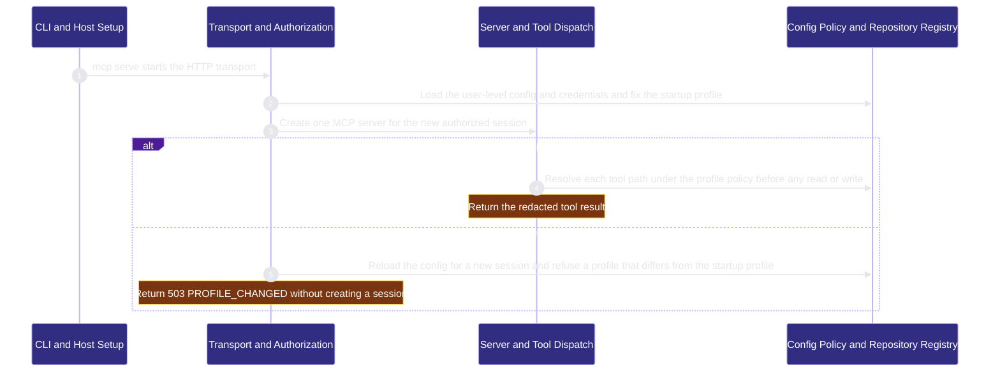
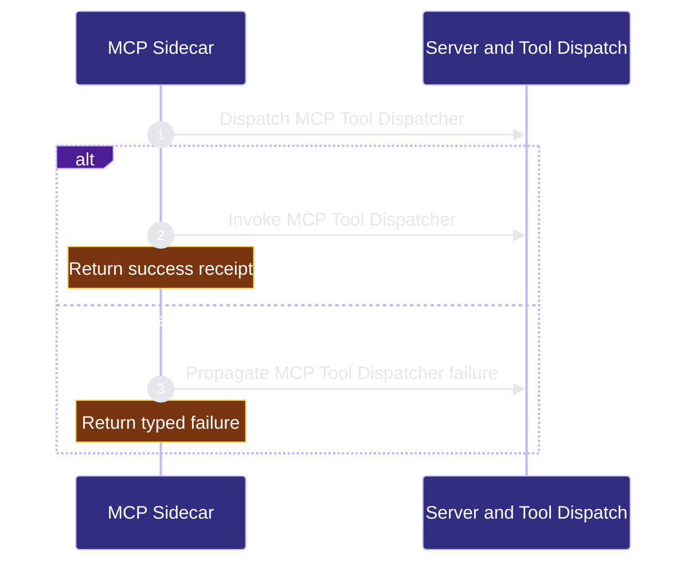

# runtime-harness/mcp-sidecar 架构文档
<!-- BEGIN ARCHCONTEXT:generated target="projection_target.entity.capability-runtime-harness-mcp-sidecar" rendererVersion="archcontext.docs-renderer/v6" outputDigest="sha256:6fea5fcd565ec7886cf9020fcb259e1732ddfd6521f25747e3d3473d79f57983" -->
> **狀態**:`active`
> **Capability ID**:`capability.runtime-harness.mcp-sidecar`(kind `capability`)
> **Matched Prefixes**:`src/cli/mcp/**`、`src/cli/commands/mcp.ts`、`src/cli/chatgpt-browser/file-policy.ts`、`docs/repo-harness-chatgpt-mcp-setup.md`、`docs/reference-configs/chatgpt-coding-mcp.md`、`docs/reference-configs/herdr-orchestrator-mcp.md`
> **Local Contracts**:`AGENTS.md`、`CLAUDE.md`
> **事實優先級**:倉庫當前狀態 > 本文檔機器區 > 本文檔人工區。機器區(引言、§1、§2)由 ArchContext 從架構模型與源碼度量投影生成,手改會在下次投影被覆蓋。本文檔不記錄出處;本次投影所驗證的 commit 見 `docs/architecture/.projection-manifest.json`。

Provides the local MCP sidecar and its repository access policy boundary.

## 1. P1:能力架構地圖

### 1.1 架構圖

```mermaid
flowchart LR
  p1_capability_runtime_harness_mcp_sidecar_4e12aaf3["MCP Sidecar"]:::component
  p1_component_mcp_sidecar_coding_profile_c04b21a1["Coding Profile Runtime"]:::component
  p1_component_mcp_sidecar_host_setup_a05a1958["CLI and Host Setup"]:::component
  p1_component_mcp_sidecar_primary_8f9b418c["Server and Tool Dispatch"]:::component
  p1_component_mcp_sidecar_repo_policy_registry_40f1ea26["Config Policy and Repository Registry"]:::component
  p1_component_mcp_sidecar_repo_policy_registry_effects_6c93657b["Bot Registry (effects)"]:::component
  p1_component_mcp_sidecar_transport_auth_2511e63e["Transport and Authorization"]:::component
  p1_component_mcp_sidecar_coding_profile_c04b21a1 -->|"Contain workspace paths against registered roots then redact and audit coding results"| p1_component_mcp_sidecar_repo_policy_registry_40f1ea26
  p1_component_mcp_sidecar_host_setup_a05a1958 -->|"List and clean up managed coding workspaces"| p1_component_mcp_sidecar_coding_profile_c04b21a1
  p1_component_mcp_sidecar_host_setup_a05a1958 -->|"Build the expected tool inventory for the live doctor and run prepare-goal through the tool dispatcher"| p1_component_mcp_sidecar_primary_8f9b418c
  p1_component_mcp_sidecar_host_setup_a05a1958 -->|"Write the user-level config and credentials and set repository access grants"| p1_component_mcp_sidecar_repo_policy_registry_40f1ea26
  p1_component_mcp_sidecar_host_setup_a05a1958 -->|"Start the stdio or HTTP transport for mcp serve"| p1_component_mcp_sidecar_transport_auth_2511e63e
  p1_capability_runtime_harness_mcp_sidecar_4e12aaf3 -->|"Dispatch an MCP tool call"| p1_component_mcp_sidecar_primary_8f9b418c
  p1_component_mcp_sidecar_primary_8f9b418c -->|"Build and dispatch the coding tool block and its process runtime"| p1_component_mcp_sidecar_coding_profile_c04b21a1
  p1_component_mcp_sidecar_primary_8f9b418c -->|"Resolve repositories and paths under the profile policy then redact and audit each result"| p1_component_mcp_sidecar_repo_policy_registry_40f1ea26
  p1_component_mcp_sidecar_transport_auth_2511e63e -->|"Create one MCP server per authorized session and dispatch its tool calls"| p1_component_mcp_sidecar_primary_8f9b418c
  p1_component_mcp_sidecar_transport_auth_2511e63e -->|"Load the local config and credentials at startup and recheck the profile on each new session"| p1_component_mcp_sidecar_repo_policy_registry_40f1ea26
  classDef actor fill:#111827,color:#ffffff,stroke:#f9fafb,stroke-width:2px
  classDef component fill:#075985,color:#ffffff,stroke:#bae6fd,stroke-width:2px
  classDef datastore fill:#3f6212,color:#ffffff,stroke:#d9f99d,stroke-width:2px
  classDef external fill:#7c2d12,color:#ffffff,stroke:#fed7aa,stroke-width:2px
```

- Proof: `proven` (`sha256:b436dffa4000f325342813cae0411c26528dbefa2a4ffb3612bf61f53fae55d6`).
- Semantic nodes: `7`; declared relations: `10`.

### 1.2 模組職責表

| 宣告入口 | 錨點 | 職責 |
| --- | --- | --- |
| `entrypoint.mcp-sidecar.primary` | `src/cli/mcp/server.ts#createRepoHarnessMcpServer` | `sink.mcp-sidecar.primary` → `src/cli/mcp/tools.ts#callMcpTool` |

組件入口:

| 組件 | 宣告入口 | 錨點 | 職責 |
| --- | --- | --- | --- |
| `component.mcp-sidecar.host-setup` | `entrypoint.mcp-sidecar.cli` | `src/cli/commands/mcp.ts#buildMcpCommand` | `sink.mcp-sidecar.http-start` → `src/cli/mcp/transports/http.ts#startMcpHttp` |
| `component.mcp-sidecar.primary` | `entrypoint.mcp-sidecar.tool-dispatch` | `src/cli/mcp/tools.ts#callMcpTool` | `sink.mcp-sidecar.path-policy` → `src/cli/mcp/paths.ts#resolveMcpPath` |
| `component.mcp-sidecar.transport-auth` | `entrypoint.mcp-sidecar.http-transport` | `src/cli/mcp/transports/http.ts#startMcpHttp` | `sink.mcp-sidecar.startup-config` → `src/cli/mcp/auth.ts#loadMcpLocalConfig` |
| `component.mcp-sidecar.transport-auth` | `entrypoint.mcp-sidecar.http-transport` | `src/cli/mcp/transports/http.ts#handleMcpPost` | `sink.mcp-sidecar.session-server` → `src/cli/mcp/server.ts#createRepoHarnessMcpServer`、`sink.mcp-sidecar.request-config` → `src/cli/mcp/auth.ts#loadMcpLocalConfig` |

### 1.3 規模信號

- 規模量級:`20–50` 個文件 / `10k–20k` 行
- 匹配前綴:`src/cli/mcp/**`、`src/cli/commands/mcp.ts`、`src/cli/chatgpt-browser/file-policy.ts`、`docs/repo-harness-chatgpt-mcp-setup.md`、`docs/reference-configs/chatgpt-coding-mcp.md`、`docs/reference-configs/herdr-orchestrator-mcp.md`
- 排除前綴:`src/cli/mcp/codegraph-adapter.ts`、`src/cli/mcp/general-repo-access.ts`、`src/cli/mcp/general-repo-access/**`
- 推導:掃描 `source.include` 減 `source.exclude`,跳過 `.git/` 與 `node_modules/`,再按 1–2–5 階梯分桶。精確計數不入本文檔:量級足以回答「這個能力有多大」,而逐行計數會讓覆蓋範圍內任何一次源碼改動都改寫本文檔。

### 1.4 依賴邊界

出向關係:

- `deployed-on` → `process.mcp-server` — The MCP sidecar runs in the MCP server process.
- `depends-on` → `capability.workflow-engine.contract-assets` — Run declared helpers from MCP tools.
- `calls` → `component.mcp-sidecar.primary` — Dispatch an MCP tool call

入向關係:

- `depends-on` ← `capability.runtime-mcp.chatgpt-browser` — Apply shared file policy to browser prompts and sessions.
- `depends-on` ← `capability.verification.evals-checks` — Test MCP Sidecar behavior through its source modules.
- `calls` ← `component.global-runtime-reconciliation.cli-root` — Register the mcp command
- `reads` ← `component.operator.console-collectors` — Run mcp doctor without live registration and read the Bot registry, the OAuth token store and the newest audit rows for Bot access.

組件出向關係:

- `component.mcp-sidecar.coding-profile`:
  - `calls` → `capability.verification.codegraph-readiness` — Refresh the CodeGraph index after coding mutations
  - `calls` → `capability.workflow-engine.execution-primitives` — Use the configured Git binary for coding workspaces
  - `calls` → `component.mcp-sidecar.repo-policy-registry` — Contain workspace paths against registered roots then redact and audit coding results
  - `calls` → `capability.runtime-harness.task-agent-host` — Clean up task worktrees for coding workspaces
  - `calls` → `capability.workflow-engine.workflow-state` — Clean up exact worktrees under the system worktree root
- `component.mcp-sidecar.host-setup`:
  - `calls` → `capability.runtime-mcp.chatgpt-browser` — Read the canonical ChatGPT bridge reference from the packaged skill source
  - `calls` → `component.mcp-sidecar.coding-profile` — List and clean up managed coding workspaces
  - `calls` → `capability.workflow-engine.execution-primitives` — Hold the MCP setup ownership lock
  - `calls` → `capability.runtime-harness.hook-adapters` — Reuse installer configuration ownership receipts and the runtime host lock
  - `calls` → `component.mcp-sidecar.primary` — Build the expected tool inventory for the live doctor and run prepare-goal through the tool dispatcher
  - `writes` → `component.mcp-sidecar.repo-policy-registry` — Write the user-level config and credentials and set repository access grants
  - `calls` → `component.mcp-sidecar.transport-auth` — Start the stdio or HTTP transport for mcp serve
- `component.mcp-sidecar.primary`:
  - `calls` → `capability.runtime-mcp.chatgpt-browser` — Run the opt-in browser consult tools through the ChatGPT browser engine
  - `calls` → `capability.verification.codegraph-readiness` — Construct the CodeGraph index adapter with repo-local binaries refused
  - `calls` → `component.mcp-sidecar.coding-profile` — Build and dispatch the coding tool block and its process runtime
  - `calls` → `capability.workflow-engine.execution-primitives` — Read the worktree topology for the PM server scope
  - `calls` → `capability.runtime-mcp.general-repo-access` — Dispatch the general repository reader and writer tools
  - `calls` → `capability.organization.publication` — Reopen and take over publications and read merge readiness
  - `calls` → `component.mcp-sidecar.repo-policy-registry` — Resolve repositories and paths under the profile policy then redact and audit each result
  - `calls` → `capability.runtime-harness.task-agent-host` — Start task agents, send task requests, and list, prompt and read in-scope agent panes through Herdr
  - `calls` → `capability.organization.task-fleet` — Acquire fleet tasks and handle task steers from the MCP tools
  - `reads` → `capability.workflow-engine.workflow-state` — Resolve effective state read-only for the state MCP tools
- `component.mcp-sidecar.repo-policy-registry`:
  - `calls` → `capability.workflow-engine.execution-primitives` — Run Git for repository roots and lock guarded writes
- `component.mcp-sidecar.repo-policy-registry-effects`:
  - 無。
- `component.mcp-sidecar.transport-auth`:
  - `calls` → `component.mcp-sidecar.primary` — Create one MCP server per authorized session and dispatch its tool calls
  - `reads` → `component.mcp-sidecar.repo-policy-registry` — Load the local config and credentials at startup and recheck the profile on each new session

### 1.5 組件結構

| 組件 | 名稱 | 規模量級 | 宣告入口 |
| --- | --- | --- | --- |
| `component.mcp-sidecar.coding-profile` | Coding Profile Runtime | `2–5` 個文件 / `2000–5000` 行 | 未宣告 |
| `component.mcp-sidecar.host-setup` | CLI and Host Setup | `5–10` 個文件 / `2000–5000` 行 | `entrypoint.mcp-sidecar.cli` |
| `component.mcp-sidecar.primary` | Server and Tool Dispatch | `5–10` 個文件 / `2000–5000` 行 | `entrypoint.mcp-sidecar.tool-dispatch` |
| `component.mcp-sidecar.repo-policy-registry` | Config Policy and Repository Registry | `10–20` 個文件 / `1000–2000` 行 | 未宣告 |
| `component.mcp-sidecar.repo-policy-registry-effects` | Bot Registry (effects) | `1–2` 個文件 / `100–200` 行 | 未宣告 |
| `component.mcp-sidecar.transport-auth` | Transport and Authorization | `2–5` 個文件 / `1000–2000` 行 | `entrypoint.mcp-sidecar.http-transport` |

## 2. P2:端到端數據流

> **Proof**: `proven` (`sha256:b436dffa4000f325342813cae0411c26528dbefa2a4ffb3612bf61f53fae55d6`); selectors `6/6`.

<!-- END ARCHCONTEXT:generated target="projection_target.entity.capability-runtime-harness-mcp-sidecar" -->
## 3. P3：设计决策与不变量

### 3.1 必须保持的不变量

1. **单一存储权威。** MCP 配置只存在 `mcpStorageDir()/mcp.local.json`（`src/cli/mcp/auth.ts:34-40`）。repo 级配置已退役。仓库里还有 `.repo-harness/mcp.local.json` 时，serve 和 doctor 都拒绝启动（`assertNoLegacyRepoScopeMcpConfig`，`auth.ts:43`）。没有 read-through 回退。
2. **退役键 fail closed。** 配置里还有 `server`、`auth`、`chatgpt`、`coding`、`authorizationRevision`，或 `capabilities` 下的 `workspaceCoder`、`taskDispatch`、`publicationMerge`，或 `profile` 为 `orchestrator`、`coding` 时，解析抛出 `MCP_CONFIG_RETIRED_FIELD` 并列出这些键（`auth.ts:29-31`、`:73`）。没有命令改写这个文件。用户手动删除这些键。
3. **只有两个 profile。** `isMcpProfileName` 只接受 `planner` 和 `executor`（`src/cli/mcp/policy.ts:144`）。两个 profile 都没有 shell、OAuth 或 HTTP。transport 只有 stdio（`src/cli/mcp/transports/stdio.ts`）。
4. **doctor 只报告，不删除。** `runMcpDoctor`（`src/cli/mcp/doctor.ts:58`）不做 live 探测。旧 ChatGPT、OAuth 与 Codex MCP 文件还在时，它报告 `retired_chatgpt_state`，给出每个路径和删除命令（`retiredChatgptState`，`doctor.ts:33`）。它不删除 HOME 或用户仓库里的任何文件。
5. **授权真相在注册表。** `read_write` 授权存在 `registered-repos.json`。`repo-harness mcp access set` 写入它。registry 归 execution-primitives（见 §4 的 2026-11-01 条目）。
6. **MCP 只投影状态，不解释状态，也不写状态。** `summarize_repo_harness_state`（`src/cli/mcp/state-tools.ts`）与 hook 使用同一个只读解析器 `resolveEffectiveStateReadOnly`，工具声明 `readOnlyHint: true`。它报告最后发布的 `state_version`；只有 `repo-harness state resolve` 分配版本。
7. **PRD 写入有 revision 前置条件。** `write_prd` 与 `write_prd_from_idea` 经 `guardedWriteFile`（`src/cli/mcp/guarded-write.ts`）写入。替换已有文件需要 `expected_sha256`。

### 3.2 关键权衡

| 决策 | 权衡 |
| --- | --- |
| 删除 HTTP、OAuth、coding 与 orchestrator，只保留 stdio（#1354） | 没有远端 connector，也没有凭证存储。代价是 ChatGPT 与远端 Bot 不能再经本 sidecar 访问仓库。 |
| 退役键 fail closed，没有迁移命令 | 没有长期兼容代码。代价是升级后旧配置的 serve 和 doctor 会失败，直到用户手动删除这些键。 |
| `createMcpToolContext` 每个 server context 读一次配置（`src/cli/mcp/server.ts:56-59`） | stdio 进程只服务一个客户端，不需要每请求复核。代价是配置修改要重启 serve 才生效。 |

### 3.3 组件拆分（2026-10-11，2026-11-02 更新）

数据来源：`archctx refactor scan --json`（archctx 0.7.0）和一次相对 import 扫描。组件 footprint 写在各 component 节点的 `source.include` 里。行数为 `wc -l`，2026-11-02。

| 组件 | footprint | 文件 / 行 | 职责 |
| --- | --- | --- | --- |
| `component.mcp-sidecar.primary`（Server and Tool Dispatch） | `server.ts`、`tools.ts`、`state-tools.ts`、`fleet-tools.ts`、`instructions.ts`、`version.ts` | 6 / 1396 | 读配置，按 profile 建工具清单，把调用分派到 workflow、state、publication readiness 与 reader 工具块 |
| `component.mcp-sidecar.transport-auth`（Stdio Transport） | `transports/**` | 1 / 8 | stdio transport |
| `component.mcp-sidecar.repo-policy-registry` | `auth.ts`、`types.ts`、`policy.ts`、`paths.ts`、`repo.ts`、`redaction.ts`、`guarded-write.ts`、`workspaces.ts`、`audit.ts` | 9 / 1109 | 用户级配置、路径策略、脱敏、审计 |
| `component.mcp-sidecar.host-setup`（CLI and Doctor） | `src/cli/commands/mcp.ts`、`doctor.ts` | 2 / 205 | mcp CLI 与静态 doctor |

依赖方向：host-setup 调用 transport-auth，读 primary 与 repo-policy-registry。transport-auth 调用 primary。primary 调用 repo-policy-registry。组件之间没有反向边。

与归属提议 §5 的差异，原因来自 import 扫描：

- `auth.ts` 放进 repo-policy-registry。它是配置存储。`server.ts` 与 `doctor.ts` 都读它。
- `types.ts` 和 `audit.ts` 放进 repo-policy-registry。`types.ts` 只定义 `McpPolicy`、`McpPathDecision`、`McpAuditEntry` 等策略类型。`audit.ts` 只被工具处理器调用。
- `src/cli/commands/mcp.ts` 放进 host-setup。这个命令启动 transport。放进 primary 会形成 primary → transport-auth → primary 的环。

以下文件留在 capability include 上，不进任何组件：`reader-tools.ts`（general-repo-access 的声明入口）、`general-repo-access.ts` 与 `general-repo-access/**`（与 general-repo-access 重复归属）、`codegraph-adapter.ts`（与 codegraph-readiness 重复归属）和一份 research 文档。

组件到其他 capability 的关系不出现在 §1.4（渲染器缺口），这里列出：

- primary → general-repo-access：`tools.ts` 分派 reader 与 writer 工具。
- primary → publication：`fleet-tools.ts` 的 `publication_readiness` 读 merge readiness。
- host-setup → global-runtime-reconciliation：`doctor.ts` 用 `hostSkillRoot` 找旧 ChatGPT skill 链接。
- repo-policy-registry → hook-adapters：`audit.ts` 经共享 segmented log 追加审计行。
- capability → codegraph-readiness：`reader-tools.ts` 只导入适配器类型。

### 3.4 10x 规模下先垮的点

按当前实现，压力顺序是：

1. **`general-repo-access.ts` 的进程内快照缓存。** 上限是 `SNAPSHOT_TTL_MS = 5min`、`MAX_SNAPSHOT_CACHE_ENTRIES = 16`（`general-repo-access.ts:191-192`）。多个大仓交替访问时，快照命中率接近零，每次都全量 walk。
2. **每个 stdio 客户端一个进程。** 客户端数量增长时，进程数和每个进程的快照缓存同比增长。

### 3.5 已知张力

- 本 PR 后包里没有写 `mcp.local.json` 的命令。reader 与 executor capability 只能由手写配置或 `serve` 的命令行参数打开。
- `McpLocalConfig.version` 仍接受 `1 | 2 | 3`（`auth.ts:6`）。
- `capabilities.reader` 是标注为 deprecated 的键（`auth.ts:12-13`）。只有 `workspaceReader` 未定义时它才参与判断。

### 3.6 开放问题

- 已解决（#1354）：coding runtime 删除后，`DEFAULT_CODEGRAPH_ADAPTER` 的问题不再适用于本 capability。`codegraph-adapter.ts` 的 `allowRepoLocalBin` 默认值只影响 general-repo-access。
- 已解决（#1343）：`src/core/security/secret-patterns.ts` 归 `component.execution-primitives.secret-patterns`（core 层），不再归本 capability。

## 4. 历史决策记录（append-only）

重写前的 `docs/architecture/modules/runtime-harness/mcp-sidecar.md` 全文为无日期的 P1/P2/P3 叙述段落，**不含任何带日期的章节**，因此本节当前没有需要逐字保留的条目。

后续带日期的决策请在此追加，只增不改。

### 2026-08-25 ME-0B restricted Engineer carrier

- Engineer 与 coding 复用 OAuth 的授权生命周期机制，但使用不同 scope、不同 exact tool inventory 与不同 runtime policy；coding grant 不蕴含 Engineer authority，Engineer grant 也不创建 coding runtime。
- HTTP transport 将 MCP session 绑定到 verified `authorizationId`。payload 里的 Engineer/Binding/session/thread 字段只能作为 fence 或 observation，不能选择 principal；另一 authorization 复用 session 会得到 404。
- Engineer profile 必须在 generic tool builders 之前按 exact profile 分派，避免 broad capability flag 将 reader/writer/shell/Fleet mutation 扩散进 restricted surface。

### 2026-10-11 组件拆分

- 本 capability 拆成五个组件：primary（Server and Tool Dispatch）、transport-auth、repo-policy-registry、coding-profile、host-setup。拆分依据是相对 import 扫描。组件之间只有单向依赖（见 §3.3）。
- `src/core/security/**` 原本没有归属，现在加入本 capability 的 include。capability include 没有删除任何条目。
- 新增 flow `flow.mcp-sidecar.http-session`。它证明 CLI → HTTP transport → 配置读取 → session server → 路径策略这条路径，并证明配置变更后的 503 拒绝路径。

### 2026-11-01 共享 registry 与密钥模式移到 execution-primitives（#1343）

- `src/effects/repo-registry.ts`、`src/effects/repo-harness-home.ts` 与 `src/core/security/**` 移出本 capability，归 `capability.workflow-engine.execution-primitives`。只改模型，源码与 import 不变。原因：core 与其他 capability 读这些文件，#1287 的依赖检查不应把它们算作 core → MCP 边。
- capability include 删除 `src/effects/repo-registry.ts` 与 `src/core/security/**`，并删除密钥模式职责。删除 `component.mcp-sidecar.repo-policy-registry-core`。`component.mcp-sidecar.repo-policy-registry-effects` 只保留 `src/effects/bot-registry.ts`，改名为 Bot Registry (effects)。
- 只指向这些文件的 12 条入向关系改到新组件，使用新 id，旧 id 删除。其中 4 条是 capability 级 import 关系：`relation.{acceptance-review,adoption,engineer-scheduling,engineering-overlay}.imports.mcp-sidecar`。两条混合关系拆分：MCP 部分留在本 capability，registry 部分指向 `component.execution-primitives.repository-registry`。
- 新关系 `relation.task-fleet.bot-registry` 声明 `src/cli/commands/fleet.ts:7` → `src/effects/bot-registry.ts`。这个 import 以前由 task-fleet 的 registry 关系在 capability 级覆盖。

### 2026-11-02 删除 ChatGPT、HTTP、OAuth、coding 与 orchestrator surface（#1354）

- 删除 HTTP transport、OAuth、`mcp setup chatgpt|codex`、`mcp clients`、`mcp uninstall`、`mcp prepare-goal`、`mcp install-skill`、coding 与 orchestrator profile 及其工具、`write_task_goal`、`append_handoff_note` 与 `merge_pull_request`。`mcp serve` 只保留 stdio、planner 与 executor。
- 删除 `capability.runtime-mcp.chatgpt-browser`、`component.chatgpt-browser.primary`、`external.chatgpt`、`component.mcp-sidecar.coding-profile`、`flow.chatgpt-browser.primary` 与它们的关系。`flow.mcp-sidecar.http-session` 换成 `flow.mcp-sidecar.stdio-session`：CLI → stdio transport → server → 配置读取 → 路径策略，错误路径是 repo 级旧配置被拒绝。
- transport-auth 改名 Stdio Transport，host-setup 改名 CLI and Doctor。删除 host-setup → hook-adapters、execution-primitives，transport-auth → repo-policy-registry，primary → codegraph-readiness、task-agent-host。
- 新增三条关系，声明仍然存在的 import：host-setup → global-runtime-reconciliation、repo-policy-registry → hook-adapters、capability → codegraph-readiness（第二个 ChangeSet）。
- 旧配置的退役键 fail closed（`MCP_CONFIG_RETIRED_FIELD`）。doctor 用 `retired_chatgpt_state` 列出旧文件，不删除。Bot 记录删除 `mcp_client_id` 字段。

## Optimization Backlog

- 在 arch-context#296 和 include 收窄之后：把 `src/cli/mcp/reader-tools.ts` 和 `src/cli/mcp/general-repo-access*` 移给 general-repo-access，把 `src/cli/mcp/codegraph-adapter.ts` 移给 codegraph-readiness（归属提议 §2）。
- `relation.mcp-sidecar.primary.task-fleet`（"Acquire fleet tasks and handle task steers"）在 #1354 之前已没有对应 import。`relation.mcp-sidecar.primary.execution-primitives` 的 import 是 `src/effects/repo-registry.ts`，但 intent 仍写 "Read the worktree topology for the PM server scope"。#1354 没有改这两条，因为目标节点由 #1352 在改。
- **repo registry 造成 capability 级的环。** 已由 #1343 完成：registry 归 `component.execution-primitives.repository-registry`，task-fleet 的关系改为 `relation.task-fleet.repository-registry`。
