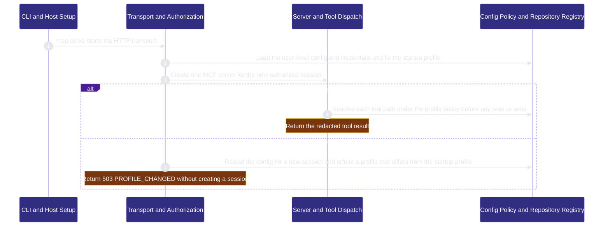
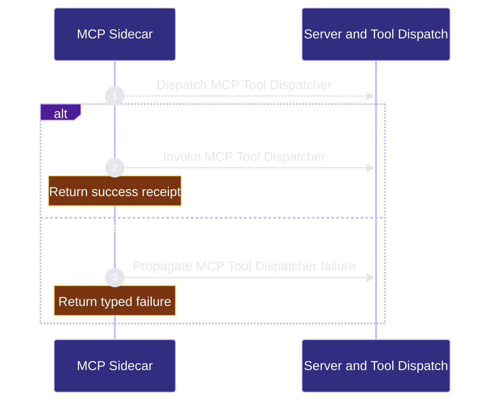

# runtime-harness/mcp-sidecar 架构文档
<!-- BEGIN ARCHCONTEXT:generated target="projection_target.entity.capability-runtime-harness-mcp-sidecar" rendererVersion="archcontext.docs-renderer/v6" outputDigest="sha256:bfad687200899af2e1732b87daa67407652406e36f42b79589dc6c6c16173c6e" -->
> **狀態**:`active`
> **Capability ID**:`capability.runtime-harness.mcp-sidecar`(kind `capability`)
> **Matched Prefixes**:`src/cli/mcp/**`、`src/cli/commands/mcp.ts`、`src/cli/chatgpt-browser/file-policy.ts`、`src/effects/repo-registry.ts`、`docs/repo-harness-chatgpt-mcp-setup.md`、`docs/reference-configs/chatgpt-coding-mcp.md`、`docs/reference-configs/herdr-orchestrator-mcp.md`、`src/core/security/**`
> **Local Contracts**:`AGENTS.md`、`CLAUDE.md`
> **事實優先級**:倉庫當前狀態 > 本文檔機器區 > 本文檔人工區。機器區(引言、§1、§2)由 ArchContext 從架構模型與源碼度量投影生成,手改會在下次投影被覆蓋。本文檔不記錄出處;本次投影所驗證的 commit 見 `docs/architecture/.projection-manifest.json`。

Provides the local MCP sidecar and its repository access policy boundary.

## 1. P1:能力架構地圖

### 1.1 架構圖

```mermaid
flowchart LR
  p1_capability_runtime_harness_mcp_sidecar_4e12aaf3["MCP Sidecar"]:::component
  p1_component_mcp_sidecar_coding_profile_c04b21a1["Coding Profile Runtime"]:::component
  p1_component_mcp_sidecar_host_setup_a05a1958["CLI and Host Setup"]:::component
  p1_component_mcp_sidecar_primary_8f9b418c["Server and Tool Dispatch"]:::component
  p1_component_mcp_sidecar_repo_policy_registry_40f1ea26["Config Policy and Repository Registry"]:::component
  p1_component_mcp_sidecar_repo_policy_registry_core_7c0f35d6["Config Policy and Repository Registry (core)"]:::component
  p1_component_mcp_sidecar_repo_policy_registry_effects_6c93657b["Config Policy and Repository Registry (effects)"]:::component
  p1_component_mcp_sidecar_transport_auth_2511e63e["Transport and Authorization"]:::component
  p1_component_mcp_sidecar_coding_profile_c04b21a1 -->|"Contain workspace paths against registered roots then redact and audit coding results"| p1_component_mcp_sidecar_repo_policy_registry_40f1ea26
  p1_component_mcp_sidecar_host_setup_a05a1958 -->|"List and clean up managed coding workspaces"| p1_component_mcp_sidecar_coding_profile_c04b21a1
  p1_component_mcp_sidecar_host_setup_a05a1958 -->|"Build the expected tool inventory for the live doctor and run prepare-goal through the tool dispatcher"| p1_component_mcp_sidecar_primary_8f9b418c
  p1_component_mcp_sidecar_host_setup_a05a1958 -->|"Write the user-level config and credentials and set repository access grants"| p1_component_mcp_sidecar_repo_policy_registry_40f1ea26
  p1_component_mcp_sidecar_host_setup_a05a1958 -->|"Start the stdio or HTTP transport for mcp serve"| p1_component_mcp_sidecar_transport_auth_2511e63e
  p1_capability_runtime_harness_mcp_sidecar_4e12aaf3 -->|"Dispatch an MCP tool call"| p1_component_mcp_sidecar_primary_8f9b418c
  p1_component_mcp_sidecar_primary_8f9b418c -->|"Build and dispatch the coding tool block and its process runtime"| p1_component_mcp_sidecar_coding_profile_c04b21a1
  p1_component_mcp_sidecar_primary_8f9b418c -->|"Resolve repositories and paths under the profile policy then redact and audit each result"| p1_component_mcp_sidecar_repo_policy_registry_40f1ea26
  p1_component_mcp_sidecar_transport_auth_2511e63e -->|"Create one MCP server per authorized session and dispatch its tool calls"| p1_component_mcp_sidecar_primary_8f9b418c
  p1_component_mcp_sidecar_transport_auth_2511e63e -->|"Load the local config and credentials at startup and recheck the profile on each new session"| p1_component_mcp_sidecar_repo_policy_registry_40f1ea26
  classDef actor fill:#111827,color:#ffffff,stroke:#f9fafb,stroke-width:2px
  classDef component fill:#075985,color:#ffffff,stroke:#bae6fd,stroke-width:2px
  classDef datastore fill:#3f6212,color:#ffffff,stroke:#d9f99d,stroke-width:2px
  classDef external fill:#7c2d12,color:#ffffff,stroke:#fed7aa,stroke-width:2px
```

- Proof: `proven` (`sha256:9c7aecf5760094e094e97afdd8049f7b14017a0a907ee8283a3e6546991ad51c`).
- Semantic nodes: `8`; declared relations: `10`.

### 1.2 模組職責表

| 宣告入口 | 錨點 | 職責 |
| --- | --- | --- |
| `entrypoint.mcp-sidecar.primary` | `src/cli/mcp/server.ts#createRepoHarnessMcpServer` | `sink.mcp-sidecar.primary` → `src/cli/mcp/tools.ts#callMcpTool` |

組件入口:

| 組件 | 宣告入口 | 錨點 | 職責 |
| --- | --- | --- | --- |
| `component.mcp-sidecar.host-setup` | `entrypoint.mcp-sidecar.cli` | `src/cli/commands/mcp.ts#buildMcpCommand` | `sink.mcp-sidecar.http-start` → `src/cli/mcp/transports/http.ts#startMcpHttp` |
| `component.mcp-sidecar.primary` | `entrypoint.mcp-sidecar.tool-dispatch` | `src/cli/mcp/tools.ts#callMcpTool` | `sink.mcp-sidecar.path-policy` → `src/cli/mcp/paths.ts#resolveMcpPath` |
| `component.mcp-sidecar.transport-auth` | `entrypoint.mcp-sidecar.http-transport` | `src/cli/mcp/transports/http.ts#startMcpHttp` | `sink.mcp-sidecar.startup-config` → `src/cli/mcp/auth.ts#loadMcpLocalConfig` |
| `component.mcp-sidecar.transport-auth` | `entrypoint.mcp-sidecar.http-transport` | `src/cli/mcp/transports/http.ts#handleMcpPost` | `sink.mcp-sidecar.session-server` → `src/cli/mcp/server.ts#createRepoHarnessMcpServer`、`sink.mcp-sidecar.request-config` → `src/cli/mcp/auth.ts#loadMcpLocalConfig` |

### 1.3 規模信號

- 規模量級:`20–50` 個文件 / `10k–20k` 行
- 匹配前綴:`src/cli/mcp/**`、`src/cli/commands/mcp.ts`、`src/cli/chatgpt-browser/file-policy.ts`、`src/effects/repo-registry.ts`、`docs/repo-harness-chatgpt-mcp-setup.md`、`docs/reference-configs/chatgpt-coding-mcp.md`、`docs/reference-configs/herdr-orchestrator-mcp.md`、`src/core/security/**`
- 排除前綴:`src/cli/mcp/codegraph-adapter.ts`、`src/cli/mcp/general-repo-access.ts`、`src/cli/mcp/general-repo-access/**`
- 推導:掃描 `source.include` 減 `source.exclude`,跳過 `.git/` 與 `node_modules/`,再按 1–2–5 階梯分桶。精確計數不入本文檔:量級足以回答「這個能力有多大」,而逐行計數會讓覆蓋範圍內任何一次源碼改動都改寫本文檔。

### 1.4 依賴邊界

出向關係:

- `calls` → `capability.runtime-harness.agent-runtime-effects` — Expose read-only runtime capability and current-effect projections to the authenticated Engineer without Host mutation authority
- `deployed-on` → `process.mcp-server` — The MCP sidecar runs in the MCP server process.
- `depends-on` → `capability.workflow-engine.contract-assets` — Run declared helpers from MCP tools.
- `calls` → `component.mcp-sidecar.primary` — Dispatch an MCP tool call

入向關係:

- `depends-on` ← `capability.verification.acceptance-review` — Apply secret patterns to module review context.
- `depends-on` ← `capability.public-surface.adoption` — Read registered repository identity for adoption planning.
- `calls` ← `capability.runtime-harness.agent-runtime-effects` — Read the strict repo registry and the authorization revision for the wake fence
- `depends-on` ← `capability.runtime-mcp.chatgpt-browser` — Apply shared file policy to browser prompts and sessions.
- `depends-on` ← `capability.runtime-harness.engineer-scheduling` — Read registered repository identity for scheduling.
- `depends-on` ← `capability.runtime-harness.engineering-overlay` — Read the repository registry for overlay observations.
- `depends-on` ← `capability.verification.evals-checks` — Test MCP Sidecar behavior through its source modules.
- `calls` ← `capability.runtime-harness.external-source-intake` — Read the strict repo registry snapshot for repository identity and authorization
- `calls` ← `component.global-runtime-reconciliation.archctx-closure` — Resolve registered repositories for the model reader
- `calls` ← `component.global-runtime-reconciliation.cli-root` — Register the mcp command
- `reads` ← `component.operator.console-collectors` — Run mcp doctor without live registration and read the OAuth token store and the newest audit rows for Bot access, and read the strict repository registry snapshot for Bot access, docs and tests.
- `reads` ← `component.operator.primary` — Resolve a registered repository root from the strict repo-harness registry snapshot
- `calls` ← `capability.runtime-harness.refactor-program` — Resolve the canonical repository path through the repo registry

組件出向關係:

- `component.mcp-sidecar.coding-profile`:
  - `calls` → `capability.verification.codegraph-readiness` — Refresh the CodeGraph index after coding mutations
  - `calls` → `capability.workflow-engine.execution-primitives` — Use the configured Git binary for coding workspaces
  - `calls` → `component.mcp-sidecar.repo-policy-registry` — Contain workspace paths against registered roots then redact and audit coding results
  - `calls` → `capability.runtime-harness.task-agent-host` — Clean up task worktrees for coding workspaces
  - `calls` → `capability.workflow-engine.workflow-state` — Clean up exact worktrees under the system worktree root
- `component.mcp-sidecar.host-setup`:
  - `calls` → `capability.runtime-mcp.chatgpt-browser` — Read the canonical ChatGPT bridge reference from the packaged skill source
  - `calls` → `component.mcp-sidecar.coding-profile` — List and clean up managed coding workspaces
  - `calls` → `capability.workflow-engine.execution-primitives` — Hold the MCP setup ownership lock
  - `calls` → `capability.runtime-harness.hook-adapters` — Reuse installer configuration ownership receipts and the runtime host lock
  - `calls` → `component.mcp-sidecar.primary` — Build the expected tool inventory for the live doctor and run prepare-goal through the tool dispatcher
  - `writes` → `component.mcp-sidecar.repo-policy-registry` — Write the user-level config and credentials and set repository access grants
  - `calls` → `component.mcp-sidecar.transport-auth` — Start the stdio or HTTP transport for mcp serve
- `component.mcp-sidecar.primary`:
  - `calls` → `capability.runtime-mcp.chatgpt-browser` — Run the opt-in browser consult tools through the ChatGPT browser engine
  - `calls` → `capability.verification.codegraph-readiness` — Construct the CodeGraph index adapter with repo-local binaries refused
  - `calls` → `component.mcp-sidecar.coding-profile` — Build and dispatch the coding tool block and its process runtime
  - `calls` → `capability.workflow-engine.execution-primitives` — Read the worktree topology for the PM server scope
  - `calls` → `capability.runtime-mcp.general-repo-access` — Dispatch the general repository reader and writer tools
  - `calls` → `capability.organization.publication` — Reopen and take over publications and read merge readiness
  - `calls` → `component.mcp-sidecar.repo-policy-registry` — Resolve repositories and paths under the profile policy then redact and audit each result
  - `calls` → `capability.runtime-harness.task-agent-host` — Start task agents, send task requests, and list, prompt and read in-scope agent panes through Herdr
  - `calls` → `capability.organization.task-fleet` — Acquire fleet tasks and handle task steers from the MCP tools
  - `reads` → `capability.workflow-engine.workflow-state` — Resolve effective state read-only for the state MCP tools
- `component.mcp-sidecar.repo-policy-registry`:
  - `calls` → `capability.workflow-engine.execution-primitives` — Run Git for repository roots and lock guarded writes
- `component.mcp-sidecar.repo-policy-registry-core`:
  - 無。
- `component.mcp-sidecar.repo-policy-registry-effects`:
  - 無。
- `component.mcp-sidecar.transport-auth`:
  - `calls` → `component.mcp-sidecar.primary` — Create one MCP server per authorized session and dispatch its tool calls
  - `reads` → `component.mcp-sidecar.repo-policy-registry` — Load the local config and credentials at startup and recheck the profile on each new session

### 1.5 組件結構

| 組件 | 名稱 | 規模量級 | 宣告入口 |
| --- | --- | --- | --- |
| `component.mcp-sidecar.coding-profile` | Coding Profile Runtime | `2–5` 個文件 / `2000–5000` 行 | 未宣告 |
| `component.mcp-sidecar.host-setup` | CLI and Host Setup | `5–10` 個文件 / `2000–5000` 行 | `entrypoint.mcp-sidecar.cli` |
| `component.mcp-sidecar.primary` | Server and Tool Dispatch | `5–10` 個文件 / `2000–5000` 行 | `entrypoint.mcp-sidecar.tool-dispatch` |
| `component.mcp-sidecar.repo-policy-registry` | Config Policy and Repository Registry | `10–20` 個文件 / `1000–2000` 行 | 未宣告 |
| `component.mcp-sidecar.repo-policy-registry-core` | Config Policy and Repository Registry (core) | `1–2` 個文件 / `20–50` 行 | 未宣告 |
| `component.mcp-sidecar.repo-policy-registry-effects` | Config Policy and Repository Registry (effects) | `2–5` 個文件 / `1000–2000` 行 | 未宣告 |
| `component.mcp-sidecar.transport-auth` | Transport and Authorization | `2–5` 個文件 / `1000–2000` 行 | `entrypoint.mcp-sidecar.http-transport` |

## 2. P2:端到端數據流

> **Proof**: `proven` (`sha256:9c7aecf5760094e094e97afdd8049f7b14017a0a907ee8283a3e6546991ad51c`); selectors `6/6`.

<!-- END ARCHCONTEXT:generated target="projection_target.entity.capability-runtime-harness-mcp-sidecar" -->
## 3. P3：设计决策与不变量

### 3.1 必须保持的不变量

1. **单一存储权威。** MCP 配置与凭证只存在 `mcpStorageDir()` 下（`src/cli/mcp/auth.ts:66`）。PR #167 把 repo 级配置迁到用户级。迁移轮换凭证，不搬运凭证。原因写在 `src/cli/mcp/setup.ts:820-830` 的注释里：repo 级 bearer token 和 passphrase 曾在 Git 工作树内，可能留在备份或历史中。迁移删除 repo 级 OAuth token store。用户因此必须重新授权一次。
2. **授权真相在注册表。** `read_write` 授权和 `authorizationRevision` 存在 `registered-repos.json`。写入先写临时文件，再 rename（`src/effects/repo-registry.ts:206-210`）。写入持有一把带 owner 记录的互斥锁，死锁持有者可以回收（`repo-registry.ts:28`、`:237`）。MCP 配置里的 `authorizationRevision` 只是副本。授权型 profile 的 HTTP 中间件在每个请求上比较两者，不相等就拒绝（`authorizationProfileBlocker`，`src/cli/mcp/server.ts`）。
3. **每个 profile 默认关闭，各自闭合。** 授权型 profile 只在 `src/cli/mcp/policy.ts` 的授权 profile 表里列出：coding 和 orchestrator，各有自己的必需 OAuth scope。它们需要 v3 配置选中该 profile、至少一个 `read_write` 注册仓库、当前的 authorization revision 和 OAuth。`authorizationProfileBlocker`（`src/cli/mcp/server.ts`）是这组前提的唯一实现；context 构造、HTTP 中间件和清理定时器都调用它。Engineer 和 PM profile 已退役。旧配置中的这两个 profile 会在启动时被拒绝。只有 coding profile 建立 shell runtime。orchestrator 只暴露三个 Herdr 派活工具（`src/cli/mcp/herdr-tools.ts`），没有文件、workflow 或 shell 工具。
4. **HTTP session 绑定启动时的 profile。** 新 session 初始化时重读配置。profile 与启动时不同，服务返回 503 `PROFILE_CHANGED`，并且不占用 session 名额（`transports/http.ts:484-499`，PR #210）。服务不做热升级，也不静默降级。
5. **HTTP session 绑定一个已验证的 authorization ID。** 另一个 authorization 复用该 session 会失败（见 §4 的 2026-08-25 条目）。coding session 的权限来自已验证的 authorization ID。请求不能选择另一个授权身份。
6. **worktree 优先。** `open_workspace` 默认新建独立 worktree，`checkout` 模式必须显式指定（`src/cli/mcp/coding-tools.ts:242-247`）。远端代理的失败只影响一个可丢弃的分支。
7. **仓库授权选择工作区，不提供 shell 沙箱。** 授权页文案写明：shell 命令能访问本地 OS 用户能访问的一切（`transports/http.ts:222`）。文档和 UI 不得声称 allowed roots 限制了 shell。
8. **MCP 只投影状态，不解释状态，也不写状态。** `summarize_repo_harness_state`（`src/cli/mcp/state-tools.ts:9`）与 hook 使用同一个只读解析器 `resolveEffectiveStateReadOnly`，工具声明 `readOnlyHint: true`。它报告最后发布的 `state_version`；只有 `repo-harness state resolve` 分配版本。`current` 预览字段标注为非权威。
9. **CodeGraph 是可选适配器。** 文件系统与注册表是内容和授权的真相。索引刷新失败只返回 `dead_letter` 信息（`coding-tools.ts:174`），不回滚已成功的变更。coding runtime 构造适配器时传 `allowRepoLocalBin: false`（`server.ts:138-141`）。被索引的仓库因此不能提供 codegraph 可执行文件。

### 3.2 关键权衡

| 决策 | 权衡 |
| --- | --- |
| 每个请求同步重读 `mcp.local.json` 和 `registered-repos.json`（`authorizationProfileBlocker`） | 授权撤销和 revision 变化立即生效。代价是每个请求都做同步文件 IO。QPS 上升时这里先成为热点。 |
| session 名额满时回收最久未用的空闲 session（PR #175） | ChatGPT Connector 重连时不发 DELETE。只按 TTL 清理会占满 `max_sessions`，之后所有新 initialize 都失败。代价是空闲但有效的客户端可能被回收，必须重新初始化。 |
| coding runtime 与 session 共用 `maxSessions`（`transports/http.ts:671-673`；默认 64，最大 256） | 一个配置项控制两种资源。代价是授权数与 transport 数的增长曲线不同，先到者可能占满后到者的名额。 |
| mutation 后串行刷新 CodeGraph 索引（`coding-tools.ts:157-158`） | 变更与索引不竞争。代价是仓库变大后端到端延迟增加。 |
| 每个 authorization 的进程上限：并发 4、单进程最长 30 分钟、输出环 4 MiB、完成后保留 15 分钟（`process-sessions.ts:6-9`） | 不可信一侧的并发面有硬上限。代价是这些上限不解决吞吐问题（见 §3.4）。 |

### 3.3 组件拆分（2026-10-11）

数据来源：`archctx refactor scan --json`（archctx 0.7.0）和一次相对 import 扫描。组件 footprint 写在各 component 节点的 `source.include` 里。

| 组件 | footprint | 文件 / 行 | 职责 |
| --- | --- | --- | --- |
| `component.mcp-sidecar.primary`（Server and Tool Dispatch） | `server.ts`、`tools.ts`、`state-tools.ts`、`fleet-tools.ts`、`herdr-tools.ts`、`instructions.ts`、`version.ts` | 7 个文件 | 按保留的 profile 建工具清单，把调用分派到各工具块 |
| `component.mcp-sidecar.transport-auth` | `transports/**`、`oauth.ts`、`session-store.ts` | 4 / 1648 | stdio 与 HTTP transport、OAuth、session 准入与回收 |
| `component.mcp-sidecar.repo-policy-registry` | `auth.ts`、`types.ts`、`policy.ts`、`paths.ts`、`repo.ts`、`redaction.ts`、`guarded-write.ts`、`workspaces.ts`、`audit.ts` | 9 / 1401（`wc -l`，2026-11-02） | 用户级配置与凭证、路径策略、脱敏、审计；通过共享 repository registry 设置仓库授权。`src/effects/repo-registry.ts`（859 行）与 `src/core/security/**`（32 行）在 #1343 移到 execution-primitives（见 §4） |
| `component.mcp-sidecar.coding-profile` | `coding-tools.ts`、`coding-workspaces.ts`、`process-sessions.ts` | 3 / 2143 | 受管 worktree、文件编辑、受限 shell 进程 |
| `component.mcp-sidecar.host-setup` | `src/cli/commands/mcp.ts`、`setup.ts`、`setup-ownership.ts`、`uninstall.ts`、`docs/repo-harness-chatgpt-mcp-setup.md` | 5 / 2452 | mcp CLI、ChatGPT 与 Codex 的 host 设置、doctor、受管卸载 |

依赖方向：host-setup 调用另外四个组件。transport-auth 调用 primary 和 repo-policy-registry。primary 调用 repo-policy-registry 和 coding-profile。coding-profile 调用 repo-policy-registry。组件之间没有反向边。

与归属提议 §5 的三处差异，原因都来自 import 扫描：

- `auth.ts` 放进 repo-policy-registry。它是配置与凭证存储。`server.ts`、`tools.ts`、`setup.ts`、`uninstall.ts` 和两个 transport 都读它。放进 transport-auth 会形成 primary 与 transport-auth 的环。
- `types.ts` 和 `audit.ts` 放进 repo-policy-registry。`types.ts` 只定义 `McpPolicy`、`McpPathDecision`、`McpAuditEntry` 等策略类型。`audit.ts` 只被工具处理器调用，transport 不调用它。
- `src/cli/commands/mcp.ts` 放进 host-setup。这个命令启动 transport。放进 primary 会形成 primary → transport-auth → primary 的环。

以下文件留在 capability include 上，不进任何组件：`reader-tools.ts`（general-repo-access 的声明入口）、`general-repo-access.ts` 与 `general-repo-access/**`（与 general-repo-access 重复归属）、`codegraph-adapter.ts`（与 codegraph-readiness 重复归属）、`src/cli/chatgpt-browser/file-policy.ts`、`docs/reference-configs/chatgpt-coding-mcp.md`（与 contract-assets 重复归属）和一份 research 文档。

组件到其他 capability 的关系不出现在 §1.4（渲染器缺口），这里列出：

- primary → chatgpt-browser：`tools.ts` 在 `--enable-chatgpt-browser` 时暴露 5 个 browser 工具（`tools.ts:1128-1159`）。
- primary → general-repo-access：`tools.ts` 分派 reader 与 writer 工具。
- primary → codegraph-readiness、coding-profile → codegraph-readiness：构造并刷新 CodeGraph 适配器。
- host-setup → hook-adapters：复用 installer 的配置归属回执和 runtime host 锁。
- host-setup → chatgpt-browser：`mcp install-skill` 读取打包的 bridge 参考（`setup.ts:69-80`）。

### 3.4 10x 规模下先垮的点

按当前实现，压力顺序是：

1. **mutation 后的串行 CodeGraph 全仓刷新。** 仓库变大或并发授权变多时，这一步先吃掉端到端延迟。MCP 路由不是瓶颈。
2. **`general-repo-access.ts` 的进程内快照缓存。** 上限是 `SNAPSHOT_TTL_MS = 5min`、`MAX_SNAPSHOT_CACHE_ENTRIES = 16`、`MAX_ENTRY_METADATA_CACHE_ENTRIES = 200_000`（`general-repo-access.ts:184-186`）。多个大仓交替访问时，快照命中率接近零，每次都全量 walk。
3. **session 与 coding runtime 共用一个上限**（见 §3.2）。
4. **每请求同步复核**（见 §3.2）。

### 3.5 已知张力

- 配置的 `repo` 字段仍被写入（`setup.ts:735`、`:879`）。runtime 的 repoRoot 只来自 `--repo` 或 cwd（`server.ts:185`）。这个字段已实现但保留不用：doctor 和迁移输出显示它，没有解析路径消费它。
- `McpLocalConfig.version` 仍接受 `1 | 2 | 3`（`auth.ts:7`）。授权型 profile 要求 `version === 3`。v1 和 v2 只对非授权型 profile 有效。
- `capabilities.reader` 是标注为 deprecated 的键（`auth.ts:30-31`）。只有 `workspaceReader` 未定义时它才参与判断。

### 3.6 开放问题

- `coding-tools.ts:79` 的 `DEFAULT_CODEGRAPH_ADAPTER` 用默认参数构造，`allowRepoLocalBin` 默认为 true（`codegraph-adapter.ts:224`）。它只在 `ctx.codeGraphAdapter` 未设置时使用（`coding-tools.ts:157`）。是否有生产路径走到这个默认值？没有验证。如果有，§3.1 第 9 条在这条路径上不成立。
- 已解决（#1343）：`src/core/security/secret-patterns.ts` 由 MCP 脱敏和 operator 的 architecture 读取共用（`src/effects/operator/architecture.ts:7`）。它现在归 `component.execution-primitives.secret-patterns`（core 层），不再归本 capability。

## 4. 历史决策记录（append-only）

重写前的 `docs/architecture/modules/runtime-harness/mcp-sidecar.md` 全文为无日期的 P1/P2/P3 叙述段落，**不含任何带日期的章节**，因此本节当前没有需要逐字保留的条目。

后续带日期的决策请在此追加，只增不改。

### 2026-08-25 ME-0B restricted Engineer carrier

- Engineer 与 coding 复用 OAuth 的授权生命周期机制，但使用不同 scope、不同 exact tool inventory 与不同 runtime policy；coding grant 不蕴含 Engineer authority，Engineer grant 也不创建 coding runtime。
- HTTP transport 将 MCP session 绑定到 verified `authorizationId`。payload 里的 Engineer/Binding/session/thread 字段只能作为 fence 或 observation，不能选择 principal；另一 authorization 复用 session 会得到 404。
- Engineer profile 必须在 generic tool builders 之前按 exact profile 分派，避免 broad capability flag 将 reader/writer/shell/Fleet mutation 扩散进 restricted surface。

### 2026-10-11 组件拆分

- 本 capability 拆成五个组件：primary（Server and Tool Dispatch）、transport-auth、repo-policy-registry、coding-profile、host-setup。拆分依据是相对 import 扫描。组件之间只有单向依赖（见 §3.3）。
- `src/core/security/**` 原本没有归属，现在加入本 capability 的 include。capability include 没有删除任何条目。
- 新增 flow `flow.mcp-sidecar.http-session`。它证明 CLI → HTTP transport → 配置读取 → session server → 路径策略这条路径，并证明配置变更后的 503 拒绝路径。

### 2026-11-01 共享 registry 与密钥模式移到 execution-primitives（#1343）

- `src/effects/repo-registry.ts`、`src/effects/repo-harness-home.ts` 与 `src/core/security/**` 移出本 capability，归 `capability.workflow-engine.execution-primitives`。只改模型，源码与 import 不变。原因：core 与其他 capability 读这些文件，#1287 的依赖检查不应把它们算作 core → MCP 边。
- capability include 删除 `src/effects/repo-registry.ts` 与 `src/core/security/**`，并删除密钥模式职责。删除 `component.mcp-sidecar.repo-policy-registry-core`。`component.mcp-sidecar.repo-policy-registry-effects` 只保留 `src/effects/bot-registry.ts`，改名为 Bot Registry (effects)。
- 只指向这些文件的 12 条入向关系改到新组件，使用新 id，旧 id 删除。其中 4 条是 capability 级 import 关系：`relation.{acceptance-review,adoption,engineer-scheduling,engineering-overlay}.imports.mcp-sidecar`。两条混合关系拆分：MCP 部分留在本 capability，registry 部分指向 `component.execution-primitives.repository-registry`。
- 新关系 `relation.task-fleet.bot-registry` 声明 `src/cli/commands/fleet.ts:7` → `src/effects/bot-registry.ts`。这个 import 以前由 task-fleet 的 registry 关系在 capability 级覆盖。

## Optimization Backlog

- 在 arch-context#296 和 include 收窄之后：把 `src/cli/mcp/reader-tools.ts` 和 `src/cli/mcp/general-repo-access*` 移给 general-repo-access，把 `src/cli/mcp/codegraph-adapter.ts` 移给 codegraph-readiness，把 `src/cli/chatgpt-browser/file-policy.ts` 移给 chatgpt-browser，把 `docs/reference-configs/chatgpt-coding-mcp.md` 交给 contract-assets（归属提议 §2）。
- 重构证据：`src/cli/chatgpt-browser/file-policy.ts` 只被 chatgpt-browser 的三个文件调用，但它 import 本 capability 的 `paths.ts` 和 `types.ts`。文件移走后，chatgpt-browser → mcp-sidecar 会变成一条反向边。路径包含检查可以抽成共享 helper。没有声明为 intended relation。
- primary 组件可展开：`tools.ts` 1558 行。它可以按工具块（state、Fleet、coding、reader、browser）继续拆。
- 集成步骤添加了到新 capability 的关系：primary → task-fleet、publication、task-agent-host、workflow-state（`reads`）与 execution-primitives；coding-profile → workflow-state、execution-primitives 与 task-agent-host；repo-policy-registry 与 host-setup → execution-primitives。没有声明 transport-auth → pm-dispatch：`src/cli/mcp/transports/http.ts:36` 只导入 `PmError` 类。
- **repo registry 造成 capability 级的环。** task-fleet 与 pm-dispatch 导入 `src/effects/repo-registry.ts`。集成把 `relation.task-fleet.repo-registry` 与 `relation.pm-dispatch.repo-registry` 的目标改为 `component.mcp-sidecar.repo-policy-registry`。节点级因此没有环。capability 级仍然双向。候选：把 repo registry 移出 mcp-sidecar。已由 #1343 完成：registry 归 `component.execution-primitives.repository-registry`，task-fleet 的关系改为 `relation.task-fleet.repository-registry`。
