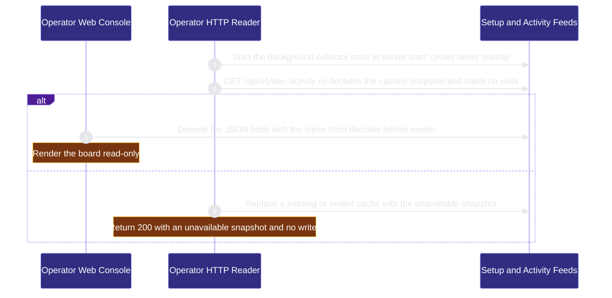
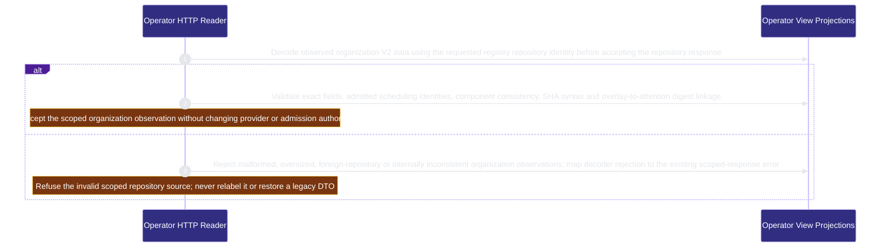
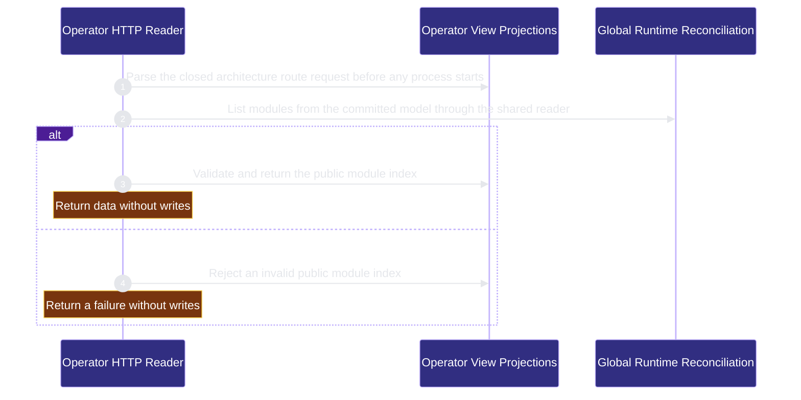

# runtime-harness/operator 架構文檔

<!-- BEGIN ARCHCONTEXT:generated target="projection_target.entity.capability-runtime-harness-operator" rendererVersion="archcontext.docs-renderer/v6" outputDigest="sha256:b98d19fbf16997f496aac2de46f994274d197d0fc52756a7232ca5f82fc0c88a" -->
> **狀態**:`active`
> **Capability ID**:`capability.runtime-harness.operator`(kind `capability`)
> **Matched Prefixes**:`docs/kanban-runtime-status.md`、`src/effects/operator/**`、`src/operator-web/**`、`src/effects/setup/**`、`src/effects/dev-activity/**`、`src/effects/terminal/herdr-observation.ts`、`vite.operator.config.ts`
> **Local Contracts**:`AGENTS.md`、`CLAUDE.md`
> **事實優先級**:倉庫當前狀態 > 本文檔機器區 > 本文檔人工區。機器區(引言、§1、§2)由 ArchContext 從架構模型與源碼度量投影生成,手改會在下次投影被覆蓋。本文檔不記錄出處;本次投影所驗證的 commit 見 `docs/architecture/.projection-manifest.json`。

Provides bounded read-only HTTP views of registered provider issues, admitted sessions, planning and explicit task history.

## 1. P1:能力架構地圖

### 1.1 架構圖

```mermaid
flowchart LR
  p1_capability_runtime_harness_global_runtime_reconciliation_401730e8["Global Runtime Reconciliation"]:::component
  p1_capability_runtime_harness_operator_00133dd3["Operator Board"]:::component
  p1_component_operator_activity_feeds_00325b96["Setup and Activity Feeds"]:::component
  p1_component_operator_activity_feeds_cli_322d3e7b["Setup and Activity Feeds (cli)"]:::component
  p1_component_operator_activity_feeds_effects_f3a498fb["Setup and Activity Feeds (effects)"]:::component
  p1_component_operator_architecture_view_0bdc3e1c["Architecture View"]:::component
  p1_component_operator_architecture_view_core_a4f42b6d["Architecture View (core)"]:::component
  p1_component_operator_assets_layer_7dafa4e8["Operator Board (assets)"]:::component
  p1_component_operator_cli_layer_6969b5f0["Operator Board (cli)"]:::component
  p1_component_operator_console_collectors_1f8d9a20["Console Collectors"]:::component
  p1_component_operator_core_layer_995d28e9["Operator Board (core)"]:::component
  p1_component_operator_primary_d8da79ba["Operator HTTP Reader"]:::component
  p1_component_operator_primary_cli_7531f69e["Operator HTTP Reader (cli)"]:::component
  p1_component_operator_view_projections_ca31e3bc["Operator View Projections"]:::component
  p1_component_operator_web_console_452bb61f["Operator Web Console"]:::component
  p1_component_operator_activity_feeds_00325b96 -->|"Reuse public agent-config text filtering and runtime source freshness rules"| p1_component_operator_view_projections_ca31e3bc
  p1_component_operator_architecture_view_0bdc3e1c -->|"List modules and export review prompts through the shared ArchitectureModelReader"| p1_capability_runtime_harness_global_runtime_reconciliation_401730e8
  p1_component_operator_console_collectors_1f8d9a20 -->|"Read the GitHub name and default branch of each repository from the Dev Activity cache for the docs ref and the daily CI run#44; read the open pull requests' heads and changed files for the architecture map's PR impact layer#44; and run the execution-state child through the setup collector's supervised process runner."| p1_component_operator_activity_feeds_00325b96
  p1_component_operator_console_collectors_1f8d9a20 -->|"Check the herdr status version and request session.snapshot through the Herdr observation transport."| p1_component_operator_primary_d8da79ba
  p1_component_operator_console_collectors_1f8d9a20 -->|"Build cache values with the strict Bot access#44; notify#44; docs and tests decoders and the JUnit and projection parsers."| p1_component_operator_view_projections_ca31e3bc
  p1_component_operator_primary_d8da79ba -->|"Start the bounded background collectors once and serve only their cached#44; re-decoded snapshots"| p1_component_operator_activity_feeds_00325b96
  p1_component_operator_primary_d8da79ba -->|"Start the notify#44; Bot access#44; docs and tests collectors once#44; serve only their re-decoded caches#44; and send a docs file GET as one object request to the resident cat-file worker."| p1_component_operator_console_collectors_1f8d9a20
  p1_component_operator_primary_d8da79ba -->|"Read the committed architecture model through the shared ArchitectureModelReader"| p1_capability_runtime_harness_global_runtime_reconciliation_401730e8
  p1_component_operator_primary_d8da79ba -->|"Parse closed route requests and project or re-decode each observation before it leaves the server"| p1_component_operator_view_projections_ca31e3bc
  p1_capability_runtime_harness_operator_00133dd3 -->|"Return a read-only HTTP observation."| p1_component_operator_primary_d8da79ba
  p1_component_operator_view_projections_ca31e3bc -->|"Decode the module index and module detail shapes that the architecture view declares"| p1_component_operator_architecture_view_0bdc3e1c
  p1_component_operator_web_console_452bb61f -->|"Decode the development activity and setup snapshots with the decoders the server uses"| p1_component_operator_activity_feeds_00325b96
  p1_component_operator_web_console_452bb61f -->|"Fetch public JSON observations through GET and HEAD routes only"| p1_component_operator_primary_d8da79ba
  p1_component_operator_web_console_452bb61f -->|"Decode each observation body with the shared strict core decoder before render"| p1_component_operator_view_projections_ca31e3bc
  classDef actor fill:#111827,color:#ffffff,stroke:#f9fafb,stroke-width:2px
  classDef component fill:#075985,color:#ffffff,stroke:#bae6fd,stroke-width:2px
  classDef datastore fill:#3f6212,color:#ffffff,stroke:#d9f99d,stroke-width:2px
  classDef external fill:#7c2d12,color:#ffffff,stroke:#fed7aa,stroke-width:2px
```

- Proof: `proven` (`sha256:72dd24498bb6d2a9ef6753af25f82c9e607c735d164c72bbde1dd8ec739df8e3`).
- Semantic nodes: `15`; declared relations: `14`.

### 1.2 模組職責表

| 宣告入口 | 錨點 | 職責 |
| --- | --- | --- |
| `entrypoint.operator.primary` | `src/effects/operator/architecture.ts#readArchitecture` | `sink.operator.primary` → `src/core/operator/architecture.ts#decodeArchitectureModuleIndex`、`sink.operator.model-reader-list` → `src/effects/architecture/model-reader.ts#list` |
| `entrypoint.operator.organization-validation` | `src/effects/operator/repository-snapshot.ts#assertOperatorRepositorySnapshotIdentity` | `sink.operator.organization-validation` → `src/core/operator/organization-snapshot.ts#decodeOperatorOrganizationSnapshot` |

組件入口:

| 組件 | 宣告入口 | 錨點 | 職責 |
| --- | --- | --- | --- |
| `component.operator.primary` | `entrypoint.operator.http-server` | `src/effects/operator/server.ts#startOperatorServer` | `sink.operator.dev-activity-collector` → `src/effects/dev-activity/collector.ts#startDevActivityCollector`、`sink.operator.notify-collector` → `src/effects/operator/notify-collector.ts#startNotifyCollector`、`sink.operator.bot-access-collector` → `src/effects/operator/bot-access.ts#startBotAccessCollector`、`sink.operator.docs-collector` → `src/effects/operator/docs-collector.ts#startDocsCollector`、`sink.operator.tests-collector` → `src/effects/operator/tests-collector.ts#startTestsCollector`、`sink.operator.execution-collector` → `src/effects/operator/execution-collector.ts#startExecutionCollector`、`sink.operator.architecture-map-collector` → `src/effects/operator/architecture-map-collector.ts#startArchitectureMapCollector`、`sink.operator.cli-inventory-collector` → `src/effects/setup/cli-inventory.ts#startCliInventoryCollector` |
| `component.operator.primary` | `entrypoint.operator.http-server` | `src/effects/operator/server.ts#handleRequest` | `sink.operator.dev-activity-decode` → `src/core/dev-activity/decode.ts#decodeDevActivitySnapshot`、`sink.operator.dev-activity-unavailable` → `src/core/dev-activity/decode.ts#unavailableDevActivitySnapshot`、`sink.operator.architecture-request` → `src/core/operator/architecture.ts#parseArchitectureRequest` |
| `component.operator.web-console` | `entrypoint.operator.web-dev-activity` | `src/operator-web/dev-activity.ts#fetchDevActivity` | `sink.operator.web-dev-activity-decode` → `src/core/dev-activity/decode.ts#decodeDevActivitySnapshot` |

### 1.3 規模信號

- 規模量級:`100–200` 個文件 / `20k–50k` 行
- 匹配前綴:`docs/kanban-runtime-status.md`、`src/effects/operator/**`、`src/operator-web/**`、`src/effects/setup/**`、`src/effects/dev-activity/**`、`src/effects/terminal/herdr-observation.ts`、`vite.operator.config.ts`
- 推導:掃描 `source.include` 減 `source.exclude`,跳過 `.git/` 與 `node_modules/`,再按 1–2–5 階梯分桶。精確計數不入本文檔:量級足以回答「這個能力有多大」,而逐行計數會讓覆蓋範圍內任何一次源碼改動都改寫本文檔。

### 1.4 依賴邊界

出向關係:

- `depends-on` → `capability.verification.acceptance-review` — Read and reobserve protected current review admission for exact session discovery and current goal context
- `deployed-on` → `process.operator-server` — The operator board runs in the operator server process.
- `reads` → `external.github` — Collect pull request and CI activity, the newest daily CI run with its JUnit and test projection artifacts, the open CI repair issues, and the CLI inventory repository lookups through gh in background collectors.
- `depends-on` → `capability.public-surface.action-commands` — Read the skill catalog for the setup snapshot.
- `depends-on` → `capability.runtime-harness.engineer-bindings` — Use claim identity types for task activity.
- `depends-on` → `capability.workflow-engine.execution-primitives` — Read Git topology for task diffs and development activity.
- `depends-on` → `capability.organization.publication` — Use publication readiness types in the Operator fixture.
- `depends-on` → `capability.runtime-harness.task-agent-host` — Read exact source-root-bound task sessions and role profiles for bounded discovery and selected current observations
- `depends-on` → `capability.workflow-engine.workflow-state` — Read state types and artifacts for Operator projections.
- `calls` → `component.operator.primary` — Return a read-only HTTP observation.

入向關係:

- `depends-on` ← `capability.verification.acceptance-review` — Use the architecture module view in review prompts.
- `depends-on` ← `component.contract-assets.template-projection` — Read the tool catalog to project the reference tooling table
- `depends-on` ← `capability.verification.evals-checks` — Test Operator Board behavior through its source modules; the CI report builds and finds repair issues, and the test projection script names its schema, with the operator tests contract.
- `calls` ← `component.global-runtime-reconciliation.cli-root` — Register the operator command

組件出向關係:

- `component.operator.activity-feeds`:
  - `reads` → `capability.runtime-harness.hook-adapters` — Read the hook route registry and install profile components for the Hooks and Agents pages
  - `reads` → `external.npm-registry` — Look up whether an npm package of the CLI inventory is deprecated, with cached and capped npm view calls.
  - `calls` → `component.operator.view-projections` — Reuse public agent-config text filtering and runtime source freshness rules
- `component.operator.activity-feeds-cli`:
  - 無。
- `component.operator.activity-feeds-effects`:
  - 無。
- `component.operator.architecture-view`:
  - `reads` → `capability.runtime-harness.global-runtime-reconciliation` — List modules and export review prompts through the shared ArchitectureModelReader
- `component.operator.architecture-view-core`:
  - 無。
- `component.operator.assets-layer`:
  - 無。
- `component.operator.cli-layer`:
  - 無。
- `component.operator.console-collectors`:
  - `reads` → `component.operator.activity-feeds` — Read the GitHub name and default branch of each repository from the Dev Activity cache for the docs ref and the daily CI run, read the open pull requests' heads and changed files for the architecture map's PR impact layer, and run the execution-state child through the setup collector's supervised process runner.
  - `reads` → `external.archctx` — Read the committed model and decisions with archctx export native, file ownership with archctx resolve, capability import counts with archctx deps, ref impact with archctx impact --base/--head, PR path impact with archctx impact --paths-from, architecture debt, doc anchors and flow proofs with flows check --no-sync. Flow-step facts use the existing worktree CodeGraph index and must match the requested commit.
  - `reads` → `external.git` — Read remote URLs from local config, docs blobs through a resident cat-file worker on local refs only, line counts of a commit for the architecture map, and worktree topology and status. Worktree merge proof uses the shared sweep authority.
  - `reads` → `external.github` — Read the newest daily CI run, download its JUnit and test projection artifacts, and list open CI repair issues with gh.
  - `reads` → `external.herdr` — Run herdr status, the session snapshot and the notify plugin list, config-dir and log list probes on collector cycles.
  - `calls` → `component.operator.primary` — Check the herdr status version and request session.snapshot through the Herdr observation transport.
  - `reads` → `capability.runtime-harness.mcp-sidecar` — Run mcp doctor without live registration and read the OAuth token store and the newest audit rows for Bot access, and read the strict repository registry snapshot for Bot access, docs and tests.
  - `reads` → `component.task-agent-host.primary` — Read the Herdr session from the notify install record at the start of each notify, Bot access and execution cycle, and read the task agent binding, native session and closed records.
  - `calls` → `component.operator.view-projections` — Build cache values with the strict Bot access, notify, docs and tests decoders and the JUnit and projection parsers.
  - `depends-on` → `capability.workflow-engine.workflow-state` — Reuse inspectWorktree and the sweep merge predicates for the read-only worktree inventory.
- `component.operator.core-layer`:
  - 無。
- `component.operator.primary`:
  - `calls` → `component.operator.activity-feeds` — Start the bounded background collectors once and serve only their cached, re-decoded snapshots
  - `calls` → `component.operator.console-collectors` — Start the notify, Bot access, docs and tests collectors once, serve only their re-decoded caches, and send a docs file GET as one object request to the resident cat-file worker.
  - `reads` → `capability.runtime-harness.engineer-scheduling` — Read the tracked work graph projection for the Planning view
  - `reads` → `capability.runtime-harness.engineering-overlay` — Collect the engineering board for the Organization view
  - `reads` → `capability.runtime-harness.global-runtime-reconciliation` — Read the committed architecture model through the shared ArchitectureModelReader
  - `reads` → `capability.runtime-harness.mcp-sidecar` — Resolve a registered repository root from the strict repo-harness registry snapshot
  - `calls` → `component.operator.view-projections` — Parse closed route requests and project or re-decode each observation before it leaves the server
  - `reads` → `component.acceptance-review.primary` — Read the docs host platform and runtimes that a doc session may use.
  - `calls` → `component.workflow-state.coordination-plane` — Create a doc session worktree under the worktree topology lock of its clone.
  - `reads` → `component.execution-primitives.primary` — Read the managed worktree root and its naming rule for a doc session worktree.
  - `reads` → `capability.organization.task-fleet` — Read retained per-repository task observations and the fleet board for the console
- `component.operator.primary-cli`:
  - 無。
- `component.operator.view-projections`:
  - `depends-on` → `capability.verification.acceptance-review` — Decode the module review prompt shape that the review prompt builder declares
  - `depends-on` → `component.operator.architecture-view` — Decode the module index and module detail shapes that the architecture view declares
  - `reads` → `component.mcp-sidecar.repo-policy-registry` — Read the shared secret token rules that redact doc session events.
  - `reads` → `capability.organization.task-fleet` — Render fleet board errors and task message shapes
- `component.operator.web-console`:
  - `calls` → `component.operator.activity-feeds` — Decode the development activity and setup snapshots with the decoders the server uses
  - `calls` → `component.operator.primary` — Fetch public JSON observations through GET and HEAD routes only
  - `calls` → `component.operator.view-projections` — Decode each observation body with the shared strict core decoder before render

### 1.5 組件結構

| 組件 | 名稱 | 規模量級 | 宣告入口 |
| --- | --- | --- | --- |
| `component.operator.activity-feeds` | Setup and Activity Feeds | `10–20` 個文件 / `2000–5000` 行 | 未宣告 |
| `component.operator.activity-feeds-cli` | Setup and Activity Feeds (cli) | `2–5` 個文件 / `100–200` 行 | 未宣告 |
| `component.operator.activity-feeds-effects` | Setup and Activity Feeds (effects) | `5–10` 個文件 / `1000–2000` 行 | 未宣告 |
| `component.operator.architecture-view` | Architecture View | `1–2` 個文件 / `20–50` 行 | 未宣告 |
| `component.operator.architecture-view-core` | Architecture View (core) | `1–2` 個文件 / `100–200` 行 | 未宣告 |
| `component.operator.assets-layer` | Operator Board (assets) | `1–2` 個文件 / `100–200` 行 | 未宣告 |
| `component.operator.cli-layer` | Operator Board (cli) | `1–2` 個文件 / `20–50` 行 | 未宣告 |
| `component.operator.console-collectors` | Console Collectors | `10–20` 個文件 / `2000–5000` 行 | 未宣告 |
| `component.operator.core-layer` | Operator Board (core) | `1–2` 個文件 / `100–200` 行 | 未宣告 |
| `component.operator.primary` | Operator HTTP Reader | `20–50` 個文件 / `5000–10000` 行 | `entrypoint.operator.http-server` |
| `component.operator.primary-cli` | Operator HTTP Reader (cli) | `1–2` 個文件 / `100–200` 行 | 未宣告 |
| `component.operator.view-projections` | Operator View Projections | `20–50` 個文件 / `2000–5000` 行 | 未宣告 |
| `component.operator.web-console` | Operator Web Console | `100–200` 個文件 / `20k–50k` 行 | `entrypoint.operator.web-dev-activity` |

## 2. P2:端到端數據流

> **Proof**: `proven` (`sha256:72dd24498bb6d2a9ef6753af25f82c9e607c735d164c72bbde1dd8ec739df8e3`); selectors `8/8`.

<!-- END ARCHCONTEXT:generated target="projection_target.entity.capability-runtime-harness-operator" -->

## 3. P3:設計決策與不變量

The Worktree page reads `GET /api/v1/worktrees`. Background child processes collect
Git topology, process cwd, merge proof and disk size. GET does no probes. The shared
`inspectWorktree` predicate also gates live sweep selection. Unknown process state,
unpublished commits and non-rebuildable ignored data prevent a green judgment.
The browser gets stable opaque ids and directory names. Orphans without a retained
Git pointer stay unassigned. Disk probes run at most once per directory incarnation
per 15 minutes; a changed directory mtime makes the cached size unknown until then.

Green cleanup (slice 5.1) has one effect, `runWorktreeCleanup`
(`src/effects/operator/worktree-cleanup.ts`). `POST /api/v1/worktrees/cleanup` and
`repo-harness worktrees clean` both send `ids[]` and `expected_digest` through the
shared write run. The digest is SHA-256 over the canonical decision fields of the
selected rows only (`src/core/operator/worktree-cleanup.ts`); sizes, process counts
and times are not part of it. The effect builds fresh rows with the collector's row
builder. It refuses the whole request before any removal: an unknown id is 409
`digest_changed`, a red row is 422 `in_use`, a yellow row is 422 `not_approved`, a
changed digest is 409 `digest_changed`, and an unreadable inventory is 503
`inventory_unavailable`. Each removal then goes through the sweep's own recovery,
`inspectWorktree` and `commitSweepRemoval` (`removeGreenWorktrees`). Inside the
topology barrier, before the trash receipt, `commitSweepRemoval` runs
`inspectWorktree` again with a fresh process inventory for every first removal, the
sweep's included; a checkout that is no longer green is kept. The effect then also
builds the row again and requires it to equal the checked row; a changed row is
skipped and kept. The local branch goes with
the worktree; remote branches stay. HTTP runs the effect in a supervised child
process (`runSetupProcess`, 20 s process-group deadline), so sync Git never blocks
the serve event loop. A child timeout, crash or invalid output after the intent
record is `reconcile_required`. Trash recovery, shared by the sweep and the cleanup,
finishes a removal from its receipt only when the payload was already renamed. A
receipt whose live source was never renamed is discarded durably, with the sweep note
`unused approval discarded; source kept for fresh selection`; that source is removed
only by a later fresh selection under the full green predicate. Approval of non-green
rows comes with the cleanup session (5.2).

Creation paths write lifecycle records in the clone's common Git directory under
`repo-harness/worktree-records`. Contract recovery metadata and MCP/session bindings
retain their operational fields; they do not supply the Console lifecycle view.
Closeout records the end state. New MCP checkouts use `REPO_HARNESS_WORKTREE_ROOT`
and the same naming rule as sweep. The retired MCP-specific root setting now fails
with an instruction to use the shared setting. Existing paths remain readable.

### 3.1 必须保持的不变量

环境页面复用 setup 与 CLI inventory 的缓存。`CliPage.tsx` 只在 CLI 页可见时读取 `/api/v1/cli-inventory`，并用 `decodeCliInventory` 校验。刷新失败保留上次数据并显示警告；`unused: null` 表示观察不足。卸载和配置删除分开显示为可复制命令。Hooks 页按事件、路由和宿主显示次数，guard 拒绝单独列出。Skills 页的宿主状态仍来自 setup check，推荐项来自 catalog 的 `skill` 类别。

1. **只有三种有界写入，其余只读。** 用户 2026-10-27 批准三种写入（[#997 评论](https://github.com/Ancienttwo/repo-harness/issues/997#issuecomment-6420993596)，D1）：本机配置 `~/.repo-harness/config.json`（第三期）、文档会话（第四期）、worktree 清理（第五期）。默认仍只读，按这个顺序逐项开放。每个写入请求先过 Origin、`Sec-Fetch-Site`、写 token、封闭 schema、幂等、锁和前置条件，先写意图审计再执行（[PRD](../../../../plans/prds/20261026-2310-operator-console-uiux.prd.md)「写入与权限边界」「写入 API」）。代码现状：生产有三条写路由。`OPERATOR_ROUTES` 是冻结的生产路由表（`src/effects/operator/server.ts:136`），`settings_agents_write`（`POST /api/v1/settings/agents`）、`sessions_create`（`POST /api/v1/sessions`）和 `worktrees_cleanup`（`POST /api/v1/worktrees/cleanup`，只删绿色 worktree，见上文 P3）是 `write: true`。`settings_agents_write` 只改 `~/.repo-harness/config.json` 的 `agents` 一节，其他键原样保留；请求带读到的 revision，revision 过期返回 409，文件不变（`src/effects/operator/agents-settings-route.ts`、`src/effects/configuration/agents-configuration.ts`）。浏览器里只有设置页发这个请求：一次保存把草稿的全部改动和读到的 revision 放进一个请求；没有回应或回 `busy`、`audit_unavailable` 时，再保存沿用同一个 `request_id`；回 409 `reconcile_required` 时页面显示「待核对」并锁住表单，重新加载前不再发送（`src/operator-web/settings.ts`、`src/operator-web/SettingsPage.tsx`）。`startOperatorServer` 要求每个写处理和路由清单里 `method: 'POST'`、`write: true` 的条目一一对应，否则拒绝启动；只有测试按 id 换掉同名的生产写路由（`server.ts:1621-1637`）。`handleRequest` 只在 POST 带本服务的 Origin 和 `Sec-Fetch-Site: same-origin` 并命中写路由时放行；GET 和 HEAD 不变，其他方法返回 405（`server.ts:1662-1704`）。`tests/effects/operator-write-boundary.test.ts:69` 要求写路由集合正好是 `worktrees_cleanup`、`settings_agents_write` 和 `sessions_create`。PR #482 删除了旧的浏览器写入口（composer）。文档会话创建（切片 4.2，`src/effects/operator/doc-session.ts`）已经走共用的写入运行：它按服务端 docs 视图的同一个提交校验每条引用，引用失效回 409 `citation_stale`。一个请求的全部引用校验共用一份哈希预算（65,536 次、16 MiB 字符），重定位超出预算也回 409 `citation_stale`，重新引用后校验只需一次哈希（`src/core/operator/doc-citation.ts`）。然后在受管 worktree 根目录下建 `docs/<slug>` 分支和 worktree，再写会话记录；`rev-parse --git-common-dir`、`show-ref` 和 `worktree add` 异步运行，30 秒期限和拓扑锁不变，慢 git 期间服务照常应答；超时先发 SIGTERM，1 秒后发 SIGKILL，子进程退出后才释放拓扑锁。生产 `sessions_create` 路由由服务器构造，docs reader 来自 docs 缓存，引用校验和 worktree 建立已上线；没有 CLI 命令。它不启动 agent。文档会话事件（切片 4.3，`src/effects/operator/doc-session-events.ts`）由宿主先脱敏、再按封闭 schema 校验，追加到会话目录的 `events.jsonl`（0600）。记录只有消息正文、工具类别、仓库内相对路径、执行状态、轮次边界和失败类别，原始工具参数、完整命令、终端输出和环境变量没有字段。`GET /api/v1/sessions/{sid}/events?after=<epoch>.<seq>` 只在路由清单声明它时响应，生产 `OPERATOR_ROUTES` 没有它。agent 启动（G5）还没开放，所以现在没有宿主写事件。
2. **请求先过身份检查，再进路由。** Host 必须等于 loopback authority，否则返回 421（`server.ts:1638`）。Origin 不匹配返回 403（`server.ts:1644`）。`/api/*` 的 `Sec-Fetch-Site` 只接受 `same-origin` 和 `none`（`server.ts:1706`）。
3. **GET 不启动工作。** 开发活动、setup、CLI 清单、Bot access、notify 状态、docs 和每日测试结果都来自后台 collector 的内存缓存。`startOperatorServer` 只在启动时创建这些 collector（`server.ts:2089-2111`）。Agent 设置（`/api/v1/settings/agents`）读配置文件和 setup collector 的 runtime 探测缓存。OAR 安装探测只在 setup collector 的周期里运行：setup check 之后，在一个 60 秒期限的受监督子进程里探测一次；探测失败时保留上一次成功的结果，标为 stale（`src/effects/setup/collector.ts`、`src/effects/setup/agent-runtime-probe.ts`）。Bot access 读 notify collector 的缓存，不自己调用 herdr 的 notify 探针。notify 和 Bot access collector 每个周期只从 `herdr notify install` 写的安装记录（`src/effects/terminal/herdr-notify-install.ts`）取 Herdr session，不读服务端的 `HERDR_SESSION`；没有记录是 `notify_session_missing`，记录读不出是 `notify_session_invalid`，Bot access 这时只有 herdr 一节不可用。docs 和 tests collector 只从开发活动缓存取每个仓库的 GitHub 名称和默认分支。collector 的 `read` 只读缓存（`src/effects/dev-activity/collector.ts:384`）。周期不重叠（`src/effects/dev-activity/collector.ts:372-381`）。docs 树也只读 collector 缓存（`src/effects/operator/docs-collector.ts`）。docs 文件读取向 docs collector 持有的常驻 `git cat-file` 进程发一个对象请求（PRD G7）。GET 不启动也不重启这个进程。进程不在时返回 503 `docs_reader_unavailable`。这个请求有并发上限（503 `docs_busy`）和期限（504 `docs_timeout`），客户端断开时服务端放弃它。任务执行状态（`/api/v1/repositories/<id>/execution`）也只读缓存（`src/effects/operator/execution-collector.ts`）。collector 在一个子进程里为每个注册仓库运行 `collectTaskExecutionStates`，因为它同步读文件、运行 `ps` 和 git。子进程沿用 setup collector 的受监督进程（`runSetupProcess`）：它是新进程组的组长，20 秒期限或服务关闭时整个进程组被 kill。子进程环境去掉选择仓库的 git 变量（`GIT_DIR`、`GIT_WORK_TREE`、`GIT_COMMON_DIR` 等），所以每个仓库从自己的路径解析。第一个周期完成前 GET 返回 503 `execution_state_pending`。子进程失败、超时或周期抛错时，该周期的所有仓库都是 503 `execution_state_unavailable`，不显示过期的已验证会话。binding hash、`native-session.json`、进程身份都通过并且没有 `closed.json` 时，任务才显示 Agent，否则是"没有已验证会话"。跟进只给 `buildTaskFollowUp` 生成的 resume 命令和 Herdr pane 位置。pane 位置只在 pane 的 session 等于 notify 安装记录的 session 时出现。架构底图（`/api/v1/repositories/<id>/architecture/map`）也只读缓存（`src/effects/operator/architecture-map-collector.ts`）。collector 为每个注册仓库运行一个子进程，同样用 `runSetupProcess`：`archctx export native` 给出已提交的模型，`git grep -c` 给出这个提交里每个已跟踪文本文件的行数，`archctx resolve` 给出每个文件的归属节点，`archctx deps` 给出 capability 之间的 import 数。行数沿模型的 `parent` 链累加。工作区里的模型有改动时，`archctx resolve` 读的不是这个提交的模型，所以行数是 `model_worktree_dirty`。CodeGraph 索引缺失、不完整或属于另一个提交时，import 数不可用并写原因；collector 不建索引。
   架构底图的五个图层来自同一个子进程和同一个周期。今日变更是这个提交从本地零点起的 first-parent 提交（git）。子进程取零点前最近的 first-parent 提交作基准，运行 `archctx impact --base <基准> --head <提交> --json`，用 archctx 发布的 `ref-impact` schema 解码，并核对两个快照就是请求的提交。改动路径和行数、归属节点、没有 owner 的路径、沿 `calls` 和 `depends-on` 关系的依赖方、flow 步骤和模型改动（节点、关系、flow）都直接来自这个回答，map 不在本地累加或对比。改动路径、归属节点、依赖方和模型改动只读提交，不要求干净的检出。`flow_steps` 还依赖工作区的 CodeGraph 索引；archctx 核对索引事实与目标提交，索引缺失或不匹配时返回 `unknown` 和 `ref-code-facts-unavailable`，`dependency_coverage` 也可能是 `partial`。archctx 失败时（例如基准提交的模型不合 schema）图层不可用，保留 archctx 的错误码（`archctx_error`），没有本地兜底。archctx 在路径数等上限处截断回答时，图层标出被截断的部分，浏览器说明这些数字是下限。违规与漂移来自 `archctx debt`、`docs anchors`、`archctx flows check --no-sync` 和 `archctx deps` 里标为未声明的行。`flows check --no-sync` 只读已有 CodeGraph 索引的私有快照，不写索引。索引缺失、过期或仓库布局不支持快照时，archctx 返回 `AC_CODE_FACTS_UNAVAILABLE`，flow 证明是 `code_facts_unavailable`。其他 archctx 错误保留 archctx 的错误码和 reason code（`archctx_error`），map 只检查它们的形状。层方向来自 `archctx constraints check --json`。模型没有声明有序的 `model.layers` 时，层方向是 `model_layers_undeclared`；提交里没有 `rule.type: layer-direction` 的约束文件时是 `layer_direction_undeclared`。约束 id 从提交的 `.archcontext/model/constraints/` 读，因为 archctx 的回答不带规则类型。检查要求模型干净和与提交一致的 CodeGraph 索引；archctx 回答 `undetermined` 时，图层保留它的 reason code（`code_facts_unavailable`、`code_facts_incomplete` 或 `layer_endpoint_unclassified`）。通过时，map 按归属节点对把这些约束的违规合并成边，每条边带 import 数和两端的层。底图的层顺序也来自同一次 `archctx export native` 的 `model.layers`（第一层在最上面），archctx 校验它声明了每个节点的层。有层顺序时，dagre 把每个顶层节点排在它的层带里，层带之间留一行空 rank 放层标签；第一屏是 85% 缩放下最上面一层的最左节点，"全图"按钮显示整张图。模型没有声明 `model.layers` 时，底图保持不分带的布局，并显示 `layer_order` 缺口 `model_layers_undeclared`。测试覆盖由 collector 在服务进程里读 tests collector 的缓存。读工作区模型或 CodeGraph 索引的事实要求 HEAD 是这个提交、模型或整个工作区干净，周期结束时再查一次。PR 影响面来自 Dev Activity 缓存：开发活动的 open 查询（`gh pr list --author @me`）同时读每个 PR 的 head 提交、`changedFiles` 和 `files`。gh 最多列 100 个文件，列出的文件比 `changedFiles` 少时这个 PR 是 `files_truncated`，不显示部分列表。map collector 把一个仓库的 open PR 写进一个 0600 临时文件交给子进程，子进程退出后删掉文件。子进程把每个 PR 的文件列表写进临时文件，运行 `archctx impact --paths-from`，得到这个提交的工作区模型下的归属、依赖方和 flow 步骤。它读工作区模型，所以要求模型干净，并核对回答的 head 来自工作区、`headSha` 等于这个提交。路径列表没有行数和模型改动。每个 PR 的事实标着它的 head 提交；浏览器只显示 archctx 给出的依赖方，不自己遍历模型关系。Dev Activity 还没读过 GitHub 时是 `dev_activity_pending`，这个仓库的 GitHub 读取不是 ok 时是 `dev_activity_unavailable`。决策图层来自同一次 `archctx export native` 的 `decisions`：每条 ADR 的标题、状态、路径和适用节点。archctx 拒绝适用于未知节点的导出，模型读不出时整张 map 不可用，所以决策图层没有单独的缺失原因。
4. **一个 schema 只有一个 decoder。** `src/core/**` 下的严格 decoder 同时服务服务端和浏览器。服务端在发送前重新 decode 缓存（`server.ts:1773`）。浏览器在渲染前用同一个函数 decode（`src/operator-web/dev-activity.ts:20`）。decode 失败时服务端返回 unavailable 快照，不合成替代值（`server.ts:1775`）。
5. **CLI 和 HTTP 输出一致。** `module review-prompt` 与 architecture 路由使用同一个 `ArchitectureModelReader`。`tests/cli/operator-serve.test.ts:1270` 比较 GET、HEAD 与 CLI 的 digest。来源：PR #590、plan-20261005-0405 不变量 I7。
6. **UI 只触发第 1 条的三种写入。** 其他动作只显示链接或可复制的命令。宿主投影（install、update、profile 切换）、registry 清理和卸载 CLI 只给命令。派活保持 Bot → CLI → herdr，不经 MCP（D9）。控制台不向用户 harness 里的编码会话发消息、停止或注入内容。来源：PR #609、plan-20261005-0405 不变量 I9（2026-10-27 修订）。
7. **不泄露 secret 和本机路径。** 本机文本经过 `publicAgentConfigText`（`src/core/operator/agent-config.ts:36`）或 `publicDevActivityText` 过滤。architecture 读取在返回前检查 `containsSecret`（`src/effects/operator/architecture.ts:38`）。文档会话只显示仓库内的相对路径。Bots 页只读 `/api/v1/bot-access`，用 `decodeBotAccessSnapshot` 校验快照（`src/operator-web/bots.ts:35`）。快照多出字段或值不合语法时，整份快照被拒绝，页面不显示其中任何值（`src/core/operator/bot-access.ts:312`、`src/core/operator/bot-access.ts:388`）。1-BOTS-N1 测试（`tests/operator-web/operator-bots-page.test.tsx`）用 fixture 检查页面没有 token、passphrase、webhook URL 和本机路径。
8. **开发活动不推断 Agent 任务身份。** 它只投影 Git、GitHub 事实和 runtime 源健康。没有 task binding 时，不输出任务级 Agent 状态。
9. **fixture 不进生产包。** `?fixture=` 只在 `import.meta.env.DEV` 下加载（`src/operator-web/main.tsx:15`）。PR #609 用 grep 检查了 `dist/operator-ui`，fixture 字符串命中数为 0。

### 3.2 关键权衡

| 决策 | 权衡 |
| --- | --- |
| 后台 collector 加内存缓存，GET 只读缓存 | GET 延迟固定，也不会因为请求启动 git 或 gh。代价是数据有延迟：开发活动最多 60 秒（`src/effects/dev-activity/collector.ts:31`），setup 最多 10 分钟（`src/effects/setup/collector.ts:19`），notify 和 docs 最多 60 秒，Bot access 最多 5 分钟，每日测试结果最多 15 分钟，CLI 清单最多 6 小时，任务执行状态最多 30 秒加一个周期的运行时间，架构底图最多 5 分钟加一个周期的运行时间。快照里的 `collected_at` 显示数据年龄。 |
| tests collector 只为新的每日运行下载 artifact | `gh run download` 把 JUnit 和测试投影写到 repo-harness home 下，GET 只读解析后的内存值。代价是数据只到最新一次完成的每日运行，运行的 channel 固定为 `daily_full`。 |
| setup check builder 在子进程里运行 | builder 是同步代码。子进程让服务端事件循环保持空闲（PR #611）。代价是每个周期启动一个进程。子进程是新进程组的组长。90 秒期限或服务关闭时，整个进程组被 kill（`setup/collector.ts:8`）。 |
| 慢读取放进受监督的 worker 进程 | 慢 git 不阻塞事件循环（PR #590 有对应测试）。代价是进程管理代码集中在 `server.ts`。该文件现在有 1766 行。 |
| 严格 decoder 放在 core，前后端共用 | 一个契约，没有漂移。代价是 schema 版本升级时前后端必须同时修改，旧 schema 被拒绝（PR #606 的 overlay v4）。 |
| 预构建 UI（`vite.operator.config.ts` → `dist/operator-ui`） | 运行时没有构建步骤。代价是 `prepack` 必须运行 `build:operator-web`（`package.json:77`）。 |
| 开发活动 collector 只看当前 gh 用户的 PR | 范围与"一个人看自己的 agent 工作"一致（`src/effects/dev-activity/collector.ts:61-67`）。代价是看不到别人的 PR。 |

### 3.3 组件拆分（2026-10-11）

数据来源：`archctx refactor scan --json`（archctx 0.7.0）。组件 footprint 写在各 component 节点的 `source.include` 里。

| 组件 | footprint | 文件 / 行 | 职责 |
| --- | --- | --- | --- |
| `component.operator.primary`（HTTP Reader） | `src/effects/operator/**`、`src/cli/commands/operator.ts`、`assets/operator/**`、`src/effects/terminal/herdr-observation.ts` | 24 / 4726 | 路由、身份检查、worker 监督、collector 启动、Herdr 观测 |
| `component.operator.console-collectors`（2026-10-27） | `src/effects/operator/` 下的 `bot-access.ts`、`notify-collector.ts`、`notify-status.ts`、`docs-collector.ts`、`docs-reader.ts`、`tests-collector.ts`；primary 用 `source.exclude` 排除这 6 个文件 | 6 / 1488 | Bot access、notify、docs 和 tests collector；仓库解析到唯一 GitHub remote 和有效 ref 后，才有一个常驻 `git cat-file` 进程 |
| `component.operator.view-projections` | `src/core/operator/**` | 16 / 2112 | 纯投影、请求解析、严格 decoder |
| `component.operator.activity-feeds` | `src/core/setup/**`、`src/effects/setup/**`、`src/cli/commands/setup-snapshot.ts`、`src/cli/commands/setup-check-child.ts`、`src/core/dev-activity/**`、`src/effects/dev-activity/**` | 10 / 1948 | 开发活动和 setup 的 collector 与投影 |
| `component.operator.architecture-view` | `module-view.ts`、`src/cli/commands/module.ts` | 2 / 182 | 模块视图、module CLI |
| `component.operator.web-console` | `src/operator-web/**`、`vite.operator.config.ts` | 45 / 9902 | 只读浏览器控制台 |

依赖方向：web-console 通过 HTTP 调用 primary，并直接使用 view-projections 和 activity-feeds 的 decoder。primary 调用 view-projections、activity-feeds 和 console-collectors，不调用 architecture-view。console-collectors 读 activity-feeds 的开发活动缓存，用 view-projections 的 decoder 构建缓存值，并通过 primary 的 Herdr 观测传输（`src/effects/terminal/herdr-observation.ts`）检查 herdr status 版本、请求 session.snapshot；所以 primary 和 console-collectors 互相依赖，传输归 primary 是设计选择。CLI 清单 collector 在 activity-feeds 里（`src/effects/setup/cli-inventory.ts`）。view-projections 不调用 primary。scan 中 `view-projections` 的入向模块边是 73，`primary` 的出向模块边是 69。

### 3.4 开放问题

- `src/cli/commands/module.ts` 归入本 capability 的置信度是 MEDIUM（归属提议 §5）。它和 architecture 路由共用 builder，但它是独立的 CLI 入口。它是否应该归入架构工具类 capability？没有记录。
- `src/operator-web/fixture.ts` import `src/core/publication/merge-readiness.ts`。该文件的归属由 publication 范围决定。

### Pi setup observations (2026-10-29, #1099)

Setup and Activity Feeds owns `src/core/setup/**`, `src/effects/setup/**` and
the setup snapshot commands. The pure projection includes Pi beside Claude
and Codex. It projects Pi doctor facts, selected skill destinations and hook
usage whose telemetry host is `pi`. Collectors observe these surfaces; setup
GET routes read the snapshot and do not install packages or change host files.
The host installer, shared skill roots and catalog retain those responsibilities.

## 4. 歷史決策記錄(append-only)

### Layer-direction check on the map (2026-10-29, issue #1118)

- ChangeSet journal `changeset_051c7f5d-b9fe-401b-ab93-fd0ec8467e95` adds `constraint.architecture.layer-direction` with severity warning. On this repository archctx 0.9.4 gives status pass: 5635 import edges, 0 violations.
- The map route serves `repo-harness.architecture-map.v5`. The `layer_direction` violations part holds one edge per source and target owner, with both layers and the import count. `layer_direction_not_read` is removed.
- The collector reads the constraint ids from the committed constraint files, because `DependencyConstraintEvaluationV1` names constraints but not their rule types. A report that does not name every committed layer-direction constraint fails closed as `archctx_failed`.

### Layer order for layer-direction (2026-10-29, issue #1118)

- ChangeSet `changeset.1118-model-layers-order-d` sets `model.layers` to `tests, scripts, cli, effects, web, core, assets, external`. It replaces the #1013 order, so the map bands follow the new list.
- archctx `constraints check` reads `model.layers` as the allowed import direction: a layer imports only the layers below it. With this order the directory-level dry run and the node-level run after the #1125 split both give 0 violations.
- web is below effects because operator-web imports only core and lower. assets is at the bottom because `src/core` imports `assets/*.json`.

### Layered architecture map (2026-10-29, issue #1013)

- The map route serves `repo-harness.architecture-map.v4`. It adds `layer_order`: archctx's `model.layers` from the same `export native` read, or `model_layers_undeclared`. No local layer list and no name-based order.
- The layout ranks each top-level node in its layer's band, first layer at the top. A relation against the order still pulls its ends together but cannot reorder the bands. The model's unlayered top-level nodes take a band below the last layer.
- The manifest declares this repository's order through one archctx ChangeSet: `assets, tests, scripts, web, cli, effects, core, external`. The order follows the layered-architecture view (mount surface, entry, effects, core, external) and the measured import direction: scripts and tests import the entry, effects and core code.
- A banded map opens at 85% zoom on the top band, because the whole map of this model is about 6100 × 5100 px. Fit still shows the whole map.

### Architecture map on archctx 0.9.4 (2026-10-28, issue #1014)

- The map route serves `repo-harness.architecture-map.v3`.
- Decisions come from `decisions` of the same `archctx export native` read as the model (Ancienttwo/arch-context#407). No new archctx call.
- Flow proofs come from `archctx flows check --no-sync --json` under the clean-tree gate (Ancienttwo/arch-context#421). It writes no index. `AC_CODE_FACTS_UNAVAILABLE` is `code_facts_unavailable`; any other archctx error keeps its codes as `archctx_error`.
- Layer direction states that the model declares no `model.layers` (`model_layers_undeclared`). Layer constraint checks (Ancienttwo/arch-context#408) stay out of scope.
- Today's changes and PR impact come from `archctx impact` (Ancienttwo/arch-context#409), decoded with the published `ref-impact` schema and bound to the requested snapshots. The local `diff --numstat` and `resolve` roll-up, the local model delta and the browser's dependent walk are removed. Dependents follow archctx: `calls` and `depends-on` relations of the head model.
- Today's changes read only commits, so they lose the clean-model gate. PR impact keeps it, because `--paths-from` reads the worktree model.
- An archctx refusal keeps its codes (`archctx_error`). A truncated answer names the parts archctx cut.

### Architecture map PR impact (2026-10-28, issue #1014)

- The user chose the source: the existing Dev Activity `gh pr list` open query also reads `headRefOid`, `changedFiles` and `files`. Dev Activity stays the one GitHub reader; no new reader or token.
- An open PR record carries `head_sha` and `changed_files` (a complete list, or `files_missing`, `files_truncated` or `files_invalid`). A partial list never leaves the collector.
- The map collector hands each repository's open PRs to its child in a private temporary file, because `runSetupProcess` gives the child no stdin. Owners come from `archctx resolve` at the map commit's model, under the same clean-model gate as today's changes.
- Dependents come from the map's model relations in the browser. Flow-step impact stays `change_impact_not_exported` (Ancienttwo/arch-context#409): archctx 0.9.4 `impact` reports it, the collector does not call it.

### Architecture map layers (2026-10-28, issue #1014)

- The map route serves `repo-harness.architecture-map.v2` with five layers. The map collector child reads today's changes, the model delta and the violations in the same cycle; the collector adds the tests layer from the tests collector cache.
- Widen the console-collectors responsibility and the archctx relation intent. No new node, relation or route.
- PR impact has no source on main (`pr_files_unavailable`). Decisions wait on the collector reading the exported `appliesTo` nodes (`decisions_not_exported`, Ancienttwo/arch-context#407).
- The collector does not run `archctx flows check`: without `--no-sync` it runs `codegraph sync` on an existing index. Flow proofs show `flows_check_writes_index`.

### Architecture base map (2026-10-27, issue #1013)

- Add the architecture map GET route. It reads only the map collector cache.
- Add the map collector and its child to `component.operator.console-collectors`. Primary excludes the two files. Add one collector sink to `startOperatorServer` and the relation from console-collectors to archctx.
- The map shows the layer as a node attribute and does not order by layer (Ancienttwo/arch-context#408).

### Console collectors (2026-10-27, PR #1047, #1048, #1049, #1051, #1054)

- Add the Bot access, CLI inventory, notify, docs and tests GET routes. Each route reads only a collector cache.
- Add `component.operator.console-collectors` for the Bot access, notify, docs and tests collectors. The CLI inventory collector stays in `component.operator.activity-feeds`.
- Add five collector sinks to `startOperatorServer` and seven relations: from primary, to activity-feeds, view-projections, the MCP sidecar, Herdr, Git and GitHub.

### Retire the docs graph reader (2026-10-25, issue #910)

- Delete the docs graph reader (`createDocsGraphReader`) and its pure builder (`buildDocsGraph`). No route or production caller read them after PR #609 removed the Docs page.
- Remove `src/core/docs/**` from the capability and architecture-view includes. Remove `relation.operator.http-reader.architecture-view`, because the docs graph reader was its only code edge.

### Retire unused observations (2026-10-16, issue #769)

- Remove Work Exchange and the pipeline observer.
- Keep Planning, Organization and Decision under the repository snapshot route.
- Keep strict identity checks, bounded workers and source failure isolation.
- Keep native runtime capture and unbound Herdr observations.

### 只读边界（2026-09-05 → 2026-10-04）

- PR #317 把唯一的浏览器写入口做成结构化边界，并加固了传输。
- PR #482 删除这个写入口。从此服务端只接受 GET 和 HEAD，浏览器没有 composer。

### Architecture 工作区和 capability 节点（2026-10-06，PR #590）

- 增加三条 architecture GET 路由、ETag/304 和 `Sec-Fetch-Site` 检查。
- 第一次建立 `capability.runtime-harness.operator`、`component.operator.primary` 和 `flow.operator.primary`。flow 的 selector 是真实调用 `readArchitecture → decodeArchitectureModuleIndex`。

### 原生 runtime 观测（2026-10-09，PR #606）

- runtime service 在 HTTP 启动前采集，然后按定时器刷新缓存。GET 只读缓存。
- capture 只用于调用方自己拥有的新运行，不接管已有会话。

### Kumo 控制台和开发活动看板（2026-10-11，PR #609、PR #611）

- 控制台基于 `@cloudflare/kumo` 重建。看板默认显示五个阶段列。
- 增加 `/api/v1/dev-activity` 和 `/api/v1/setup`。两者都只读缓存。

### 组件拆分（2026-10-11）

- 一个 ChangeSet 增加 4 个组件、18 条关系和 1 条 flow（`flow.operator.dev-activity`），并更新 capability、`component.operator.primary` 和 `flow.operator.primary`。
- capability 的 include 增加了此前无归属的 setup、dev-activity、docs、module-view、review prompt、`module.ts`、Herdr 观测、`assets/operator` 和 Vite 配置。无归属文件数从 653 降到 637。多归属文件数保持 45。
- `flow.operator.primary` 的参与者从"capability → component"改为"HTTP Reader → View Projections / 共享模型读取器"。selector 仍是真实调用。

### review prompt builder 移到 acceptance-review（2026-10-11）

- `src/core/review/**` 整个目录归 `capability.verification.acceptance-review`（brief 规则 6：一个目录先只给一个 owner）。
- 本 capability 的 include 和 architecture-view 组件删除了 `src/core/review/module-review-prompt.ts`。这个条目只在本分支上加过，main 上没有。
- 新增 3 条关系到 acceptance-review：primary 和 architecture-view 使用 `ModuleReadError`，view-projections 使用 `ModuleReviewPromptV1` 类型。

## Optimization Backlog

- `startOperatorServer` 仍集中处理路由、repository observation 队列、Fleet 队列和任务读取监督。拆分需要改动频率或性能证据。
- `ModuleReadError` 现在在 `src/core/architecture/module-view.ts` 声明（#907）。architecture-view 与 primary 不再导入 acceptance-review。`relation.operator.architecture-view.acceptance-review` 与 `relation.operator.http-reader.acceptance-review` 没有源码边，需要删除。view-projections 仍导入 `ModuleReviewPromptV1` 类型。
- 在 arch-context#296 之后，把 `src/core/review/module-review-prompt.ts` 放回 architecture-view 组件（归属提议 §5 的原方案）。那时 operator 到 acceptance-review 的 3 条关系可以删除。
