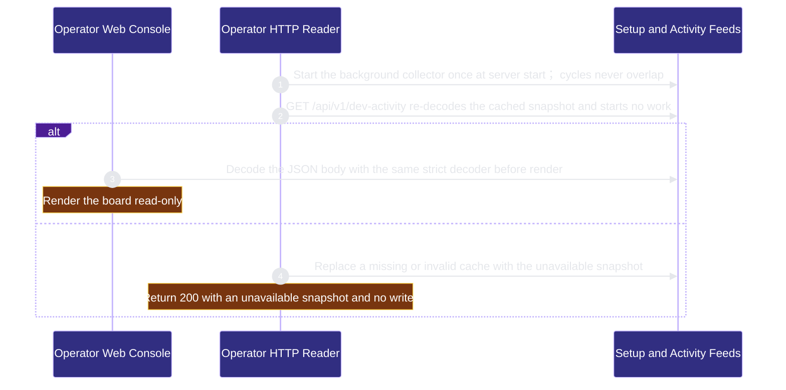
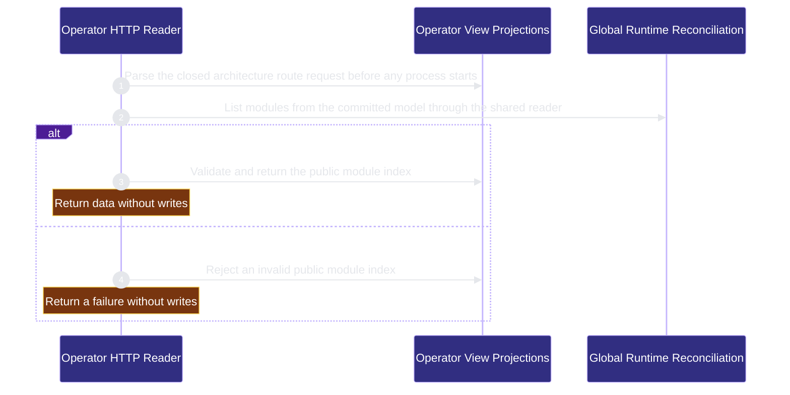

# runtime-harness/operator 架構文檔

<!-- BEGIN ARCHCONTEXT:generated target="projection_target.entity.capability-runtime-harness-operator" sourceDigest="sha256:074d4cf9e6d1ad86dadda5ed9c35934adb795236ebec0e2ff094457ecb09cfa2" rendererVersion="archcontext.docs-renderer/v5" outputDigest="sha256:6669b2bddf62c2a117762dcbfc7d4bf77a6261b6b1bf8ea04b0c08b1d32b3a57" -->
> **狀態**:`active`
> **Capability ID**:`capability.runtime-harness.operator`(kind `capability`)
> **Matched Prefixes**:`src/core/operator/**`、`src/effects/operator/**`、`src/operator-web/**`、`src/cli/commands/operator.ts`、`src/cli/commands/module.ts`、`src/core/architecture/module-view.ts`、`src/core/docs/**`、`src/core/setup/**`、`src/effects/setup/**`、`src/core/dev-activity/**`、`src/effects/dev-activity/**`、`src/effects/terminal/herdr-observation.ts`、`assets/operator/**`、`vite.operator.config.ts`
> **Local Contracts**:`AGENTS.md`、`CLAUDE.md`
> **事實優先級**:倉庫當前狀態 > 本文檔機器區 > 本文檔人工區。機器區(引言、§1、§2)由 ArchContext 從架構模型與源碼度量投影生成,手改會在下次投影被覆蓋。本文檔不記錄出處;本次投影所驗證的 commit 見 `docs/architecture/.projection-manifest.json`。

Provides local read-only HTTP views of registered repositories.

## 1. P1:能力架構地圖

### 1.1 架構圖

```mermaid
flowchart LR
  p1_capability_runtime_harness_global_runtime_reconciliation_401730e8["Global Runtime Reconciliation"]:::component
  p1_capability_runtime_harness_operator_00133dd3["Operator Board"]:::component
  p1_component_operator_activity_feeds_00325b96["Setup and Activity Feeds"]:::component
  p1_component_operator_architecture_view_0bdc3e1c["Architecture View"]:::component
  p1_component_operator_primary_d8da79ba["Operator HTTP Reader"]:::component
  p1_component_operator_view_projections_ca31e3bc["Operator View Projections"]:::component
  p1_component_operator_web_console_452bb61f["Operator Web Console"]:::component
  p1_component_operator_activity_feeds_00325b96 -->|"Reuse public agent-config text filtering and runtime badge freshness rules"| p1_component_operator_view_projections_ca31e3bc
  p1_component_operator_architecture_view_0bdc3e1c -->|"List modules and export review prompts through the shared ArchitectureModelReader"| p1_capability_runtime_harness_global_runtime_reconciliation_401730e8
  p1_component_operator_primary_d8da79ba -->|"Start the bounded background collectors once and serve only their cached， re-decoded snapshots"| p1_component_operator_activity_feeds_00325b96
  p1_component_operator_primary_d8da79ba -->|"Build the docs graph from committed repository content"| p1_component_operator_architecture_view_0bdc3e1c
  p1_component_operator_primary_d8da79ba -->|"Read the committed architecture model through the shared ArchitectureModelReader"| p1_capability_runtime_harness_global_runtime_reconciliation_401730e8
  p1_component_operator_primary_d8da79ba -->|"Parse closed route requests and project or re-decode each observation before it leaves the server"| p1_component_operator_view_projections_ca31e3bc
  p1_capability_runtime_harness_operator_00133dd3 -->|"Return a read-only HTTP observation."| p1_component_operator_primary_d8da79ba
  p1_component_operator_view_projections_ca31e3bc -->|"Decode the module index and module detail shapes that the architecture view declares"| p1_component_operator_architecture_view_0bdc3e1c
  p1_component_operator_web_console_452bb61f -->|"Decode the development activity and setup snapshots with the decoders the server uses"| p1_component_operator_activity_feeds_00325b96
  p1_component_operator_web_console_452bb61f -->|"Fetch public JSON observations through GET and HEAD routes only"| p1_component_operator_primary_d8da79ba
  p1_component_operator_web_console_452bb61f -->|"Decode each observation body with the shared strict core decoder before render"| p1_component_operator_view_projections_ca31e3bc
  classDef actor fill:#111827,color:#ffffff,stroke:#f9fafb,stroke-width:2px
  classDef component fill:#075985,color:#ffffff,stroke:#bae6fd,stroke-width:2px
  classDef datastore fill:#3f6212,color:#ffffff,stroke:#d9f99d,stroke-width:2px
  classDef external fill:#7c2d12,color:#ffffff,stroke:#fed7aa,stroke-width:2px
```

- Proof: `proven` (`sha256:d030437a632128f234257b33d3d257c4b4ee079dc14da54ab26757fc36473a1b`).
- Semantic nodes: `7`; declared relations: `11`.

### 1.2 模組職責表

| 宣告入口 | 錨點 | 職責 |
| --- | --- | --- |
| `entrypoint.operator.primary` | `src/effects/operator/architecture.ts#readArchitecture` | `sink.operator.primary` → `src/core/operator/architecture.ts#decodeArchitectureModuleIndex`、`sink.operator.model-reader-list` → `src/effects/architecture/model-reader.ts#list` |

### 1.3 規模信號

- 規模量級:`50–100` 個文件 / `10k–20k` 行
- 匹配前綴:`src/core/operator/**`、`src/effects/operator/**`、`src/operator-web/**`、`src/cli/commands/operator.ts`、`src/cli/commands/module.ts`、`src/core/architecture/module-view.ts`、`src/core/docs/**`、`src/core/setup/**`、`src/effects/setup/**`、`src/core/dev-activity/**`、`src/effects/dev-activity/**`、`src/effects/terminal/herdr-observation.ts`、`assets/operator/**`、`vite.operator.config.ts`
- 推導:掃描 `source.include` 減 `source.exclude`,跳過 `.git/` 與 `node_modules/`,再按 1–2–5 階梯分桶。精確計數不入本文檔:量級足以回答「這個能力有多大」,而逐行計數會讓覆蓋範圍內任何一次源碼改動都改寫本文檔。

### 1.4 依賴邊界

出向關係:

- `calls` → `component.operator.primary` — Return a read-only HTTP observation.

入向關係:

- `calls` ← `component.global-runtime-reconciliation.cli-root` — Register the operator command

## 2. P2:端到端數據流

> **Proof**: `proven` (`sha256:d030437a632128f234257b33d3d257c4b4ee079dc14da54ab26757fc36473a1b`); selectors `7/7`.

<!-- END ARCHCONTEXT:generated target="projection_target.entity.capability-runtime-harness-operator" -->

## 3. P3:設計決策與不變量

### 3.1 必须保持的不变量

1. **Operator 只读。** `OPERATOR_ROUTES` 是冻结的完整路由表，每条路由都是 `write: false`（`src/effects/operator/server.ts:102`）。`handleRequest` 对 GET 和 HEAD 以外的方法返回 405（`server.ts:1462`）。`tests/effects/operator-write-boundary.test.ts:59` 要求写路由集合为空。PR #482 删除了最后一个浏览器写入口（composer）。
2. **请求先过身份检查，再进路由。** Host 必须等于 loopback authority，否则返回 421（`server.ts:1452`）。Origin 不匹配返回 403（`server.ts:1458`）。`/api/*` 的 `Sec-Fetch-Site` 只接受 `same-origin` 和 `none`（`server.ts:1481`）。
3. **GET 不启动工作。** 开发活动和 setup 数据来自后台 collector 的内存缓存。`startOperatorServer` 只在启动时创建 collector（`server.ts:1690`、`server.ts:1695`）。collector 的 `read` 只读缓存（`src/effects/dev-activity/collector.ts:436`）。周期不重叠（`collector.ts:443`）。
4. **一个 schema 只有一个 decoder。** `src/core/**` 下的严格 decoder 同时服务服务端和浏览器。服务端在发送前重新 decode 缓存（`server.ts:1547`）。浏览器在渲染前用同一个函数 decode（`src/operator-web/dev-activity.ts:20`）。decode 失败时服务端返回 unavailable 快照，不合成替代值（`server.ts:1549`）。
5. **CLI 和 HTTP 输出一致。** `module review-prompt` 与 architecture 路由使用同一个 `ArchitectureModelReader`。`tests/cli/operator-serve.test.ts:1270` 比较 GET、HEAD 与 CLI 的 digest。来源：PR #590、plan-20261005-0405 不变量 I7。
6. **UI 不触发动作。** 每个动作只显示链接或可复制的 Bot 命令。来源：PR #609、plan-20261005-0405 不变量 I9。命令通道保持 Bot → CLI → herdr。
7. **不泄露 secret 和本机路径。** 本机文本经过 `publicAgentConfigText`（`src/core/operator/agent-config.ts:36`）或 `publicDevActivityText` 过滤。architecture 读取在返回前检查 `containsSecret`（`src/effects/operator/architecture.ts:38`）。
8. **Agent 身份只有两个来源。** 一个是 ledger 的 `owner_bot`（`src/core/dev-activity/projection.ts:220`），另一个是已验证的 runtime binding。分支前缀和 PR 作者不能作为身份来源。来源：PR #609。
9. **fixture 不进生产包。** `?fixture=` 只在 `import.meta.env.DEV` 下加载（`src/operator-web/main.tsx:15`）。PR #609 用 grep 检查了 `dist/operator-ui`，fixture 字符串命中数为 0。

### 3.2 关键权衡

| 决策 | 权衡 |
| --- | --- |
| 后台 collector 加内存缓存，GET 只读缓存 | GET 延迟固定，也不会因为请求启动 git 或 gh。代价是数据有延迟：开发活动最多 60 秒（`collector.ts:39`），setup 最多 10 分钟（`src/effects/setup/collector.ts:19`）。快照里的 `collected_at` 显示数据年龄。 |
| setup check builder 在子进程里运行 | builder 是同步代码。子进程让服务端事件循环保持空闲（PR #611）。代价是每个周期启动一个进程。子进程是新进程组的组长。90 秒期限或服务关闭时，整个进程组被 kill（`setup/collector.ts:8`）。 |
| 慢读取放进受监督的 worker 进程 | 慢 git 不阻塞事件循环（PR #590 有对应测试）。代价是进程管理代码集中在 `server.ts`。该文件现在有 1766 行。 |
| 严格 decoder 放在 core，前后端共用 | 一个契约，没有漂移。代价是 schema 版本升级时前后端必须同时修改，旧 schema 被拒绝（PR #606 的 overlay v4）。 |
| 预构建 UI（`vite.operator.config.ts` → `dist/operator-ui`） | 运行时没有构建步骤。代价是 `prepack` 必须运行 `build:operator-web`（`package.json:77`）。 |
| 开发活动 collector 只看当前 gh 用户的 PR | 范围与"一个人看自己的 agent 工作"一致（`collector.ts:54`）。代价是看不到别人的 PR。 |

### 3.3 组件拆分（2026-10-11）

数据来源：`archctx refactor scan --json`（archctx 0.7.0）。组件 footprint 写在各 component 节点的 `source.include` 里。

| 组件 | footprint | 文件 / 行 | 职责 |
| --- | --- | --- | --- |
| `component.operator.primary`（HTTP Reader） | `src/effects/operator/**`、`src/cli/commands/operator.ts`、`assets/operator/**`、`src/effects/terminal/herdr-observation.ts` | 25 / 4884 | 路由、身份检查、worker 监督、collector 启动、Herdr 观测 |
| `component.operator.view-projections` | `src/core/operator/**` | 16 / 2112 | 纯投影、请求解析、严格 decoder |
| `component.operator.activity-feeds` | `src/core/setup/**`、`src/effects/setup/**`、`src/core/dev-activity/**`、`src/effects/dev-activity/**` | 10 / 1948 | 开发活动和 setup 的 collector 与投影 |
| `component.operator.architecture-view` | `module-view.ts`、`src/core/docs/**`、`src/cli/commands/module.ts` | 3 / 425 | 模块视图、module CLI、docs graph |
| `component.operator.web-console` | `src/operator-web/**`、`vite.operator.config.ts` | 45 / 9902 | 只读浏览器控制台 |

依赖方向：web-console 通过 HTTP 调用 primary，并直接使用 view-projections 和 activity-feeds 的 decoder。primary 调用另外三个组件。view-projections 不调用 primary。scan 中 `view-projections` 的入向模块边是 73，`primary` 的出向模块边是 69。

### 3.4 开放问题

- `createDocsGraphReader`（`src/effects/operator/docs-graph.ts:35`）在 `src/` 中没有调用方，只有 `tests/docs/` 使用它。PR #579 明确没有加路由。PR #609 删除了 Docs 占位页。这个 reader 是保留给后续 Docs 工作区，还是应该退役？没有记录。
- `src/cli/commands/module.ts` 归入本 capability 的置信度是 MEDIUM（归属提议 §5）。它和 architecture 路由共用 builder，但它是独立的 CLI 入口。它是否应该归入架构工具类 capability？没有记录。
- web-console 直接 import `src/core/pipeline/board.ts`。`src/operator-web/fixture.ts` import `src/core/publication/merge-readiness.ts`。这两个文件目前没有归属。它们的 owner 由其他分组决定。

## 4. 歷史決策記錄(append-only)

### 只读边界（2026-09-05 → 2026-10-04）

- PR #317 把唯一的浏览器写入口做成结构化边界，并加固了传输。
- PR #482 删除这个写入口。从此服务端只接受 GET 和 HEAD，浏览器没有 composer。

### Architecture 工作区和 capability 节点（2026-10-06，PR #590）

- 增加三条 architecture GET 路由、ETag/304 和 `Sec-Fetch-Site` 检查。
- 第一次建立 `capability.runtime-harness.operator`、`component.operator.primary` 和 `flow.operator.primary`。flow 的 selector 是真实调用 `readArchitecture → decodeArchitectureModuleIndex`。

### 原生 runtime 观测（2026-10-09，PR #606）

- runtime service 在 HTTP 启动前采集，然后按定时器刷新缓存。GET 只读缓存。
- capture 只用于调用方自己拥有的新运行，不接管已有会话。

### Kumo 控制台和开发活动看板（2026-10-11，PR #609、PR #611）

- 控制台基于 `@cloudflare/kumo` 重建。看板默认显示五个阶段列。
- 增加 `/api/v1/dev-activity` 和 `/api/v1/setup`。两者都只读缓存。

### 组件拆分（2026-10-11）

- 一个 ChangeSet 增加 4 个组件、18 条关系和 1 条 flow（`flow.operator.dev-activity`），并更新 capability、`component.operator.primary` 和 `flow.operator.primary`。
- capability 的 include 增加了此前无归属的 setup、dev-activity、docs、module-view、review prompt、`module.ts`、Herdr 观测、`assets/operator` 和 Vite 配置。无归属文件数从 653 降到 637。多归属文件数保持 45。
- `flow.operator.primary` 的参与者从"capability → component"改为"HTTP Reader → View Projections / 共享模型读取器"。selector 仍是真实调用。

### review prompt builder 移到 acceptance-review（2026-10-11）

- `src/core/review/**` 整个目录归 `capability.verification.acceptance-review`（brief 规则 6：一个目录先只给一个 owner）。
- 本 capability 的 include 和 architecture-view 组件删除了 `src/core/review/module-review-prompt.ts`。这个条目只在本分支上加过，main 上没有。
- 新增 3 条关系到 acceptance-review：primary 和 architecture-view 使用 `ModuleReadError`，view-projections 使用 `ModuleReviewPromptV1` 类型。

## Optimization Backlog

- `src/effects/operator/server.ts` 有 1766 行。路由分发、collaboration 队列、Fleet 队列和任务读取监督都在同一个闭包里（`startOperatorServer`，`server.ts:1050`）。scan 报告 `component.operator.primary` 有 10 个跨模块循环。拆分顺序需要先有 profiling 或改动频率证据，目前没有。
- docs graph reader 没有生产调用方（见 §3.4）。如果 Docs 工作区不在计划中，可以退役它和 `src/core/docs/**`。
- 在 arch-context#296 之后，把 `src/core/review/module-review-prompt.ts` 放回 architecture-view 组件（归属提议 §5 的原方案）。那时 operator 到 acceptance-review 的 3 条关系可以删除。
