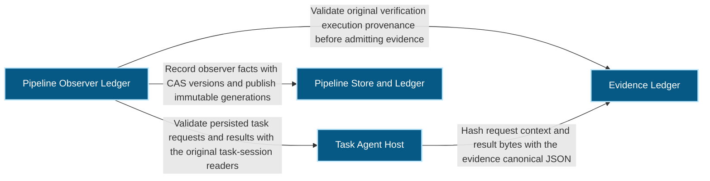
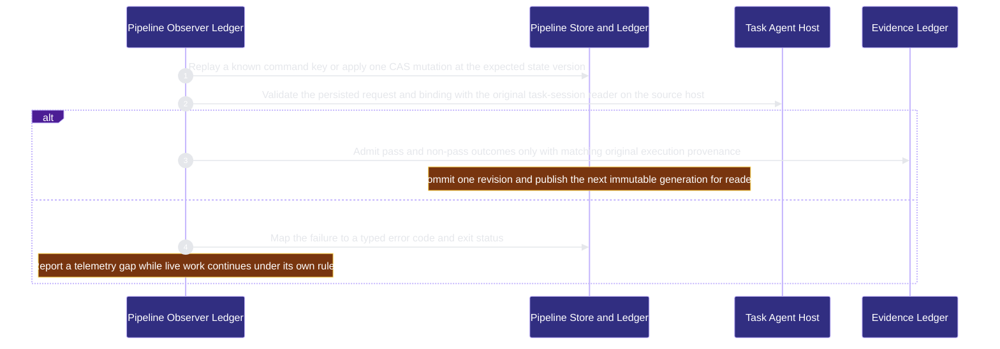

# runtime-harness/pipeline-ledger 架構文檔

<!-- BEGIN ARCHCONTEXT:generated target="projection_target.entity.capability-runtime-harness-pipeline-ledger" sourceDigest="sha256:ab608c933872419910a63538b58870ab2e201250ba2a26a1436af6f67f4a7844" rendererVersion="archcontext.docs-renderer/v5" outputDigest="sha256:f846ebbd16a7758090a371bbb291584dc74ba0bdc50721df88e38bdcd45f079a" -->
> **狀態**:`active`
> **Capability ID**:`capability.runtime-harness.pipeline-ledger`(kind `capability`)
> **Matched Prefixes**:`src/core/pipeline/**`、`src/effects/pipeline/**`、`src/cli/commands/pipeline.ts`、`assets/pipeline-record.v2.schema.json`
> **Local Contracts**:`AGENTS.md`、`CLAUDE.md`
> **事實優先級**:倉庫當前狀態 > 本文檔機器區 > 本文檔人工區。機器區(引言、§1、§2)由 ArchContext 從架構模型與源碼度量投影生成,手改會在下次投影被覆蓋。本文檔不記錄出處;本次投影所驗證的 commit 見 `docs/architecture/.projection-manifest.json`。

Records development pipeline facts per task in one SQLite observer ledger and serves readers from immutable published generations; it never dispatches, merges or cleans.

## 1. P1:能力架構地圖

### 1.1 架構圖

- Proof: `proven` (`sha256:912f37e51d89056c205366283542d3864dff35d2dee91d0b6e588816ce2b43ae`).
- Semantic nodes: `4`; declared relations: `4`.

### 1.2 模組職責表

| 宣告入口 | 錨點 | 職責 |
| --- | --- | --- |
| `entrypoint.pipeline-ledger.command` | `src/cli/commands/pipeline.ts#buildPipelineCommand` | `sink.pipeline-ledger.mutate` → `src/effects/pipeline/ledger.ts#mutatePipeline`、`sink.pipeline-ledger.ingest` → `src/effects/pipeline/ingest.ts#ingestEvent` |
| `entrypoint.pipeline-ledger.command` | `src/cli/commands/pipeline.ts#output` | `sink.pipeline-ledger.store-failure` → `src/effects/pipeline/store.ts#storeFailure` |
| `entrypoint.pipeline-ledger.source-authority` | `src/effects/pipeline/authority.ts#validateOnSource` | `sink.pipeline-ledger.task-request` → `src/effects/terminal/task-session.ts#assertTaskRequest`、`sink.pipeline-ledger.outcome-provenance` → `src/effects/evidence/verification-execution.ts#verificationOutcomeProvenance` |

### 1.3 規模信號

- 規模量級:`10–20` 個文件 / `2000–5000` 行
- 匹配前綴:`src/core/pipeline/**`、`src/effects/pipeline/**`、`src/cli/commands/pipeline.ts`、`assets/pipeline-record.v2.schema.json`
- 推導:掃描 `source.include` 減 `source.exclude`,跳過 `.git/` 與 `node_modules/`,再按 1–2–5 階梯分桶。精確計數不入本文檔:量級足以回答「這個能力有多大」,而逐行計數會讓覆蓋範圍內任何一次源碼改動都改寫本文檔。

### 1.4 依賴邊界

出向關係:

- `calls` → `capability.runtime-harness.evidence-ledger` — Validate original verification execution provenance before admitting evidence
- `calls` → `component.pipeline-ledger.primary` — Record observer facts with CAS versions and publish immutable generations
- `calls` → `capability.runtime-harness.task-agent-host` — Validate persisted task requests and results with the original task-session readers

入向關係:

- `calls` ← `component.global-runtime-reconciliation.cli-root` — Register the pipeline command
- `reads` ← `component.operator.activity-feeds` — Read pipeline records into the activity snapshot
- `reads` ← `component.operator.primary` — Open pipeline ledger snapshots and decode the pipeline board
- `reads` ← `component.operator.web-console` — Decode the pipeline board in the browser

## 2. P2:端到端數據流

> **Proof**: `proven` (`sha256:912f37e51d89056c205366283542d3864dff35d2dee91d0b6e588816ce2b43ae`); selectors `4/4`.

<!-- END ARCHCONTEXT:generated target="projection_target.entity.capability-runtime-harness-pipeline-ledger" -->

## 3. P3:設計決策與不變量

### 3.1 必须保持的不变量

1. **Ledger 只观察，不控制。** 命令描述是 "Observer ledger. It never dispatches, merges or cleans."（`src/cli/commands/pipeline.ts:20`）。Ledger 失败只是遥测缺口。现有工作按原规则继续（`docs/reference-configs/pipeline-observer.md`）。Live workflow 不依赖 ledger（#519 回滚说明）。
2. **Ledger 的准入门不是 live workflow 门。** #519 的目标明确排除这一点。PM 与 Kanban 也把 pipeline 当作投影（#610 架构决策）。
3. **原权威不变。** Task-session 拥有 request 与 result 身份。Verification execution 拥有不可变的检查事实（#519 P1 与 P3）。Ledger 只通过 source-host 验证接纳 verified evidence（`src/effects/pipeline/authority.ts` 中的 `validateOnSource`）。没有 source 通道时，证据是 unavailable 或 attested。Writer 从不在本地打开远端路径（operations guide）。
4. **CAS 与 replay 在 source 读取之前。** `record` 与 `advance` 需要 state version。Command key 在 CAS、source 读取与门禁之前返回原 receipt。`already_applied` 证明提交，不证明当前准入（operations guide）。
5. **读者只读不可变 generation。** 读者不打开 live DB，不探测 SQLite，不恢复，不建目录（`src/effects/pipeline/read.ts:45-46`）。
6. **发布意图在 COMMIT 之前保存。** 只有持有写锁的 writer 能修复挂起的发布。匹配的 replay 重试发布，不重复变更（#581，`src/effects/pipeline/store.ts:31`、`:159-165`）。
7. **存储位置与 SQLite 版本门在建目录之前失败。** Darwin 只接受本地的 `apfs` 与 `hfs`，按文件系统名称识别，不按 statfs 索引（`store.ts:66-69`、`:89`，#621）。未修复的 SQLite 版本被拒绝，没有绕过开关（`store.ts:26`，operations guide）。
8. **门禁只认当前证据。** implement → cross-review 只读最高注册轮次（`src/core/pipeline/gates.ts:30`，#555）。Go 绑定确切的 PR 与 target（`gates.ts:11`）。未映射的 policy 不能使门禁合格（operations guide）。
9. **Idle 不是完成。** 聚焦的 idle 不能替代已验证的结果（`src/core/pipeline/projection.ts:16`）。

### 3.2 关键权衡

| 决策 | 权衡 |
| --- | --- |
| 用 Bun SQLite 和单写者存储 | SQLite 提供事务与 CAS，不增加 npm 依赖（#519）。代价：需要固定的 SQLite 版本与本地文件系统。macOS 系统 SQLite 3.51.0 不合格（#519 风险说明） |
| 记录 CAS 与 store 发布序列分离（#519 P3） | 只做 ingest 的写入推进 store 序列，不改记录版本（A15）。读者按提交顺序看到跨任务写入 |
| 导出失败时保留已提交的 receipt（A11） | 写入不因导出失败回滚。代价：读者看到旧 generation，直到下一次导出追上 |
| Darwin 用 `bun:ffi` 调用 `statfs`（#621） | 进程内调用，没有新依赖，没有子进程。代价：x64 符号 `statfs$INODE64` 未在 Intel Mac 上运行 |
| Source 通道是同用户 CLI 信任边界 | 不隔离恶意的通道操作员（#519，operations guide） |
| 默认 authority host 与 `/Volumes/D` 路径 | 这是部署假设（operations guide）。在其他主机上没有自动存储 |

### 3.3 组件

| 组件 | 文件 / 行 | 职责 |
| --- | --- | --- |
| `component.pipeline-ledger.primary` | 13 / 2,403 | Record schema、门禁、stage machine、store、ledger、source authority、ingest、读者 |

当前只有一个组件。`store.ts`、`ledger.ts`、`authority.ts`、`ingest.ts` 与 `read.ts` 的职责分工见 #519 "New files" 一节。

### 3.4 未决问题

- Mini 的确切主机名、本地卷与 source 通道仍需部署验证（#519 风险说明）。当前源码与文档没有记录完成的部署。

## 4. 歷史決策記錄(append-only)

### Phase 1 observer ledger (2026-10-05, #519)

- P1：#519 曾加入一个未经评审的独立 capability 与手写模块文档。导出与投影计数变为 27，而评审过的模型是 26，CI 失败。
- P2：CI 修复删除了该 capability 与文档，不改计数断言。
- P3：Operations guide 写明：发布新 capability 需要同时提供评审过的组件、关系、flow 与投影。

### 进入架构模型 (2026-10-11)

- P3：这次变更一次性加入 capability、组件、三条关系与 required flow。Flow 证明 source-host 验证调用 task-agent-host 与 evidence-ledger 的原读取器。

## Optimization Backlog

- **Core 层导入 effects 层类型。** `src/core/pipeline/types.ts:4-5` 从 `src/effects/terminal/task-session.ts` 与 `src/effects/terminal/herdr.ts` 导入 `TaskRequest` 与 `HerdrEndpoint`。候选重构：把这两个类型移到 core。
- **关系目标会在拆分后移动。** `authority.ts` 调用 `src/effects/evidence/verification-execution.ts`。arch-context#296 之后 verification-plan 文件归 evals-checks。届时 pipeline-ledger → evidence-ledger 的出处验证关系要改指 evals-checks。
