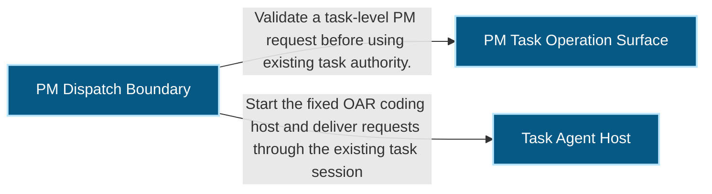
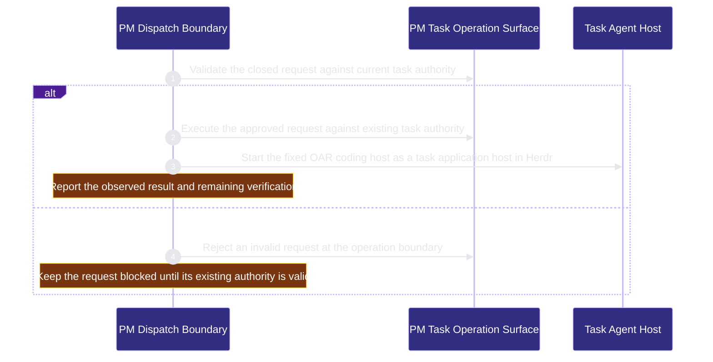

# runtime-harness/pm-dispatch 架構文檔

<!-- BEGIN ARCHCONTEXT:generated target="projection_target.entity.capability-runtime-harness-pm-dispatch" sourceDigest="sha256:b9d276eb309eb159e7112f4a3280e03412e4e473b0d9a5e2f40f79f66fb19f30" rendererVersion="archcontext.docs-renderer/v5" outputDigest="sha256:0855a39e9e5fa0d116a3042136cf9e0cb311fb8c082e109bca39303cea2f04a9" -->
> **狀態**:`active`
> **Capability ID**:`capability.runtime-harness.pm-dispatch`(kind `capability`)
> **Matched Prefixes**:`src/core/pm/**`、`src/effects/pm/**`、`src/cli/commands/pm.ts`、`src/effects/terminal/coding-isolation.ts`、`src/effects/terminal/coding-session.ts`、`src/effects/terminal/oar-coding-host.ts`、`assets/hermes/**`、`references/pm-operations.md`
> **Local Contracts**:`AGENTS.md`、`CLAUDE.md`
> **事實優先級**:倉庫當前狀態 > 本文檔機器區 > 本文檔人工區。機器區(引言、§1、§2)由 ArchContext 從架構模型與源碼度量投影生成,手改會在下次投影被覆蓋。本文檔不記錄出處;本次投影所驗證的 commit 見 `docs/architecture/.projection-manifest.json`。

Provides shared task-level PM operations and a fixed OAR coding host without adding task or result authority.

## 1. P1:能力架構地圖

### 1.1 架構圖

- Proof: `proven` (`sha256:e0f724e2086a65fae8339cfb707f89852ea045ef562cd9b2253240c0f9df7760`).
- Semantic nodes: `3`; declared relations: `2`.

### 1.2 模組職責表

| 宣告入口 | 錨點 | 職責 |
| --- | --- | --- |
| `entrypoint.pm-dispatch.request` | `src/cli/commands/pm.ts#runPmJson` | `sink.pm-dispatch.operation` → `src/effects/pm/operations.ts#executePmRequest` |
| `entrypoint.pm-dispatch.coding-host` | `src/effects/terminal/coding-session.ts#startCodingTaskAgent` | `sink.pm-dispatch.task-binding` → `src/effects/terminal/task-session.ts#startTaskApplicationHost` |

組件入口:

- 組件均未宣告 `source.entrypoints`。

### 1.3 規模信號

- 規模量級:`10–20` 個文件 / `1000–2000` 行
- 匹配前綴:`src/core/pm/**`、`src/effects/pm/**`、`src/cli/commands/pm.ts`、`src/effects/terminal/coding-isolation.ts`、`src/effects/terminal/coding-session.ts`、`src/effects/terminal/oar-coding-host.ts`、`assets/hermes/**`、`references/pm-operations.md`
- 推導:掃描 `source.include` 減 `source.exclude`,跳過 `.git/` 與 `node_modules/`,再按 1–2–5 階梯分桶。精確計數不入本文檔:量級足以回答「這個能力有多大」,而逐行計數會讓覆蓋範圍內任何一次源碼改動都改寫本文檔。

### 1.4 依賴邊界

出向關係:

- `calls` → `capability.runtime-harness.evidence-ledger` — Hash coding session records with the evidence canonical JSON
- `calls` → `component.pm-dispatch.primary` — Validate a task-level PM request before using existing task authority.
- `reads` → `component.mcp-sidecar.repo-policy-registry` — Read registry authorization and hold its lock through PM effects
- `calls` → `capability.runtime-harness.task-agent-host` — Start the fixed OAR coding host and deliver requests through the existing task session
- `reads` → `capability.organization.task-fleet` — Read repository task offers for PM status without acquiring work

入向關係:

- `calls` ← `component.global-runtime-reconciliation.cli-root` — Register the pm command
- `calls` ← `component.mcp-sidecar.primary` — Serve the PM MCP binding over the PM host protocol

組件出向關係:

- `component.pm-dispatch.primary`:
  - `calls` → `capability.workflow-engine.execution-primitives` — Read the worktree topology before dispatch
  - `calls` → `capability.workflow-engine.workflow-state` — Read claim tokens and leases under the task and topology locks

### 1.5 組件結構

| 組件 | 名稱 | 規模量級 | 宣告入口 |
| --- | --- | --- | --- |
| `component.pm-dispatch.primary` | PM Task Operation Surface | `10–20` 個文件 / `1000–2000` 行 | 未宣告 |

## 2. P2:端到端數據流

> **Proof**: `proven` (`sha256:e0f724e2086a65fae8339cfb707f89852ea045ef562cd9b2253240c0f9df7760`); selectors `2/2`.

<!-- END ARCHCONTEXT:generated target="projection_target.entity.capability-runtime-harness-pm-dispatch" -->

## 3. P3:設計決策與不變量

### 3.1 必须保持的不变量

1. **PM 只能选择操作。** PM 不能选择 host 命令或权限（`src/core/pm/protocol.ts:1`）。操作集合封闭：`capabilities`、`status`、`dispatch`、`follow-up`、`collect`（`protocol.ts:2`）。
2. **不新增任务存储或调度器。** PM 通过现有的 task、claim 与 result 记录委派工作（#608）。
3. **请求路径不触达 Git 或文件系统。** 路径来自 lease（`src/effects/pm/operations.ts:27`）。可信调用方围栏不从 PM wire 请求中解析（`operations.ts:17`）。
4. **副作用持有现有的锁。** Bind、cleanup、lease 变更与授权变更使用同一组锁（`operations.ts:57`）。锁持续到启动与投递结束（capability responsibilities）。
5. **Worker 准入只来自 operator。** PM 请求不能提供或修改准入（`src/effects/terminal/coding-isolation.ts:6`）。只有批准的 worktree 可写。系统不会为了让 provider 运行而授予额外的状态访问（`coding-isolation.ts:61-63`）。
6. **OAR 完成不等于任务完成。** 收集需要有效的 request-bound TaskResult。OAR 输出只是观察（`src/effects/terminal/oar-coding-host.ts:29`）。
7. **未知投递不重放。** Canonical request 就是重试 receipt，包括未知投递（`operations.ts:137`）。被接受的传输 ACK 在后续权威检查之前持久化（#619）。
8. **跨适配器边界只传固定标识符。** 错误消息与未知代码可能含本地路径，所以不跨边界（`protocol.ts:59-60`，#619）。
9. **Hermes 只暴露五个 PM 工具。** 它的模型工具边界不是整个 Hermes 进程的 OS sandbox（#608）。

### 3.2 关键权衡

| 决策 | 权衡 |
| --- | --- |
| 共享 CLI contract 加薄适配器（#608） | Grok 与以后的 Dot host 可以复用同一个 contract。代价：每个 host 的限制要单独验证，#608 没有验证它们 |
| 这一阶段只支持 macOS 上的 Codex worker 隔离（#608） | 其他平台与 provider fail closed |
| 远端错误改为固定公共代码（#619） | 本地路径与传输诊断不外泄。代价：远端调用方得到的诊断更少，内部 worker 诊断保持不变 |
| 在后续 guard 之前持久化 ACK（#619） | 拒绝之后仍保留已接受的投递证据。代价：拒绝路径也会写一个 receipt |
| Coding host 复用 task-agent-host 的 `startTaskApplicationHost` | 生命周期、清理与结果收集只有一份实现。代价：pm-dispatch 依赖 task-agent-host |

### 3.3 未决问题

- 真实的 coding provider 任务与 live Hermes 配置仍未验证（#608，原 P3 记录）。
- #608 的后续项 F2：Hermes 适配器使用 60 秒超时。当前文件仍是 `timeout=60`（`assets/hermes/repo-harness-pm/__init__.py:15`）。Dispatch 可能更久。#608 要求在 live 激活前修复。

## 4. 歷史決策記錄(append-only)

### PM 边界加入模型 (2026-10-10, #608 与 #615)

- P1：Bot 停在 PM 边界。Coding agent 在 Herdr 中的固定 OAR host 里运行。
- P2：#608 加入共享 PM 操作与 Hermes 适配器。#615 把 PM 与 MCP 适配器整合到 main。
- P3：PM 不拥有 task 或 result 权威。原 P3 的英文说明已并入 §3.1。

### 与 task-agent-host 的依赖进入模型 (2026-10-11)

- P3：`startCodingTaskAgent` 直接调用 task-agent-host 的 `startTaskApplicationHost`。Flow 增加这一步，并声明 pm-dispatch → task-agent-host 关系。

## Optimization Backlog

- **共享目录 `src/effects/terminal/`。** 本能力在其中拥有 3 个显式文件。After arch-context#296，与 task-agent-host 一起决定目录归属。
- **`relation.pm-dispatch.repo-registry` 的目标（集成）。** 目标从 mcp-sidecar capability 改为 `component.mcp-sidecar.repo-policy-registry`。导入只指向 `src/effects/repo-registry.ts`。`relation.mcp-sidecar.primary.pm-dispatch` 因此不形成节点级的环。
