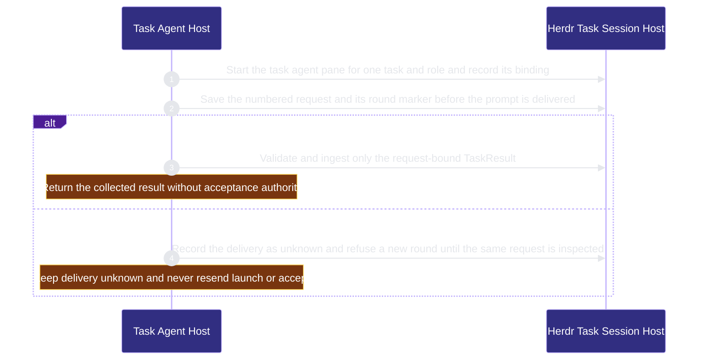

# runtime-harness/task-agent-host 架構文檔

<!-- BEGIN ARCHCONTEXT:generated target="projection_target.entity.capability-runtime-harness-task-agent-host" rendererVersion="archcontext.docs-renderer/v6" outputDigest="sha256:5bdc8d1cb90366c0186dfe1c3814bd48fe0f8af054d8c7f730ed554fa79d0020" -->
> **狀態**:`active`
> **Capability ID**:`capability.runtime-harness.task-agent-host`(kind `capability`)
> **Matched Prefixes**:`src/effects/terminal/herdr.ts`、`src/effects/terminal/task-session.ts`、`src/effects/terminal/task-runtime-observation.ts`、`src/effects/terminal/task-worktree.ts`、`src/effects/terminal/task-role-profiles.ts`、`src/cli/commands/herdr.ts`、`src/cli/commands/herdr-skill.ts`、`assets/herdr/**`、`agents/fleet/**`、`.codex/agents/**`、`scripts/install-agent-fleet.sh`、`src/effects/terminal/coding-isolation.ts`、`src/effects/terminal/coding-session.ts`、`src/effects/terminal/oar-coding-host.ts`、`src/core/decision/**`、`src/effects/terminal/herdr-decision.ts`
> **Local Contracts**:`AGENTS.md`、`CLAUDE.md`
> **事實優先級**:倉庫當前狀態 > 本文檔機器區 > 本文檔人工區。機器區(引言、§1、§2)由 ArchContext 從架構模型與源碼度量投影生成,手改會在下次投影被覆蓋。本文檔不記錄出處;本次投影所驗證的 commit 見 `docs/architecture/.projection-manifest.json`。

Hosts persistent task-agent participants in Herdr panes with role profiles, task worktrees, request send, request-bound result collection and OAR runtime observation, and installs the Herdr notify plugin and the agent fleet personas. Records pane-status shadow decisions and blind Bot labels without applying model output.

## 1. P1:能力架構地圖

### 1.1 架構圖

- Proof: `proven` (`sha256:f740737d70b0b6659e790b9b781e5e2295b01eedb5743d6b1f50c35d7e18f357`).
- Semantic nodes: `2`; declared relations: `1`.

### 1.2 模組職責表

| 宣告入口 | 錨點 | 職責 |
| --- | --- | --- |
| `entrypoint.task-agent-host.session` | `src/effects/terminal/task-session.ts#startTaskApplicationHost` | `sink.task-agent-host.start` → `src/effects/terminal/task-session.ts#startTaskAgent` |
| `entrypoint.task-agent-host.session` | `src/effects/terminal/task-session.ts#sendTaskRequest` | `sink.task-agent-host.send` → `src/effects/terminal/task-session.ts#nextSessionRound` |
| `entrypoint.task-agent-host.session` | `src/effects/terminal/task-session.ts#collectTaskResult` | `sink.task-agent-host.collect` → `src/effects/terminal/task-session.ts#readTaskRequestResult` |
| `entrypoint.task-agent-host.coding` | `src/effects/terminal/coding-session.ts#startCodingTaskAgent` | `sink.task-agent-host.coding` → `src/effects/terminal/task-session.ts#startTaskApplicationHost` |

組件入口:

- 組件均未宣告 `source.entrypoints`。

### 1.3 規模信號

- 規模量級:`20–50` 個文件 / `2000–5000` 行
- 匹配前綴:`src/effects/terminal/herdr.ts`、`src/effects/terminal/task-session.ts`、`src/effects/terminal/task-runtime-observation.ts`、`src/effects/terminal/task-worktree.ts`、`src/effects/terminal/task-role-profiles.ts`、`src/cli/commands/herdr.ts`、`src/cli/commands/herdr-skill.ts`、`assets/herdr/**`、`agents/fleet/**`、`.codex/agents/**`、`scripts/install-agent-fleet.sh`、`src/effects/terminal/coding-isolation.ts`、`src/effects/terminal/coding-session.ts`、`src/effects/terminal/oar-coding-host.ts`、`src/core/decision/**`、`src/effects/terminal/herdr-decision.ts`
- 推導:掃描 `source.include` 減 `source.exclude`,跳過 `.git/` 與 `node_modules/`,再按 1–2–5 階梯分桶。精確計數不入本文檔:量級足以回答「這個能力有多大」,而逐行計數會讓覆蓋範圍內任何一次源碼改動都改寫本文檔。

### 1.4 依賴邊界

出向關係:

- `calls` → `capability.runtime-harness.evidence-ledger` — Hash request context and result bytes with the evidence canonical JSON
- `depends-on` → `capability.runtime-harness.hook-adapters` — Use host installation commands for Herdr skill setup.
- `calls` → `component.task-agent-host.primary` — Start send and collect persistent Herdr task agents

入向關係:

- `calls` ← `component.acceptance-review.primary` — Run the persistent review session on a Herdr task agent and read its session artifacts
- `calls` ← `capability.runtime-harness.agent-runtime-effects` — Run Herdr commands for task agent runtime effects
- `calls` ← `component.contract-assets.contract-worktree-lifecycle` — Register and clean up task worktrees and read session artifacts
- `calls` ← `component.contract-assets.template-projection` — Install the required Herdr skill during init
- `depends-on` ← `capability.verification.evals-checks` — Test Task Agent Host behavior through its source modules.
- `calls` ← `component.global-runtime-reconciliation.cli-root` — Register the herdr commands
- `calls` ← `component.global-runtime-reconciliation.primary` — Configure the required Herdr skill during global runtime setup
- `depends-on` ← `capability.runtime-harness.hook-adapters` — Resolve task role profiles during host installation.
- `calls` ← `component.mcp-sidecar.coding-profile` — Clean up task worktrees for coding workspaces
- `calls` ← `component.mcp-sidecar.primary` — Start task agents and send task requests through Herdr
- `depends-on` ← `capability.runtime-harness.operator` — Read task role profiles for the setup snapshot.
- `reads` ← `component.workflow-state.coordination-plane` — Confirm that the task runtime is closed before a worktree prune

組件出向關係:

- `component.task-agent-host.primary`:
  - `calls` → `capability.workflow-engine.execution-primitives` — Run Git through the process runner and hold task session locks

### 1.5 組件結構

| 組件 | 名稱 | 規模量級 | 宣告入口 |
| --- | --- | --- | --- |
| `component.task-agent-host.primary` | Herdr Task Session Host | `20–50` 個文件 / `2000–5000` 行 | 未宣告 |

## 2. P2:端到端數據流

> **Proof**: `proven` (`sha256:f740737d70b0b6659e790b9b781e5e2295b01eedb5743d6b1f50c35d7e18f357`); selectors `3/3`.

<!-- END ARCHCONTEXT:generated target="projection_target.entity.capability-runtime-harness-task-agent-host" -->

## 3. P3:設計決策與不變量

### 3.1 必须保持的不变量

本能力只保留内部 OAR session 路径：启动（`startTaskApplicationHost`、`bindTerminalApplicationHost`）、发送（`sendTaskRequest`）、收集（`collectTaskResult`）、关闭与取消（`closeTaskAgent`、`cancelTaskAgent`）。没有 `task-agent` 命令，也没有 provider 提交或 history API。跨模型 peer 在 Herdr pane 中通过 herdr skill 运行，不经过本路径。

1. **Task pane 由 Herdr 或 operator 终端托管。** `src/effects/terminal/task-session.ts` 的 binding 有 `herdr` 与 `terminal` 两种 runtime。宿主命令只接受 `oar-review-host.js` 这一个 bundle（`assertApplicationHostCommand`）。Cleanup 从不向 `terminal` runtime 的进程发信号。
2. **文件工件拥有轮次预算。** 单调轮次预算存在 session 目录的文件中，从不新建进程或会话（`src/effects/terminal/task-session.ts#nextSessionRound`）。
3. **未知投递从不重放。** `started-N.json` 写入之后，崩溃、非零退出或超时都可能意味着输入已发送。`sendTaskRequest` 把这类异常写成 `delivery-N.json` 的 `state: unknown`，之后不重放，也不分配新的 request。下一轮会因 `task_agent_ambiguous_round` 被拒绝，直到同一个 request 有已保存的 result。
4. **传输 ACK 是持久事实。** 成功的传输写入 `state: accepted`。之后的权威拒绝会停止后续工作，但不把已接受的投递改成 unknown（#619）。
5. **Owner 验证结果。** `collectTaskResult` 在 session 内写入 `collected-N.json` 之前，先验证 request 绑定的 result（`readTaskRequestResult`）：字段只能是 `request_id`、`context_sha256`、`value`，且 id 与 hash 必须匹配。同一轮已收集的 result 与新读到的内容不一致时，抛出 `task_agent_result_conflict`。Provider 只写自己执行 checkout 下的 outbox（`assertTaskRequest`）。
6. **OAR 观察不是 ACK。** `readOarObservation` 的输出只用于状态展示（`taskAgentStatus`）。它不是 task ACK，也不是 acceptance receipt。
7. **已有的启动 intent 只做对账。** `reconcile(dir, intent)` 在 intent 已存在时只读取 `pane-created.json`、`launch-intent.json` 与 `provider-created.json`，并校验身份。它从不重复 split 或 launch。工件缺失时写入 `reconciliation.json` 并以 `task_agent_start_reconciliation_required` 失败。
8. **关闭工作区不删 Git checkout。** `cleanupTaskWorktree` 只关闭 Herdr workspace，不执行 `worktree remove`。Git 的发布、脏状态与合并检查归调用方。
9. **OAR 的 disposal 先于清理。** Review 域在调用 `closeTaskAgent` 或 `cancelTaskAgent` 之前写 `close.request`，并等待 `disposed.json` 回执（`src/effects/review/generic-review.ts` 的 `dispose`）。没有回执时 review 域报告 cleanup pending，不调用 task-agent 清理。`close` 在仍有未收集 result 的 request 时拒绝，`cancel` 才能跳过这个检查。会话清扫（`taskWorktreeRuntimeClosed`）不关闭打开的 runtime，也不联系 Herdr。
10. **进程身份证明从不放松。** 退出状态在身份确认之后读取（`processProofAlive`）。有歧义的 foreground 进程列表被拒绝，不按名称或位置猜测（`bindStartedAgent`）。
11. **Lock 与 intent 先于副作用。** 启动、发送与清理都在 `locked` 目录锁内运行。启动与清理先写 intent 工件（`intent.json`、`close-intent.json`），再产生副作用，所以崩溃后可以对账。
12. **安装只替换自己拥有的副本。** Herdr skill 安装拒绝用户修改过的副本、无 owner 的副本与 symlink，失败时恢复旧副本（#582）。Notify 插件配置用 mode 600 原子替换，拒绝 symlink（#500）。

### 3.2 关键权衡

| 决策 | 权衡 |
| --- | --- |
| 每个 task 与 role 一个常驻 pane agent | 多轮请求共享上下文。代价：身份证明与清理逻辑复杂，`task-session.ts` 是本能力最大的文件 |
| 去掉推测性的宿主机制，只保留通信协议（`aad93a6e`） | 表面更小。新的宿主需求要从协议重新加入 |
| 未知投递不重放 | 安全优先于活性。代价：投递未知后不能自动恢复，操作员要在 Herdr pane 中检查同一请求（#610） |
| 删除 `task-agent` 命令、provider 提交、history 读取与 request 回读（#771） | 只剩一条内部 OAR 路径，没有第二套 result 权威。代价：跨模型 peer 的结果不再进入 task session，由 herdr skill 路径和各自的 reader 处理 |
| Notify 默认只发 blocked 事件，Slack、Discord 与 Telegram 可选（#500） | Bot webhook 是必需通道。完成事件要按通道单独打开 |
| Claude 与 Codex 共用 persona 定义，Codex 有显式的模型映射（`src/effects/terminal/task-role-profiles.ts:1-2`、`AGENT_TARGET_OVERRIDES`） | 两个宿主行为一致。代价：模型变更时要更新映射表 |

### 3.3 组件

| 组件 | 规模 | 职责 |
| --- | --- | --- |
| `component.task-agent-host.primary` | 20–50 个文件 / 2000–5000 行 | Herdr 传输、OAR task session（启动、发送、收集、关闭）、task worktree、role profile、herdr 命令与安装的 persona 和插件资产 |

`src/effects/terminal/` 是共享目录。本能力拥有 task session。PM dispatch 已删除。OAR coding host 在 PM 删除后没有生产调用方，已随 #911 删除。

### 3.4 未决问题

- `.codex/agents/**` 与 `agents/fleet/**` 内容平行。`scripts/install-agent-fleet.sh:111` 只写 `~/.codex/agents`。仓库内 `.codex/agents/**` 由谁生成、是否有漂移检查，当前没有证据。
- `agents/openai.yaml` 是 repo-harness skill 的显示接口，不是 fleet persona。这次变更没有把它放进本能力。它的 owner 待定。
- #608 的后续项 F3 指向一个已不存在的行号（原为 `task-session.ts` 第 1056-1057 行，OAR 启动失败后没有 disposal 证明）。当前状态未验证。

## 4. 歷史決策記錄(append-only)

### 从无 owner 到独立能力 (2026-10-11)

- P1：这些文件此前没有 capability owner。`src/effects/terminal/` 中只有 pm-dispatch 的 3 个文件有 owner。
- P2：主要提交：`d8c082b1`（tmux → Herdr）、`10764112`（共享的持久 task agent 生命周期）、#476（OAR 上的 generic review）、#500（notify 插件）、#582（release-matched Herdr skill）、#610（只读 reconcile）。
- P3：共享目录用显式单文件 include，不认领其他能力将要拥有的文件。

## Optimization Backlog

- **After arch-context#296：决定 `src/effects/terminal/` 的目录归属。** 现在目录中的新文件会成为 unowned。
- **`task-session.ts` 过大。** 候选拆分：身份证明、request 轮次、清理。可展开，现在不拆。
- **入向调用者分散。** `scripts/contract-worktree-runtime.ts`、`src/effects/review/generic-review.ts`、`src/cli/mcp/tools.ts` 与 agent-runtime-effects 的 `herdr-cli-agent.ts` 直接调用 task-session 或 herdr。
