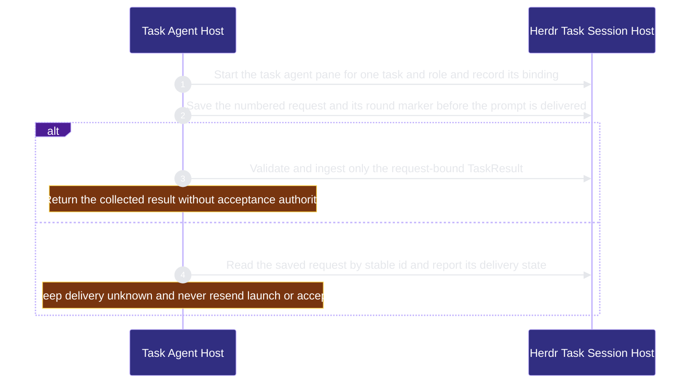

# runtime-harness/task-agent-host 架構文檔

<!-- BEGIN ARCHCONTEXT:generated target="projection_target.entity.capability-runtime-harness-task-agent-host" sourceDigest="sha256:e3f4b38bf50f2bd68a532253ba6ebcca927b9d724ff3c83b385c84c945a6f930" rendererVersion="archcontext.docs-renderer/v5" outputDigest="sha256:ac185b540beb2fc028037e99257d5469fa57aa932baba7f5f3f87bd62c6a6918" -->
> **狀態**:`active`
> **Capability ID**:`capability.runtime-harness.task-agent-host`(kind `capability`)
> **Matched Prefixes**:`src/effects/terminal/herdr.ts`、`src/effects/terminal/task-session.ts`、`src/effects/terminal/task-runtime-observation.ts`、`src/effects/terminal/task-worktree.ts`、`src/effects/terminal/task-request-readback.ts`、`src/effects/terminal/task-role-profiles.ts`、`src/cli/commands/task-agent.ts`、`src/cli/commands/herdr.ts`、`src/cli/commands/herdr-skill.ts`、`assets/herdr/**`、`agents/fleet/**`、`.codex/agents/**`、`scripts/install-agent-fleet.sh`
> **Local Contracts**:`AGENTS.md`、`CLAUDE.md`
> **事實優先級**:倉庫當前狀態 > 本文檔機器區 > 本文檔人工區。機器區(引言、§1、§2)由 ArchContext 從架構模型與源碼度量投影生成,手改會在下次投影被覆蓋。本文檔不記錄出處;本次投影所驗證的 commit 見 `docs/architecture/.projection-manifest.json`。

Hosts persistent task-agent participants in Herdr panes with role profiles, task worktrees, request send, request-bound result collection, saved-request readback and OAR runtime observation, and installs the Herdr notify plugin and the agent fleet personas.

## 1. P1:能力架構地圖

### 1.1 架構圖

- Proof: `proven` (`sha256:0fba3df1bdc55a9ddacbecf00bd851215031cce59eac05307bd5bffe4f3216b8`).
- Semantic nodes: `2`; declared relations: `1`.

### 1.2 模組職責表

| 宣告入口 | 錨點 | 職責 |
| --- | --- | --- |
| `entrypoint.task-agent-host.command` | `src/cli/commands/task-agent.ts#buildTaskAgentCommand` | `sink.task-agent-host.start` → `src/effects/terminal/task-session.ts#startTaskAgent`、`sink.task-agent-host.send` → `src/effects/terminal/task-session.ts#sendTaskRequest`、`sink.task-agent-host.collect` → `src/effects/terminal/task-session.ts#collectTaskResult`、`sink.task-agent-host.reconcile` → `src/effects/terminal/task-request-readback.ts#reconcileTaskRequest` |

組件入口:

- 組件均未宣告 `source.entrypoints`。

### 1.3 規模信號

- 規模量級:`20–50` 個文件 / `2000–5000` 行
- 匹配前綴:`src/effects/terminal/herdr.ts`、`src/effects/terminal/task-session.ts`、`src/effects/terminal/task-runtime-observation.ts`、`src/effects/terminal/task-worktree.ts`、`src/effects/terminal/task-request-readback.ts`、`src/effects/terminal/task-role-profiles.ts`、`src/cli/commands/task-agent.ts`、`src/cli/commands/herdr.ts`、`src/cli/commands/herdr-skill.ts`、`assets/herdr/**`、`agents/fleet/**`、`.codex/agents/**`、`scripts/install-agent-fleet.sh`
- 推導:掃描 `source.include` 減 `source.exclude`,跳過 `.git/` 與 `node_modules/`,再按 1–2–5 階梯分桶。精確計數不入本文檔:量級足以回答「這個能力有多大」,而逐行計數會讓覆蓋範圍內任何一次源碼改動都改寫本文檔。

### 1.4 依賴邊界

出向關係:

- `calls` → `capability.runtime-harness.evidence-ledger` — Hash request context and result bytes with the evidence canonical JSON
- `calls` → `component.task-agent-host.primary` — Start send collect and read back persistent Herdr task agents

入向關係:

- `calls` ← `component.acceptance-review.primary` — Run the persistent review session on a Herdr task agent and read its session artifacts
- `calls` ← `capability.runtime-harness.agent-runtime-effects` — Run Herdr commands for task agent runtime effects
- `calls` ← `component.contract-assets.contract-worktree-lifecycle` — Register and clean up task worktrees and read session artifacts
- `calls` ← `component.contract-assets.template-projection` — Install the required Herdr skill during init
- `calls` ← `component.global-runtime-reconciliation.cli-root` — Register the herdr and task-agent commands
- `calls` ← `component.global-runtime-reconciliation.primary` — Configure the required Herdr skill during global runtime setup
- `calls` ← `component.mcp-sidecar.coding-profile` — Clean up task worktrees for coding workspaces
- `calls` ← `component.mcp-sidecar.primary` — Start task agents and send task requests through Herdr
- `calls` ← `capability.runtime-harness.pipeline-ledger` — Validate persisted task requests and results with the original task-session readers
- `calls` ← `capability.runtime-harness.pm-dispatch` — Start the fixed OAR coding host and deliver requests through the existing task session
- `reads` ← `component.workflow-state.coordination-plane` — Confirm that the task runtime is closed before a worktree prune

組件出向關係:

- `component.task-agent-host.primary`:
  - `calls` → `capability.workflow-engine.execution-primitives` — Run Git through the process runner and hold task session locks

### 1.5 組件結構

| 組件 | 名稱 | 規模量級 | 宣告入口 |
| --- | --- | --- | --- |
| `component.task-agent-host.primary` | Herdr Task Session Host | `20–50` 個文件 / `2000–5000` 行 | 未宣告 |

## 2. P2:端到端數據流

> **Proof**: `proven` (`sha256:0fba3df1bdc55a9ddacbecf00bd851215031cce59eac05307bd5bffe4f3216b8`); selectors `4/4`.

<!-- END ARCHCONTEXT:generated target="projection_target.entity.capability-runtime-harness-task-agent-host" -->

## 3. P3:設計決策與不變量

### 3.1 必须保持的不变量

1. **Herdr 是唯一宿主。** 命令描述是 "Persistent task participants hosted only by Herdr"（`src/cli/commands/task-agent.ts:8`）。提交 `d8c082b1` 用 Herdr 替换了 tmux。
2. **文件工件拥有轮次预算。** 单调轮次预算存在文件中，从不新建进程或会话（`src/effects/terminal/task-session.ts:162`）。
3. **未知投递从不重放。** 轮次标记写入之后，崩溃、非零退出或超时都可能意味着输入已发送。系统只检查同一个 request 与 result，从不重放，也不分配新的 request（`task-session.ts:650-651`）。投递异常写入 `state: unknown`（`:652-657`）。
4. **传输 ACK 是持久事实。** 之后的权威拒绝会停止后续工作，但不把已接受的投递改成 unknown（`task-session.ts:659-660`，#619）。
5. **Owner 验证结果。** Owner 在写入主状态之前验证传输结果（`:572`）。Provider 只写它的执行 checkout（`:594`）。OAR 输出只是观察（`src/effects/terminal/oar-coding-host.ts:29`）。
6. **History 只是观察。** 它不是 task ACK，也不是 acceptance receipt（`task-session.ts:826`）。
7. **Reconcile 只读。** 它不发送、不启动、不收集、不接受。输出声明 `acceptance_authorized: false`（#610，`task-agent.ts:53`）。
8. **关闭工作区不删 Git checkout。** 不执行 `worktree remove`（`task-session.ts:917`）。Git 的发布、脏状态与合并检查归调用方（`:858`）。
9. **清理等待 OAR 的 disposal。** 所有清理路径等待 OAR owner 完成 disposal（`:677`）。会话清扫不关闭打开的 runtime，也不联系 Herdr（`:246`）。
10. **进程身份证明从不放松。** 退出状态在身份确认之后读取（`:116-132`）。有歧义的进程列表被拒绝，不按名称猜测（`:392`）。
11. **安装只替换自己拥有的副本。** Herdr skill 安装拒绝用户修改过的副本、无 owner 的副本与 symlink，失败时恢复旧副本（#582）。Notify 插件配置用 mode 600 原子替换，拒绝 symlink（#500）。

### 3.2 关键权衡

| 决策 | 权衡 |
| --- | --- |
| 每个 task 与 role 一个常驻 pane agent | 多轮请求共享上下文。代价：身份证明与清理逻辑复杂，`task-session.ts` 有 925 行 |
| 去掉推测性的宿主机制，只保留通信协议（`aad93a6e`） | 表面更小。新的宿主需求要从协议重新加入 |
| 未知投递不重放 | 安全优先于活性。代价：操作员要用 `task-agent reconcile` 检查（#610） |
| Notify 默认只发 blocked 事件，Slack、Discord 与 Telegram 可选（#500） | Bot webhook 是必需通道。完成事件要按通道单独打开 |
| Claude 与 Codex 共用 persona 定义，Codex 有显式的模型映射（`src/effects/terminal/task-role-profiles.ts:1-2`、`AGENT_TARGET_OVERRIDES`） | 两个宿主行为一致。代价：模型变更时要更新映射表 |

### 3.3 组件

| 组件 | 文件 / 行 | 职责 |
| --- | --- | --- |
| `component.task-agent-host.primary` | 26 / 2,397 | Herdr 传输、task session、task worktree、request 回读、role profile、命令与安装的 persona 和插件资产 |

`src/effects/terminal/` 是共享目录。本能力只列出 5 个文件。pm-dispatch 拥有 `coding-*` 与 `oar-coding-host.ts`。`herdr-observation.ts` 计划归 operator。

### 3.4 未决问题

- `.codex/agents/**` 与 `agents/fleet/**` 内容平行。`scripts/install-agent-fleet.sh:111` 只写 `~/.codex/agents`。仓库内 `.codex/agents/**` 由谁生成、是否有漂移检查，当前没有证据。
- `agents/openai.yaml` 是 repo-harness skill 的显示接口，不是 fleet persona。这次变更没有把它放进本能力。它的 owner 待定。
- #608 的后续项 F3 指向一个已不存在的行号（`task-session.ts:1056-1057`，OAR 启动失败后没有 disposal 证明）。当前状态未验证。

## 4. 歷史決策記錄(append-only)

### 从无 owner 到独立能力 (2026-10-11)

- P1：这些文件此前没有 capability owner。`src/effects/terminal/` 中只有 pm-dispatch 的 3 个文件有 owner。
- P2：主要提交：`d8c082b1`（tmux → Herdr）、`10764112`（共享的持久 task agent 生命周期）、#476（OAR 上的 generic review）、#500（notify 插件）、#582（release-matched Herdr skill）、#610（只读 reconcile）。
- P3：共享目录用显式单文件 include，不认领其他能力将要拥有的文件。

## Optimization Backlog

- **After arch-context#296：决定 `src/effects/terminal/` 的目录归属。** 现在目录中的新文件会成为 unowned。
- **`task-session.ts` 925 行。** 候选拆分：身份证明、request 轮次、清理。可展开，现在不拆。
- **入向调用者分散。** `scripts/contract-worktree-runtime.ts`、`src/effects/review/generic-review.ts`、`src/cli/mcp/tools.ts` 与 agent-runtime-effects 的 `herdr-cli-agent.ts` 直接调用 task-session 或 herdr。
