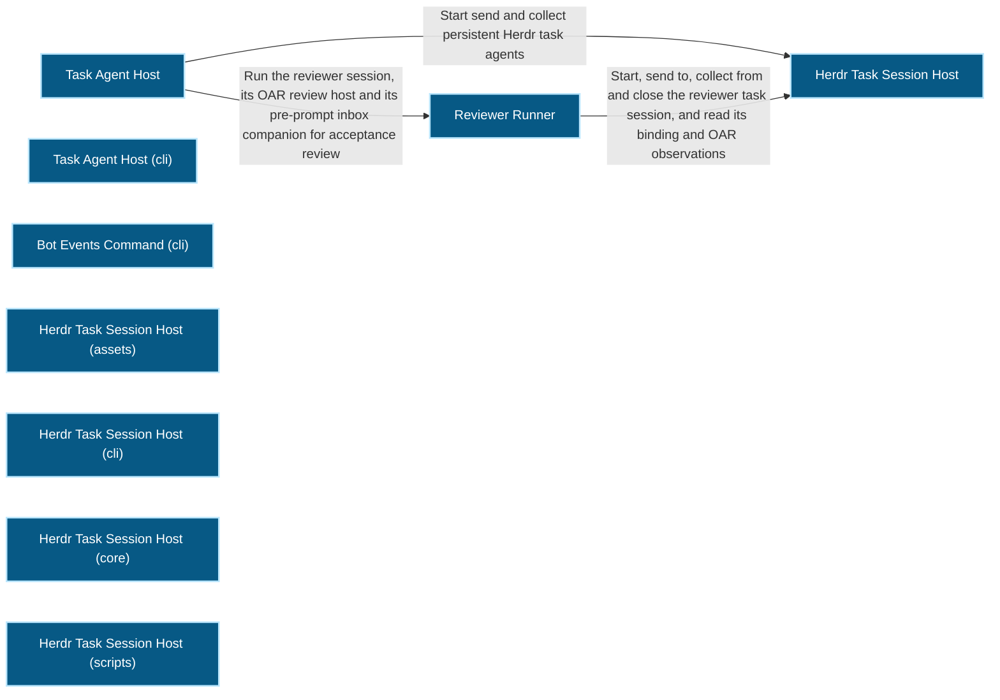
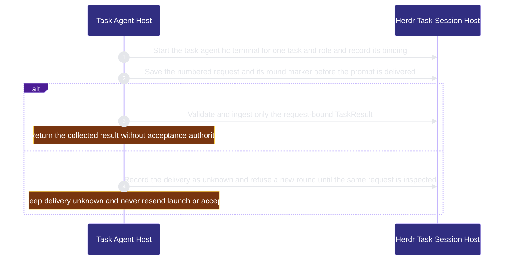

# runtime-harness/task-agent-host 架構文檔

<!-- BEGIN ARCHCONTEXT:generated target="projection_target.entity.capability-runtime-harness-task-agent-host" rendererVersion="archcontext.docs-renderer/v6" outputDigest="sha256:efc48318346387eaae4c35f5881e7f3a462550bf0545506eda5903d125bca549" -->
> **狀態**:`active`
> **Capability ID**:`capability.runtime-harness.task-agent-host`(kind `capability`)
> **Matched Prefixes**:`src/effects/terminal/herdr.ts`、`src/effects/terminal/herdr-core.ts`、`src/effects/terminal/task-session.ts`、`src/effects/terminal/task-runtime-observation.ts`、`assets/herdr/**`、`agents/fleet/**`、`.codex/agents/**`、`scripts/install-agent-fleet.sh`、`src/effects/terminal/native-task-session.ts`、`src/effects/review-runner/**`
> **Local Contracts**:`AGENTS.md`、`CLAUDE.md`
> **事實優先級**:倉庫當前狀態 > 本文檔機器區 > 本文檔人工區。機器區(引言、§1、§2)由 ArchContext 從架構模型與源碼度量投影生成,手改會在下次投影被覆蓋。本文檔不記錄出處;本次投影所驗證的 commit 見 `docs/architecture/.projection-manifest.json`。

Hosts persistent task-agent participants in hc terminals with role profiles, task worktrees, request send, request-bound result collection and OAR runtime observation, and installs the notify relay and the agent fleet personas.

## 1. P1:能力架構地圖

### 1.1 架構圖

- Proof: `proven` (`sha256:5d77e345e5d1fc8a598f0d400a2f86f9e775c9e6783ed9ef431de29868c35c9c`).
- Semantic nodes: `9`; declared relations: `3`.

### 1.2 模組職責表

| 宣告入口 | 錨點 | 職責 |
| --- | --- | --- |
| `entrypoint.task-agent-host.session` | `src/effects/terminal/task-session.ts#startTaskApplicationHost` | `sink.task-agent-host.start` → `src/effects/terminal/task-session.ts#startTaskAgent` |
| `entrypoint.task-agent-host.session` | `src/effects/terminal/task-session.ts#sendTaskRequest` | `sink.task-agent-host.send` → `src/effects/terminal/task-session-io.ts#nextSessionRound` |
| `entrypoint.task-agent-host.session` | `src/effects/terminal/task-session.ts#collectTaskResult` | `sink.task-agent-host.collect` → `src/effects/terminal/task-session.ts#readTaskRequestResult` |
| `entrypoint.task-agent-host.review-runner` | `src/effects/review-runner/task-review-runner.ts#send` | `sink.task-agent-host.reserve-inbox` → `src/effects/review-runner/task-pre-prompt-inbox.ts#preparePrePromptInbox` |
| `entrypoint.task-agent-host.review-runner` | `src/effects/review-runner/task-review-runner.ts#settleCompanion` | `sink.task-agent-host.commit-inbox` → `src/effects/review-runner/task-pre-prompt-inbox.ts#commitPrePromptInbox` |
| `entrypoint.task-agent-host.review-runner` | `src/effects/review-runner/task-review-runner.ts#recoverCompanions` | `sink.task-agent-host.recover-inbox` → `src/effects/review-runner/task-pre-prompt-inbox.ts#commitPrePromptInbox` |
| `entrypoint.task-agent-host.inbox-host` | `src/effects/review-runner/task-oar-host.ts#runHostFileRequest` | `sink.task-agent-host.consume-inbox` → `src/effects/review-runner/task-pre-prompt-inbox-consumer.ts#consumePrePromptInbox`、`sink.task-agent-host.accepted-inbox` → `src/effects/review-runner/task-pre-prompt-inbox-consumer.ts#recordPrePromptInboxAccepted` |
| `entrypoint.task-agent-host.inbox-proof` | `src/effects/review-runner/task-pre-prompt-inbox-consumer.ts#recordPrePromptInboxAccepted` | `sink.task-agent-host.persist-inbox-proof` → `src/effects/terminal/task-session-io.ts#writeSessionArtifact` |
| `entrypoint.task-agent-host.inbox-commit` | `src/effects/review-runner/task-pre-prompt-inbox.ts#commitPrePromptInbox` | `sink.task-agent-host.inbox-session` → `src/effects/terminal/task-session-record.ts#readTaskAgent`、`sink.task-agent-host.inbox-oar-proof` → `src/effects/terminal/task-runtime-observation.ts#readOarObservation`、`sink.task-agent-host.deliver-inbox` → `src/effects/fleet/task-inbox.ts#deliverTaskInbox` |

組件入口:

- 組件均未宣告 `source.entrypoints`。

### 1.3 規模信號

- 規模量級:`20–50` 個文件 / `2000–5000` 行
- 匹配前綴:`src/effects/terminal/herdr.ts`、`src/effects/terminal/herdr-core.ts`、`src/effects/terminal/task-session.ts`、`src/effects/terminal/task-runtime-observation.ts`、`assets/herdr/**`、`agents/fleet/**`、`.codex/agents/**`、`scripts/install-agent-fleet.sh`、`src/effects/terminal/native-task-session.ts`、`src/effects/review-runner/**`
- 推導:掃描 `source.include` 減 `source.exclude`,跳過 `.git/` 與 `node_modules/`,再按 1–2–5 階梯分桶。精確計數不入本文檔:量級足以回答「這個能力有多大」,而逐行計數會讓覆蓋範圍內任何一次源碼改動都改寫本文檔。

### 1.4 依賴邊界

出向關係:

- `calls` → `capability.verification.acceptance-review` — Plugin → core: bind task sessions to the active review admission and its source, resolve the policy review base of the diff fingerprint, implement the reviewer runner port, and apply the review isolation policy in the OAR review host
- `deployed-on` → `process.notify-relay` — The notify relay process runs the task-agent-host relay code.
- `deployed-on` → `process.oar-review-host` — The reviewer runner builds and runs the OAR review host bundle.
- `calls` → `capability.runtime-harness.evidence-ledger` — Hash request context and result bytes with the evidence canonical JSON
- `depends-on` → `external.herdr-app` — Own the one herdr-app do argv for tab.new, pane.split, pane.close and terminal.keep. The console prints the terminal.keep command for the person to run.
- `calls` → `external.herdr-core` — Run labeled task-agent, review-host and notify relay terminals with hc run, and get, list, send to, kill and remove them. Follow hc events in the notify relay. List seat terminals and read the hc version for the board.
- `depends-on` → `capability.organization.board` — Implement the board host port: seat terminals by parent label and the hc version
- `depends-on` → `capability.runtime-harness.hook-adapters` — Use host installation commands for Herdr skill setup.
- `depends-on` → `capability.workflow-engine.workflow-state` — Read admitted sessions and task session lists through the shared core selector and session types
- `calls` → `component.task-agent-host.primary` — Start send and collect persistent Herdr task agents
- `calls` → `component.task-agent-host.review-runner` — Run the reviewer session, its OAR review host and its pre-prompt inbox companion for acceptance review

入向關係:

- `calls` ← `component.acceptance-review.primary` — Drive the persistent reviewer session through the runner port that task-agent-host implements; the CLI root injects the implementation, so review imports no task-agent-host module
- `calls` ← `component.contract-assets.contract-worktree-lifecycle` — Run the task worktree register, merge notice and cleanup actions as the task-agent-host process entry src/effects/terminal/task-worktree-runtime.ts
- `depends-on` ← `capability.verification.evals-checks` — Test Task Agent Host behavior through its source modules.
- `calls` ← `component.global-runtime-reconciliation.cli-root` — Register the herdr and events commands and pass the Herdr skill setup step to the global runtime
- `depends-on` ← `capability.runtime-harness.operator` — Read exact source-root-bound task sessions and role profiles for bounded discovery and selected current observations

組件出向關係:

- `component.task-agent-host.cli-layer`:
  - 無。
- `component.task-agent-host.events-cli`:
  - 無。
- `component.task-agent-host.primary`:
  - `calls` → `capability.workflow-engine.execution-primitives` — Run Git through the process runner, hold task session locks, and read and write immutable session artifacts
  - `reads` → `component.execution-primitives.repository-registry` — Root the Herdr notify install record in the account-level repo-harness home.
- `component.task-agent-host.primary-assets`:
  - 無。
- `component.task-agent-host.primary-cli`:
  - 無。
- `component.task-agent-host.primary-core`:
  - 無。
- `component.task-agent-host.primary-scripts`:
  - 無。
- `component.task-agent-host.review-runner`:
  - `reads` → `capability.workflow-engine.contract-assets` — Plugin → core: read the fleet role profile frontmatter rules and target overrides for the review host
  - `calls` → `capability.workflow-engine.execution-primitives` — Read and write immutable session artifacts, including the accepted-input proof, and read the host process identity
  - `calls` → `component.task-agent-host.primary` — Start, send to, collect from and close the reviewer task session, and read its binding and OAR observations
  - `calls` → `capability.organization.task-fleet` — Reserve admitted inbox context through read-only listing and commit exact delivery receipts only after positive accepted OAR input proof; unknown acceptance leaves delivery pending

### 1.5 組件結構

| 組件 | 名稱 | 規模量級 | 宣告入口 |
| --- | --- | --- | --- |
| `component.task-agent-host.cli-layer` | Task Agent Host (cli) | `2–5` 個文件 / `10–20` 行 | 未宣告 |
| `component.task-agent-host.events-cli` | Bot Events Command (cli) | `1–2` 個文件 / `100–200` 行 | 未宣告 |
| `component.task-agent-host.primary` | Herdr Task Session Host | `10–20` 個文件 / `2000–5000` 行 | 未宣告 |
| `component.task-agent-host.primary-assets` | Herdr Task Session Host (assets) | `10–20` 個文件 / `200–500` 行 | 未宣告 |
| `component.task-agent-host.primary-cli` | Herdr Task Session Host (cli) | `2–5` 個文件 / `200–500` 行 | 未宣告 |
| `component.task-agent-host.primary-core` | Herdr Task Session Host (core) | `1–2` 個文件 / `5–10` 行 | 未宣告 |
| `component.task-agent-host.primary-scripts` | Herdr Task Session Host (scripts) | `1–2` 個文件 / `200–500` 行 | 未宣告 |
| `component.task-agent-host.review-runner` | Reviewer Runner | `2–5` 個文件 / `500–1000` 行 | 未宣告 |

## 2. P2:端到端數據流

> **Proof**: `proven` (`sha256:5d77e345e5d1fc8a598f0d400a2f86f9e775c9e6783ed9ef431de29868c35c9c`); selectors `3/3`.

<!-- END ARCHCONTEXT:generated target="projection_target.entity.capability-runtime-harness-task-agent-host" -->

## 3. P3:設計決策與不變量

### 3.1 必须保持的不变量

本能力只保留内部 OAR session 路径：启动（`startTaskApplicationHost`、`bindTerminalApplicationHost`）、发送（`sendTaskRequest`）、收集（`collectTaskResult`）、关闭与取消（`closeTaskAgent`、`cancelTaskAgent`）。没有 `task-agent` 命令，也没有 provider 提交或 history API。跨模型 peer 在 Herdr pane 中通过 herdr skill 运行，不经过本路径。

1. **Task 会话由 hc 终端或 operator 终端托管。** `src/effects/terminal/task-session.ts` 的 binding 有 `herdr-core` 与 `terminal` 两种 runtime。`herdr-core` runtime 用 `hc run` 启动带 repo-harness 标签的终端，binding 记录终端地址和 hc core 的 endpoint；classic `herdr` 记录读到时以 retired 错误失败。宿主命令只接受 `oar-review-host.js` 这一个 bundle（`assertApplicationHostCommand`）。Cleanup 从不向 `terminal` runtime 的进程发信号。
2. **文件工件拥有轮次预算。** 单调轮次预算存在 session 目录的文件中，从不新建进程或会话（`src/effects/terminal/task-session-io.ts#nextSessionRound`，归 `component.execution-primitives.session-artifact-io`）。
3. **未知投递从不重放。** `started-N.json` 写入之后，崩溃、非零退出或超时都可能意味着输入已发送。`sendTaskRequest` 把这类异常写成 `delivery-N.json` 的 `state: unknown`，之后不重放，也不分配新的 request。下一轮会因 `task_agent_ambiguous_round` 被拒绝，直到同一个 request 有已保存的 result。
4. **传输 ACK 是持久事实。** 成功的传输写入 `state: accepted`。之后的权威拒绝会停止后续工作，但不把已接受的投递改成 unknown（#619）。
5. **Owner 验证结果。** `collectTaskResult` 在 session 内写入 `collected-N.json` 之前，先验证 request 绑定的 result（`readTaskRequestResult`）：字段只能是 `request_id`、`context_sha256`、`value`，且 id 与 hash 必须匹配。同一轮已收集的 result 与新读到的内容不一致时，抛出 `task_agent_result_conflict`。Provider 只写自己执行 checkout 下的 outbox（`assertTaskRequest`）。
6. **OAR 观察不是 ACK。** `readOarObservation` 的输出只用于状态展示（`taskAgentStatus`）。它不是 task ACK，也不是 acceptance receipt。
7. **已有的启动 intent 只做对账。** `reconcile(dir, intent)` 在 intent 已存在时只读取 `terminal-created.json`、`launch-intent.json` 与 `provider-created.json`，并校验身份。它从不重复 `hc run`。三个工件中任一缺失时，它写入 `reconciliation.json` 并以 `task_agent_start_reconciliation_required` 失败：`launch-intent.json` 存在时，它用 intent 的标签运行 `hc ls`，把找到的终端写入 `live`；`launch-intent.json` 不存在时，它写入 `live: []`，不调用 hc。
8. **关闭工作区不删 Git checkout。** hc 没有 workspace。`cleanupTaskWorktree` 关闭这个 checkout 的 task 角色，再写 `closed.json`，不执行 `worktree remove`。Git 的发布、脏状态与合并检查归调用方。
9. **OAR 的 disposal 先于清理。** Reviewer runner 在调用 `closeTaskAgent` 或 `cancelTaskAgent` 之前写 `close.request`，并等待 `disposed.json` 回执（`src/effects/review-runner/task-review-runner.ts` 中 `taskReviewRunner` 的 `dispose`）。没有回执时 review 报告 cleanup pending，不调用 task-agent 清理。`close` 在仍有未收集 result 的 request 时拒绝，`cancel` 才能跳过这个检查。会话清扫（`taskWorktreeRuntimeClosed`）不关闭打开的 runtime，也不调用 hc。
10. **进程身份证明从不放松。** 退出状态在身份确认之后读取（`processProofAlive`）。有歧义的 foreground 进程列表被拒绝，不按名称或位置猜测（`bindStartedAgent`）。
11. **Lock 与 intent 先于副作用。** 启动、发送与清理都在 `withCallerLock` 目录锁内运行（`src/effects/locking/exclusive-directory-lock.ts`）。启动与清理先写 intent 工件（`intent.json`、`close-intent.json`），再产生副作用，所以崩溃后可以对账。
12. **安装只替换自己拥有的副本。** Herdr skill 安装拒绝用户修改过的副本、无 owner 的副本与 symlink，失败时恢复旧副本（#582）。Notify relay 的 `notify.env` 和安装记录用 mode 600 原子替换，目录或目标是 symlink 时拒绝（`src/effects/terminal/herdr-notify-install.ts`）。
13. **Reviewer runner 只有一个实现。** `taskReviewRunner` 实现 `src/core/review/runner-port.ts` 的 `ReviewerRunner`。hc 终端启动（`--launch herdr-app`）与 app-terminal 启动是每个 session 的选项，没有选择注册表。CLI 根（`src/cli/index.ts`）把它传给 `buildReviewCommand`。Port 类型在 core 中只有一个定义，本能力导入这些类型，没有映射层。
14. **隔离策略由 review 生成，由 host 执行。** Review 把 Seatbelt 策略写进 `ReviewHostSpec`。`openReviewHost` 按 spec 的路径重算策略，并比较策略文件。不能隔离时 host 拒绝打开 session（`src/effects/review-runner/task-oar-host.ts#openReviewHost`）。构建产物仍是 `dist/oar-review-host.js`。
15. **Pre-prompt inbox 只在接受证明之后投递。** Runner 在 `send` 中预留有界的 companion，不写投递回执（`preparePrePromptInbox`）。Host 在 prompt 前只读校验 companion，并记录 input 范围的 accepted OAR 证明（`recordPrePromptInboxAccepted`）。Review 调用 `settleCompanion` 时，runner 才提交已有的 inbox 投递回执（`commitPrePromptInbox`）。没有证明时结果是 `pending`，不重发 prompt。

### 3.2 关键权衡

合并通知使用现有 workspace binding 的 hc endpoint。派工记录或 PR 中的 hc 终端地址
指定负责 agent。发送前，`notifyTaskWorktreeMerged` 用 `hc get` 确认该终端带 repo-harness 标签、
仍是 live，且前台进程的 cwd 等于 checkout，然后用 `hc send` 投递。marker 只记录路径，不提供 agent 身份。投递回执只记录
提交状态，不构成新的归属记录。未知投递不重放。通知不授予删除权限。

| 决策 | 权衡 |
| --- | --- |
| 每个 task 与 role 一个常驻 hc 终端 agent | 多轮请求共享上下文。代价：身份证明与清理逻辑复杂，`task-session.ts` 是本能力最大的文件 |
| 去掉推测性的宿主机制，只保留通信协议（`aad93a6e`） | 表面更小。新的宿主需求要从协议重新加入 |
| 未知投递不重放 | 安全优先于活性。代价：投递未知后不能自动恢复，操作员要在同一个 hc 终端中检查同一请求（#610） |
| 删除 `task-agent` 命令、provider 提交、history 读取与 request 回读（#771） | 只剩一条内部 OAR 路径，没有第二套 result 权威。代价：跨模型 peer 的结果不再进入 task session，由 herdr skill 路径和各自的 reader 处理 |
| Notify 默认只发 blocked 事件，Slack、Discord 与 Telegram 可选（#500） | Bot webhook 是必需通道。完成事件要按通道单独打开 |
| Reviewer runner 与 OAR host 放在叶子目录 `src/effects/review-runner/`（#1352） | 只有 CLI 根导入这 4 个文件，所以 effects 目录图没有环。放在 `src/effects/terminal/` 时，`check:state-boundaries` 报告 fleet ↔ terminal 与 review ↔ terminal 两个目录环。代价：本能力的源码分在两个目录 |
| Claude 与 Codex 共用 persona 定义，Codex 有显式的模型映射（`src/effects/terminal/task-role-profiles.ts:1-2`、`AGENT_TARGET_OVERRIDES`） | 两个宿主行为一致。代价：模型变更时要更新映射表 |

### 3.3 组件

| 组件 | 规模 | 职责 |
| --- | --- | --- |
| `component.task-agent-host.primary` | 20–50 个文件 / 2000–5000 行 | hc 传输、OAR task session（启动、发送、收集、关闭）、task worktree、role profile、herdr 命令、notify relay 与安装的 persona 资产 |
| `component.task-agent-host.review-runner` | 4 个文件 / 约 600 行 | Acceptance review 的 reviewer runner、OAR review host 与 pre-prompt inbox companion |

`src/effects/terminal/` 是共享目录。本能力拥有 task session。PM dispatch 已删除。OAR coding host 在 PM 删除后没有生产调用方，已随 #911 删除。

### 3.4 未决问题

- `.codex/agents/**` 与 `agents/fleet/**` 内容平行。`scripts/install-agent-fleet.sh:111` 只写 `~/.codex/agents`。仓库内 `.codex/agents/**` 由谁生成、是否有漂移检查，当前没有证据。
- `agents/openai.yaml` 是 repo-harness skill 的显示接口，不是 fleet persona。这次变更没有把它放进本能力。它的 owner 待定。
- #608 的后续项 F3 指向一个已不存在的行号（原为 `task-session.ts` 第 1056-1057 行，OAR 启动失败后没有 disposal 证明）。当前状态未验证。

## 4. 歷史決策記錄(append-only)

### 从无 owner 到独立能力 (2026-10-11)

- P1：这些文件此前没有 capability owner。`src/effects/terminal/` 中只有 pm-dispatch 的 3 个文件有 owner。
- P2：主要提交：`d8c082b1`（tmux → Herdr）、`10764112`（共享的持久 task agent 生命周期）、#476（OAR 上的 generic review）、#500（notify 插件）、#582（release-matched Herdr skill）、#610（只读 reconcile）。
- P3：共享目录用显式单文件 include，不认领其他能力将要拥有的文件。

### Reviewer runner port (2026-11-02，#1352 slice B，PR #1375)

- 新建 `component.task-agent-host.review-runner`，include `src/effects/review-runner/**`。`oar-review-host.ts`、`pre-prompt-inbox.ts` 与 `pre-prompt-inbox-consumer.ts` 从 acceptance-review 移入，文件名改为 `task-*`。
- Acceptance review 的 pre-prompt inbox 职责移到本能力。`flow.acceptance-review.pre-prompt-inbox` 保留 ID，参与者改为 runner、task session、execution primitives 与 task fleet。
- 新增 relation：`relation.task-agent-host.review-runner`、`relation.task-agent-host.review-runner.primary`、`relation.task-agent-host.review-runner.execution-primitives`、`relation.task-agent-host.review-runner.task-fleet` 与 `relation.task-agent-host.deployed-on.oar-review-host`。
- `nextSessionRound` 与 `ensureSessionDirectory` 移到 `task-session-io.ts`。`locked` 移到锁模块，名为 `withCallerLock`。

## Optimization Backlog

- **After arch-context#296：决定 `src/effects/terminal/` 的目录归属。** 现在目录中的新文件会成为 unowned。
- **`task-session.ts` 过大。** 候选拆分：身份证明、request 轮次、清理。可展开，现在不拆。
- **入向调用者。** #1402 后，只有 operator 与 CLI 组合根导入本 capability 的文件。`scripts/contract-worktree-runtime.ts` 以进程方式运行 `src/effects/terminal/task-worktree-runtime.ts`，执行 register、notify-merged 与 cleanup；argv、stdout 上的 JSON 与退出码是该端口的合同。Generic review 经过 runner port（#1352）。task session 记录与 reader 在 `src/effects/terminal/task-session-record.ts`（execution-primitives），admission 读取在 `src/effects/terminal/task-session-admission.ts`（workflow-state），role profiles 归 contract-assets。
