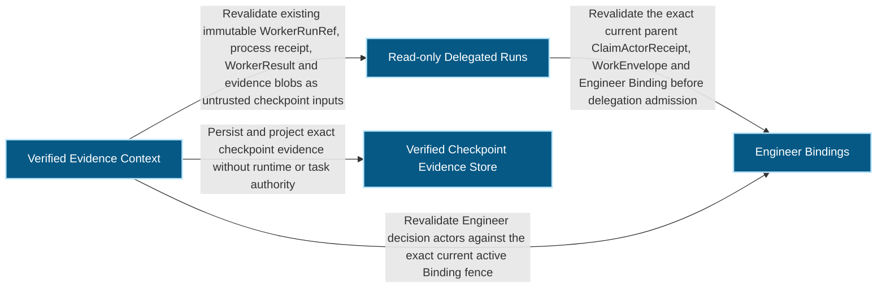
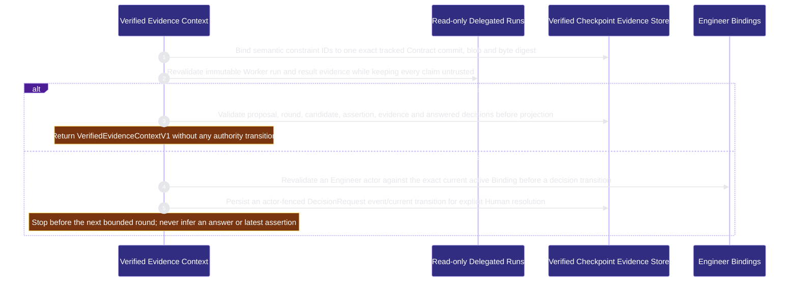

# runtime-harness/verified-context 架構文檔

<!-- BEGIN ARCHCONTEXT:generated target="projection_target.entity.capability-runtime-harness-verified-context" sourceDigest="sha256:3e9f4343183b37072703652c7ef33e5f858ca24e91f77db2c0c6db5a23623eb2" rendererVersion="archcontext.docs-renderer/v5" outputDigest="sha256:560bed61b9ea109a2af402bc6785eda4ae05c5e1ef8fa8024bb35dbe46025cf6" -->
> **狀態**:`active`
> **Capability ID**:`capability.runtime-harness.verified-context`(kind `capability`)
> **Matched Prefixes**:`src/core/engineers/verified-context.ts`、`src/effects/engineers/verified-context-store.ts`、`src/cli/commands/verified-context.ts`
> **Local Contracts**:`AGENTS.md`、`CLAUDE.md`
> **事實優先級**:倉庫當前狀態 > 本文檔機器區 > 本文檔人工區。機器區(引言、§1、§2)由 ArchContext 從架構模型與源碼度量投影生成,手改會在下次投影被覆蓋。本文檔不記錄出處;本次投影所驗證的 commit 見 `docs/architecture/.projection-manifest.json`。

Projects exact Contract constraints, candidate-bound verification checkpoints and Human-fenced decisions into one content-addressed trusted/untrusted context packet.

## 1. P1:能力架構地圖

### 1.1 架構圖

- Proof: `proven` (`sha256:0f6892c1ba87359a2e3a6ac8970926b95373de27cce1baa6dbf626c2b8fa48d4`).
- Semantic nodes: `4`; declared relations: `4`.

### 1.2 模組職責表

| 宣告入口 | 錨點 | 職責 |
| --- | --- | --- |
| `entrypoint.verified-context.contract` | `src/effects/engineers/verified-context-store.ts#projectSemanticContract` | `sink.verified-context.contract-schema` → `src/core/engineers/verified-context.ts#buildSemanticContractProjection` |
| `entrypoint.verified-context.delegated-evidence` | `src/effects/engineers/verified-context-store.ts#readVerifiedWorkerResultEvidence` | `sink.verified-context.worker-result` → `src/effects/engineers/delegated-run-store.ts#readDelegatedRunResult` |
| `entrypoint.verified-context.compile` | `src/effects/engineers/verified-context-store.ts#compileVerifiedCheckpointProjection` | `sink.verified-context.compile-schema` → `src/core/engineers/verified-context.ts#compileVerifiedEvidenceContext` |
| `entrypoint.verified-context.decision` | `src/effects/engineers/verified-context-store.ts#buildVerifiedDecisionEvent` | `sink.verified-context.decision-schema` → `src/core/engineers/verified-context.ts#buildDecisionRequestEvent` |
| `entrypoint.verified-context.binding-fence` | `src/effects/engineers/verified-context-store.ts#validateCurrentDecisionEngineerBinding` | `sink.verified-context.binding-current` → `src/effects/engineers/binding-store.ts#readEngineerBindingStatus` |

組件入口:

- 組件均未宣告 `source.entrypoints`。

### 1.3 規模信號

- 規模量級:`2–5` 個文件 / `1000–2000` 行
- 匹配前綴:`src/core/engineers/verified-context.ts`、`src/effects/engineers/verified-context-store.ts`、`src/cli/commands/verified-context.ts`
- 推導:掃描 `source.include` 減 `source.exclude`,跳過 `.git/` 與 `node_modules/`,再按 1–2–5 階梯分桶。精確計數不入本文檔:量級足以回答「這個能力有多大」,而逐行計數會讓覆蓋範圍內任何一次源碼改動都改寫本文檔。

### 1.4 依賴邊界

出向關係:

- `calls` → `capability.runtime-harness.delegated-runs` — Revalidate existing immutable WorkerRunRef, process receipt, WorkerResult and evidence blobs as untrusted checkpoint inputs
- `calls` → `capability.runtime-harness.engineer-bindings` — Revalidate Engineer decision actors against the exact current active Binding fence
- `calls` → `capability.runtime-harness.engineer-messages` — Validate closed records and compute canonical digests with the shared message mechanics
- `calls` → `component.verified-context.primary` — Persist and project exact checkpoint evidence without runtime or task authority

入向關係:

- `calls` ← `component.global-runtime-reconciliation.cli-root` — Register the verified-context command
- `reads` ← `component.operator.activity-feeds` — Read open Human Decisions for the board attention queue
- `reads` ← `component.operator.primary` — Read the open Human Decision inventory

組件出向關係:

- `component.verified-context.primary`:
  - `calls` → `capability.workflow-engine.execution-primitives` — Hold exclusive directory locks under the Git common directory

### 1.5 組件結構

| 組件 | 名稱 | 規模量級 | 宣告入口 |
| --- | --- | --- | --- |
| `component.verified-context.primary` | Verified Checkpoint Evidence Store | `1–2` 個文件 / `500–1000` 行 | 未宣告 |

## 2. P2:端到端數據流

> **Proof**: `proven` (`sha256:0f6892c1ba87359a2e3a6ac8970926b95373de27cce1baa6dbf626c2b8fa48d4`); selectors `5/5`.

<!-- END ARCHCONTEXT:generated target="projection_target.entity.capability-runtime-harness-verified-context" -->

## 3. P3:設計決策與不變量

本 capability 来自 ME-2C（`plans/prds/20260824-1653-verified-context-contracts.prd.md`）。PRD 的问题陈述：Provider 的 compaction、transcript 和 Worker 叙述可能被误当成跨轮可信事实。下一轮执行需要的是 canonical 任务意图和已验证的候选证据，不是完整轨迹。

### 3.1 必须保持的不变量

1. **只投影证据，不转移权威。** 本模块不依赖任何权威转移（`src/core/engineers/verified-context.ts:19`）。semantic assertion 不能把 Task 标为完成，不能改 Lease，不能签 Acceptance，也不能进入 Publication readiness（PRD "Hard constraint"）。
2. **Contract 投影绑定精确的 Git 对象。** `projectSemanticContract` 要求精确的 commit OID，路径必须以 `.contract.md` 结尾且不含 `..`，再读取 blob 和字节（`verified-context-store.ts:240-262`）。Contract 必须恰好有一个 `Semantic Constraint Catalog` JSON 块（`:222-238`）。没有旁路文件、标题推导或自由文本替代（PRD "Product Direction"）。
3. **只选唯一连续的断言链。** 编译器要求恰好一个根，链不能分叉、不能有缺口，轮次从 0 连续编号（`verified-context.ts:610-638`）。不用时间戳或文件顺序选"最新"。任何未被链使用的 proposal、round 或 delegated-run 证据都使编译失败（`:666-668`）。
4. **check 与 verifier 回执必须是两个不同的产物。** 一次运行不能为自己作证（`verified-context.ts:430`；`1544a184`）。断言证据必须同时带这两个回执（`:657`）。
5. **Worker 和 verifier 的叙述永远不可信。** 它们只进入 `untrusted_claims`。可信部分只有精确的证据引用（`verified-context.ts:663-664`、`:681`）。
6. **打开的 Human 决定阻止编译。** 任何 `open` 状态的 DecisionRequest 让编译以 `verified_context_blocked` 失败（`verified-context.ts:677`）。只有已回答的决定进入上下文。
7. **决定转移有 actor 栅栏和幂等键。** Engineer actor 必须匹配当前 active Binding 的 id、generation 和 contract revision（`verified-context-store.ts:384-396`）。转移在每个决定的独占目录锁里执行。同一幂等键对应不同操作字节时报冲突（`:406-438`）。
8. **不可变记录按内容寻址。** 记录写在 Git common 目录的 `repo-harness/verified-context/v1` 下（`verified-context-store.ts:69`）。同一摘要已存在不同字节时报冲突。读取时重新校验 canonical 字节（`:188-220`）。

### 3.2 关键权衡

| 决策 | 权衡 |
| --- | --- |
| 只在显式检查点投影，不记录每个 Provider turn | Provider 的历史和 compaction 变化不会改变可信投影。代价是检查点之间的推理过程不进入上下文（PRD "P0 surface"）。 |
| 断言链有歧义时直接失败 | 不会选错"最新"断言。代价是一次重复提交或分叉就会阻塞下一轮，需要人工处理。 |
| 决定的 current 文件可替换，事件不可变 | 读取当前状态只需一个文件。崩溃后由事件和 transition 记录恢复（`crash_hook` 测试点，`verified-context-store.ts:427-436`）。代价是每次转移要写三类文件并 fsync。 |
| Operator 只读决定清单 | `readOpenDecisionInventory` 不建目录、不取锁、不转移，有 2 秒期限和 100 条上限（`verified-context-store.ts:473-484`）。代价是清单可能分页，调用方要处理 `after` 游标。 |

### 3.3 组件与关系（2026-10-11）

| 节点 | footprint | 说明 |
| --- | --- | --- |
| `component.verified-context.primary` | `src/effects/engineers/verified-context-store.ts` | 不可变证据存储、决定转移、只读清单 |
| capability 自身 | `src/core/engineers/verified-context.ts`、`src/cli/commands/verified-context.ts` | 纯 schema 校验与编译、CLI |

对外关系：`delegated-runs`（重新校验 Worker 运行证据）、`engineer-bindings`（决定 actor 栅栏）、`engineer-messages`（共享的封闭键校验和 canonical 摘要，新增于 2026-10-11）。

入向调用方：Operator 的 `src/effects/operator/collaboration.ts` 和 `src/effects/dev-activity/collector.ts:356` 读取打开的决定清单。

### 3.4 开放问题

- PRD 把 verifier 的成本和 profile 策略、Human UI 的传输方式标为 `[UNKNOWN]`。代码里没有对应的策略入口。这两项是否仍未决定？没有记录。
- `src/core/engineers/verified-context.ts` 和 `src/effects/engineers/verified-context-store.ts` 同时被 `engineer-bindings` 的 umbrella include 覆盖，属于 45 个多归属文件。按用户决定，等 arch-context#296 后再处理。

## 4. 歷史決策記錄(append-only)

### ME-2C 交付（2026-08-26，`35ff0dde`）

- 交付 Contract 投影、proposal、round、assertion、DecisionRequest 和 content-addressed 上下文编译。

### 目录与回执校验加固（2026-08-28，`1544a184`）

- 带两个 `Semantic Constraint Catalog` 块的 Contract 以前只投影第一个。现在必须恰好一个。
- 断言以前可以把同一个产物同时当作 check 回执和 verifier 回执。现在两个摘要必须不同。

### Operator 读取决定清单（2026-09-22，`9e8e6607`）

- 增加有界的只读 Human Decision 清单，供 Operator 显示。

## Optimization Backlog

- `verified-context.ts` 有 722 行，schema、校验和编译器在同一个文件里。编译器（`compileVerifiedEvidenceContext`）可以独立成文件。没有改动频率证据前不拆。
- store 依赖的 `src/effects/git/common-directory.ts` 和 `src/effects/locking/exclusive-directory-lock.ts` 归 `execution-primitives`。集成步骤声明了 primary → execution-primitives。
